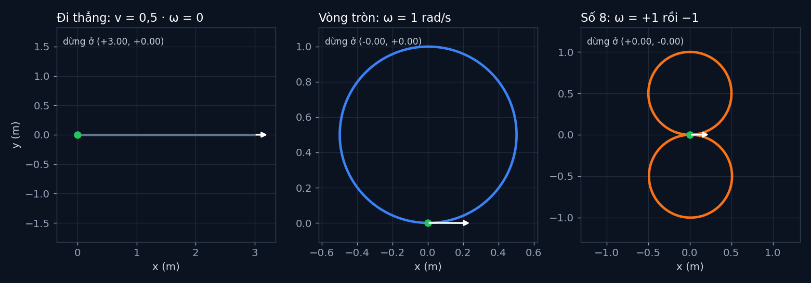

# Tập 0.2 · Robot đầu tiên trong mô phỏng

> **Mùa 0 · Khởi động** · ⏱ khoảng 25 phút · Độ khó ★☆☆ · Cần: biết Python cơ bản (biến, hàm, vòng lặp) ·
> 📚 Giáo trình: Principles of Robot Autonomy, [Chương 1 · Modeling robot dynamics](https://porabook.com/book/modeling-robot-dynamics/) ·
> 📺 Video: TikTok [@thanh82k5](https://www.tiktok.com/@thanh82k5) (tìm "Tập 0.2")

[](https://colab.research.google.com/github/thanhpro82/tu-hoc-robot-tu-hanh/blob/main/tap02/tap02_robot_dau_tien.ipynb)
Không muốn cài gì? Bấm nút trên để làm toàn bộ bài ngay trên trình duyệt.

**Một câu:** robot 2 bánh chỉ cần 3 số để biết mình ở đâu (x, y, θ) và 2 lệnh để điều khiển (v, ω). Bạn tự viết
"bộ não vật lý" ~5 dòng cho nó, rồi bắt nó đi thẳng, chạy vòng tròn và vẽ số 8.



## Trong thư mục này

| File | Dùng khi nào |
|---|---|
| [tap02_robot_dau_tien.ipynb](tap02_robot_dau_tien.ipynb) | Làm bài trên Colab hoặc Jupyter |
| [bai_tap/robot_cua_ban.py](bai_tap/robot_cua_ban.py) | **Bạn viết code ở đây** (nếu làm trên máy) |
| [bai_tap/kiem_tra.py](bai_tap/kiem_tra.py) | Tự chấm: in ✅ / ❌ cho từng bài |
| [bai_tap/ve_do_thi.py](bai_tap/ve_do_thi.py) | Vẽ 3 đường đi bằng code của bạn ra `ket_qua.png` |
| [sim/robot_dau_tien.py](sim/robot_dau_tien.py) | Mô phỏng dùng trong video (cũng là lời giải Bài 1) |
| [bai_tap/loi_giai.py](bai_tap/loi_giai.py) | Lời giải cả 3 bài. Tự làm xong rồi hãy mở |

## 1. Bài toán

Robot 2 bánh (mô hình *unicycle*) được mô tả bằng:

- **Trạng thái** `(x, y, θ)`: đang đứng ở đâu và mũi xe hướng về đâu.
- **Lệnh** `(v, ω)`: chạy tới nhanh cỡ nào (m/s) và quay nhanh cỡ nào (rad/s).

Máy tính không tính "liên tục" được, nên ta chia thời gian thành từng bước nhỏ `dt = 0,01 s` và cập nhật 100 lần mỗi giây:

```text
                      ┌───────────────────────────────┐
  lệnh (v, ω) ───────►│ x ← x + v·cos θ·dt            │
                      │ y ← y + v·sin θ·dt            │──► trạng thái mới (x, y, θ) ──┐
  trạng thái ────────►│ θ ← θ + ω·dt                  │                               │
  (x, y, θ)     ▲     └───────────────────────────────┘                               │
                └──────────────────── lặp lại 100 lần mỗi giây ◄───────────────────────┘
```

Để ý: không có công thức nào cho robot **đi ngang**. Robot chỉ chạy được theo hướng mũi xe. Tập 1.1 sẽ giải thích vì sao điều này quan trọng.

## 2. Sau bài này bạn làm được

| # | Bạn có thể… | Kiểm tra bằng | Đạt khi |
|---|---|---|---|
| 1 | Viết mô hình robot 2 bánh dạng rời rạc | `kiem_tra.py` Bài 1 | ✅, đi thẳng 6 s dừng ở x = 3,00 m như video |
| 2 | Thiết kế lệnh ω theo thời gian để vẽ hình | `kiem_tra.py` Bài 2 | ✅, hình số 8 quay về điểm xuất phát |
| 3 | Tính ngược lệnh (v, ω) từ hình muốn vẽ | `kiem_tra.py` Bài 3 | ✅, vòng tròn đúng bán kính |
| 4 | Giải thích vì sao robot thật vẫn lệch dần | [Câu hỏi tự kiểm tra](#6-câu-hỏi-tự-kiểm-tra) | Tự trả lời được |

## 3. Bạn làm gì

| Bài | Hàm | Việc |
|---|---|---|
| **1** | `step(x, y, theta, v, omega)` | Cài 3 công thức cập nhật ở trên, trả về `(x, y, theta)` |
| **2** | `omega_so_8(t)` | Trả về ω = +1 trong vòng đầu (2π giây đầu), ω = −1 trong vòng sau |
| **3** | `lenh_vong_tron(R, T)` | Muốn chạy đúng 1 vòng bán kính R trong T giây thì v, ω bằng bao nhiêu? |

Bộ chấm thử hàm với vài con số tính tay được, rồi cho robot chạy bằng code của bạn và so với kết quả trong video.

## 4. Bắt đầu

**Cách 1: Colab.** Bấm nút *Open in Colab* ở đầu trang, chạy lần lượt từng ô.

**Cách 2: trên máy** (Python 3.10+):

```bash
git clone https://github.com/thanhpro82/tu-hoc-robot-tu-hanh.git
cd tu-hoc-robot-tu-hanh && pip install -r requirements.txt
cd tap02
python -X utf8 sim/robot_dau_tien.py   # 1. số liệu trong video (có matplotlib thì mở thêm cửa sổ hình)
python -X utf8 bai_tap/kiem_tra.py     # 2. lúc đầu: ⏳ chưa làm cả 3 bài
# 3. mở bai_tap/robot_cua_ban.py, làm từng bài, chạy lại kiem_tra.py
python -X utf8 bai_tap/ve_do_thi.py    # 4. vẽ 3 đường đi bằng code của bạn -> ket_qua.png
```

Kết quả mong đợi của bước 1:

```text
Đi thẳng   -> kết thúc tại x=+3.00 m, y=+0.00 m, θ=+0°
Vòng tròn  -> kết thúc tại x=-0.00 m, y=+0.00 m, θ=+360°
Số 8       -> kết thúc tại x=+0.00 m, y=-0.00 m, θ=+1°
```

Kết quả khi làm xong cả 3 bài:

```text
✅ Bài 1 · hàm step: đi thẳng 6 s tới x = 3.00 m; vòng tròn 2π giây quay về (-0.00, +0.00), θ = 360° như video
✅ Bài 2 · hình số 8: số 8: hai vòng cao 1.00 m và -1.00 m, quay về (+0.00, -0.00)
✅ Bài 3 · lệnh cho vòng tròn: vòng R = 1 m trong 10 s cần v = 0.628 m/s, ω = 0.628 rad/s (để ý: v = ω·R)

Đạt 3/3 bài.  🎉 Xong! Thử phần Thử thách trong README nhé.
```

### Lịch gợi ý (25 phút)

| Phút | Việc |
|--:|:--|
| 5 | Xem video, đọc mục 1 |
| 15 | Làm Bài 1 → 2 → 3, chạy `kiem_tra.py` sau mỗi bài |
| 5 | Câu hỏi tự kiểm tra, chọn 1 thử thách |

## 5. Thử thách (không chấm)

1. **Bước thời gian lớn:** đổi `dt` từ 0,01 thành 0,5 rồi chạy vòng tròn. Robot còn quay về đúng chỗ cũ không? Vì sao?
2. **Hình vuông bo góc:** viết `omega(t)` để robot chạy 4 cạnh thẳng, mỗi góc quay đúng 90°.
3. **Bánh lệch:** cộng thêm 0,05 rad/s vào ω mỗi bước (giống bánh xe hơi lệch). Đi thẳng 6 s thì lệch bao xa?
4. **Xoắn ốc:** cho v tăng dần theo thời gian, giữ ω không đổi. Hình gì hiện ra?

## 6. Câu hỏi tự kiểm tra

<details><summary>1. Vì sao trạng thái cần cả θ, không chỉ (x, y)?</summary>

Cùng một lệnh "chạy tới" nhưng mũi xe hướng khác nhau thì robot đi về chỗ khác nhau. Muốn biết bước sau robot ở đâu,
phải biết nó đang hướng về đâu, nên θ là một phần của trạng thái.
</details>

<details><summary>2. Trong Bài 3, vì sao v = ω·R?</summary>

Một vòng tròn dài 2πR mét và quay đủ 2π radian. Chạy hết trong cùng T giây thì v = 2πR/T và ω = 2π/T.
Chia hai số cho nhau được v/ω = R.
</details>

<details><summary>3. Vì sao chọn dt = 0,01 s mà không chọn 1 s cho nhanh?</summary>

Công thức cập nhật giả sử θ không đổi trong suốt dt. Bước càng dài thì giả sử này càng sai: robot chạy thẳng một đoạn dài
rồi mới đổi hướng, nên vòng tròn thành hình đa giác và lệch tâm. dt nhỏ thì sai số nhỏ (thử thách 1 cho bạn thấy).
</details>

<details><summary>4. Code chạy số 8 hoàn hảo, sao robot thật lại lệch dần?</summary>

Robot thật có bánh xe trượt, hai động cơ không đều, mặt sàn gồ ghề, nên ω thật không bao giờ đúng bằng lệnh. Sai số nhỏ mỗi bước
cộng dồn lại thành lệch lớn. Muốn sửa thì phải **đo** vị trí rồi điều chỉnh, đó là điều khiển vòng kín ở tập 1.3.
</details>

## 7. Giới hạn cần biết

- Mô phỏng lý tưởng: không trượt bánh, không nhiễu, lệnh nào cũng thực hiện đúng 100%.
- Cập nhật kiểu Euler (giữ θ không đổi trong mỗi bước dt) nên có sai số nhỏ, đổi lại code rất ngắn.
- Không có giới hạn tốc độ hay gia tốc như động cơ thật.

## Đọc thêm

- Sách, [Chương 1](https://porabook.com/book/modeling-robot-dynamics/): mô hình động học của robot bánh xe.
- Tập sau: [0.3 · ROS 2, hệ thần kinh của robot](../tap03/) · Rồi tới [1.1 · Vì sao xe không đi ngang được?](../tap11/)

---
[← Về danh sách tập](../README.md)
