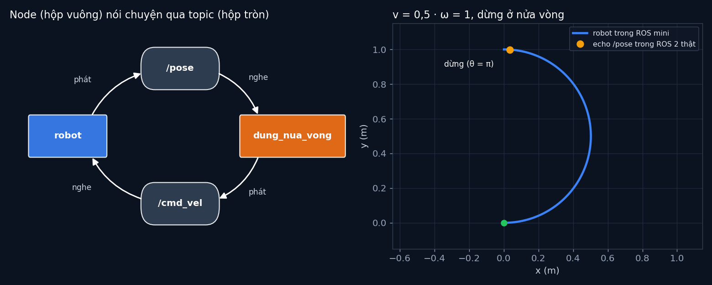

# Tập 0.3 · ROS 2: hệ thần kinh của robot

> **Mùa 0 · Khởi động** · ⏱ khoảng 30 phút (+ 15 phút nếu chạy ROS 2) · Độ khó ★☆☆ · Cần: đã làm [tập 0.2](../tap02/), biết class trong Python; Docker nếu muốn chạy ROS 2 ·
> 📚 Nền tảng phần mềm dùng cùng giáo trình Principles of Robot Autonomy (ROS 2 là phần **mở rộng**, sách không dạy chi tiết) ·
> 📺 Video: TikTok [@thanh82k5](https://www.tiktok.com/@thanh82k5) (tìm "Tập 0.3")

[](https://colab.research.google.com/github/thanhpro82/tu-hoc-robot-tu-hanh/blob/main/tap03/tap03_ros_mini.ipynb)
Phần bài tập là Python thuần, làm được trên Colab. Phần chạy ROS 2 thật thì cần Docker trên máy.

**Một câu:** robot thật có hàng chục chương trình chạy cùng lúc (camera, bản đồ, bánh xe…). ROS 2 cho chúng nói chuyện với nhau qua
**topic**. Mình bọc robot của tập 0.2 thành một **node** ROS 2: nghe `/cmd_vel`, phát `/pose`. Bạn tự viết một "ROS mini" 30 dòng để thấy
bên trong cơ chế đó hoạt động thế nào, và nó cho ra đúng vị trí như ROS 2 thật.



## Trong thư mục này

| File | Dùng khi nào |
|---|---|
| [tap03_ros_mini.ipynb](tap03_ros_mini.ipynb) | Làm bài trên Colab hoặc Jupyter |
| [bai_tap/ros_mini_cua_ban.py](bai_tap/ros_mini_cua_ban.py) | **Bạn viết code ở đây** (nếu làm trên máy) |
| [bai_tap/kiem_tra.py](bai_tap/kiem_tra.py) | Tự chấm: in ✅ / ❌ cho từng bài |
| [bai_tap/ve_do_thi.py](bai_tap/ve_do_thi.py) | Vẽ đường robot trong ROS mini của bạn, ra `ket_qua.png` |
| [robot_node.py](robot_node.py) | Node ROS 2 thật trong video (bọc hàm `step` của tập 0.2) |
| [demo.sh](demo.sh), [demo-output.txt](demo-output.txt) | Script chạy demo trong video và output thật của nó |
| [bai_tap/loi_giai.py](bai_tap/loi_giai.py) | Lời giải cả 3 bài. Tự làm xong rồi hãy mở |

## 1. Bài toán

Ba khái niệm cốt lõi của ROS 2:

| Khái niệm | Là gì | Trong tập này |
|---|---|---|
| **Node** | Một chương trình làm một việc | `robot` (mô phỏng xe 2 bánh) |
| **Topic** | Một "kênh" có tên, ai cũng phát hoặc nghe được | `/cmd_vel` (lệnh), `/pose` (vị trí) |
| **Message** | Kiểu dữ liệu đi trên topic | `Twist` (v, ω), `Pose2D` (x, y, θ) |

```text
  bàn phím / node khác ── phát ──► /cmd_vel ── nghe ──► ┌────────────────────────┐
                                   (Twist: v, ω)        │ node robot             │
                                                        │ 100 lần/giây: step()   │
  ros2 topic echo / node khác ◄── nghe ── /pose ◄─ phát ─┤ (hàm của tập 0.2)      │
                                   (Pose2D: x, y, θ)    └────────────────────────┘
```

Điểm hay: node robot không cần biết ai gửi lệnh, cũng không cần biết ai đọc vị trí. Thay bàn phím bằng một node tự lái (tập 1.7) thì
node robot giữ nguyên.

## 2. Sau bài này bạn làm được

| # | Bạn có thể… | Kiểm tra bằng | Đạt khi |
|---|---|---|---|
| 1 | Viết cơ chế phát / nghe theo topic | `kiem_tra.py` Bài 1 | ✅ |
| 2 | Viết một node nghe lệnh và phát trạng thái | `kiem_tra.py` Bài 2 | ✅, vị trí khớp `ros2 topic echo /pose` trong ROS 2 thật |
| 3 | Ghép hai node thành một vòng kín qua topic | `kiem_tra.py` Bài 3 | ✅, robot dừng đúng ở nửa vòng |
| 4 | Chạy node ROS 2 thật và dùng lệnh `ros2` | `demo.sh` | Ra output giống `demo-output.txt` |

## 3. Bạn làm gì

| Bài | Viết trong | Việc |
|---|---|---|
| **1** | `BangTin.dang_ky`, `BangTin.phat` | Lưu callback theo tên topic; phát tin thì gọi mọi callback của topic đó |
| **2** | `RobotNode` | Đăng ký nghe `/cmd_vel`; mỗi `tick()` chạy `step()` rồi phát `/pose` |
| **3** | `DungNuaVong` | Nghe `/pose`; khi θ ≥ π thì phát lệnh dừng `(0, 0)` lên `/cmd_vel` (một lần) |

Bài 2 được so với lần `ros2 topic echo /pose --once` đầu tiên trong `demo-output.txt`: sau 308 bước, ROS mini của bạn phải ra đúng vị trí đó.

## 4. Bắt đầu

**Cách 1: Colab** (chỉ phần bài tập). Bấm nút *Open in Colab* ở đầu trang.

**Cách 2: trên máy:**

```bash
cd tu-hoc-robot-tu-hanh/tap03
python -X utf8 bai_tap/kiem_tra.py     # 1. lúc đầu: ⏳ chưa làm cả 3 bài
# 2. mở bai_tap/ros_mini_cua_ban.py, làm từng bài, chạy lại kiem_tra.py
python -X utf8 bai_tap/ve_do_thi.py    # 3. vẽ đường robot -> ket_qua.png
```

**Chạy ROS 2 thật** (cần Docker; image `ros:jazzy` khoảng 1 GB). Từ thư mục `tap03`:

```bash
docker run --rm -v "$PWD:/ws" ros:jazzy bash /ws/demo.sh
```

Output trong video (rút gọn):

```text
$ python3 robot_node.py &
[INFO] [robot]: Robot sẵn sàng, đang nghe /cmd_vel
$ ros2 node list
/robot
$ ros2 topic list
/cmd_vel
/parameter_events
/pose
/rosout
$ ros2 topic pub /cmd_vel geometry_msgs/msg/Twist "{linear: {x: 0.5}, angular: {z: 1.0}}"
$ ros2 topic echo /pose --once
x: 0.03577186167094566
y: 0.9988896763077438
theta: 3.0799999999999783
```

Kết quả khi làm xong cả 3 bài:

```text
✅ Bài 1 · bảng tin (topic): tin tới đúng mọi người nghe của topic; topic chưa ai nghe thì bỏ qua
✅ Bài 2 · node robot: sau 308 bước robot ở (0.036, 0.999, θ = 3.08), khớp lần echo /pose trong ROS 2 thật (0.036, 0.999, 3.08)
✅ Bài 3 · node điều khiển: node điều khiển nghe /pose, phát /cmd_vel: robot dừng ở (0.00, 1.00), θ = 180° (vòng kín đầu tiên qua topic)

Đạt 3/3 bài.  🎉 Xong! Thử phần Thử thách trong README nhé.
```

### Lịch gợi ý (30 phút)

| Phút | Việc |
|--:|:--|
| 5 | Xem video, đọc mục 1 và `robot_node.py` |
| 20 | Làm Bài 1 → 2 → 3 |
| 5 | Câu hỏi tự kiểm tra, hoặc chạy ROS 2 bằng Docker |

## 5. Thử thách (không chấm)

1. **Hai người nghe:** thêm một node "ghi_log" cũng nghe `/pose` và đếm số tin. Node robot có phải sửa gì không?
2. **Vẽ hình vuông qua topic:** viết node điều khiển phát lệnh theo thời gian để robot chạy hình vuông (giống tập 1.2), chỉ qua `/cmd_vel`.
3. **ROS 2 thật:** trong container, mở thêm terminal (`docker exec -it <tên> bash`) và gõ `ros2 topic hz /pose` xem node phát bao nhiêu lần mỗi giây.
4. **So sánh:** ROS mini của bạn gọi callback ngay lập tức, còn ROS 2 gửi qua mạng. Điều này gây khác biệt gì khi có nhiều máy tính?

## 6. Câu hỏi tự kiểm tra

<details><summary>1. Vì sao không cho node điều khiển gọi thẳng hàm của node robot?</summary>

Gọi thẳng thì hai node dính chặt vào nhau: đổi robot (mô phỏng sang thật) là phải sửa node điều khiển. Qua topic, mỗi bên chỉ cần biết
tên topic và kiểu message. Các node còn có thể chạy trên máy khác nhau, viết bằng ngôn ngữ khác nhau.
</details>

<details><summary>2. Vì sao ROS mini của bạn ra đúng vị trí như ROS 2 thật?</summary>

Cả hai cùng dùng hàm `step()` của tập 0.2 với cùng dt = 0,01 s và cùng lệnh v = 0,5, ω = 1. Lần echo đầu tiên trong demo xảy ra sau
đúng 308 bước (θ = 3,08). ROS 2 chỉ lo việc chuyển tin; phần tính toán là của bạn.
</details>

<details><summary>3. Topic `/rosout` và `/parameter_events` ở đâu ra?</summary>

ROS 2 tự tạo cho mọi node: `/rosout` gom log của các node, `/parameter_events` báo khi tham số của node thay đổi. Mình không phải viết gì cho chúng.
</details>

<details><summary>4. Bài 3 là vòng hở hay vòng kín?</summary>

Vòng kín: node điều khiển **đo** (nghe `/pose`) rồi mới quyết định lệnh. Vòng hở thì chỉ đếm thời gian rồi ra lệnh dừng mà không nhìn vị trí (tập 1.2 sẽ cho thấy vì sao cách đó dễ sai).
</details>

## 7. Giới hạn cần biết

- ROS mini chạy trong một chương trình, gọi callback ngay và theo thứ tự. ROS 2 thật chạy song song qua mạng, có hàng đợi, QoS và độ trễ.
- Robot vẫn là mô phỏng lý tưởng của tập 0.2, chưa có Gazebo hay phần cứng thật.
- ROS 2 là công cụ phần mềm, nằm ngoài nội dung chính của giáo trình (phần **mở rộng**).

## Đọc thêm

- Tài liệu ROS 2 Jazzy: [docs.ros.org/en/jazzy](https://docs.ros.org/en/jazzy/) (mục Tutorials → Beginner: CLI tools).
- Tập trước: [0.2 · Robot đầu tiên](../tap02/) · Tập sau: [1.1 · Vì sao xe không đi ngang được?](../tap11/)

---
[← Về danh sách tập](../README.md)
