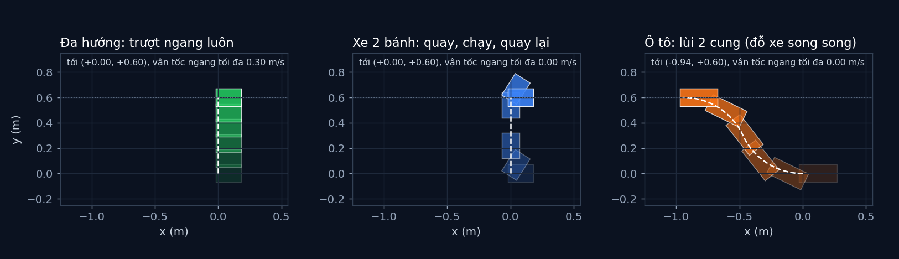

# Tập 1.1 · Vì sao xe không đi ngang được?

> **Mùa 1 · Biết đi** · ⏱ khoảng 30 phút · Độ khó ★★☆ · Cần: đã làm [tập 0.2](../tap02/), biết sin/cos ·
> 📚 Giáo trình: Principles of Robot Autonomy, [Chương 1 · Modeling robot dynamics](https://porabook.com/book/modeling-robot-dynamics/) ·
> 📺 Video: TikTok [@thanh82k5](https://www.tiktok.com/@thanh82k5) (tìm "Tập 1.1")

[](https://colab.research.google.com/github/thanhpro82/tu-hoc-robot-tu-hanh/blob/main/tap11/tap11_khong_di_ngang.ipynb)
Không muốn cài gì? Bấm nút trên để làm toàn bộ bài ngay trên trình duyệt.

**Một câu:** ba robot cùng nhận nhiệm vụ "dời sang ngang 60 cm, giữ nguyên hướng". Robot đa hướng trượt ngang luôn, xe 2 bánh
phải quay 90° rồi chạy, còn ô tô phải lùi 2 cung tròn như đỗ xe song song. Bạn tự viết mô hình ô tô, đo ràng buộc "không trượt ngang",
và tính kế hoạch đỗ xe.



## Trong thư mục này

| File | Dùng khi nào |
|---|---|
| [tap11_khong_di_ngang.ipynb](tap11_khong_di_ngang.ipynb) | Làm bài trên Colab hoặc Jupyter |
| [bai_tap/xe_cua_ban.py](bai_tap/xe_cua_ban.py) | **Bạn viết code ở đây** (nếu làm trên máy) |
| [bai_tap/kiem_tra.py](bai_tap/kiem_tra.py) | Tự chấm: in ✅ / ❌ cho từng bài |
| [bai_tap/ve_do_thi.py](bai_tap/ve_do_thi.py) | Vẽ 3 robot, ô tô dùng mô hình của bạn, ra `ket_qua.png` |
| [sim/khong_di_ngang.py](sim/khong_di_ngang.py) | Mô phỏng dùng trong video (cũng là lời giải Bài 1, 2) |
| [bai_tap/loi_giai.py](bai_tap/loi_giai.py) | Lời giải cả 3 bài. Tự làm xong rồi hãy mở |

## 1. Bài toán

Ba loại robot, ba mô hình (đều có trong Chương 1 của sách):

| Robot | Lệnh | Cập nhật mỗi bước dt |
|---|---|---|
| Đa hướng (omni) | `vx, vy, ω` | `x += vx·dt`, `y += vy·dt`, `θ += ω·dt` (đi được mọi hướng) |
| Xe 2 bánh | `v, ω` | `x += v·cos θ·dt`, `y += v·sin θ·dt`, `θ += ω·dt` |
| Ô tô (bicycle model) | `v, φ` (góc lái) | `x += v·cos θ·dt`, `y += v·sin θ·dt`, `θ += v·tan φ / L·dt` |

Xe 2 bánh và ô tô có chung một **ràng buộc**: bánh xe lăn tới được nhưng không trượt ngang. Viết thành công thức:

```text
vận tốc ngang thân xe  =  ẋ·sin θ − ẏ·cos θ  =  0        (ràng buộc nonholonomic)
```

Ràng buộc này chặn **vận tốc** chứ không chặn **vị trí**: xe vẫn tới được chỗ cần tới, chỉ là phải đi đường vòng.
Ô tô còn khó hơn vì tay lái chỉ quay tối đa 30°, nên không quay tại chỗ được. Bán kính quay nhỏ nhất:

```text
           L                         lùi, lái trái hết cỡ          lùi, lái phải hết cỡ
 R  =  ─────────           (0, 0) ──── cung 1 (góc α) ────► · ──── cung 2 (góc α) ────► (−0,94; 0,6)
        tan φ_max                         dời ngang R(1 − cos α)        dời thêm R(1 − cos α)
```

## 2. Sau bài này bạn làm được

| # | Bạn có thể… | Kiểm tra bằng | Đạt khi |
|---|---|---|---|
| 1 | Viết mô hình ô tô (bicycle model) có giới hạn góc lái | `kiem_tra.py` Bài 1 | ✅, đỗ xe dừng ở (−0,94; +0,60) như video |
| 2 | Đo ràng buộc không trượt ngang từ đường đi | `kiem_tra.py` Bài 2 | ✅, đa hướng 0,30 m/s, hai xe kia 0 |
| 3 | Tính kế hoạch đỗ xe song song cho xe bất kỳ | `kiem_tra.py` Bài 3 | ✅, R = 0,52 m, mỗi cung 65° |
| 4 | Phân biệt ràng buộc lên vận tốc và lên vị trí | [Câu hỏi tự kiểm tra](#6-câu-hỏi-tự-kiểm-tra) | Tự trả lời được |

## 3. Bạn làm gì

| Bài | Hàm | Việc |
|---|---|---|
| **1** | `step_car(x, y, theta, v, phi)` | Kẹp φ trong ±30°, rồi cập nhật theo bicycle model |
| **2** | `van_toc_ngang(path)` | Tính `|ẋ·sin θ − ẏ·cos θ|` giữa từng cặp điểm, trả về giá trị lớn nhất |
| **3** | `ke_hoach_do_xe(d, L, phi_max)` | Trả về `(R, α)`: bán kính quay nhỏ nhất và góc mỗi cung để dời ngang d mét |

Bài 3 được chấm thêm bằng một chiếc xe khác (dài 0,5 m, lái tối đa 25°) để chắc công thức của bạn đúng tổng quát.

## 4. Bắt đầu

**Cách 1: Colab.** Bấm nút *Open in Colab* ở đầu trang.

**Cách 2: trên máy:**

```bash
cd tu-hoc-robot-tu-hanh/tap11
python -X utf8 sim/khong_di_ngang.py   # 1. số liệu trong video
python -X utf8 bai_tap/kiem_tra.py     # 2. lúc đầu: ⏳ chưa làm cả 3 bài
# 3. mở bai_tap/xe_cua_ban.py, làm từng bài, chạy lại kiem_tra.py
python -X utf8 bai_tap/ve_do_thi.py    # 4. vẽ 3 robot -> ket_qua.png
```

Kết quả mong đợi của bước 1:

```text
Ô tô: L = 0.3 m, góc lái tối đa 30°, bán kính quay nhỏ nhất R = 0.52 m
Đỗ xe song song: 2 cung, mỗi cung 65°

Đa hướng  -> x=+0.00 m, y=+0.60 m, θ=+0° | vận tốc ngang lớn nhất = 0.30 m/s
Xe 2 bánh -> x=+0.00 m, y=+0.60 m, θ=-0° | vận tốc ngang lớn nhất = 0.00 m/s
Ô tô      -> x=-0.94 m, y=+0.60 m, θ=-0° | vận tốc ngang lớn nhất = 0.00 m/s
```

Kết quả khi làm xong cả 3 bài:

```text
✅ Bài 1 · mô hình ô tô: đỗ xe song song bằng mô hình của bạn: dừng ở x = -0.94 m, y = +0.60 m, θ = -0° như video
✅ Bài 2 · vận tốc ngang: đa hướng 0.30 m/s · xe 2 bánh 0.00 · ô tô 0.00: hai xe sau không bao giờ trượt ngang (ràng buộc nonholonomic)
✅ Bài 3 · kế hoạch đỗ xe: R = 0.52 m, mỗi cung 65° như video; thử xe khác cũng dời đúng 0.30 m

Đạt 3/3 bài.  🎉 Xong! Thử phần Thử thách trong README nhé.
```

### Lịch gợi ý (30 phút)

| Phút | Việc |
|--:|:--|
| 5 | Xem video, đọc mục 1 |
| 20 | Làm Bài 1 → 2 → 3 |
| 5 | Câu hỏi tự kiểm tra, chọn 1 thử thách |

## 5. Thử thách (không chấm)

1. **Lái gắt hơn:** đổi `PHI_MAX` thành 45°. R còn bao nhiêu, xe lùi ít hơn bao nhiêu mét?
2. **Chỗ đỗ ngắn:** nếu phía sau chỉ còn 0,7 m trống, có đỗ được bằng 2 cung không? Thử nghĩ cách 3 cung (lùi, tiến, lùi).
3. **Xe 2 bánh nhanh hơn:** tìm cách cho xe 2 bánh dời 60 cm mà không cần quay tại chỗ (gợi ý: hai cung tròn giống ô tô).
4. **Đo trượt:** viết một robot "bánh trơn", cho trượt ngang 5% mỗi bước, rồi dùng `van_toc_ngang` để phát hiện.

## 6. Câu hỏi tự kiểm tra

<details><summary>1. Xe 2 bánh không đi ngang được, vậy sao nó vẫn tới được y = 0,6 m?</summary>

Ràng buộc chỉ cấm **vận tốc** ngang tại mỗi thời điểm, không cấm **vị trí**. Xe quay mũi về hướng cần tới rồi chạy thẳng tới đó,
nên vị trí nào cũng tới được, chỉ là phải đi đường vòng. Đó là ý nghĩa của chữ *nonholonomic*.
</details>

<details><summary>2. Vì sao ô tô không làm như xe 2 bánh (quay 90° tại chỗ)?</summary>

Ô tô chỉ đổi hướng khi đang chạy: `θ̇ = v·tan φ / L`. Đứng yên (v = 0) thì θ không đổi dù có đánh lái. Và vì φ tối đa 30°,
nó chỉ quay được theo cung có bán kính ít nhất `R = L / tan 30° ≈ 0,52 m`.
</details>

<details><summary>3. Vì sao phải 2 cung ngược chiều mà không phải 1 cung?</summary>

Một cung làm xe dời ngang nhưng cũng làm mũi xe xoay đi góc α. Cung thứ hai quay ngược lại đúng α nên mũi xe về hướng cũ,
đồng thời dời ngang thêm một đoạn bằng cung đầu. Tổng cộng: `2R(1 − cos α) = d`.
</details>

<details><summary>4. Trong Bài 2, vì sao robot đa hướng ra 0,30 m/s?</summary>

Nó trượt ngang 0,6 m trong 2 giây với hướng không đổi (θ = 0), nên vận tốc ngang = 0,6 / 2 = 0,30 m/s. Hai xe còn lại luôn ra 0
vì công thức cập nhật của chúng chỉ cho chạy dọc theo hướng mũi xe.
</details>

## 7. Giới hạn cần biết

- Mô phỏng lý tưởng: bánh không trượt, tay lái đổi góc tức thì (xe thật phải mất thời gian quay vô lăng).
- Kế hoạch đỗ xe 2 cung là cách đơn giản nhất, không phải đường ngắn nhất. Đường tối ưu cho ô tô (đường Reeds-Shepp) là phần **mở rộng**, không có trong bài.
- Không kiểm tra va chạm với xe đỗ trước hay sau.

## Đọc thêm

- Sách, [Chương 1](https://porabook.com/book/modeling-robot-dynamics/): ràng buộc nonholonomic, mô hình unicycle và bicycle.
- Tập trước: [0.2 · Robot đầu tiên](../tap02/) · Tập sau: [1.2 · Điều khiển vòng hở](../tap12/)

---
[← Về danh sách tập](../README.md)
