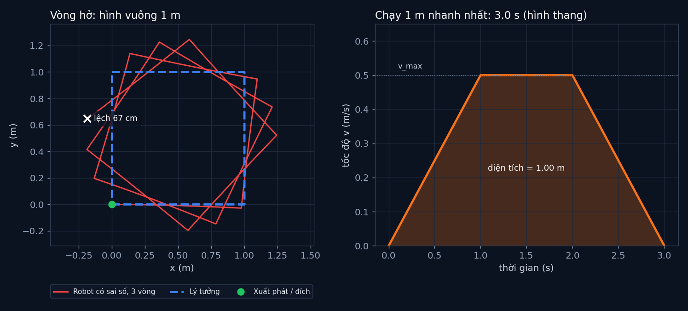

# Tập 1.2 · Nhắm mắt mà chạy: điều khiển vòng hở

> **Mùa 1 · Biết đi** · ⏱ khoảng 30 phút · Độ khó ★☆☆ · Cần: đã làm [tập 0.2](../tap02/) ·
> 📚 Giáo trình: Principles of Robot Autonomy, [Chương 2 · Open-loop control](https://porabook.com/book/open-loop-control/) ·
> 📺 Video: TikTok [@thanh82k5](https://www.tiktok.com/@thanh82k5) (tìm "Tập 1.2")

[](https://colab.research.google.com/github/thanhpro82/tu-hoc-robot-tu-hanh/blob/main/tap12/tap12_vong_ho.ipynb)
Không muốn cài gì? Bấm nút trên để làm toàn bộ bài ngay trên trình duyệt.

**Một câu:** tính sẵn mọi lệnh rồi cứ thế chạy, không nhìn lại. Trong mô phỏng hoàn hảo, robot về đúng chỗ cũ. Còn robot có chút sai số
thì cứ mỗi vòng lệch thêm ~22 cm. Bạn tự lập kế hoạch hình vuông, rồi tìm cách chạy 1 m nhanh nhất khi động cơ có giới hạn.



## Trong thư mục này

| File | Dùng khi nào |
|---|---|
| [tap12_vong_ho.ipynb](tap12_vong_ho.ipynb) | Làm bài trên Colab hoặc Jupyter |
| [bai_tap/vong_ho_cua_ban.py](bai_tap/vong_ho_cua_ban.py) | **Bạn viết code ở đây** (nếu làm trên máy) |
| [bai_tap/kiem_tra.py](bai_tap/kiem_tra.py) | Tự chấm: in ✅ / ❌ cho từng bài |
| [bai_tap/ve_do_thi.py](bai_tap/ve_do_thi.py) | Vẽ hình vuông và đồ thị tốc độ bằng code của bạn, ra `ket_qua.png` |
| [sim/vong_ho.py](sim/vong_ho.py) | Mô phỏng dùng trong video |
| [bai_tap/loi_giai.py](bai_tap/loi_giai.py) | Lời giải cả 3 bài. Tự làm xong rồi hãy mở |

## 1. Bài toán

**Điều khiển vòng hở** = lập sẵn chuỗi lệnh từ trước, rồi thực hiện đúng như thế mà không đo lại xem mình đang ở đâu:

```text
 kế hoạch lệnh ──► [ (2 s, v = 0,5, ω = 0), (1 s, v = 0, ω = π/2), … ] ──► robot ──► ? (không ai kiểm tra)
```

Robot "thật" trong mô phỏng có bánh nhỏ hơn thiết kế 2%, mỗi lần quay hụt 3%, chạy thẳng hơi lệch phải và rung lắc nhẹ.
Từng sai số rất nhỏ, nhưng vòng hở **không bao giờ sửa**, nên chúng cộng dồn.

Phần thứ hai của chương là **tối ưu quỹ đạo**: tính trước lệnh *tốt nhất*. Ví dụ: chạy 1 m nhanh nhất có thể, biết động cơ chỉ tăng
hoặc giảm tốc tối đa 0,5 m/s² và chạy tối đa 0,5 m/s. Lời giải là đồ thị tốc độ hình thang: tăng tốc hết cỡ, chạy đều, phanh hết cỡ.

```text
 v ▲   ┌──────────┐ v_max
   │  ╱            ╲            quãng đường = diện tích dưới đồ thị
   │ ╱              ╲
   └╱────────────────╲──► t
    tăng tốc  đều   phanh
```

## 2. Sau bài này bạn làm được

| # | Bạn có thể… | Kiểm tra bằng | Đạt khi |
|---|---|---|---|
| 1 | Lập kế hoạch lệnh vòng hở cho một hình | `kiem_tra.py` Bài 1 | ✅, robot sai số lệch 24, 46, 67 cm sau 3 vòng như video |
| 2 | Tính thời gian ngắn nhất khi có giới hạn tốc độ và gia tốc | `kiem_tra.py` Bài 2 | ✅, 1 m mất 3,0 s |
| 3 | Sinh đồ thị tốc độ hình thang (cả trường hợp tam giác) | `kiem_tra.py` Bài 3 | ✅, đi đúng quãng, không vượt giới hạn |
| 4 | Giải thích vì sao vòng hở không đủ cho robot thật | [Câu hỏi tự kiểm tra](#6-câu-hỏi-tự-kiểm-tra) | Tự trả lời được |

## 3. Bạn làm gì

| Bài | Hàm | Việc |
|---|---|---|
| **1** | `ke_hoach_vuong(canh, v, t_quay)` | Trả về 8 lệnh `(giây, v, ω)`: 4 lần "chạy hết cạnh" + "quay trái 90° tại chỗ" |
| **2** | `thoi_gian_nhanh_nhat(d, v_max, a_max)` | Thời gian hình thang; nếu quãng quá ngắn thì thành hình tam giác |
| **3** | `van_toc_luc(t, d, v_max, a_max)` | Tốc độ tại thời điểm t: số nhỏ nhất trong `a_max·t`, `v_max`, `a_max·(T − t)` |

## 4. Bắt đầu

**Cách 1: Colab.** Bấm nút *Open in Colab* ở đầu trang.

**Cách 2: trên máy:**

```bash
cd tu-hoc-robot-tu-hanh/tap12
python -X utf8 sim/vong_ho.py          # 1. số liệu trong video
python -X utf8 bai_tap/kiem_tra.py     # 2. lúc đầu: ⏳ chưa làm cả 3 bài
# 3. mở bai_tap/vong_ho_cua_ban.py, làm từng bài, chạy lại kiem_tra.py
python -X utf8 bai_tap/ve_do_thi.py    # 4. vẽ bằng code của bạn -> ket_qua.png
```

Kết quả mong đợi của bước 1:

```text
Hình vuông lý tưởng: lệch 0.0 cm khi về đích
Robot có sai số, sau vòng 1: lệch 24 cm
Robot có sai số, sau vòng 2: lệch 46 cm
Robot có sai số, sau vòng 3: lệch 67 cm
Hình thang: 3.0 s cho 1.00 m (v_max 0.5 m/s, a_max 0.5 m/s²)
```

Kết quả khi làm xong cả 3 bài:

```text
✅ Bài 1 · kế hoạch hình vuông: lý tưởng về đúng chỗ cũ; robot có sai số thì lệch 24, 46, 67 cm sau 3 vòng như video
✅ Bài 2 · thời gian nhanh nhất: 1 m mất 3.0 s như video; quãng ngắn 0.2 m thành hình tam giác, 1.26 s
✅ Bài 3 · đồ thị hình thang: đồ thị hình thang khớp video; cả 3 quãng đều đi đúng quãng, không vượt v_max, a_max

Đạt 3/3 bài.  🎉 Xong! Thử phần Thử thách trong README nhé.
```

### Lịch gợi ý (30 phút)

| Phút | Việc |
|--:|:--|
| 5 | Xem video, đọc mục 1 |
| 20 | Làm Bài 1 → 2 → 3 |
| 5 | Câu hỏi tự kiểm tra, chọn 1 thử thách |

## 5. Thử thách (không chấm)

1. **Sai số nào tệ nhất?** Trong `sim/vong_ho.py`, lần lượt chỉ giữ lại một loại sai số trong `ROBOT_THAT` (bánh nhỏ, quay hụt, lệch, nhiễu). Loại nào làm lệch nhiều nhất sau 3 vòng?
2. **Bù sai số:** biết robot quay hụt 3%, hãy sửa kế hoạch (quay lâu hơn một chút) để bù. Robot còn lệch bao nhiêu? Vì sao vẫn không về 0?
3. **Đổi seed:** chạy robot sai số với `seed` khác. Độ lệch thay đổi nhiều không? Điều đó nói gì về việc "tính sẵn" lệnh?
4. **Hình vuông nhanh nhất:** dùng đồ thị hình thang cho mỗi cạnh thay cho tốc độ không đổi. Một vòng nhanh hơn bao nhiêu giây?

## 6. Câu hỏi tự kiểm tra

<details><summary>1. Vì sao độ lệch tăng đều theo số vòng (24 → 46 → 67 cm)?</summary>

Mỗi vòng robot mắc gần như cùng các sai số (bánh nhỏ, quay hụt, lệch hướng). Vòng hở không đo lại nên không biết mình đã lệch,
vòng sau bắt đầu từ chỗ sai và cộng thêm sai số mới. Sai số cứ thế dồn lại.
</details>

<details><summary>2. Đã biết robot quay hụt 3%, bù trong kế hoạch là xong?</summary>

Chỉ bù được phần sai số **biết trước và không đổi**. Nhiễu ngẫu nhiên, sàn trơn, pin yếu dần thì không đoán trước được.
Muốn xử lý chúng thì phải đo và sửa liên tục, tức là điều khiển vòng kín (tập 1.3).
</details>

<details><summary>3. Vì sao đồ thị tốc độ nhanh nhất có dạng hình thang?</summary>

Quãng đường bằng diện tích dưới đồ thị v(t). Muốn đi đủ 1 m trong thời gian ngắn nhất thì phải lấp diện tích nhanh nhất:
lúc nào cũng tăng tốc hết cỡ, chạm v_max thì giữ nguyên, rồi phanh hết cỡ vừa đúng lúc dừng ở đích. Kiểu điều khiển "hết cỡ hoặc giữ"
này gọi là bang-bang.
</details>

<details><summary>4. Khi nào hình thang biến thành hình tam giác?</summary>

Khi quãng đường ngắn hơn quãng cần để tăng tốc tới v_max rồi phanh lại (`v_max²/a_max`). Lúc đó chưa kịp chạm v_max đã phải phanh,
đỉnh đồ thị thấp hơn v_max và `T = 2·√(d/a_max)`.
</details>

## 7. Giới hạn cần biết

- Các con số sai số (bánh nhỏ 2%, quay hụt 3%, lệch −0,02 rad/s, nhiễu 5%) là **giả định** để minh hoạ, không lấy từ robot thật.
- Tối ưu quỹ đạo ở đây chỉ cho 1 chiều (chạy thẳng) với lời giải có công thức. Sách trình bày cách tổng quát hơn (giải bài toán tối ưu bằng số); phần đó không có trong bài tập.
- Quay tại chỗ được coi là tức thời đạt tốc độ, không có giới hạn gia tốc góc.

## Đọc thêm

- Sách, [Chương 2](https://porabook.com/book/open-loop-control/): điều khiển vòng hở và tối ưu quỹ đạo.
- Tập trước: [1.1 · Vì sao xe không đi ngang được?](../tap11/) · Tập sau: [1.3 · PID](../tap13/)

---
[← Về danh sách tập](../README.md)
