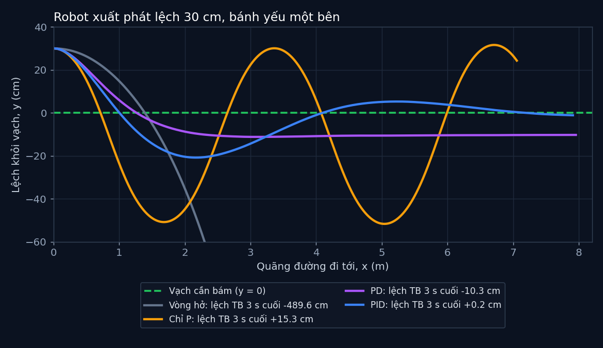

# Tập 1.3 · PID: robot tự sửa sai

> **Mùa 1 · Biết đi** · ⏱ khoảng 30 phút · Độ khó ★☆☆ · Cần: Python cơ bản, đã xem [tập 0.2](../tap02/) ·
> 📚 Giáo trình: Principles of Robot Autonomy, [Chương 3 · Closed-loop control](https://porabook.com/book/closed-loop-control/) ·
> 📺 Video: TikTok [@thanh82k5](https://www.tiktok.com/@thanh82k5) (tìm "Tập 1.3")

[](https://colab.research.google.com/github/thanhpro82/tu-hoc-robot-tu-hanh/blob/main/tap13/tap13_pid.ipynb)
Không muốn cài gì? Bấm nút trên để làm toàn bộ bài ngay trên trình duyệt.

**Một câu:** robot xuất phát lệch vạch 30 cm, một bánh yếu luôn kéo nó lệch đi. Bạn tự viết bộ điều khiển PID, từng chữ một,
và tận mắt thấy P còn lắc, PD còn lệch, PID bám đúng vạch.



## Trong thư mục này

| File | Dùng khi nào |
|---|---|
| [README.md](README.md) | Đọc đầu tiên: mục tiêu, cách làm, thử thách (file này) |
| [tap13_pid.ipynb](tap13_pid.ipynb) | Làm bài trên Colab hoặc Jupyter: có sẵn ô code, ô chấm và hình |
| [bai_tap/pid_cua_ban.py](bai_tap/pid_cua_ban.py) | **Bạn viết code ở đây** (nếu làm trên máy, không dùng notebook) |
| [bai_tap/kiem_tra.py](bai_tap/kiem_tra.py) | Tự chấm: in ✅ / ❌ cho từng bài |
| [bai_tap/ve_do_thi.py](bai_tap/ve_do_thi.py) | Vẽ đường đi robot bằng PID của bạn ra `ket_qua.png` |
| [sim/pid.py](sim/pid.py) | Mô phỏng và **lời giải**, chính là code tạo ra số liệu trong video. Tự làm xong rồi hãy mở |

## 1. Bài toán

Robot chạy tới với tốc độ 0,5 m/s, nhiệm vụ là bám theo vạch thẳng `y = 0`. Nhưng:

- nó xuất phát lệch **30 cm**;
- một bánh yếu nên robot luôn bị kéo quay lệch **0,15 rad/s**, động cơ chỉ quay được 96% lệnh, lại thêm nhiễu.

Nếu cứ ra lệnh "đi thẳng" (vòng hở như [tập 1.2](../tap12/)), robot trôi mất. Cách sửa: **đo** xem đang lệch bao nhiêu,
rồi **ra lệnh bẻ lái** dựa trên độ lệch đó, lặp lại 100 lần mỗi giây. Đó là điều khiển vòng kín:

```text
 mục tiêu r = 0       e = r − y      ┌─────────┐   lệnh ω   ┌──────────────────────────────┐
 (vạch) ───────►( + )───────────────►│   PID   │───────────►│ Robot: bánh yếu kéo lệch,    │──┬──► vị trí y
                  ▲ −                └─────────┘            │ chỉ quay được 96% lệnh, nhiễu│  │
                  │                                         └──────────────────────────────┘  │
                  └──────────────────────────── đo vị trí y ◄─────────────────────────────────┘
```

Bộ PID tính lệnh quay từ sai số `e = r − y` (đúng ký hiệu của sách):

```text
ω = Kp·e  +  Ki·∫e dt  +  Kd·de/dt
    (P)       (I)          (D)
    lệch bao  lệch lâu     lệch đang tăng
    nhiêu bẻ  rồi thì bẻ   hay giảm thì
    bấy nhiêu thêm dần     hãm lại
```

## 2. Sau bài này bạn làm được

| # | Bạn có thể… | Kiểm tra bằng | Đạt khi |
|---|---|---|---|
| 1 | Viết thành phần **P** | `kiem_tra.py` Bài 1 | ✅, robot lắc qua lắc lại quanh vạch như video |
| 2 | Viết thành phần **D**, xử lý đúng bước đầu tiên | `kiem_tra.py` Bài 2 | ✅, robot hết lắc, lệch −10,3 cm |
| 3 | Viết thành phần **I** | `kiem_tra.py` Bài 3 | ✅, robot lệch +0,2 cm |
| 4 | Giải thích vì sao P lắc, D hết lắc, I khử lệch | [Câu hỏi tự kiểm tra](#6-câu-hỏi-tự-kiểm-tra) | Tự trả lời được trước khi mở đáp án |

## 3. Bạn làm gì

| Bài | Viết trong `PID` | Việc | Hệ số dùng để chấm |
|---|---|---|---|
| **1** | `thanh_phan_P(e)` | Trả về `Kp·e` | Kp = 1,5 |
| **2** | `thanh_phan_D(e)` | `de/dt ≈ (e − e_trước)/dt`, bước đầu coi bằng 0, nhớ lưu `e_trước` | Kp = 1,5 · Kd = 2,8 |
| **3** | `thanh_phan_I(e)` | Cộng dồn `e·dt` rồi nhân `Ki` | Kp = 1,5 · Ki = 0,6 · Kd = 2,8 |

Mỗi hàm đang là `raise NotImplementedError("TODO ...")`. Thành phần nào có hệ số bằng 0 thì không được gọi,
nên làm xong Bài 1 là chấm được Bài 1 ngay. **Giữ nguyên tên hàm và tham số** để bộ chấm gọi được.

Bộ chấm kiểm tra 2 bước: thử hàm với vài con số tính tay được, rồi cho robot chạy 16 giây bằng PID của bạn
trong **đúng mô phỏng của video** và so độ lệch với lời giải (sai số cho phép 0,05 cm).

## 4. Bắt đầu

**Cách 1: Colab** (không cần cài). Bấm nút *Open in Colab* ở đầu trang, chạy lần lượt từng ô.

**Cách 2: trên máy** (Python 3.10+):

```bash
git clone https://github.com/thanhpro82/tu-hoc-robot-tu-hanh.git
cd tu-hoc-robot-tu-hanh
pip install -r requirements.txt
cd tap13
python -X utf8 sim/pid.py              # 1. xem lại số liệu trong video
python -X utf8 bai_tap/kiem_tra.py     # 2. lúc đầu: ⏳ chưa làm cả 3 bài
# 3. mở bai_tap/pid_cua_ban.py, làm Bài 1, chạy lại kiem_tra.py; rồi Bài 2, Bài 3
python -X utf8 bai_tap/ve_do_thi.py    # 4. vẽ đường đi bằng PID của bạn -> ket_qua.png
```

Kết quả mong đợi của bước 1:

```text
vong_ho -> lệch cuối -489.6 cm | y nhỏ nhất -547.6 cm | x cuối 2.3 m
P       -> lệch cuối  +15.3 cm | y nhỏ nhất  -51.7 cm | x cuối 7.1 m
PD      -> lệch cuối  -10.3 cm | y nhỏ nhất  -11.2 cm | x cuối 8.0 m
PID     -> lệch cuối   +0.2 cm | y nhỏ nhất  -20.8 cm | x cuối 7.9 m
```

("lệch cuối" là độ lệch trung bình trong 3 giây cuối. Vòng hở lệch tới −489,6 cm vì robot đã quay vòng, nên chỉ đi tới được 2,3 m.)

Kết quả khi làm xong cả 3 bài:

```text
✅ Bài 1 · thành phần P: chỉ P: robot lắc qua lắc lại quanh vạch như video (lệch TB 3 s cuối +15.3 cm)
✅ Bài 2 · thành phần D: PD: robot lệch -10.3 cm (hết lắc nhưng bánh yếu vẫn kéo lệch)
✅ Bài 3 · thành phần I: PID: robot lệch +0.2 cm (I đã khử phần lệch còn lại)

Đạt 3/3 bài.  🎉 Xong! Thử phần Thử thách trong README nhé.
```

### Lịch gợi ý (30 phút)

| Phút | Việc |
|--:|:--|
| 5 | Xem video, đọc mục 1 |
| 5 | Chạy `sim/pid.py`, xem hình 4 đường đi |
| 15 | Làm Bài 1 → 2 → 3, chạy `kiem_tra.py` sau mỗi bài |
| 5 | Câu hỏi tự kiểm tra, chọn 1 thử thách |

## 5. Thử thách (không chấm, tự khám phá)

Sửa hệ số trong `bai_tap/ve_do_thi.py` (bảng `CACH`) hoặc ô thử nghiệm cuối notebook, rồi quan sát:

1. **Tăng Kp** từ 1,5 lên 3 (chỉ P). Robot lắc nhanh hơn hay chậm hơn? Có bớt lệch không?
2. **Bỏ D, giữ I** (Kp = 1,5 · Ki = 0,6 · Kd = 0). Chuyện gì xảy ra, và vì sao D quan trọng?
3. **Bánh yếu hơn:** trong `sim/pid.py` đổi `W_LECH = -0.15` thành `-0.3`. PD lệch thêm bao nhiêu? PID có còn về 0 không?
4. **Chống tích phân bão hoà** (mở rộng): kẹp `self.tich_phan` trong khoảng ±0,5. Khi nào việc này giúp ích?
5. **Tự chỉnh hệ số:** tìm bộ Kp, Ki, Kd cho robot về vạch nhanh nhất mà không vượt quá 10 cm sang phía bên kia.

## 6. Câu hỏi tự kiểm tra

<details><summary>1. Vì sao chỉ có P thì robot cứ lắc qua lắc lại?</summary>

P chỉ nhìn **độ lệch hiện tại**. Khi robot về tới vạch thì `e = 0` nên lệnh bẻ lái bằng 0, nhưng lúc đó robot vẫn
đang chạy chéo, nên nó vọt sang phía bên kia. Không có gì "hãm" lại, nên nó lắc mãi.
</details>

<details><summary>2. Thêm D thì vì sao hết lắc, nhưng vẫn còn lệch?</summary>

D nhìn **sai số đang thay đổi nhanh cỡ nào**: robot đang lao về vạch thì D bẻ ngược lại để hãm, nên hết vọt lố.
Nhưng bánh yếu kéo lệch **liên tục**. Muốn bù lực kéo đó, lệnh ω phải luôn khác 0. Với PD, khi robot đã chạy ổn định
thì `de/dt = 0`, nên ω chỉ còn đến từ `Kp·e`, tức là `e` phải khác 0. Robot dừng lại ở chỗ lệch vừa đủ để bù.
</details>

<details><summary>3. I khử phần lệch còn lại bằng cách nào?</summary>

I **cộng dồn** sai số theo thời gian. Chỉ cần còn lệch một chút, tích phân cứ lớn dần, lệnh bù tăng dần, cho tới khi
lệnh đủ để thắng lực kéo của bánh yếu. Lúc đó `e` về 0 mà thành phần I vẫn giữ nguyên giá trị đã tích luỹ.
</details>

<details><summary>4. Vì sao bước đầu tiên phải coi de/dt = 0?</summary>

Bước đầu chưa có sai số trước đó. Nếu coi `e_trước = 0` thì `de/dt = 0,3 / 0,01 = 30`, lệnh D vọt lên rất lớn và robot
giật mạnh ngay lúc khởi động. Bỏ qua D ở bước đầu là cách đơn giản để tránh cú giật này.
</details>

## 7. Giới hạn cần biết

- Robot đo được vị trí `y` **chính xác**, không có nhiễu đo. Nhiễu chỉ nằm ở chuyển động. Mùa 3 sẽ học cách lọc nhiễu đo.
- Chỉ điều khiển góc quay ω. Tốc độ tiến cố định 0,5 m/s và ω bị kẹp trong ±2 rad/s (giới hạn động cơ).
- Mô hình "bánh yếu" (quay được 96% lệnh, kéo lệch 0,15 rad/s) là **giả định** để có bài toán, không lấy từ sách.
- Hệ số Kp = 1,5 · Ki = 0,6 · Kd = 2,8 do mình chỉnh tay cho đẹp, không phải bộ tối ưu.

## Đọc thêm

- Sách, [Chương 3](https://porabook.com/book/closed-loop-control/): vòng kín, sai số `e = r − y`, PID. Đọc sau khi làm bài để hiểu sâu.
- Tập trước: [1.2 · Điều khiển vòng hở](../tap12/) · Tập sau: [1.4 · Bám quỹ đạo số 8](../tap14/)

---
[← Về danh sách tập](../README.md)
