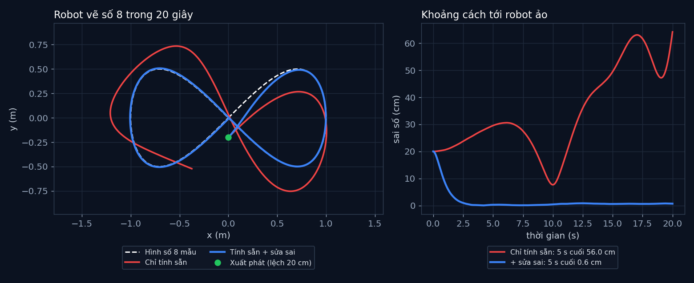

# Tập 1.4 · Bám quỹ đạo: robot chạy hình số 8

> **Mùa 1 · Biết đi** · ⏱ khoảng 40 phút · Độ khó ★★☆ · Cần: đã làm [tập 1.3](../tap13/), biết đạo hàm cơ bản ·
> 📚 Giáo trình: Principles of Robot Autonomy, [Chương 3 · Closed-loop control](https://porabook.com/book/closed-loop-control/) (Ví dụ 3.1.2) ·
> 📺 Video: TikTok [@thanh82k5](https://www.tiktok.com/@thanh82k5) (tìm "Tập 1.4")

[](https://colab.research.google.com/github/thanhpro82/tu-hoc-robot-tu-hanh/blob/main/tap14/tap14_bam_quy_dao.ipynb)
Không muốn cài gì? Bấm nút trên để làm toàn bộ bài ngay trên trình duyệt.

**Một câu:** robot phải đuổi theo một "robot ảo" đang vẽ số 8. Chỉ tính sẵn lệnh thì lệch tới 56 cm; tính sẵn **cộng** sửa sai thì
sai số còn 0,6 cm. Bạn tự viết cả ba mảnh: phẳng vi phân, điều khiển ảo, và phép đổi về lệnh thật.



## Trong thư mục này

| File | Dùng khi nào |
|---|---|
| [tap14_bam_quy_dao.ipynb](tap14_bam_quy_dao.ipynb) | Làm bài trên Colab hoặc Jupyter |
| [bai_tap/bam_cua_ban.py](bai_tap/bam_cua_ban.py) | **Bạn viết code ở đây** (nếu làm trên máy) |
| [bai_tap/kiem_tra.py](bai_tap/kiem_tra.py) | Tự chấm: in ✅ / ❌ cho từng bài |
| [bai_tap/ve_do_thi.py](bai_tap/ve_do_thi.py) | Vẽ hình số 8 và sai số bằng code của bạn, ra `ket_qua.png` |
| [sim/bam_quy_dao.py](sim/bam_quy_dao.py) | Mô phỏng dùng trong video (cũng là lời giải) |
| [bai_tap/loi_giai.py](bai_tap/loi_giai.py) | Lời giải cả 3 bài. Tự làm xong rồi hãy mở |

## 1. Bài toán

Khác tập 1.3 (bám một vạch thẳng), lần này mục tiêu **di chuyển**: một robot ảo chạy hình số 8 rộng 2 m trong 20 giây,
robot thật xuất phát lệch 20 cm và phải bám theo. Robot thật lại có bánh yếu và nhiễu.

Sách dùng mô hình unicycle mở rộng: trạng thái `(x, y, v, θ)`, lệnh `(a, ω)`. Ý tưởng chính có hai phần:

**1. Phẳng vi phân (tính sẵn).** Chỉ cần biết đường đi `x(t), y(t)` là suy ra được *mọi thứ* robot phải làm, không cần giải phương trình:

```text
 v = √(ẋ² + ẏ²)          θ = atan2(ẏ, ẋ)          a = (ẋẍ + ẏÿ)/v          ω = (ẋÿ − ẏẍ)/v²
```

**2. Sửa sai (feedback).** Tính sẵn chỉ đúng khi robot hoàn hảo. Nên ta cộng thêm phần sửa theo sai số vị trí và vận tốc, giống PD:

```text
                 tính sẵn       sửa sai vị trí        sửa sai vận tốc
  w1  =   ẍ_d      +     kp·(x_d − x)    +     kd·(ẋ_d − ẋ)
  w2  =   ÿ_d      +     kp·(y_d − y)    +     kd·(ẏ_d − ẏ)

  rồi đổi về lệnh thật:   [a, ω] = J⁻¹·[w1, w2],    J = ┌ cos θ   −v·sin θ ┐
                                                       └ sin θ    v·cos θ ┘
```

Hệ số `kp = 4`, `kd = 4` thoả `kd = 2√kp`: sai số giảm nhanh mà không dao động (tắt dần tới hạn).

## 2. Sau bài này bạn làm được

| # | Bạn có thể… | Kiểm tra bằng | Đạt khi |
|---|---|---|---|
| 1 | Suy ra v, θ, a, ω từ đường đi (phẳng vi phân) | `kiem_tra.py` Bài 1 | ✅, chỉ tính sẵn lệch 56,0 cm như video |
| 2 | Viết điều khiển ảo feedforward + feedback | `kiem_tra.py` Bài 2 | ✅ |
| 3 | Đổi lệnh ảo về lệnh thật bằng J⁻¹ | `kiem_tra.py` Bài 3 | ✅, sai số 5 s cuối 0,6 cm như video |
| 4 | Giải thích vai trò của từng phần | [Câu hỏi tự kiểm tra](#6-câu-hỏi-tự-kiểm-tra) | Tự trả lời được |

## 3. Bạn làm gì

| Bài | Hàm | Việc |
|---|---|---|
| **1** | `tinh_san(dx, dy, ddx, ddy)` | Cài 4 công thức phẳng vi phân, trả về `(v, θ, a, ω)` |
| **2** | `dieu_khien_ao(xd, yd, dxd, dyd, ddxd, ddyd, x, y, v, th, kp, kd)` | Trả về `(w1, w2)`; vận tốc robot thật là `(v·cos θ, v·sin θ)` |
| **3** | `doi_lenh(w1, w2, th, v)` | Giải `J·[a, ω] = [w1, w2]`, trả về `(a, ω)` |

Sau Bài 1, bộ chấm chạy robot chỉ bằng phần tính sẵn. Sau Bài 3, nó chạy cả vòng bám quỹ đạo bằng code của bạn trong đúng mô phỏng của video.

## 4. Bắt đầu

**Cách 1: Colab.** Bấm nút *Open in Colab* ở đầu trang.

**Cách 2: trên máy:**

```bash
cd tu-hoc-robot-tu-hanh/tap14
python -X utf8 sim/bam_quy_dao.py      # 1. số liệu trong video
python -X utf8 bai_tap/kiem_tra.py     # 2. lúc đầu: ⏳ chưa làm cả 3 bài
# 3. mở bai_tap/bam_cua_ban.py, làm từng bài, chạy lại kiem_tra.py
python -X utf8 bai_tap/ve_do_thi.py    # 4. vẽ bằng code của bạn -> ket_qua.png
```

Kết quả mong đợi của bước 1:

```text
Số 8 rộng 2.0 m, 20 s, tốc độ robot ảo 0.21–0.44 m/s, kp = 4.0, kd = 4.0
Chỉ tính sẵn      : sai số đầu 20 cm, lớn nhất 64 cm, trung bình 5 s cuối 56.0 cm
Tính sẵn + sửa sai: sai số đầu 20 cm, lớn nhất 20 cm, trung bình 5 s cuối 0.6 cm
```

Kết quả khi làm xong cả 3 bài:

```text
✅ Bài 1 · phẳng vi phân: chỉ tính sẵn (vòng hở): robot vẽ lệch, sai số 5 s cuối 56.0 cm như video
✅ Bài 2 · điều khiển ảo: w1, w2 đúng: phần ẍ_d, ÿ_d tính sẵn + phần kp, kd sửa sai
✅ Bài 3 · đổi về lệnh thật: tính sẵn + sửa sai: sai số giảm từ 20 cm còn 0.6 cm trong 5 s cuối như video

Đạt 3/3 bài.  🎉 Xong! Thử phần Thử thách trong README nhé.
```

### Lịch gợi ý (40 phút)

| Phút | Việc |
|--:|:--|
| 10 | Xem video, đọc mục 1 (đọc kỹ hai công thức) |
| 25 | Làm Bài 1 → 2 → 3 |
| 5 | Câu hỏi tự kiểm tra, chọn 1 thử thách |

## 5. Thử thách (không chấm)

1. **Bỏ phần tính sẵn:** trong `dieu_khien_ao`, bỏ `ẍ_d`, `ÿ_d` (chỉ còn sửa sai). Sai số tăng hay giảm? Vì sao?
2. **Đổi hệ số:** thử `kp = 1, kd = 2` và `kp = 16, kd = 8`. Robot về quỹ đạo nhanh hơn bao nhiêu? Có cái giá nào không?
3. **Vẽ nhanh hơn:** đổi `T = 20` thành `T = 10` trong `sim/bam_quy_dao.py`. Robot ảo chạy nhanh gấp đôi, robot thật còn bám kịp không?
4. **Hình khác:** thay hình số 8 trong `tham_chieu` bằng đường tròn hoặc hình bông hoa (nhớ tính đúng đạo hàm bậc 1 và 2).

## 6. Câu hỏi tự kiểm tra

<details><summary>1. Vì sao chỉ tính sẵn mà robot vẫn lệch tới 56 cm?</summary>

Lệnh tính sẵn giả sử robot hoàn hảo và xuất phát đúng chỗ. Robot thật xuất phát lệch 20 cm, bánh yếu, có nhiễu. Không có phần nào đo lại
và sửa, nên sai lệch cứ tích luỹ, giống vòng hở ở tập 1.2.
</details>

<details><summary>2. Đã có sửa sai rồi, sao còn cần phần tính sẵn ẍ_d, ÿ_d?</summary>

Robot ảo luôn đổi hướng và đổi tốc độ. Nếu chỉ sửa sai, robot thật phải **lệch trước** rồi mới phản ứng, nên lúc nào cũng chạy sau một đoạn.
Phần tính sẵn cho robot biết trước "sắp phải rẽ thế nào", nên sửa sai chỉ còn lo phần lệch nhỏ.
</details>

<details><summary>3. "Phẳng vi phân" giúp được gì?</summary>

Với robot có ràng buộc không đi ngang, thường khó biết phải ra lệnh gì để đi theo một đường cho trước. Phẳng vi phân nói rằng với unicycle,
chỉ cần x(t), y(t) và các đạo hàm là tính thẳng ra v, θ, a, ω bằng công thức, không phải giải phương trình vi phân.
</details>

<details><summary>4. Vì sao trong ω có chia cho v? Điều gì xảy ra khi v gần 0?</summary>

Robot càng chạy chậm thì muốn đổi hướng chuyển động càng phải quay gấp. Khi v = 0, J không nghịch đảo được (định thức `= v`),
ta không điều khiển được hướng chuyển động. Vì vậy mô phỏng giữ `v ≥ 0,05 m/s` và hình số 8 được chọn để robot ảo luôn chạy (0,21–0,44 m/s).
</details>

## 7. Giới hạn cần biết

- Robot đo được chính xác vị trí, hướng và tốc độ của mình (không nhiễu đo).
- Mô hình bánh yếu (ω × 0,95 − 0,06 rad/s) và nhiễu là **giả định** để có bài toán.
- Vận tốc được kẹp tối thiểu 0,05 m/s để tránh chia cho 0; cách xử lý khi robot cần dừng hẳn không có trong bài.

## Đọc thêm

- Sách, [Chương 3](https://porabook.com/book/closed-loop-control/), Ví dụ 3.1.2: bám quỹ đạo cho unicycle mở rộng bằng phẳng vi phân.
- Tập trước: [1.3 · PID](../tap13/) · Tập sau: [1.5 · Tìm đường A*](../tap15/)

---
[← Về danh sách tập](../README.md)
