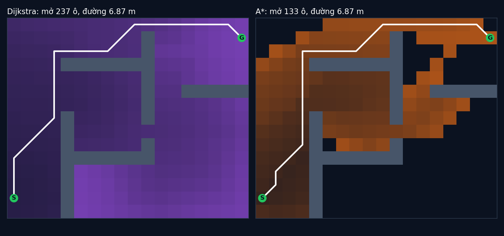

# Tập 1.5 · Tìm đường như Google Maps: A*

> **Mùa 1 · Biết đi** · ⏱ khoảng 40 phút · Độ khó ★★☆ · Cần: Python (list, dict), biết hàng đợi là gì ·
> 📚 Giáo trình: Principles of Robot Autonomy, [Chương 4 · Motion planning](https://porabook.com/book/motion-planning/) (Mục 4.2) ·
> 📺 Video: TikTok [@thanh82k5](https://www.tiktok.com/@thanh82k5) (tìm "Tập 1.5")

[](https://colab.research.google.com/github/thanhpro82/tu-hoc-robot-tu-hanh/blob/main/tap15/tap15_a_sao.ipynb)
Không muốn cài gì? Bấm nút trên để làm toàn bộ bài ngay trên trình duyệt.

**Một câu:** chia căn phòng thành lưới ô rồi tìm đường ngắn nhất từ S tới G. Dijkstra loang đều ra mọi phía và mở 237 ô; A* biết
"đích ở hướng nào" nên chỉ mở 133 ô mà vẫn ra đúng đường ngắn nhất 6,87 m. Bạn tự viết A* từ đầu.



## Trong thư mục này

| File | Dùng khi nào |
|---|---|
| [tap15_a_sao.ipynb](tap15_a_sao.ipynb) | Làm bài trên Colab hoặc Jupyter |
| [bai_tap/a_sao_cua_ban.py](bai_tap/a_sao_cua_ban.py) | **Bạn viết code ở đây** (nếu làm trên máy) |
| [bai_tap/kiem_tra.py](bai_tap/kiem_tra.py) | Tự chấm: in ✅ / ❌ cho từng bài |
| [bai_tap/ve_do_thi.py](bai_tap/ve_do_thi.py) | Vẽ các ô đã mở và đường đi bằng code của bạn, ra `ket_qua.png` |
| [sim/a_sao.py](sim/a_sao.py) | Mô phỏng dùng trong video |
| [bai_tap/loi_giai.py](bai_tap/loi_giai.py) | Lời giải cả 3 bài. Tự làm xong rồi hãy mở |

## 1. Bài toán

Bản đồ 15 × 18 ô, mỗi ô 0,25 m, `#` là tường. Mỗi ô trống là một **đỉnh**, hai ô kề nhau (8 hướng) nối bằng một **cạnh**:
đi ngang/dọc tốn 1, đi chéo tốn √2. Bài toán tìm đường thành bài toán tìm đường ngắn nhất trên đồ thị.

```text
  Dijkstra: luôn mở ô có C(q) nhỏ nhất            A*: luôn mở ô có f(q) = C(q) + h(q) nhỏ nhất
            C = chi phí đã đi từ S tới q                h = khoảng cách chim bay từ q tới G

        ┌─────────────────────────── vòng lặp ───────────────────────────┐
        │ lấy ô q có điểm nhỏ nhất khỏi hàng đợi → mở q (gặp G thì dừng)  │
        │ với mỗi ô kề q2:  nếu C(q) + chi_phí < C(q2) thì                 │
        │     C(q2) ← C(q) + chi_phí,  trước(q2) ← q,  đẩy q2 vào hàng đợi │
        └──────────────────────────────────────────────────────────────────┘
        xong: lần ngược trước(G) → … → S để lấy đường đi
```

Vì sao A* vẫn ra đường **ngắn nhất**? Vì h không bao giờ lớn hơn chi phí thật còn lại (đường chim bay luôn ngắn nhất).
Heuristic như vậy gọi là *admissible*.

## 2. Sau bài này bạn làm được

| # | Bạn có thể… | Kiểm tra bằng | Đạt khi |
|---|---|---|---|
| 1 | Biến lưới ô thành đồ thị (ô kề, chi phí, không cắt góc tường) | `kiem_tra.py` Bài 1 | ✅ cho cả 237 ô |
| 2 | Viết heuristic admissible | `kiem_tra.py` Bài 2 | ✅ |
| 3 | Viết A* (và Dijkstra khi h = 0) bằng hàng đợi ưu tiên | `kiem_tra.py` Bài 3 | ✅, đường 6,87 m, A* mở ít ô hơn Dijkstra |
| 4 | Giải thích vì sao A* nhanh hơn mà vẫn tối ưu | [Câu hỏi tự kiểm tra](#6-câu-hỏi-tự-kiểm-tra) | Tự trả lời được |

## 3. Bạn làm gì

| Bài | Hàm | Việc |
|---|---|---|
| **1** | `ke(o, ban_do)` | Trả về list `((hàng, cột), chi_phí)` của các ô đi sang được |
| **2** | `h_euclid(o, dich)` | Khoảng cách Euclid tính theo đơn vị ô |
| **3** | `tim_duong(bat_dau, dich, ban_do, h)` | A* với `heapq`, trả về `(đường, số ô đã mở, chi phí)` |

Bài 3 được chấm thêm trên 5 bản đồ ngẫu nhiên 20 × 20, so với lời giải. Số ô mở có thể lệch video vài ô nếu bạn xếp các ô "hoà điểm" khác,
điều đó vẫn đúng.

## 4. Bắt đầu

**Cách 1: Colab.** Bấm nút *Open in Colab* ở đầu trang.

**Cách 2: trên máy:**

```bash
cd tu-hoc-robot-tu-hanh/tap15
python -X utf8 sim/a_sao.py            # 1. số liệu trong video
python -X utf8 bai_tap/kiem_tra.py     # 2. lúc đầu: ⏳ chưa làm cả 3 bài
# 3. mở bai_tap/a_sao_cua_ban.py, làm từng bài, chạy lại kiem_tra.py
python -X utf8 bai_tap/ve_do_thi.py    # 4. vẽ bằng code của bạn -> ket_qua.png
```

Kết quả mong đợi của bước 1:

```text
Lưới 15x18, 237 ô trống, mỗi ô 0.25 m, nối 8 hướng
Dijkstra: mở 237 ô, đường đi 26 ô, dài 6.87 m
A*      : mở 133 ô, đường đi 26 ô, dài 6.87 m
```

Kết quả khi làm xong cả 3 bài:

```text
✅ Bài 1 · ô kề: đúng ô kề cho cả 237 ô trống: 8 hướng, chéo √2, không xuyên tường, không cắt góc
✅ Bài 2 · heuristic: h(S) = 20.81 ô: không bao giờ dài hơn đường thật (đường thật 27.49 ô)
✅ Bài 3 · A*: cùng đường 6.87 m; Dijkstra mở 237 ô, A* chỉ mở 133 ô

Đạt 3/3 bài.  🎉 Xong! Thử phần Thử thách trong README nhé.
```

### Lịch gợi ý (40 phút)

| Phút | Việc |
|--:|:--|
| 5 | Xem video, đọc mục 1 |
| 30 | Làm Bài 1 → 2 → 3 (Bài 3 là phần chính) |
| 5 | Câu hỏi tự kiểm tra, chọn 1 thử thách |

## 5. Thử thách (không chấm)

1. **Heuristic "tham":** dùng `h = 3 × khoảng cách Euclid`. A* mở bao nhiêu ô? Đường còn ngắn nhất không?
2. **Chỉ 4 hướng:** bỏ 4 hướng chéo. Đường dài bao nhiêu? Lúc đó heuristic nào hợp hơn Euclid?
3. **Vẽ bản đồ của bạn:** sửa `BAN_DO` trong `sim/a_sao.py` thành nhà bạn hoặc một mê cung, chạy lại.
4. **Tránh sát tường:** cộng thêm chi phí khi đi vào ô sát tường để robot không đi quệt tường (tập cuối của series dùng ý tưởng này).

## 6. Câu hỏi tự kiểm tra

<details><summary>1. Vì sao Dijkstra mở gần như hết bản đồ?</summary>

Dijkstra chỉ nhìn chi phí đã đi `C(q)`, không biết đích ở đâu, nên loang đều như vết dầu theo mọi hướng. Ô nào gần S hơn đích
thì đều được mở trước, kể cả những ô ở phía ngược với đích.
</details>

<details><summary>2. A* "biết hướng" nhờ đâu, và vì sao vẫn chắc chắn ra đường ngắn nhất?</summary>

Nhờ `h(q)`: ô nào gần đích hơn (theo đường chim bay) thì có `f` nhỏ hơn và được mở sớm hơn. Vì h không bao giờ lớn hơn chi phí thật,
A* không bao giờ bỏ qua một đường ngắn hơn chỉ vì "tưởng nó dài". Khi lấy G ra khỏi hàng đợi, không còn đường nào ngắn hơn chưa xét.
</details>

<details><summary>3. Vì sao cấm cắt chéo qua góc tường?</summary>

Trên lưới, đi chéo giữa hai ô tường chạm góc nghĩa là robot chui qua một khe rộng bằng 0. Robot thật có kích thước nên sẽ va vào tường.
</details>

<details><summary>4. Vì sao một ô có thể bị đẩy vào hàng đợi nhiều lần?</summary>

Khi tìm thấy đường rẻ hơn tới ô đó, ta đẩy nó vào lại với điểm mới thay vì sửa bản cũ trong heap (sửa trong heap phức tạp hơn).
Bản cũ vẫn nằm đó, nên khi lấy ra phải kiểm tra "đã mở chưa" để bỏ qua.
</details>

## 7. Giới hạn cần biết

- Robot được coi là một điểm nằm gọn trong một ô; robot thật cần "nở" tường ra theo bán kính robot (xem tập cuối).
- Lưới ô cho đường gấp khúc theo 8 hướng, chưa phải đường mượt nhất ngoài đời thật.
- Bản đồ biết trước và không đổi. Vật cản di chuyển được xử lý ở các tập sau.

## Đọc thêm

- Sách, [Chương 4](https://porabook.com/book/motion-planning/), Mục 4.2: tìm đường trên đồ thị, Dijkstra, A*.
- Tập trước: [1.4 · Bám quỹ đạo](../tap14/) · Tập sau: [1.6 · RRT & PRM](../tap16/)

---
[← Về danh sách tập](../README.md)
