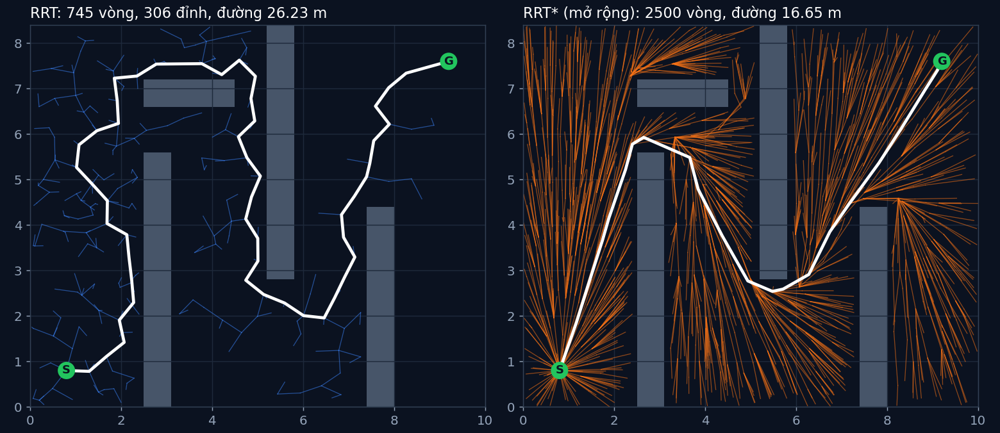

# Tập 1.6 · Tìm đường bằng may rủi: RRT & RRT*

> **Mùa 1 · Biết đi** · ⏱ khoảng 40 phút · Độ khó ★★☆ · Cần: đã làm [tập 1.5](../tap15/) ·
> 📚 Giáo trình: Principles of Robot Autonomy, [Chương 4 · Motion planning](https://porabook.com/book/motion-planning/) (Mục 4.4.2) ·
> 📺 Video: TikTok [@thanh82k5](https://www.tiktok.com/@thanh82k5) (tìm "Tập 1.6")

[](https://colab.research.google.com/github/thanhpro82/tu-hoc-robot-tu-hanh/blob/main/tap16/tap16_rrt.ipynb)
Không muốn cài gì? Bấm nút trên để làm toàn bộ bài ngay trên trình duyệt.

**Một câu:** khi không gian quá lớn để chia lưới (cánh tay 6 khớp, mỗi khớp 100 nấc = 10¹² ô), ta gieo điểm ngẫu nhiên và mọc dần một cây
từ điểm xuất phát. RRT tìm ra đường sau 745 vòng nhưng đường ngoằn ngoèo 26,23 m; RRT* (mở rộng) nắn lại còn 16,65 m. Bạn tự viết RRT.



## Trong thư mục này

| File | Dùng khi nào |
|---|---|
| [tap16_rrt.ipynb](tap16_rrt.ipynb) | Làm bài trên Colab hoặc Jupyter |
| [bai_tap/rrt_cua_ban.py](bai_tap/rrt_cua_ban.py) | **Bạn viết code ở đây** (nếu làm trên máy) |
| [bai_tap/kiem_tra.py](bai_tap/kiem_tra.py) | Tự chấm: in ✅ / ❌ cho từng bài |
| [bai_tap/ve_do_thi.py](bai_tap/ve_do_thi.py) | Vẽ cây RRT của bạn cạnh RRT*, ra `ket_qua.png` |
| [sim/rrt.py](sim/rrt.py) | Mô phỏng dùng trong video (RRT, RRT*, tỉ lệ tìm thấy) |
| [bai_tap/loi_giai.py](bai_tap/loi_giai.py) | Lời giải cả 3 bài. Tự làm xong rồi hãy mở |

## 1. Bài toán

A* ở tập 1.5 cần chia không gian thành lưới. Với robot nhiều khớp, số ô tăng theo cấp số mũ: 2 khớp là 10.000 ô, 6 khớp là 10¹² ô.
RRT (Rapidly-exploring Random Tree) không chia lưới mà **gieo điểm ngẫu nhiên** rồi cho cây mọc về phía đó:

```text
 mỗi vòng:
   1. gieo q_rand ngẫu nhiên (10% số lần gieo thẳng vào đích: "goal biasing")
   2. tìm đỉnh gần q_rand nhất trên cây:  q_near
   3. từ q_near tiến về phía q_rand một bước 0,5 m:  q_new          q_rand ·
   4. đoạn q_near → q_new không xuyên tường?  → gắn q_new vào cây            ╲
   5. q_new đủ gần đích (< 0,4 m)?  → xong, lần theo cha về S         q_new ●
                                                                            │ 0,5 m
                                                                    q_near ●─── cây
```

Vì điểm gieo phủ đều không gian, cây có xu hướng mọc vào những vùng còn trống. Gieo đủ lâu thì gần như chắc chắn tìm ra đường
(trong mô phỏng: sau 1000 vòng, 100% số lần chạy đã tìm ra). Nhưng đường đầu tiên thường ngoằn ngoèo.
**RRT\*** (mở rộng, ngoài phạm vi bài tập) chọn cha rẻ nhất trong bán kính 1,2 m và nối lại các đỉnh lân cận, nên đường ngắn dần theo thời gian.

## 2. Sau bài này bạn làm được

| # | Bạn có thể… | Kiểm tra bằng | Đạt khi |
|---|---|---|---|
| 1 | Tìm đỉnh gần nhất trên cây | `kiem_tra.py` Bài 1 | ✅ |
| 2 | Viết bước "tiến về phía" (steer) | `kiem_tra.py` Bài 2 | ✅ |
| 3 | Viết vòng lặp RRT có goal biasing và kiểm tra va chạm | `kiem_tra.py` Bài 3 | ✅, 745 vòng, 306 đỉnh, đường 26,23 m như video |
| 4 | Giải thích khi nào dùng RRT thay A*, và vì sao đường RRT xấu | [Câu hỏi tự kiểm tra](#6-câu-hỏi-tự-kiểm-tra) | Tự trả lời được |

## 3. Bạn làm gì

| Bài | Hàm | Việc |
|---|---|---|
| **1** | `gan_nhat(V, q)` | Chỉ số đỉnh gần q nhất |
| **2** | `tien_ve(q_near, q_rand, buoc)` | Điểm cách q_near đúng `buoc` về phía q_rand (không vượt quá q_rand) |
| **3** | `rrt(seed, toi_da)` | Vòng lặp 5 bước ở trên. Docstring ghi rõ thứ tự gọi `rng` để ra đúng số trong video |

Hàm kiểm tra va chạm `khong_va_cham(a, b)` và bản đồ có sẵn. Nếu bạn gọi `rng` theo thứ tự khác, đường vẫn được chấm đúng nếu hợp lệ,
chỉ là số vòng sẽ khác video.

## 4. Bắt đầu

**Cách 1: Colab.** Bấm nút *Open in Colab* ở đầu trang.

**Cách 2: trên máy:**

```bash
cd tu-hoc-robot-tu-hanh/tap16
python -X utf8 sim/rrt.py              # 1. số liệu trong video (mất vài giây cho phần 30 lần chạy)
python -X utf8 bai_tap/kiem_tra.py     # 2. lúc đầu: ⏳ chưa làm cả 3 bài
# 3. mở bai_tap/rrt_cua_ban.py, làm từng bài, chạy lại kiem_tra.py
python -X utf8 bai_tap/ve_do_thi.py    # 4. vẽ cây của bạn -> ket_qua.png
```

Kết quả mong đợi của bước 1:

```text
Không gian 10.0x8.4 m, bước 0.5 m, goal bias α = 0.1
Lưới 100 nấc/khớp: robot 2 khớp = 10,000 ô, cánh tay 6 khớp = 1,000,000,000,000 ô
RRT : tìm thấy đường sau 745 vòng, cây 306 đỉnh, đường dài 26.23 m
RRT*: sau  300 vòng, đường tốt nhất dài inf m
RRT*: sau  800 vòng, đường tốt nhất dài 16.81 m
RRT*: sau 1500 vòng, đường tốt nhất dài 16.65 m
RRT*: sau 2500 vòng, đường tốt nhất dài 16.65 m
Đường thẳng xuất phát→đích (không tính tường): 10.81 m
Sau  250 vòng: 3% số lần chạy đã tìm ra đường
Sau  500 vòng: 70% số lần chạy đã tìm ra đường
Sau 1000 vòng: 100% số lần chạy đã tìm ra đường
Sau 2000 vòng: 100% số lần chạy đã tìm ra đường
Sau 4000 vòng: 100% số lần chạy đã tìm ra đường
```

(`inf` nghĩa là sau 300 vòng RRT* chưa tìm ra đường nào.)

Kết quả khi làm xong cả 3 bài:

```text
✅ Bài 1 · đỉnh gần nhất: tìm đúng đỉnh gần nhất (cách đơn giản: duyệt hết, mỗi lần O(n))
✅ Bài 2 · tiến một bước: tiến đúng một bước 0.5 m về phía điểm ngẫu nhiên, không vượt quá điểm đó
✅ Bài 3 · vòng lặp RRT: giống hệt video: 745 vòng, cây 306 đỉnh, đường 26.23 m; 10 seed khác tìm ra 10/10

Đạt 3/3 bài.  🎉 Xong! Thử phần Thử thách trong README nhé.
```

### Lịch gợi ý (40 phút)

| Phút | Việc |
|--:|:--|
| 5 | Xem video, đọc mục 1 |
| 30 | Làm Bài 1 → 2 → 3 |
| 5 | Câu hỏi tự kiểm tra, chọn 1 thử thách |

## 5. Thử thách (không chấm)

1. **Goal bias:** đổi `ALPHA` thành 0 rồi 0,5. Tìm ra đường nhanh hơn hay chậm hơn? Có khi nào bias cao lại hại không?
2. **Bước dài:** đổi `BUOC` thành 1,5 m. Cây mọc nhanh hơn, nhưng có chui được qua khe hẹp không?
3. **Làm mượt:** viết hàm "đi tắt": với mỗi cặp điểm trên đường, nếu đoạn thẳng nối chúng không va chạm thì bỏ các điểm ở giữa. Đường còn dài bao nhiêu?
4. **RRT\*:** đọc phần `sao=True` trong `sim/rrt.py`. Vẽ độ dài đường tốt nhất theo số vòng (`RRT_SAO["lich_su"]`).

## 6. Câu hỏi tự kiểm tra

<details><summary>1. Khi nào nên dùng RRT thay cho A*?</summary>

Khi không gian có nhiều chiều (robot nhiều khớp, xe có cả vị trí lẫn hướng và tốc độ). Lưới ô của A* tăng theo cấp số mũ với số chiều,
còn RRT chỉ cần kiểm tra va chạm cho các điểm nó gieo. Với bản đồ 2D nhỏ thì A* vẫn tốt hơn: nhanh và cho đường ngắn nhất.
</details>

<details><summary>2. Vì sao đường RRT ngoằn ngoèo?</summary>

Cây chỉ quan tâm "có tới được không", không quan tâm "đường ngắn không". Mỗi đỉnh mới nối vào đỉnh gần nhất lúc đó, theo hướng ngẫu nhiên,
nên đường từ gốc tới đích là chuỗi các bước ngẫu nhiên. RRT* sửa điều này bằng cách chọn cha rẻ nhất và nối lại các đỉnh lân cận.
</details>

<details><summary>3. "Đầy đủ theo xác suất" nghĩa là gì?</summary>

Nếu có đường đi, xác suất RRT tìm ra nó tiến về 1 khi số vòng tăng lên, nhưng không có số vòng cố định nào đảm bảo 100%. Mô phỏng cho thấy:
3% số lần chạy tìm ra sau 250 vòng, 70% sau 500 vòng, 100% sau 1000 vòng (trong 30 lần chạy).
</details>

<details><summary>4. Goal biasing giúp gì?</summary>

10% số lần gieo, ta gieo thẳng vào đích, nên cây có xu hướng vươn về phía đích thay vì chỉ lan đều. Không có nó cây vẫn tới, nhưng chậm hơn.
Bias quá cao thì cây cứ đâm vào tường chắn giữa nó và đích.
</details>

## 7. Giới hạn cần biết

- Robot được coi là một điểm, tường được nới thêm 0,1 m cho an toàn.
- Kiểm tra va chạm bằng cách lấy điểm cách nhau 5 cm trên mỗi đoạn, có thể bỏ sót vật cản mỏng hơn 5 cm.
- RRT\* trong code là phần **mở rộng** theo bài báo của Karaman & Frazzoli (2011) mà sách trích dẫn, không thuộc phần bài tập.
- Tìm đỉnh gần nhất bằng cách duyệt hết (chậm khi cây lớn). Thư viện thật dùng cây k-d.

## Đọc thêm

- Sách, [Chương 4](https://porabook.com/book/motion-planning/), Mục 4.4: lập kế hoạch dựa trên lấy mẫu (PRM, RRT).
- Tập trước: [1.5 · A*](../tap15/) · Tập sau: [1.7 · Tổng kết Mùa 1](../tap17/)

---
[← Về danh sách tập](../README.md)
