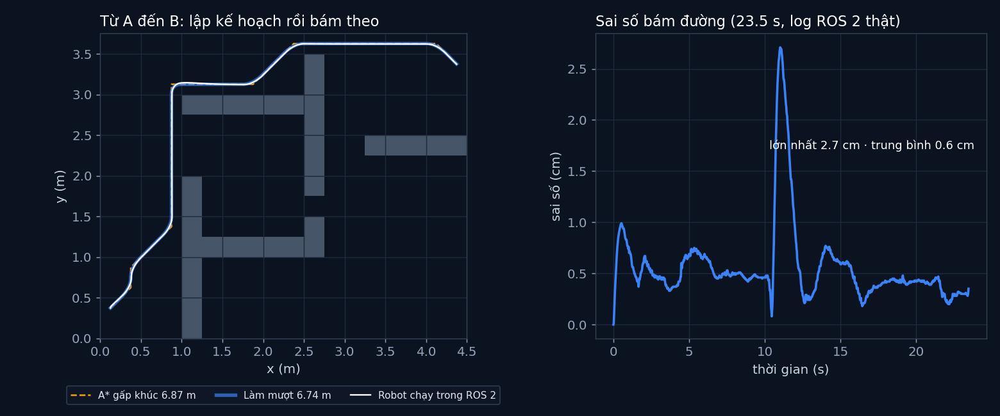

# Tập 1.7 · Tổng kết Mùa 1: robot tự đi từ A đến B (ROS 2)

> **Mùa 1 · Biết đi** · ⏱ khoảng 45 phút (+ 15 phút nếu chạy ROS 2) · Độ khó ★★☆ · Cần: đã làm [1.2](../tap12/), [1.4](../tap14/), [1.5](../tap15/); Docker nếu muốn chạy ROS 2 ·
> 📚 Giáo trình: Principles of Robot Autonomy, Chương 1–4 ·
> 📺 Video: TikTok [@thanh82k5](https://www.tiktok.com/@thanh82k5) (tìm "Tập 1.7")

[](https://colab.research.google.com/github/thanhpro82/tu-hoc-robot-tu-hanh/blob/main/tap17/tap17_a_den_b.ipynb)
Phần bài tập là Python thuần, làm được trên Colab. Phần chạy cả hệ thống ROS 2 thì cần Docker trên máy.

**Một câu:** ghép cả Mùa 1 thành ba chương trình ROS 2 chạy thật: `planner` tìm đường bằng A* rồi làm mượt, `controller` gắn thời gian
cho đường và bám theo bằng phẳng vi phân, `robot` mô phỏng xe 2 bánh có bánh yếu. Kết quả: tới đích sau 23,5 s, sai số trung bình 0,6 cm.
Bạn tự viết ba mảnh Python nằm bên trong hai node đầu.



## Trong thư mục này

| File | Dùng khi nào |
|---|---|
| [tap17_a_den_b.ipynb](tap17_a_den_b.ipynb) | Làm bài trên Colab hoặc Jupyter |
| [bai_tap/duong_cua_ban.py](bai_tap/duong_cua_ban.py) | **Bạn viết code ở đây** (nếu làm trên máy) |
| [bai_tap/kiem_tra.py](bai_tap/kiem_tra.py) | Tự chấm: in ✅ / ❌ cho từng bài |
| [bai_tap/ve_do_thi.py](bai_tap/ve_do_thi.py) | Vẽ đường của bạn cùng log ROS 2, ra `ket_qua.png` |
| [ws/planner_node.py](ws/planner_node.py) | Node lập kế hoạch: A* + làm mượt, phát `/path` |
| [ws/controller_node.py](ws/controller_node.py) | Node điều khiển: gắn thời gian, bám đường, phát `/cmd_vel`, ghi `log.csv` |
| [ws/robot_node.py](ws/robot_node.py) | Node robot: xe 2 bánh mô phỏng, nghe `/cmd_vel`, phát `/pose` |
| [ws/demo.sh](ws/demo.sh), [ws/demo-output.txt](ws/demo-output.txt), [ws/log.csv](ws/log.csv) | Script chạy cả hệ thống, output và log của lần chạy trong video |
| [bai_tap/loi_giai.py](bai_tap/loi_giai.py) | Lời giải cả 3 bài. Tự làm xong rồi hãy mở |

## 1. Bài toán

Ba node nói chuyện với nhau qua topic (xem lại [tập 0.3](../tap03/)):

```text
 ┌────────────────────┐   /path (1 lần)    ┌──────────────────────────────┐   /cmd_vel (50 Hz)   ┌──────────────────┐
 │ planner            │───────────────────►│ controller                   │────────────────────►│ robot            │
 │ A* (tập 1.5)       │                    │ gắn thời gian: hình thang    │                     │ xe 2 bánh (0.2)  │
 │ + làm mượt Chaikin │                    │   (tập 1.2)                  │◄────────────────────│ bánh yếu, nhiễu  │
 └────────────────────┘                    │ bám đường: phẳng vi phân     │   /pose (100 Hz)    └──────────────────┘
                                           │   + PD (tập 1.4)             │
                                           └──────────────────────────────┘
```

Ba mảnh ghép mới so với các tập trước:

1. **Làm mượt:** đường A* gấp khúc theo ô lưới, robot không quẹo gắt được. Cắt góc Chaikin thay mỗi góc nhọn bằng một đường cong.
2. **Gắn thời gian:** A* chỉ cho "đi qua đâu", chưa cho "lúc nào ở đâu". Controller cho robot ảo chạy dọc đường theo đồ thị tốc độ hình thang (tối đa 0,3 m/s).
3. **Điểm theo quãng đường:** biết lúc t robot ảo phải đi được s mét, cần tìm điểm (x, y) nằm trên đường cách đầu đường s mét.

## 2. Sau bài này bạn làm được

| # | Bạn có thể… | Kiểm tra bằng | Đạt khi |
|---|---|---|---|
| 1 | Làm mượt đường gấp khúc bằng cắt góc Chaikin | `kiem_tra.py` Bài 1 | ✅, 208 điểm, dài 6,74 m như log của planner |
| 2 | Gắn thời gian cho đường theo hình thang | `kiem_tra.py` Bài 2 | ✅, chạy hết 23,5 s như log của controller |
| 3 | Nội suy điểm trên đường theo quãng đường | `kiem_tra.py` Bài 3 | ✅ |
| 4 | Chạy cả hệ thống ROS 2 và đọc log | `ws/demo.sh` | Ra dòng `TỚI ĐÍCH sau 23.5 s` |

## 3. Bạn làm gì

| Bài | Hàm | Việc |
|---|---|---|
| **1** | `lam_muot(pts, lan)` | Mỗi đoạn a → b thay bằng 2 điểm ở 1/4 và 3/4, giữ 2 đầu, lặp `lan` lần |
| **2** | `s_tai(t, L, v_ref, a_ref)` | Quãng đường theo thời gian của hình thang, kẹp t trong [0, T] |
| **3** | `diem_tai(pts, s_cong_don, s)` | Tìm đoạn chứa s (bisect) rồi nội suy tuyến tính |

## 4. Bắt đầu

**Cách 1: Colab** (chỉ phần bài tập). Bấm nút *Open in Colab* ở đầu trang.

**Cách 2: trên máy:**

```bash
cd tu-hoc-robot-tu-hanh/tap17
python -X utf8 bai_tap/kiem_tra.py     # 1. lúc đầu: ⏳ chưa làm cả 3 bài
# 2. mở bai_tap/duong_cua_ban.py, làm từng bài, chạy lại kiem_tra.py
python -X utf8 bai_tap/ve_do_thi.py    # 3. vẽ đường của bạn cùng log ROS 2 -> ket_qua.png
```

**Chạy cả hệ thống ROS 2** (cần Docker; image `ros:jazzy` khoảng 1 GB, tải lần đầu hơi lâu). Từ thư mục `tap17`:

```bash
docker run --rm -v "$PWD/ws:/ws" ros:jazzy bash /ws/demo.sh
```

Script bật `robot` và `planner`, liệt kê node và topic, rồi chạy `controller` tới khi robot tới đích (log mới ghi đè `ws/log.csv`).
Output trong video (bỏ dấu thời gian):

```text
[robot]: Robot ở (0.12, 0.38), bánh phải yếu, đang nghe /cmd_vel
[planner]: A*: mở 133 ô, đường 26 ô dài 6.87 m -> làm mượt 208 điểm, dài 6.74 m
$ ros2 node list
/planner
/robot
$ ros2 topic list
/cmd_vel
/parameter_events
/path
/pose
/rosout
[controller]: Nhận đường dài 6.74 m, dự kiến chạy 23.5 s
[controller]: TỚI ĐÍCH sau 23.5 s | sai số lớn nhất 2.7 cm | trung bình 0.6 cm | cách đích 0.3 cm
```

Kết quả khi làm xong cả 3 bài:

```text
✅ Bài 1 · làm mượt đường: đường A* 6.87 m → làm mượt 208 điểm, dài 6.74 m như log của planner
✅ Bài 2 · gắn thời gian (hình thang): đường 6.74 m chạy hết trong 23.5 s như log của controller
✅ Bài 3 · điểm theo quãng đường: lấy đúng điểm cần tới theo quãng đường: ghép với Bài 2 là có robot ảo để controller bám theo

Đạt 3/3 bài.  🎉 Xong! Thử phần Thử thách trong README nhé.
```

### Lịch gợi ý (45 phút)

| Phút | Việc |
|--:|:--|
| 10 | Xem video, đọc mục 1 và lướt 3 file node trong `ws/` |
| 25 | Làm Bài 1 → 2 → 3 |
| 10 | Chạy ROS 2 bằng Docker (nếu có), hoặc làm 1 thử thách |

## 5. Thử thách (không chấm)

1. **Bỏ làm mượt:** trong `planner_node.py` gửi thẳng đường A* gấp khúc. Sai số lớn nhất của controller tăng lên bao nhiêu?
2. **Chạy nhanh hơn:** tăng `V_REF` trong `controller_node.py` lên 0,5 m/s. Tới đích nhanh hơn, sai số thì sao?
3. **Đổi đích:** sửa chữ `G` trong bản đồ của `ws/a_sao.py` sang chỗ khác rồi chạy lại cả hệ thống.
4. **Xem topic:** trong lúc chạy, mở thêm một terminal vào container và gõ `ros2 topic echo /pose` để xem robot báo vị trí.

## 6. Câu hỏi tự kiểm tra

<details><summary>1. Vì sao tách thành 3 node thay vì viết 1 chương trình?</summary>

Mỗi node làm một việc và chỉ nói chuyện qua topic. Muốn thay robot mô phỏng bằng robot thật thì chỉ thay node `robot`, hai node kia
giữ nguyên vì vẫn nhận `/pose` và gửi `/cmd_vel` như cũ. Đó là lý do ROS 2 được dùng rộng rãi (tập 0.3).
</details>

<details><summary>2. Làm mượt làm đường ngắn đi (6,87 → 6,74 m). Vì sao?</summary>

Cắt góc Chaikin thay mỗi góc nhọn bằng đường cong đi "tắt" phía trong góc, nên tổng chiều dài giảm. Đường mới không còn đi đúng tâm các ô,
nên trong thực tế phải chắc rằng đường cắt góc không sát tường quá.
</details>

<details><summary>3. Tại sao controller cần "robot ảo chạy theo thời gian" mà không chỉ nhắm điểm gần nhất?</summary>

Phẳng vi phân ở tập 1.4 cần vị trí, vận tốc và gia tốc mong muốn tại mỗi thời điểm. Gắn thời gian bằng hình thang cho ta cả ba
(vận tốc và gia tốc lấy bằng sai phân), lại đảm bảo robot xuất phát và dừng êm.
</details>

<details><summary>4. Vì sao topic /path dùng QoS "transient_local"?</summary>

Planner chỉ phát đường **một lần** lúc khởi động. Controller bật sau vài giây. Transient_local giữ lại tin nhắn cuối để node đến sau vẫn nhận được,
nếu không controller sẽ chờ mãi.
</details>

## 7. Giới hạn cần biết

- Robot là mô phỏng chạy trong node `robot`, không có Gazebo hay robot thật. Vị trí robot được báo chính xác (không cần định vị, Mùa 3 mới học).
- Bản đồ biết trước, không có vật cản bất ngờ.
- Vận tốc và gia tốc của robot ảo lấy bằng sai phân số, nên có nhiễu nhỏ ở chỗ nối các đoạn thẳng.

## Đọc thêm

- Sách, Chương 1–4: mô hình robot, điều khiển vòng hở, vòng kín, lập kế hoạch đường đi.
- Tập trước: [1.6 · RRT](../tap16/) · Mùa sau: [2.1 · Giác quan của robot](../tap21/)

---
[← Về danh sách tập](../README.md)
