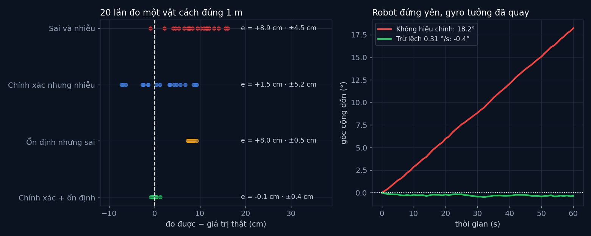

# Tập 2.1 · Giác quan của robot

> **Mùa 2 · Biết nhìn** · ⏱ khoảng 25 phút · Độ khó ★☆☆ · Cần: Python cơ bản, biết trung bình và độ lệch chuẩn ·
> 📚 Giáo trình: Principles of Robot Autonomy, [Chương 5 · Robot sensors](https://porabook.com/book/robot-sensors/) ·
> 📺 Video: TikTok [@thanh82k5](https://www.tiktok.com/@thanh82k5) (tìm "Tập 2.1")

[](https://colab.research.google.com/github/thanhpro82/tu-hoc-robot-tu-hanh/blob/main/tap21/tap21_cam_bien.ipynb)
Không muốn cài gì? Bấm nút trên để làm toàn bộ bài ngay trên trình duyệt.

**Một câu:** robot "thấy" thế giới qua cảm biến, và cảm biến nào cũng sai theo hai kiểu: lệch đều (không chính xác) và dao động
(không ổn định). Gyro rẻ để yên 60 giây tưởng mình đã quay 18,2°. Bạn tự tính khoảng cách từ thời gian bay, đánh giá 4 cảm biến, và hiệu
chỉnh gyro để còn trôi chưa tới 1°.



## Trong thư mục này

| File | Dùng khi nào |
|---|---|
| [tap21_cam_bien.ipynb](tap21_cam_bien.ipynb) | Làm bài trên Colab hoặc Jupyter |
| [bai_tap/cam_bien_cua_ban.py](bai_tap/cam_bien_cua_ban.py) | **Bạn viết code ở đây** (nếu làm trên máy) |
| [bai_tap/kiem_tra.py](bai_tap/kiem_tra.py) | Tự chấm: in ✅ / ❌ cho từng bài |
| [bai_tap/ve_do_thi.py](bai_tap/ve_do_thi.py) | Vẽ 4 cảm biến và gyro bằng code của bạn, ra `ket_qua.png` |
| [sim/cam_bien.py](sim/cam_bien.py) | Mô phỏng dùng trong video |
| [bai_tap/loi_giai.py](bai_tap/loi_giai.py) | Lời giải cả 3 bài. Tự làm xong rồi hãy mở |

## 1. Bài toán

**Thời gian bay.** Siêu âm và LiDAR đều phát sóng rồi đo thời gian sóng dội về. Sóng đi tới vật rồi quay lại, nên:

```text
  cảm biến ))))))))))))))►  vật         quãng sóng đi = 2d     →    d = c·t / 2
           ◄((((((((((((((              siêu âm: c = 343 m/s · ánh sáng: c = 3·10⁸ m/s
```

**Chính xác và ổn định** là hai thứ khác nhau. Với sai số `e = m − v` (đo được trừ giá trị thật):

```text
      chính xác + ổn định      ổn định nhưng sai       chính xác nhưng nhiễu      sai và nhiễu
            ◎ ●●                    ◎    ●●              ●  ◎  ●   ●            ◎     ●  ●
                                                           ●   ●                    ●    ●
      trung bình đúng chỗ,     tụm lại nhưng lệch     trung bình đúng chỗ,      vừa lệch vừa
      tụm lại                  một khoảng            nhưng tản ra              tản ra
```

**Trôi.** Gyro đo tốc độ quay; muốn biết góc thì cộng dồn (tích phân). Một chút lệch 0,3 °/s, cộng dồn 60 giây thành 18°.

## 2. Sau bài này bạn làm được

| # | Bạn có thể… | Kiểm tra bằng | Đạt khi |
|---|---|---|---|
| 1 | Tính khoảng cách từ thời gian bay | `kiem_tra.py` Bài 1 | ✅ |
| 2 | Đo độ chính xác (sai số hệ thống) và độ ổn định (độ lệch chuẩn) | `kiem_tra.py` Bài 2 | ✅, đúng 4 cặp số như video |
| 3 | Hiệu chỉnh lệch của gyro bằng cách đo khi đứng yên | `kiem_tra.py` Bài 3 | ✅, trôi 18,2° → dưới 1° |
| 4 | Phân biệt lỗi nào sửa được bằng hiệu chỉnh, lỗi nào không | [Câu hỏi tự kiểm tra](#6-câu-hỏi-tự-kiểm-tra) | Tự trả lời được |

## 3. Bạn làm gì

| Bài | Hàm | Việc |
|---|---|---|
| **1** | `khoang_cach(t, c)` | `d = c·t/2` |
| **2** | `danh_gia(cac_lan_do, gia_tri_that)` | Trả về `(e, độ lệch chuẩn mẫu)` |
| **3** | `uoc_luong_lech(mau)`, `goc_tich_phan(mau, dt, lech)` | Lệch = trung bình mẫu lúc đứng yên; góc = Σ(mẫu − lệch)·dt |

Ở Bài 3, bộ chấm cho robot đứng yên 10 giây lúc khởi động để bạn đo lệch, rồi cộng dồn 60 giây tiếp theo đã trừ lệch.

## 4. Bắt đầu

**Cách 1: Colab.** Bấm nút *Open in Colab* ở đầu trang.

**Cách 2: trên máy:**

```bash
cd tu-hoc-robot-tu-hanh/tap21
python -X utf8 sim/cam_bien.py         # 1. số liệu trong video
python -X utf8 bai_tap/kiem_tra.py     # 2. lúc đầu: ⏳ chưa làm cả 3 bài
# 3. mở bai_tap/cam_bien_cua_ban.py, làm từng bài, chạy lại kiem_tra.py
python -X utf8 bai_tap/ve_do_thi.py    # 4. vẽ bằng code của bạn -> ket_qua.png
```

Kết quả mong đợi của bước 1:

```text
Siêu âm: vật cách 1 m -> tiếng vang về sau 5.83 ms
LiDAR  : vật cách 1 m -> tia sáng về sau 6.67 ns
chinh_xac_on_dinh : trung bình 0.999 m (sai số e = -0.1 cm), dao động ±0.4 cm
on_dinh_sai       : trung bình 1.080 m (sai số e = +8.0 cm), dao động ±0.5 cm
chinh_xac_nhieu   : trung bình 1.015 m (sai số e = +1.5 cm), dao động ±5.2 cm
sai_va_nhieu      : trung bình 1.089 m (sai số e = +8.9 cm), dao động ±4.5 cm
Gyro rẻ, đứng yên 60 s: tưởng đã quay 18.2°
Gyro đã hiệu chỉnh, 60 s: tưởng đã quay 0.8°
```

Kết quả khi làm xong cả 3 bài:

```text
✅ Bài 1 · thời gian bay: siêu âm về sau 5.83 ms, LiDAR sau 6.67 ns, đều là vật cách 1 m như video
✅ Bài 2 · chính xác và ổn định: 4 cảm biến (cm): -0.1±0.4 · +8.0±0.5 · +1.5±5.2 · +8.9±4.5 như video
✅ Bài 3 · hiệu chỉnh gyro: không hiệu chỉnh: trôi 18.2° như video; đo lệch 10 s đứng yên được 0.310 °/s, trừ đi thì 60 s chỉ trôi -0.4°

Đạt 3/3 bài.  🎉 Xong! Thử phần Thử thách trong README nhé.
```

### Lịch gợi ý (25 phút)

| Phút | Việc |
|--:|:--|
| 5 | Xem video, đọc mục 1 |
| 15 | Làm Bài 1 → 2 → 3 |
| 5 | Câu hỏi tự kiểm tra, chọn 1 thử thách |

## 5. Thử thách (không chấm)

1. **Đo lâu hơn:** đo lệch gyro trong 1 s, 10 s, 60 s. Ước lượng chính xác dần thế nào? (Gợi ý: sai số giảm theo √n.)
2. **Lấy trung bình:** với cảm biến "chính xác nhưng nhiễu", lấy trung bình 5 lần đo liên tiếp thì dao động còn bao nhiêu?
3. **Nhiệt độ:** tốc độ âm thanh đổi theo nhiệt độ (khoảng 331 + 0,6·T m/s). Nếu tính bằng 343 m/s mà trời 35 °C thì đo 2 m sai bao nhiêu?
4. **Thời gian chính xác:** LiDAR muốn đo chính xác 1 cm thì phải đo thời gian chính xác tới bao nhiêu nano giây?

## 6. Câu hỏi tự kiểm tra

<details><summary>1. Cảm biến "ổn định nhưng sai" và "chính xác nhưng nhiễu", cái nào dễ sửa hơn?</summary>

"Ổn định nhưng sai" dễ sửa hơn: lệch đều +8 cm thì cứ trừ đi 8 cm (hiệu chỉnh) là xong. Nhiễu ngẫu nhiên thì không trừ được,
chỉ giảm được bằng cách đo nhiều lần rồi lấy trung bình, hoặc kết hợp với cảm biến khác (Mùa 3).
</details>

<details><summary>2. Vì sao gyro trôi tăng đều theo thời gian?</summary>

Góc là tổng cộng dồn của (tốc độ đo được × dt). Phần lệch 0,3 °/s lúc nào cũng có, nên mỗi giây cộng thêm 0,3°: 60 giây thành 18°.
Phần nhiễu thì lúc dương lúc âm, phần lớn tự triệt tiêu nhau.
</details>

<details><summary>3. Đã hiệu chỉnh rồi, vì sao gyro vẫn trôi một chút?</summary>

Ước lượng lệch từ 10 giây đứng yên không thể đúng tuyệt đối (còn nhiễu), và nhiễu ngẫu nhiên cộng dồn cũng tạo ra trôi nhỏ.
Ngoài đời lệch còn thay đổi theo nhiệt độ. Vì vậy robot cần thêm cảm biến khác (la bàn, camera, LiDAR) để sửa góc, đó là chuyện của Mùa 3.
</details>

<details><summary>4. Vì sao LiDAR khó chế tạo hơn siêu âm dù cùng nguyên lý?</summary>

Ánh sáng nhanh hơn âm thanh gần 1 triệu lần: vật cách 1 m thì tia sáng về sau 6,67 ns, còn tiếng vang về sau 5,83 ms. Đo thời gian
cỡ nano giây cần mạch điện tử rất nhanh và đắt.
</details>

## 7. Giới hạn cần biết

- Các thông số cảm biến (lệch 8 cm, nhiễu 5 cm, gyro lệch 0,3 °/s…) là **giả định** để minh hoạ, không lấy từ cảm biến cụ thể nào.
- Nhiễu được giả sử là phân phối chuẩn và độc lập giữa các lần đo. Cảm biến thật có thể có nhiễu phụ thuộc nhau, phụ thuộc nhiệt độ.
- Tốc độ âm thanh 343 m/s là giá trị vật lý chuẩn ở khoảng 20 °C, sách không nêu số này.

## Đọc thêm

- Sách, [Chương 5](https://porabook.com/book/robot-sensors/): phân loại cảm biến, sai số, thời gian bay, IMU.
- Tập trước: [1.7 · Tổng kết Mùa 1](../tap17/) · Tập sau: [2.2 · Camera lỗ kim](../tap22/)

---
[← Về danh sách tập](../README.md)
