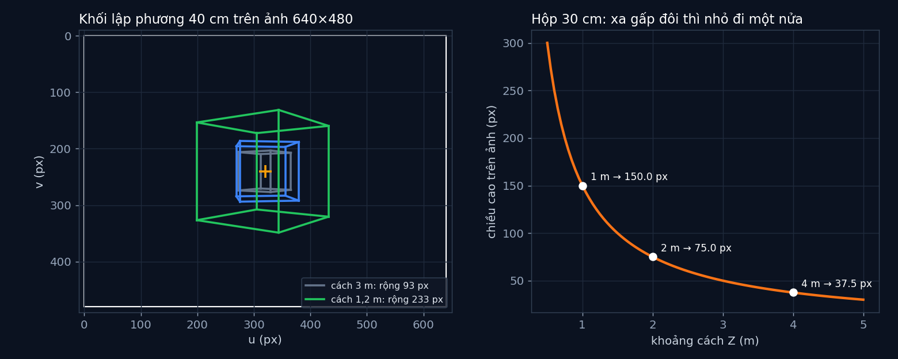

# Tập 2.2 · Camera thực ra là cái hộp có lỗ

> **Mùa 2 · Biết nhìn** · ⏱ khoảng 30 phút · Độ khó ★★☆ · Cần: nhân ma trận với véc-tơ ·
> 📚 Giáo trình: Principles of Robot Autonomy, [Chương 6 · Camera models](https://porabook.com/book/camera-models/) ·
> 📺 Video: TikTok [@thanh82k5](https://www.tiktok.com/@thanh82k5) (tìm "Tập 2.2")

[](https://colab.research.google.com/github/thanhpro82/tu-hoc-robot-tu-hanh/blob/main/tap22/tap22_camera.ipynb)
Không muốn cài gì? Bấm nút trên để làm toàn bộ bài ngay trên trình duyệt.

**Một câu:** mọi camera, từ điện thoại tới xe tự lái, đều làm cùng một phép tính: chia toạ độ cho khoảng cách Z. Bạn tự viết ma trận K,
phép chiếu một điểm 3D thành pixel, và thấy vì sao một tấm ảnh không cho biết vật to hay vật gần.



## Trong thư mục này

| File | Dùng khi nào |
|---|---|
| [tap22_camera.ipynb](tap22_camera.ipynb) | Làm bài trên Colab hoặc Jupyter |
| [bai_tap/camera_cua_ban.py](bai_tap/camera_cua_ban.py) | **Bạn viết code ở đây** (nếu làm trên máy) |
| [bai_tap/kiem_tra.py](bai_tap/kiem_tra.py) | Tự chấm: in ✅ / ❌ cho từng bài |
| [bai_tap/ve_do_thi.py](bai_tap/ve_do_thi.py) | Vẽ khối lập phương bằng phép chiếu của bạn, ra `ket_qua.png` |
| [sim/pinhole.py](sim/pinhole.py) | Mô phỏng dùng trong video |
| [bai_tap/loi_giai.py](bai_tap/loi_giai.py) | Lời giải cả 3 bài. Tự làm xong rồi hãy mở |

## 1. Bài toán

Camera lỗ kim: tia sáng từ điểm P đi qua một lỗ nhỏ rồi in lên mặt sau hộp. Tam giác đồng dạng cho ngay:

```text
         P (X, Y, Z)                  x = f·X / Z
          ●                           y = f·Y / Z
           ╲
            ╲           lỗ                   vật xa gấp đôi  →  ảnh nhỏ đi một nửa
   ──────────╲──────────●──────── trục Z
              ╲         │← f →│
               ╲               ● ảnh của P (ngược chiều)
```

Đổi sang pixel thì cần thêm tiêu cự theo pixel (α, β), độ xiên γ và tâm ảnh (u₀, v₀), gom lại thành **ma trận tham số nội** K.
Nếu camera đặt ở chỗ khác hoặc xoay đi, trước hết đổi điểm sang toạ độ camera bằng phép quay R và dời t (6 **tham số ngoại**):

```text
            ┌ α  γ  u₀ ┐                       ┌ u·s ┐
      K  =  │ 0  β  v₀ │           p  =  K·(R·P_W + t)  =  │ v·s │    →   u = p₀/p₂,  v = p₁/p₂
            └ 0  0  1  ┘                       └  s  ┘
```

Camera trong bài: ảnh 640 × 480, α = β = 500 px, γ = 0, tâm ảnh (320, 240).

## 2. Sau bài này bạn làm được

| # | Bạn có thể… | Kiểm tra bằng | Đạt khi |
|---|---|---|---|
| 1 | Lập ma trận tham số nội K | `kiem_tra.py` Bài 1 | ✅ |
| 2 | Chiếu điểm 3D thành pixel, kể cả khi camera xoay và dời | `kiem_tra.py` Bài 2 | ✅, (0,2; 0,1; 2) → pixel (370, 265); lập phương rộng 93 → 233 px |
| 3 | Đo khoảng cách từ ảnh khi biết kích thước thật | `kiem_tra.py` Bài 3 | ✅ |
| 4 | Giải thích vì sao một ảnh không đủ để biết độ sâu | [Câu hỏi tự kiểm tra](#6-câu-hỏi-tự-kiểm-tra) | Tự trả lời được |

## 3. Bạn làm gì

| Bài | Hàm | Việc |
|---|---|---|
| **1** | `ma_tran_K(alpha, beta, gamma, u0, v0)` | Trả về K dạng list 3 hàng |
| **2** | `chieu(P_W, K, R, t)` | `P_C = R·P_W + t`, `p = K·P_C`, rồi chia cho `p[2]` |
| **3** | `khoang_cach_tu_anh(H, h_px, beta)` | Từ `h_px = β·H/Z` suy ra Z |

## 4. Bắt đầu

**Cách 1: Colab.** Bấm nút *Open in Colab* ở đầu trang.

**Cách 2: trên máy:**

```bash
cd tu-hoc-robot-tu-hanh/tap22
python -X utf8 sim/pinhole.py          # 1. số liệu trong video
python -X utf8 bai_tap/kiem_tra.py     # 2. lúc đầu: ⏳ chưa làm cả 3 bài
# 3. mở bai_tap/camera_cua_ban.py, làm từng bài, chạy lại kiem_tra.py
python -X utf8 bai_tap/ve_do_thi.py    # 4. vẽ khối lập phương -> ket_qua.png
```

Kết quả mong đợi của bước 1:

```text
K = [[500.0, 0.0, 320.0], [0.0, 500.0, 240.0], [0.0, 0.0, 1.0]]  (5 tham số nội: α, β, γ, u0, v0)
Hộp 30 cm cách 1 m -> cao 150.0 px
Hộp 30 cm cách 2 m -> cao 75.0 px
Hộp 30 cm cách 4 m -> cao 37.5 px
Hộp 30 cm cách 1 m -> cao 150.0 px
Hộp 60 cm cách 2 m -> cao 150.0 px
Hộp 120 cm cách 4 m -> cao 150.0 px
Lỗ 0.5 mm -> vệt mờ ~0.5 mm, sáng gấp 1 lần lỗ 0.5 mm
Lỗ 2.0 mm -> vệt mờ ~2.0 mm, sáng gấp 16 lần lỗ 0.5 mm
Lỗ 8.0 mm -> vệt mờ ~8.0 mm, sáng gấp 256 lần lỗ 0.5 mm
Điểm (0.2, 0.1, 2.0) m -> pixel (370, 265)
Lập phương: khung đầu rộng 93 px, khung cuối rộng 233 px
```

Kết quả khi làm xong cả 3 bài:

```text
✅ Bài 1 · ma trận K: K = [[500.0, 0.0, 320.0], [0.0, 500.0, 240.0], [0.0, 0.0, 1.0]] (5 tham số nội)
✅ Bài 2 · chiếu điểm 3D: (0.2, 0.1, 2.0) → pixel (370, 265); khối lập phương rộng 93 px khi ở xa, 233 px khi lại gần như video
✅ Bài 3 · đo khoảng cách từ ảnh: biết kích thước thật thì đo được khoảng cách; không biết thì 150 px có thể là hộp 30 cm cách 1 m, 60 cm cách 2 m hay 120 cm cách 4 m

Đạt 3/3 bài.  🎉 Xong! Thử phần Thử thách trong README nhé.
```

### Lịch gợi ý (30 phút)

| Phút | Việc |
|--:|:--|
| 5 | Xem video, đọc mục 1 |
| 20 | Làm Bài 1 → 2 → 3 |
| 5 | Câu hỏi tự kiểm tra, chọn 1 thử thách |

## 5. Thử thách (không chấm)

1. **Ống kính tele:** đổi α = β = 1500. Khối lập phương to lên bao nhiêu lần? Phải lùi camera ra bao xa để nó trông như cũ?
2. **Điểm sau lưng camera:** chiếu điểm có Z < 0. Pixel ra sao? Vì sao code thật phải bỏ những điểm này?
3. **Pixel không vuông:** đổi β = 400 (α vẫn 500). Khối lập phương bị bóp méo thế nào?
4. **Lỗ to hay nhỏ:** đọc phần `LO` trong `sim/pinhole.py`. Vì sao camera thật dùng thấu kính thay cho lỗ nhỏ?

## 6. Câu hỏi tự kiểm tra

<details><summary>1. Vì sao nhìn một tấm ảnh không biết vật cách bao xa?</summary>

Pixel chỉ phụ thuộc tỉ số X/Z và Y/Z. Hộp 30 cm cách 1 m, hộp 60 cm cách 2 m và hộp 120 cm cách 4 m cho cùng một ảnh cao 150 px.
Muốn biết Z thì cần thêm thông tin: biết kích thước thật (Bài 3), hoặc nhìn bằng hai camera (tập 2.4).
</details>

<details><summary>2. Vì sao phải chia cho thành phần cuối của p?</summary>

Đó là bước "chia cho Z" của camera lỗ kim. Viết dưới dạng toạ độ thuần nhất (thêm số 1 vào cuối) thì phép chiếu thành phép nhân ma trận,
còn phép chia được dồn vào bước cuối. Nhờ vậy cả K lẫn R, t đều gộp được thành một ma trận 3×4.
</details>

<details><summary>3. Camera có bao nhiêu tham số cần biết?</summary>

11: 5 tham số nội trong K (α, β, γ, u₀, v₀) và 6 tham số ngoại (3 cho phép quay R, 3 cho phép dời t). Tập 2.3 sẽ tìm các tham số này bằng bàn cờ.
</details>

<details><summary>4. Vì sao vật lại gần thì to ra nhanh như vậy (93 → 233 px)?</summary>

Chiều rộng trên ảnh tỉ lệ nghịch với Z. Khối lập phương đi từ 3 m về 1,2 m, tức Z giảm 2,5 lần, nên nó to ra khoảng 2,5 lần
(thêm chút khác biệt vì nó đang xoay, nên mặt nhìn thấy cũng đổi).
</details>

## 7. Giới hạn cần biết

- Camera lý tưởng: không méo ống kính (méo được xử lý ở tập 2.3), không mờ, không nhiễu.
- Thông số camera (640 × 480, α = β = 500) là **giả định**, điển hình cho webcam.
- Phần "lỗ to hay nhỏ" dùng quang hình đơn giản (**mở rộng**), không tính nhiễu xạ ánh sáng.

## Đọc thêm

- Sách, [Chương 6](https://porabook.com/book/camera-models/): mô hình camera lỗ kim, tham số nội và ngoại.
- Tập trước: [2.1 · Giác quan của robot](../tap21/) · Tập sau: [2.3 · Hiệu chỉnh camera bằng bàn cờ](../tap23/)

---
[← Về danh sách tập](../README.md)
