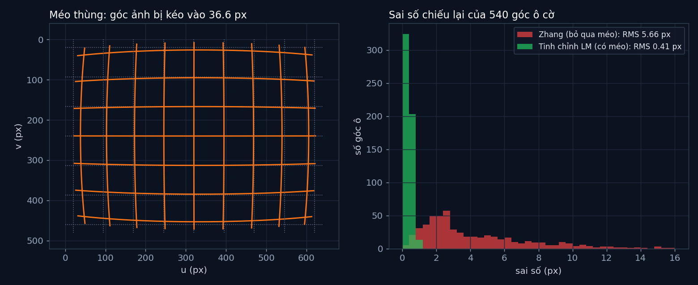

# Tập 2.3 · Hiệu chỉnh camera bằng bàn cờ

> **Mùa 2 · Biết nhìn** · ⏱ khoảng 50 phút · Độ khó ★★★ · Cần: đã làm [tập 2.2](../tap22/), biết numpy và SVD ở mức dùng hàm ·
> 📚 Giáo trình: Principles of Robot Autonomy, [Chương 6 · Camera models](https://porabook.com/book/camera-models/) (Mục 6.5.2) ·
> 📺 Video: TikTok [@thanh82k5](https://www.tiktok.com/@thanh82k5) (tìm "Tập 2.3")

[](https://colab.research.google.com/github/thanhpro82/tu-hoc-robot-tu-hanh/blob/main/tap23/tap23_hieu_chinh.ipynb)
Không muốn cài gì? Bấm nút trên để làm toàn bộ bài ngay trên trình duyệt.

**Một câu:** camera thật không đúng thông số in trên hộp, lại còn méo ống kính (góc ảnh lệch 36,6 px). Chụp 10 tấm bàn cờ là tìm lại được
đủ 11 tham số của camera. Đoán vị trí một điểm cách 2 m: trước hiệu chỉnh lệch 5,0 cm, sau hiệu chỉnh còn 4,5 mm. Bạn tự viết ba mảnh
cốt lõi của phương pháp Zhang.



## Trong thư mục này

| File | Dùng khi nào |
|---|---|
| [tap23_hieu_chinh.ipynb](tap23_hieu_chinh.ipynb) | Làm bài trên Colab hoặc Jupyter |
| [bai_tap/hieu_chinh_cua_ban.py](bai_tap/hieu_chinh_cua_ban.py) | **Bạn viết code ở đây** (nếu làm trên máy) |
| [bai_tap/kiem_tra.py](bai_tap/kiem_tra.py) | Tự chấm: in ✅ / ❌ cho từng bài |
| [bai_tap/ve_do_thi.py](bai_tap/ve_do_thi.py) | Vẽ lưới méo bằng hàm của bạn và sai số chiếu lại, ra `ket_qua.png` |
| [sim/hieu_chinh.py](sim/hieu_chinh.py) | Mô phỏng dùng trong video: chụp bàn cờ, Zhang, tinh chỉnh LM, đối chiếu OpenCV |
| [bai_tap/loi_giai.py](bai_tap/loi_giai.py) | Lời giải (trỏ thẳng vào code video). Tự làm xong rồi hãy mở |

## 1. Bài toán

Camera "thật" trong mô phỏng có `α = 512, β = 508, u₀ = 331, v₀ = 236` (thông số in trên hộp là 500/500/320/240) và méo thùng `k = −6·10⁻⁷`.
Ta chỉ có 10 ảnh chụp một bàn cờ 9 × 6 góc ô (ô 30 mm) ở các góc khác nhau. Các bước:

```text
 10 ảnh bàn cờ ──► mỗi ảnh: dò 54 góc ô (u, v)  ──► mỗi ảnh: tìm homography H (Bài 2)
                                                         │   bàn cờ phẳng (Z = 0) nên H = K·[r1 r2 t]
                                                         ▼
       r1 ⟂ r2 và |r1| = |r2|  →  mỗi ảnh cho 2 phương trình theo B = K⁻ᵀK⁻¹  (dùng v_ij, Bài 3)
                                                         ▼
       10 ảnh → V·b = 0 (20 phương trình, 6 ẩn) → SVD → b → K dạng đóng → R, t từng ảnh   (Zhang)
                                                         ▼
       tinh chỉnh K, k, R, t cùng lúc cho sai số chiếu lại nhỏ nhất (Levenberg-Marquardt)
```

Méo xuyên tâm (Bài 1): điểm càng xa tâm càng bị kéo lệch nhiều. Với `k < 0`, đường thẳng ở mép ảnh cong vào trong như cái thùng:

```text
   d = (u, v) − tâm,    r² = |d|²,    (u, v) bị méo = (1 + k·r²)·d + tâm
```

## 2. Sau bài này bạn làm được

| # | Bạn có thể… | Kiểm tra bằng | Đạt khi |
|---|---|---|---|
| 1 | Mô hình hoá méo xuyên tâm | `kiem_tra.py` Bài 1 | ✅, góc ảnh lệch 36,6 px như video |
| 2 | Tìm homography bằng DLT có chuẩn hoá điểm | `kiem_tra.py` Bài 2 | ✅ |
| 3 | Lập phương trình Zhang và ra K từ 10 ảnh | `kiem_tra.py` Bài 3 | ✅, α = 511,9, β = 514,7 … như video |
| 4 | Giải thích vì sao cần bước tinh chỉnh có méo | [Câu hỏi tự kiểm tra](#6-câu-hỏi-tự-kiểm-tra) | Tự trả lời được |

## 3. Bạn làm gì

| Bài | Hàm | Việc |
|---|---|---|
| **1** | `meo(uv, k, c)` | Công thức méo xuyên tâm cho cả mảng điểm (numpy) |
| **2** | `tim_H(XY, uv)` | DLT: chuẩn hoá → ma trận A (2 dòng mỗi điểm) → SVD → bỏ chuẩn hoá. Hàm `chuan_hoa` có sẵn |
| **3** | `v_ij(H, i, j)` | 6 số theo công thức trong docstring; bộ chấm ghép vào Zhang của video để ra K |

Bước tinh chỉnh Levenberg-Marquardt dùng `scipy.optimize.least_squares` có sẵn trong `sim/hieu_chinh.py`, không nằm trong bài tập.

## 4. Bắt đầu

**Cách 1: Colab.** Bấm nút *Open in Colab* ở đầu trang.

**Cách 2: trên máy** (cần `numpy`, `scipy`; `opencv-python` để chạy phần đối chiếu):

```bash
cd tu-hoc-robot-tu-hanh/tap23
python -X utf8 sim/hieu_chinh.py       # 1. số liệu trong video
python -X utf8 bai_tap/kiem_tra.py     # 2. lúc đầu: ⏳ chưa làm cả 3 bài
# 3. mở bai_tap/hieu_chinh_cua_ban.py, làm từng bài, chạy lại kiem_tra.py
python -X utf8 bai_tap/ve_do_thi.py    # 4. vẽ bằng code của bạn -> ket_qua.png
```

Kết quả mong đợi của bước 1:

```text
Ảnh chụp: 10 · mỗi ảnh 54 góc ô · V có kích thước (20, 6) (2N × 6)
Méo thật k = -6.0e-07: góc ảnh (640,480) bị kéo lệch 36.6 px
Điểm thật [0.55, 0.42, 2.0] m -> pixel [469.2 340.7]; đoán lại vị trí khi biết Z = 2 m:
  dùng 500/320/240, bỏ méo: lệch 5.0 cm · sau hiệu chỉnh: lệch 4.5 mm
  Zhang (bỏ qua méo): k = 0.00e+00  α=511.9 β=514.7 γ=9.95 u0=335.6 v0=210.4  RMS = 5.66 px
  Tinh chỉnh LM (có méo): k = -6.01e-07  α=512.5 β=508.6 γ=-0.16 u0=331.1 v0=237.0  RMS = 0.41 px
K thật: α=512 β=508 u0=331 v0=236 · k thật = -6.0e-07 · ước lượng k = -6.01e-07
Hàng góc ô cờ xa tâm nhất: cong 3.18 px trước, 0.42 px sau khử méo
Lưới đường thẳng: cong tối đa 13.8 px khi méo
OpenCV: fx=512.5 fy=508.6 cx=332.8 cy=237.8 RMS=0.41 px (k1=-0.155)
```

Kết quả khi làm xong cả 3 bài:

```text
✅ Bài 1 · méo xuyên tâm: méo thùng k = -6e-07: góc ảnh bị kéo lệch 36.6 px như video
✅ Bài 2 · homography (DLT): H của 3 ảnh thử khớp đáp án; H đưa 54 góc ô cờ lên ảnh lệch trung bình 1.33 px (phần lệch là do méo + nhiễu)
✅ Bài 3 · Zhang: véc-tơ v_ij: V có kích thước (20, 6); Zhang ra α=511.9 β=514.7 u0=335.6 v0=210.4 như video (thật 512/508/331/236; bước tinh chỉnh có méo đưa về 512.5/508.6/331.1/237.0)

Đạt 3/3 bài.  🎉 Xong! Thử phần Thử thách trong README nhé.
```

### Lịch gợi ý (50 phút)

| Phút | Việc |
|--:|:--|
| 10 | Xem video, đọc mục 1, lướt hàm `zhang` trong `sim/hieu_chinh.py` |
| 35 | Làm Bài 1 → 2 → 3 (Bài 2 là phần dài nhất) |
| 5 | Câu hỏi tự kiểm tra, chọn 1 thử thách |

## 5. Thử thách (không chấm)

1. **Ít ảnh hơn:** đổi `SO_ANH = 3`. Zhang còn ra K hợp lý không? Với 2 ảnh thì sao (gợi ý: 2 ảnh cho 4 phương trình, B có 5 ẩn)?
2. **Bỏ chuẩn hoá:** trong `tim_H` bỏ bước chuẩn hoá điểm. H khác đi bao nhiêu khi có nhiễu?
3. **Nhiễu dò góc:** tăng `NHIEU_PX` từ 0,3 lên 2 px. RMS sau tinh chỉnh tăng tới bao nhiêu? K lệch bao nhiêu?
4. **Chụp thẳng mặt:** cho mọi ảnh chụp vuông góc với bàn cờ (góc quay gần 0). Vì sao Zhang hỏng?

## 6. Câu hỏi tự kiểm tra

<details><summary>1. Vì sao bàn cờ phải phẳng?</summary>

Bàn cờ phẳng thì mọi điểm có Z = 0, nên phép chiếu `K·[r1 r2 r3 t]·[X, Y, 0, 1]` gọn thành `K·[r1 r2 t]·[X, Y, 1]`, tức một ma trận 3 × 3 (homography).
Tìm H từ các cặp điểm là bài toán tuyến tính, giải bằng SVD được.
</details>

<details><summary>2. Mỗi ảnh cho bao nhiêu thông tin về K?</summary>

Hai phương trình. Vì r1, r2 là hai cột của một phép quay nên chúng vuông góc và cùng độ dài. Viết điều đó theo các cột của H và B = K⁻ᵀK⁻¹
được `v_01·b = 0` và `(v_00 − v_11)·b = 0`. B có 6 số (đối xứng) nhưng chỉ xác định tới một hệ số tỉ lệ, nên cần ít nhất 3 ảnh.
</details>

<details><summary>3. Zhang cho γ = 9,95 và v₀ = 210,4, khá xa giá trị thật. Vì sao?</summary>

Zhang dạng đóng giả sử ảnh không méo. Ảnh thật có méo thùng nên các góc ô cờ ở mép bị kéo lệch, H bị sai, K cũng sai theo (RMS 5,66 px).
Bước tinh chỉnh đưa cả hệ số méo k vào, tối ưu tất cả cùng lúc, nên K về gần đúng và RMS còn 0,41 px (cỡ nhiễu 0,3 px).
</details>

<details><summary>4. "Sai số chiếu lại" là gì?</summary>

Dùng K, k, R, t vừa ước lượng để chiếu các góc ô cờ lên ảnh, rồi đo khoảng cách tới vị trí dò được. RMS của các khoảng cách đó cho biết
mô hình khớp dữ liệu tốt cỡ nào. Không thể nhỏ hơn nhiễu dò góc (0,3 px ở đây).
</details>

## 7. Giới hạn cần biết

- Camera "thật", bàn cờ, góc chụp và nhiễu đều là **giả định** trong mô phỏng; góc ô cờ được biết chính xác (không phải dò từ ảnh thật).
- Méo chỉ có 1 hệ số xuyên tâm k, tâm méo trùng tâm ảnh. OpenCV dùng mô hình đầy đủ hơn (k1, k2, p1, p2, k3) nên hệ số không so trực tiếp được.
- Chuẩn hoá điểm khi tìm H (Hartley), đưa k vào bước tinh chỉnh, và đối chiếu OpenCV là phần **mở rộng** ngoài sách.

## Đọc thêm

- Sách, [Chương 6](https://porabook.com/book/camera-models/), Mục 6.5: hiệu chỉnh camera, phương pháp Zhang.
- Tập trước: [2.2 · Camera lỗ kim](../tap22/) · Tập sau: [2.4 · Hai mắt đoán khoảng cách](../tap24/)

---
[← Về danh sách tập](../README.md)
