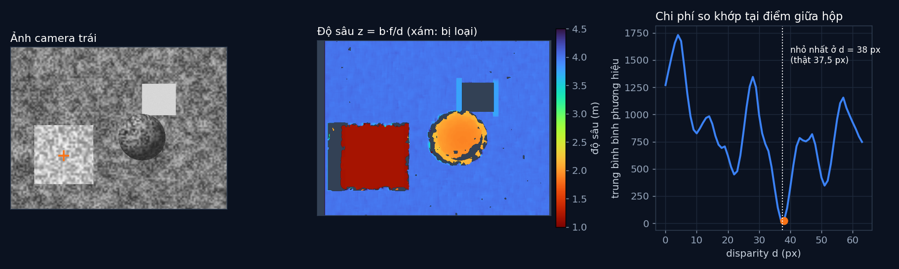

# Tập 2.4 · Hai mắt để đoán khoảng cách (stereo)

> **Mùa 2 · Biết nhìn** · ⏱ khoảng 40 phút · Độ khó ★★☆ · Cần: đã làm [tập 2.2](../tap22/), biết cắt mảng numpy ·
> 📚 Giáo trình: Principles of Robot Autonomy, [Chương 7 · Stereo vision](https://porabook.com/book/stereo-vision/) (Mục 7.1–7.2) ·
> 📺 Video: TikTok [@thanh82k5](https://www.tiktok.com/@thanh82k5) (tìm "Tập 2.4")

[](https://colab.research.google.com/github/thanhpro82/tu-hoc-robot-tu-hanh/blob/main/tap24/tap24_stereo.ipynb)
Không muốn cài gì? Bấm nút trên để làm toàn bộ bài ngay trên trình duyệt.

**Một câu:** một camera không biết vật xa hay gần (tập 2.2), nhưng hai camera đặt cạnh nhau thì biết: vật càng gần càng lệch nhiều giữa
hai ảnh. Hộp cách 1,2 m lệch 37,5 px, tường cách 4 m chỉ lệch 11,25 px. Bạn tự viết công thức độ sâu, phép so khớp trên một hàng ảnh,
và mẹo nội suy để chính xác dưới 1 pixel.



## Trong thư mục này

| File | Dùng khi nào |
|---|---|
| [tap24_stereo.ipynb](tap24_stereo.ipynb) | Làm bài trên Colab hoặc Jupyter |
| [bai_tap/stereo_cua_ban.py](bai_tap/stereo_cua_ban.py) | **Bạn viết code ở đây** (nếu làm trên máy) |
| [bai_tap/kiem_tra.py](bai_tap/kiem_tra.py) | Tự chấm: in ✅ / ❌ cho từng bài |
| [bai_tap/ve_do_thi.py](bai_tap/ve_do_thi.py) | Vẽ bản đồ độ sâu và đường chi phí bằng hàm của bạn, ra `ket_qua.png` |
| [sim/stereo.py](sim/stereo.py) | Mô phỏng dùng trong video: dò tia ra 2 ảnh, so khớp cả ảnh, loại vùng xấu |
| [bai_tap/loi_giai.py](bai_tap/loi_giai.py) | Lời giải cả 3 bài. Tự làm xong rồi hãy mở |

## 1. Bài toán

Hai camera giống hệt nhau, đặt song song cách nhau `b = 12 cm`, tiêu cự `f = 375 px`. Sau khi chỉnh ảnh (rectification), một điểm 3D
hiện trên **cùng một hàng** ở cả hai ảnh, chỉ lệch nhau theo chiều ngang một đoạn `d` (disparity):

```text
   camera trái          camera phải            tam giác đồng dạng:
       ●────── b ──────────●                       d = u_trái − u_phải = b·f / z
        ╲                 ╱                         →   z = b·f / d
         ╲               ╱
          ╲             ╱                   gần (d lớn) ──► đo chính xác
           ╲           ╱                    xa (d nhỏ)  ──► lệch 1 px là sai nhiều
                 ● điểm P (độ sâu z)
```

Muốn biết `d` của một pixel bên trái, ta trượt một cửa sổ 11 × 11 dọc **cùng hàng** bên ảnh phải và tìm chỗ giống nhất
(chi phí = trung bình bình phương hiệu nhỏ nhất). Chỗ khó: vùng trơn không có vân (áp phích trắng), vùng chỉ một camera thấy (bị che).

## 2. Sau bài này bạn làm được

| # | Bạn có thể… | Kiểm tra bằng | Đạt khi |
|---|---|---|---|
| 1 | Đổi disparity ra độ sâu, thấy sai số tăng theo z² | `kiem_tra.py` Bài 1 | ✅, lệch 1 px: sai 2,3 cm ở 1 m, 39 cm ở 4 m |
| 2 | So khớp cửa sổ dọc một hàng ảnh | `kiem_tra.py` Bài 2 | ✅, điểm giữa hộp ra d = 38 px |
| 3 | Nội suy parabol để chính xác dưới 1 pixel | `kiem_tra.py` Bài 3 | ✅, d = 37,53 px → z = 1,199 m |
| 4 | Giải thích vì sao áp phích trắng bị loại 76% | [Câu hỏi tự kiểm tra](#6-câu-hỏi-tự-kiểm-tra) | Tự trả lời được |

## 3. Bạn làm gì

| Bài | Hàm | Việc |
|---|---|---|
| **1** | `do_sau(d, b, f)` | `z = b·f/d`, chạy được cả với mảng numpy |
| **2** | `chi_phi_diem(L, R, hang, cot, d_max, cua_so)` | Với mỗi d: trung bình bình phương hiệu giữa cửa sổ quanh `(hang, cot)` ở L và quanh `(hang, cot − d)` ở R |
| **3** | `noi_suy_parabol(c0, c1, c2)` | Đỉnh parabol qua 3 điểm chi phí, kẹp trong ±0,5 px |

Bản đầy đủ trong `sim/stereo.py` làm Bài 2 cho mọi pixel cùng lúc (nhanh hơn nhiều nhờ `uniform_filter`), thêm kiểm tra trái-phải và ngưỡng độ vân.

## 4. Bắt đầu

**Cách 1: Colab.** Bấm nút *Open in Colab* ở đầu trang.

**Cách 2: trên máy** (cần `numpy`, `scipy`):

```bash
cd tu-hoc-robot-tu-hanh/tap24
python -X utf8 sim/stereo.py           # 1. số liệu trong video (vài giây)
python -X utf8 bai_tap/kiem_tra.py     # 2. lúc đầu: ⏳ chưa làm cả 3 bài
# 3. mở bai_tap/stereo_cua_ban.py, làm từng bài, chạy lại kiem_tra.py
python -X utf8 bai_tap/ve_do_thi.py    # 4. vẽ bằng code của bạn -> ket_qua.png
```

Kết quả mong đợi của bước 1:

```text
Camera 480×360, f = 375 px, baseline b = 12 cm -> b·f = 45.0 px·m
  hộp       z thật 1.20 m · d thật 37.50 px · d đo 37.50 px · z đo 1.200 m · bị loại 2%
  bóng      z thật 1.97 m · d thật 22.84 px · d đo 22.82 px · z đo 1.972 m · bị loại 13%
  tường     z thật 4.00 m · d thật 11.25 px · d đo 11.24 px · z đo 4.004 m · bị loại 8%
  áp phích  z thật 4.00 m · d thật 11.25 px · d đo 11.97 px · z đo 3.759 m · bị loại 76%
Điểm giữa hộp (242, 118): d tốt nhất = 38 px (thật 37.5)
Pixel bị loại: vùng trơn 2.8% · bị che 7.8% · viền 1.2%
  ở 1 m: d = 45.00 px, lệch 1 px -> sai 2.3 cm
  ở 2 m: d = 22.50 px, lệch 1 px -> sai 9.3 cm
  ở 4 m: d = 11.25 px, lệch 1 px -> sai 39.0 cm
Sai số độ sâu trung vị trên pixel hợp lệ: 0.9 cm
```

Kết quả khi làm xong cả 3 bài:

```text
✅ Bài 1 · độ sâu từ disparity: lệch 1 px disparity làm sai 2.3 cm ở 1 m, 9.3 cm ở 2 m, 39.0 cm ở 4 m như video (xa gấp đôi → sai gấp ~4)
✅ Bài 2 · so khớp trên một hàng: điểm giữa hộp: chi phí nhỏ nhất ở d = 38 px (thật 37.5) → z ≈ 1.184 m
✅ Bài 3 · nội suy dưới pixel: d = 38 -0.470 = 37.530 px (thật 37.5) → z = 1.199 m, sát độ sâu thật 1.200 m

Đạt 3/3 bài.  🎉 Xong! Thử phần Thử thách trong README nhé.
```

### Lịch gợi ý (40 phút)

| Phút | Việc |
|--:|:--|
| 5 | Xem video, đọc mục 1 |
| 30 | Làm Bài 1 → 2 → 3 |
| 5 | Câu hỏi tự kiểm tra, chọn 1 thử thách |

## 5. Thử thách (không chấm)

1. **Cửa sổ to nhỏ:** gọi `chi_phi_diem` với cửa sổ 3, 11, 31. Đường chi phí có rõ đáy không? Cửa sổ to có hại gì ở mép vật?
2. **Baseline dài hơn:** nếu hai camera cách 30 cm thay vì 12 cm, sai số khi lệch 1 px ở 4 m còn bao nhiêu? Đổi lại mất gì?
3. **Điểm trên áp phích:** chạy `chi_phi_diem` cho một pixel giữa áp phích trắng. Đường chi phí trông thế nào?
4. **So khớp cả hàng:** viết vòng lặp tính d cho mọi pixel trên hàng `goc.DIEM[0]` và vẽ độ sâu dọc hàng đó.

## 6. Câu hỏi tự kiểm tra

<details><summary>1. Vì sao chỉ cần dò dọc một hàng mà không phải cả ảnh?</summary>

Sau khi chỉnh ảnh, hai camera song song và cùng độ cao, nên một điểm 3D luôn hiện trên cùng một hàng ở hai ảnh (đường epipolar thành hàng ngang).
Bài toán tìm điểm tương ứng từ 2 chiều rút về 1 chiều, nhanh và ít nhầm hơn nhiều.
</details>

<details><summary>2. Vì sao áp phích trắng bị loại 76%?</summary>

Áp phích một màu, không có vân. Cửa sổ 11 × 11 ở chỗ nào trên đó cũng giống nhau, nên chi phí gần như bằng nhau với mọi d, không có đáy rõ.
Code nhận ra điều này bằng độ lệch chuẩn trong cửa sổ (quá nhỏ thì loại), thà bỏ còn hơn đoán sai.
</details>

<details><summary>3. Vì sao sai số độ sâu tăng theo bình phương khoảng cách?</summary>

Từ `z = b·f/d`, đạo hàm theo d là `−b·f/d² = −z²/(b·f)`. Lệch 1 px ở z = 4 m gây sai gấp 16 lần ở z = 1 m. Mô phỏng: 2,3 cm ở 1 m, 39 cm ở 4 m
(lớn hơn 16 × 2,3 một chút vì lệch 1 px ở xa là lệch rất lớn so với d = 11,25).
</details>

<details><summary>4. Vùng "bị che" ở mép trái hộp là gì?</summary>

Camera trái thấy một dải tường ngay bên trái hộp mà camera phải bị hộp che mất. Pixel đó không có điểm tương ứng thật, nên so khớp ra kết quả bậy.
Kiểm tra trái-phải (so khớp hai chiều, kết quả phải khớp nhau) phát hiện và loại các pixel này.
</details>

## 7. Giới hạn cần biết

- Cảnh 3D, camera, baseline và nhiễu ảnh là **giả định**; hai ảnh được dò tia từ cảnh giả định nên độ sâu thật biết chính xác.
- Hai camera đã song song hoàn hảo (bỏ qua bước chỉnh ảnh thật).
- Hàm chi phí SSD, nội suy parabol, kiểm tra trái-phải và ngưỡng độ vân là phần **mở rộng** ngoài sách.

## Đọc thêm

- Sách, [Chương 7](https://porabook.com/book/stereo-vision/): hình học epipolar, chỉnh ảnh, disparity và độ sâu.
- Tập trước: [2.3 · Hiệu chỉnh camera](../tap23/) · Tập sau: [2.5 · Dựng 3D từ ảnh chụp](../tap25/)

---
[← Về danh sách tập](../README.md)
