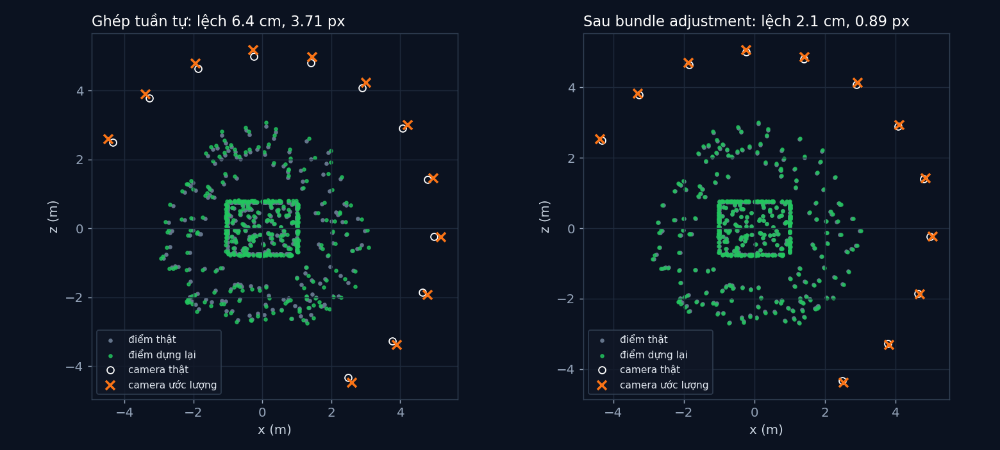

# Tập 2.5 · Dựng 3D từ ảnh chụp (Structure from Motion)

> **Mùa 2 · Biết nhìn** · ⏱ khoảng 50 phút · Độ khó ★★★ · Cần: đã làm [2.3](../tap23/) và [2.4](../tap24/), numpy, SVD ở mức dùng hàm ·
> 📚 Giáo trình: Principles of Robot Autonomy, [Chương 7 · Stereo vision](https://porabook.com/book/stereo-vision/) (Mục 7.3) ·
> 📺 Video: TikTok [@thanh82k5](https://www.tiktok.com/@thanh82k5) (tìm "Tập 2.5")

[](https://colab.research.google.com/github/thanhpro82/tu-hoc-robot-tu-hanh/blob/main/tap25/tap25_sfm.ipynb)
Không muốn cài gì? Bấm nút trên để làm toàn bộ bài ngay trên trình duyệt.

**Một câu:** đi vòng quanh một ngôi nhà, chụp 12 tấm ảnh bằng một camera, là dựng lại được 402 điểm 3D của nhà và vị trí cả 12 lần chụp.
Sau bundle adjustment, sai số chỉ còn 2,1 cm. Bạn tự viết bước khó nhất: từ hai ảnh đầu tiên suy ra camera đã di chuyển thế nào.



## Trong thư mục này

| File | Dùng khi nào |
|---|---|
| [tap25_sfm.ipynb](tap25_sfm.ipynb) | Làm bài trên Colab hoặc Jupyter |
| [bai_tap/sfm_cua_ban.py](bai_tap/sfm_cua_ban.py) | **Bạn viết code ở đây** (nếu làm trên máy) |
| [bai_tap/kiem_tra.py](bai_tap/kiem_tra.py) | Tự chấm: in ✅ / ❌ cho từng bài |
| [bai_tap/ve_do_thi.py](bai_tap/ve_do_thi.py) | Vẽ ngôi nhà dựng lại, ra `ket_qua.png` |
| [sim/sfm.py](sim/sfm.py) | Mô phỏng dùng trong video: chụp ảnh, hai ảnh đầu, ghép tuần tự, bundle adjustment |
| [bai_tap/loi_giai.py](bai_tap/loi_giai.py) | Lời giải cả 3 bài. Tự làm xong rồi hãy mở |

## 1. Bài toán

Khác stereo (hai camera biết trước vị trí), ở đây chỉ có **một** camera di chuyển, không ai cho biết nó đi đâu. Biết K (tập 2.3), ta tìm cả
vị trí camera lẫn điểm 3D:

```text
 ảnh 0, ảnh 1 ──► 273 cặp điểm chung ──► F (8 điểm, Bài 1) ──► E = Kᵀ F K ──► 4 nghiệm (R, t)
                                                                                  │
                         chọn nghiệm cho điểm nằm TRƯỚC cả hai camera (Bài 3) ◄───┤ tam giác hoá (Bài 2)
                                                                                  ▼
 thêm ảnh 2, 3, … : định vị camera mới bằng điểm 3D đã có (PnP), tam giác hoá điểm mới
                                                                                  ▼
 bundle adjustment: chỉnh mọi camera và mọi điểm cùng lúc cho sai số chiếu lại nhỏ nhất
```

**Ma trận cơ bản F** gói hình học giữa hai ảnh: mọi cặp điểm tương ứng thoả `p1ᵀ·F·p2 = 0`. Một điều quan trọng: ảnh không cho biết
**tỉ lệ**. Ngôi nhà to gấp đôi chụp từ xa gấp đôi cho ảnh y hệt, nên mô hình dựng lại có đơn vị tuỳ ý cho tới khi ta đo thật một cạnh (2,0 m).

## 2. Sau bài này bạn làm được

| # | Bạn có thể… | Kiểm tra bằng | Đạt khi |
|---|---|---|---|
| 1 | Ước lượng ma trận cơ bản F bằng thuật toán 8 điểm | `kiem_tra.py` Bài 1 | ✅ |
| 2 | Tam giác hoá điểm 3D từ hai ảnh | `kiem_tra.py` Bài 2 | ✅, không nhiễu thì ra đúng điểm thật |
| 3 | Chọn nghiệm (R, t) đúng trong 4 nghiệm | `kiem_tra.py` Bài 3 | ✅, [0, 0, 273, 0] như video |
| 4 | Giải thích vì sao SfM không biết tỉ lệ và vì sao cần bundle adjustment | [Câu hỏi tự kiểm tra](#6-câu-hỏi-tự-kiểm-tra) | Tự trả lời được |

## 3. Bạn làm gì

| Bài | Hàm | Việc |
|---|---|---|
| **1** | `tim_F(p1, p2)` | Chuẩn hoá → mỗi cặp một dòng `outer(a, b)` → SVD → ép hạng 2 → bỏ chuẩn hoá. `chuan_hoa` có sẵn |
| **2** | `tam_giac(P1, P2, x1, x2)` | Mỗi cặp điểm: 4 dòng → SVD → chia cho phần tử cuối |
| **3** | `dem_truoc_camera(R, t, X)` | Đếm điểm có độ sâu dương ở cả camera 1 (`X[:,2]`) và camera 2 (`(X·Rᵀ + t)[:,2]`) |

Sau Bài 3, bộ chấm ghép 3 hàm của bạn vào bước hai ảnh của video (tách E thành 4 nghiệm có sẵn) và so số điểm trước camera.
PnP, ghép tuần tự và bundle adjustment nằm trong `sim/sfm.py`, không thuộc bài tập.

## 4. Bắt đầu

**Cách 1: Colab.** Bấm nút *Open in Colab* ở đầu trang.

**Cách 2: trên máy** (cần `numpy`, `scipy`, `opencv-python`):

```bash
cd tu-hoc-robot-tu-hanh/tap25
python -X utf8 sim/sfm.py              # 1. số liệu trong video (vài giây)
python -X utf8 bai_tap/kiem_tra.py     # 2. lúc đầu: ⏳ chưa làm cả 3 bài
# 3. mở bai_tap/sfm_cua_ban.py, làm từng bài, chạy lại kiem_tra.py
python -X utf8 bai_tap/ve_do_thi.py    # 4. vẽ ngôi nhà dựng lại -> ket_qua.png
```

Kết quả mong đợi của bước 1:

```text
402 điểm trên nhà · 12 ảnh · mỗi ảnh thấy [274, 278, 277, 236, 277, 276, 274, 274, 187, 272, 270, 263] điểm
Hai ảnh đầu: 273 cặp điểm chung · 4 nghiệm (R, t) có số điểm nằm trước cả hai camera: [0, 0, 273, 0]
Tỉ lệ: khoảng cách 2 camera đầu trong mô hình = 1.01 (đơn vị tuỳ ý), thật = 1.66 m
Số điểm 3D sau mỗi ảnh: [273, 277, 279, 280, 320, 321, 321, 322, 322, 402, 402]
Sai số chiếu lại: ghép tuần tự 3.71 px -> sau bundle adjustment 0.89 px
Sau khi gắn tỉ lệ bằng cạnh 2.0 m: sai số 3D trung bình 6.4 cm (trước BA) -> 2.1 cm (sau BA)
Tâm camera lệch trung bình: 18.0 cm -> 6.1 cm
```

Kết quả khi làm xong cả 3 bài:

```text
✅ Bài 1 · ma trận cơ bản F: 273 cặp điểm chung → F hạng 2; p1ᵀFp2 trung bình 2.5e-02 (≈ 0)
✅ Bài 2 · tam giác hoá: không nhiễu: ra đúng điểm thật; với pixel nhiễu 0.7 px: lệch trung bình 2.8 cm
✅ Bài 3 · chọn nghiệm (R, t): 4 nghiệm (R, t) cho [0, 0, 273, 0] điểm trước cả hai camera: chỉ một nghiệm đúng, như video

Đạt 3/3 bài.  🎉 Xong! Thử phần Thử thách trong README nhé.
```

### Lịch gợi ý (50 phút)

| Phút | Việc |
|--:|:--|
| 10 | Xem video, đọc mục 1, lướt hàm `hai_anh` trong `sim/sfm.py` |
| 35 | Làm Bài 1 → 2 → 3 |
| 5 | Câu hỏi tự kiểm tra, chọn 1 thử thách |

## 5. Thử thách (không chấm)

1. **Bỏ ép hạng 2:** trong `tim_F` bỏ bước ép hạng 2. Số điểm trước camera của 4 nghiệm có đổi không?
2. **Ít điểm:** chỉ dùng 8 cặp điểm đầu tiên để tìm F. Kết quả còn dùng được không khi pixel có nhiễu 0,7 px?
3. **Bỏ bundle adjustment:** so `A0` và `A1` trong `sim/sfm.py`: phần nào của ngôi nhà lệch nhiều nhất trước BA? Vì sao (gợi ý: ảnh thêm vào sau cùng)?
4. **Tỉ lệ:** nhân mọi điểm và mọi `t` của mô hình dựng lại với 3. Sai số chiếu lại có đổi không? Điều đó nói gì?

## 6. Câu hỏi tự kiểm tra

<details><summary>1. Vì sao E tách ra 4 nghiệm, và vì sao chỉ một nghiệm đúng?</summary>

E chỉ xác định hướng dời t tới dấu (t hoặc −t) và có hai cách quay R khớp với nó, nên có 2 × 2 = 4 tổ hợp. Cả bốn đều thoả phương trình,
nhưng chỉ một tổ hợp cho các điểm nằm **trước** cả hai camera. Ba tổ hợp còn lại đặt điểm ra sau lưng camera, điều không thể xảy ra
(trong video: [0, 0, 273, 0]).
</details>

<details><summary>2. Vì sao SfM không biết tỉ lệ thật?</summary>

Phóng to cả ngôi nhà lẫn quãng camera di chuyển lên k lần thì mọi tia sáng vẫn y như cũ, ảnh không đổi. Vì vậy mô hình có đơn vị tuỳ ý
(khoảng cách hai camera đầu = 1,01). Cần một thông tin từ ngoài: một cạnh đo thật, odometry của bánh xe, hoặc IMU.
</details>

<details><summary>3. Bundle adjustment sửa được gì mà ghép tuần tự không sửa được?</summary>

Ghép tuần tự thêm từng ảnh dựa trên kết quả trước, nên sai số dồn dần (ảnh càng về sau càng lệch). Bundle adjustment chỉnh lại **mọi** camera
và **mọi** điểm cùng lúc để khớp tất cả quan sát, phân bổ sai số đều ra: chiếu lại 3,71 → 0,89 px, lệch 3D 6,4 → 2,1 cm.
</details>

<details><summary>4. Vì sao cần chuẩn hoá điểm trước thuật toán 8 điểm?</summary>

Toạ độ pixel cỡ hàng trăm, khi nhân với nhau trong ma trận W thì có cột cỡ 10⁵, có cột cỡ 1. SVD trên ma trận chênh lệch như vậy rất nhạy với nhiễu.
Chuẩn hoá đưa điểm về quanh gốc với độ lớn cỡ 1, kết quả ổn định hơn nhiều.
</details>

## 7. Giới hạn cần biết

- Ngôi nhà mô hình, quỹ đạo camera và nhiễu là **giả định**. Điểm tương ứng giữa các ảnh được biết sẵn (ngoài đời phải dò và so khớp đặc trưng, tập 2.6).
- Không có điểm ghép nhầm (outlier). Thực tế phải dùng RANSAC khi tìm F.
- Chuẩn hoá điểm, công thức tách E bằng SVD, PnP bằng `cv2.solvePnP`, gắn tỉ lệ bằng cạnh thật và căn chỉnh Umeyama là phần **mở rộng** ngoài sách.

## Đọc thêm

- Sách, [Chương 7](https://porabook.com/book/stereo-vision/), Mục 7.3: Structure from Motion, bundle adjustment.
- Tập trước: [2.4 · Stereo](../tap24/) · Tập sau: [2.6 · Thị giác máy tính cổ điển](../tap26/)

---
[← Về danh sách tập](../README.md)
