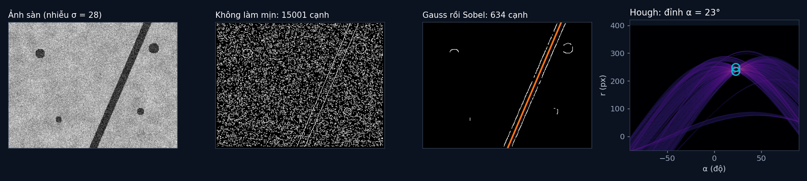

# Tập 2.6 · Thị giác máy tính cổ điển: dò vạch dẫn đường

> **Mùa 2 · Biết nhìn** · ⏱ khoảng 40 phút · Độ khó ★★☆ · Cần: cắt mảng numpy, sin/cos ·
> 📚 Giáo trình: Principles of Robot Autonomy, [Chương 8 · Classical perception](https://porabook.com/book/classical-perception/) (Mục 8.1–8.2) ·
> 📺 Video: TikTok [@thanh82k5](https://www.tiktok.com/@thanh82k5) (tìm "Tập 2.6")

[](https://colab.research.google.com/github/thanhpro82/tu-hoc-robot-tu-hanh/blob/main/tap26/tap26_do_vach.ipynb)
Không muốn cài gì? Bấm nút trên để làm toàn bộ bài ngay trên trình duyệt.

**Một câu:** trước thời deep learning, robot "nhìn" bằng các phép tính tay: làm mịn, tìm cạnh, rồi bỏ phiếu tìm đường thẳng. Ảnh sàn nhiễu
cho 15.001 pixel cạnh (93% là giả); làm mịn Gauss trước thì còn 634 pixel, không cái nào giả, và Hough tìm ra vạch lệch chỉ 0,4°.
Bạn tự viết tích chập, Sobel và Hough.



## Trong thư mục này

| File | Dùng khi nào |
|---|---|
| [tap26_do_vach.ipynb](tap26_do_vach.ipynb) | Làm bài trên Colab hoặc Jupyter |
| [bai_tap/thi_giac_cua_ban.py](bai_tap/thi_giac_cua_ban.py) | **Bạn viết code ở đây** (nếu làm trên máy) |
| [bai_tap/kiem_tra.py](bai_tap/kiem_tra.py) | Tự chấm: in ✅ / ❌ cho từng bài |
| [bai_tap/ve_do_thi.py](bai_tap/ve_do_thi.py) | Vẽ 4 bước bằng hàm của bạn, ra `ket_qua.png` |
| [sim/thi_giac.py](sim/thi_giac.py) | Mô phỏng dùng trong video |
| [bai_tap/loi_giai.py](bai_tap/loi_giai.py) | Lời giải cả 3 bài. Tự làm xong rồi hãy mở |

## 1. Bài toán

Robot nhìn xuống sàn, có một vạch dẫn đường màu tối, vài vết bẩn và nhiều nhiễu. Cần tìm đường thẳng của vạch để biết lệch bao nhiêu.

```text
 ảnh nhiễu ──► làm mịn Gauss ──► Sobel: Sx, Sy ──► |∇S| = √(Sx² + Sy²) ──► ngưỡng + chỉ giữ đỉnh ──► pixel cạnh
                (bớt nhiễu)       (Bài 1, 2)                                   (mảnh như sợi chỉ)        │
                                                                                                          ▼
     đường thẳng  x·cos α + y·sin α = r   ◄── đỉnh trong lưới (α, r) ◄── mỗi pixel cạnh bỏ 180 phiếu (Bài 3)
```

**Tích chập** trượt một mặt nạ 3 × 3 trên ảnh. Mặt nạ Sobel đo ảnh đổi màu nhanh cỡ nào theo x và theo y; chỗ đổi nhanh là cạnh.
**Hough** biến bài "tìm đường thẳng đi qua nhiều điểm" thành "tìm ô nhiều phiếu nhất": mỗi điểm cạnh bỏ phiếu cho mọi đường có thể đi qua nó.

## 2. Sau bài này bạn làm được

| # | Bạn có thể… | Kiểm tra bằng | Đạt khi |
|---|---|---|---|
| 1 | Viết tích chập 2D có xử lý viền | `kiem_tra.py` Bài 1 | ✅, khớp `scipy.ndimage.convolve` |
| 2 | Tính độ dốc ảnh bằng Sobel | `kiem_tra.py` Bài 2 | ✅, 15.001 → 634 pixel cạnh như video |
| 3 | Viết biến đổi Hough và tìm đường thẳng | `kiem_tra.py` Bài 3 | ✅, vạch α = 23,0°, r = 242,0 |
| 4 | Giải thích vì sao phải làm mịn trước khi lấy đạo hàm | [Câu hỏi tự kiểm tra](#6-câu-hỏi-tự-kiểm-tra) | Tự trả lời được |

## 3. Bạn làm gì

| Bài | Hàm | Việc |
|---|---|---|
| **1** | `tich_chap(anh, mat_na)` | `Σ mat_na[1+i, 1+j]·anh[y−i, x−j]`, viền lấy pixel gần nhất (`np.pad(..., mode="edge")`) |
| **2** | `do_doc(anh)` | Tích chập với `SOBEL_X`, `SOBEL_Y`, rồi `|∇S|`. Trả về `(|∇S|, Sx, Sy)` |
| **3** | `hough(canh, n_alpha)` | Lưới `(180, 2·r_max + 1)`; mỗi pixel cạnh cộng 1 phiếu cho mọi α |

Gợi ý: Bài 1 viết bằng 9 phép cộng mảng đã dời (mỗi (i, j) một lần) thay vì 2 vòng lặp qua từng pixel, nhanh hơn hàng trăm lần.

## 4. Bắt đầu

**Cách 1: Colab.** Bấm nút *Open in Colab* ở đầu trang.

**Cách 2: trên máy** (cần `numpy`, `scipy`):

```bash
cd tu-hoc-robot-tu-hanh/tap26
python -X utf8 sim/thi_giac.py         # 1. số liệu trong video
python -X utf8 bai_tap/kiem_tra.py     # 2. lúc đầu: ⏳ chưa làm cả 3 bài
# 3. mở bai_tap/thi_giac_cua_ban.py, làm từng bài, chạy lại kiem_tra.py
python -X utf8 bai_tap/ve_do_thi.py    # 4. vẽ bằng code của bạn -> ket_qua.png
```

Kết quả mong đợi của bước 1:

```text
Ảnh 320×240 = 76800 con số · nhiễu σ = 28.0 · lọc Gauss σ = 2.0 · ngưỡng |∇S| > 160.0
Không làm mịn: 15001 pixel cạnh, 13985 cạnh giả (93%)
Làm mịn Gauss rồi Sobel: 634 pixel cạnh, 0 cạnh giả (0%)
Hough: lưới 180 góc × 801 giá trị r = 144180 ô; mỗi điểm cạnh bỏ 180 phiếu
  đỉnh: α = 23°, r = 249 px, 144 phiếu
  đỉnh: α = 23°, r = 235 px, 135 phiếu
Vạch thật α = 23.4°, r = 242.2 · đo được α = 23.0°, r = 242.0 -> lệch 0.4°
Mép dưới ảnh: vạch ở x = 161.0 px (thật 160.0), vạch nghiêng 23.0° so với phương thẳng đứng của ảnh
Đỉnh Hough thứ 3 (cực đại cục bộ): (32.0, 232.0, 20)
Pixel cạnh trên vết bẩn (sau làm mịn): 96 · trên mép vạch: 538
```

Kết quả khi làm xong cả 3 bài:

```text
✅ Bài 1 · tích chập: khớp scipy.ndimage.convolve trên ảnh thử, cả với mặt nạ không đối xứng
✅ Bài 2 · độ dốc Sobel: không làm mịn: 15001 pixel cạnh, 93% giả; làm mịn Gauss trước: 634 pixel cạnh, 0 giả, như video
✅ Bài 3 · biến đổi Hough: 2 đỉnh: α = 23°, r = 249 và 235 px (hai mép vạch) → đường giữa α = 23.0°, r = 242.0 (thật 23.4°, 242.2) như video

Đạt 3/3 bài.  🎉 Xong! Thử phần Thử thách trong README nhé.
```

### Lịch gợi ý (40 phút)

| Phút | Việc |
|--:|:--|
| 5 | Xem video, đọc mục 1 |
| 30 | Làm Bài 1 → 2 → 3 |
| 5 | Câu hỏi tự kiểm tra, chọn 1 thử thách |

## 5. Thử thách (không chấm)

1. **Độ mịn:** đổi `SIGMA` thành 0,5, 1, 4. Số cạnh giả và độ chính xác của vạch thay đổi thế nào? Làm mịn quá tay có hại gì?
2. **Nhiễu mạnh hơn:** tăng `NHIEU` lên 60. Cách làm này còn tìm ra vạch không?
3. **Hai vạch:** thêm một vạch thứ hai vào `tao_anh`. Hough có tìm ra cả hai không?
4. **Tương quan và tích chập:** đổi dấu trong Bài 1 thành `anh[y + i, x + j]` (tương quan). Với Sobel, kết quả khác gì? Với mặt nạ Gauss thì sao?

## 6. Câu hỏi tự kiểm tra

<details><summary>1. Vì sao không làm mịn thì 93% cạnh là giả?</summary>

Đạo hàm khuếch đại những thay đổi nhanh, mà nhiễu chính là thay đổi nhanh từ pixel này sang pixel kế bên. Không làm mịn thì nhiễu tạo
độ dốc lớn khắp nơi, vượt ngưỡng thành "cạnh". Làm mịn Gauss trung bình hoá nhiễu đi trước, chỉ còn các cạnh thật (mép vạch, mép vết bẩn).
</details>

<details><summary>2. Vì sao Hough cho hai đỉnh mà không phải một?</summary>

Vạch có bề rộng 14 px, nên có **hai** mép song song (cùng α = 23°, r cách nhau 14: 235 và 249). Mỗi mép là một đường thẳng nhiều phiếu.
Lấy trung bình hai đỉnh ra đường giữa vạch (r = 242,0, thật 242,2).
</details>

<details><summary>3. Vết bẩn cũng có cạnh, sao Hough không nhầm chúng thành vạch?</summary>

Mép vết bẩn là đường tròn nhỏ. Điểm của nó bỏ phiếu rải rác cho nhiều đường khác nhau, không dồn vào một ô. Mép vạch thì hàng trăm điểm
cùng bỏ phiếu cho đúng một ô (144 phiếu), nổi bật hẳn (đỉnh thứ ba chỉ có 20 phiếu).
</details>

<details><summary>4. Vì sao dùng dạng x·cos α + y·sin α = r mà không dùng y = ax + b?</summary>

Với y = ax + b, đường thẳng đứng có độ dốc a vô cùng, không bỏ vào lưới được. Dạng cực mô tả được mọi đường thẳng bằng α trong [−90°, 90°)
và r có giới hạn (không quá đường chéo ảnh).
</details>

## 7. Giới hạn cần biết

- Ảnh sàn, vạch, vết bẩn và nhiễu là **giả định** tạo bằng code.
- Ứng dụng dò vạch dẫn đường và cách tách hai mép thành đường giữa là phần **mở rộng** (sách dạy phép lọc, dò cạnh và Hough tổng quát).
- Ngưỡng 160 được chọn tay cho ảnh này; ảnh khác (đèn khác, sàn khác) cần chọn lại, đây là điểm yếu lớn của thị giác cổ điển.

## Đọc thêm

- Sách, [Chương 8](https://porabook.com/book/classical-perception/): lọc ảnh, dò cạnh, biến đổi Hough, đặc trưng.
- Tập trước: [2.5 · Structure from Motion](../tap25/) · Tập sau: [2.7 · Deep learning nhìn thế giới](../tap27/)

---
[← Về danh sách tập](../README.md)
