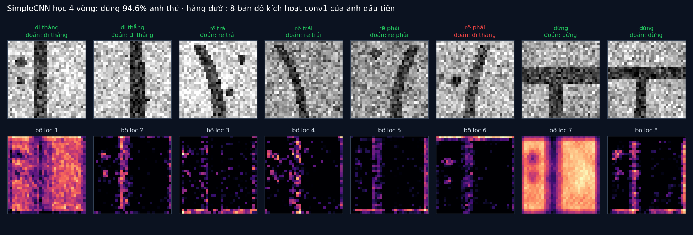

# Tập 2.7 · Deep learning nhìn thế giới thế nào (CNN)

> **Mùa 2 · Biết nhìn** · ⏱ khoảng 45 phút · Độ khó ★★☆ · Cần: đã làm [tập 2.6](../tap26/), biết PyTorch cơ bản là tốt (không bắt buộc) ·
> 📚 Giáo trình: Principles of Robot Autonomy, [Chương 9 · Deep learning perception](https://porabook.com/book/deep-learning-perception/) (Mục 9.1) ·
> 📺 Video: TikTok [@thanh82k5](https://www.tiktok.com/@thanh82k5) (tìm "Tập 2.7")

[](https://colab.research.google.com/github/thanhpro82/tu-hoc-robot-tu-hanh/blob/main/tap27/tap27_cnn.ipynb)
Không muốn cài gì? Bấm nút trên để làm toàn bộ bài ngay trên trình duyệt (Colab có sẵn PyTorch).

**Một câu:** tập 2.6 phải tự chọn bộ lọc và ngưỡng bằng tay; mạng nơ-ron tích chập (CNN) **tự học** bộ lọc từ 1500 ảnh ví dụ, và nhận ra
4 kiểu vạch (đi thẳng, rẽ trái, rẽ phải, dừng) đúng 98,2%. Bạn tự viết lớp tích chập, max pooling, và dựng SimpleCNN bằng PyTorch.



## Trong thư mục này

| File | Dùng khi nào |
|---|---|
| [tap27_cnn.ipynb](tap27_cnn.ipynb) | Làm bài trên Colab hoặc Jupyter |
| [bai_tap/cnn_cua_ban.py](bai_tap/cnn_cua_ban.py) | **Bạn viết code ở đây** (nếu làm trên máy) |
| [bai_tap/kiem_tra.py](bai_tap/kiem_tra.py) | Tự chấm: in ✅ / ❌ cho từng bài (Bài 3 tự huấn luyện mạng của bạn ~15 giây) |
| [bai_tap/ve_do_thi.py](bai_tap/ve_do_thi.py) | Vẽ dự đoán và bản đồ kích hoạt của mạng bạn viết, ra `ket_qua.png` |
| [sim/cnn.py](sim/cnn.py) | Mô phỏng dùng trong video: tạo dữ liệu, học CNN và mạng nối đầy đủ, thử dịch ảnh |
| [bai_tap/loi_giai.py](bai_tap/loi_giai.py) | Lời giải cả 3 bài. Tự làm xong rồi hãy mở |

## 1. Bài toán

Ảnh xám 32 × 32 nhìn xuống sàn, có vạch dẫn đường kiểu: thẳng, cong trái, cong phải, hoặc chữ T (dừng), cộng thêm vết bẩn và nhiễu.
SimpleCNN (theo bài tập 1 của chương):

```text
 ảnh 1×32×32 ─► conv1: 8 bộ lọc 5×5 ─► ReLU ─► max pool 2×2 ─► 8×16×16
             ─► conv2: 16 bộ lọc 5×5 ─► ReLU ─► max pool 2×2 ─► 16×8×8 = 1024 số
             ─► fc1: 1024 → 32 ─► ReLU ─► fc2: 32 → 4 điểm ─► lớp có điểm cao nhất
```

Ba ý tưởng làm CNN hợp với ảnh (Mục 9.1.2):

- **Dùng chung tham số:** một bộ lọc 5 × 5 (25 số) trượt khắp ảnh, thay vì mỗi pixel một trọng số riêng.
- **Tương tác thưa:** mỗi số ở lớp sau chỉ nhìn một vùng nhỏ của lớp trước.
- **Gần như bất biến tịnh tiến:** vạch dịch sang vài pixel, bộ lọc vẫn bắt được, max pooling còn làm dịu thêm.

Kết quả: CNN chỉ có 36.356 tham số nhưng đúng 98,2%; mạng nối đầy đủ có 263.428 tham số chỉ đúng 96,8%. Khi vạch bị dịch xa hơn lúc học,
CNN đúng 62,6% còn mạng nối đầy đủ chỉ 53,4%.

## 2. Sau bài này bạn làm được

| # | Bạn có thể… | Kiểm tra bằng | Đạt khi |
|---|---|---|---|
| 1 | Viết lớp tích chập (Eq. 9.1) bằng numpy | `kiem_tra.py` Bài 1 | ✅, khớp `torch.nn.functional.conv2d` |
| 2 | Viết max pooling 2 × 2 | `kiem_tra.py` Bài 2 | ✅ |
| 3 | Dựng và huấn luyện SimpleCNN bằng PyTorch | `kiem_tra.py` Bài 3 | ✅, đúng 36.356 tham số, học 4 vòng đạt > 80% |
| 4 | Giải thích vì sao CNN ít tham số mà tốt hơn mạng nối đầy đủ | [Câu hỏi tự kiểm tra](#6-câu-hỏi-tự-kiểm-tra) | Tự trả lời được |

## 3. Bạn làm gì

| Bài | Viết | Việc |
|---|---|---|
| **1** | `lop_tich_chap(X, W, b)` | `Y[i, j] = Σ X[i+u, j+v]·W[u, v] + b`, không đệm viền |
| **2** | `max_pool(A)` | Mỗi ô 2 × 2 giữ số lớn nhất |
| **3** | lớp `SimpleCNN` | Khai báo `conv1, conv2, pool, fc1, fc2` và viết `forward` theo sơ đồ ở trên |

Ở Bài 3, bộ chấm đếm tham số rồi tự huấn luyện mạng của bạn 4 vòng (video học 12 vòng) trên dữ liệu sinh bằng đúng hàm của video.

## 4. Bắt đầu

**Cách 1: Colab.** Bấm nút *Open in Colab* ở đầu trang.

**Cách 2: trên máy** (cần `torch` bản CPU, `numpy`, `scipy`):

```bash
cd tu-hoc-robot-tu-hanh/tap27
python -X utf8 sim/cnn.py              # 1. số liệu trong video (~35 giây: học 2 mạng)
python -X utf8 bai_tap/kiem_tra.py     # 2. lúc đầu: ⏳ chưa làm cả 3 bài
# 3. mở bai_tap/cnn_cua_ban.py, làm từng bài, chạy lại kiem_tra.py
python -X utf8 bai_tap/ve_do_thi.py    # 4. vẽ bằng mạng của bạn -> ket_qua.png
```

Kết quả mong đợi của bước 1 (con số có thể lệch chút nếu khác phiên bản PyTorch):

```text
Dữ liệu: 1500 ảnh học, 1000 ảnh thử, ảnh 32×32 = 1024 pixel, 4 lớp ['đi thẳng', 'rẽ trái', 'rẽ phải', 'dừng']
SimpleCNN: 36356 tham số · conv1 có 208 tham số (8 bộ lọc 5×5 + 8 bias)
Mạng nối đầy đủ: 263428 tham số
Độ chính xác trên ảnh thử theo vòng học (CNN): [24.4, 75.0, 81.2, 85.8, 91.4, 94.5, 95.7, 95.9, 97.2, 96.1, 97.2, 98.1, 98.2]
Độ chính xác trên ảnh thử theo vòng học (mạng đầy đủ): [28.0, 78.3, 82.8, 89.0, 86.6, 93.2, 94.6, 94.7, 95.0, 94.2, 94.3, 95.8, 96.8]
Ảnh bị dịch ngang ±5..9 px (chưa từng học): CNN 62.6% · mạng đầy đủ 53.4%
Ma trận nhầm lẫn CNN (hàng = thật, cột = đoán):
[[232   2   1   0]
 [  8 245   0   0]
 [  6   1 267   0]
 [  0   0   0 238]]
ViT với mảnh 8×8: ảnh 32×32 -> 16 token
```

Kết quả khi làm xong cả 3 bài:

```text
✅ Bài 1 · lớp tích chập: khớp torch.nn.functional.conv2d: 1 bộ lọc 3×3 dùng chung cho mọi vị trí (9 tham số + 1 bias)
✅ Bài 2 · max pooling: mỗi ô 2×2 giữ số lớn nhất: ảnh nhỏ đi 4 lần, dịch vài pixel vẫn ra gần như cùng kết quả
✅ Bài 3 · SimpleCNN bằng PyTorch: 36356 tham số như video; tự học 4 vòng (thay vì 12 như video) đã đúng 94.6% trên 1000 ảnh thử

Đạt 3/3 bài.  🎉 Xong! Thử phần Thử thách trong README nhé.
```

### Lịch gợi ý (45 phút)

| Phút | Việc |
|--:|:--|
| 10 | Xem video, đọc mục 1, chạy `sim/cnn.py` |
| 30 | Làm Bài 1 → 2 → 3 |
| 5 | Câu hỏi tự kiểm tra, chọn 1 thử thách |

## 5. Thử thách (không chấm)

1. **Đếm tham số bằng tay:** conv2 có bao nhiêu tham số? fc1? Cộng lại có ra 36.356 không?
2. **Bỏ pooling:** bỏ hai lớp max pooling (sửa fc1 cho khớp kích thước). Số tham số tăng bao nhiêu? Thử dịch ảnh còn tốt không?
3. **Ít dữ liệu:** chỉ học với 200 ảnh. CNN và mạng nối đầy đủ, cái nào tụt nhiều hơn?
4. **Xem bộ lọc:** vẽ 8 bộ lọc 5 × 5 của `conv1` sau khi học (`m.conv1.weight`). Có cái nào giống mặt nạ Sobel của tập 2.6 không?

## 6. Câu hỏi tự kiểm tra

<details><summary>1. Vì sao CNN ít tham số hơn mạng nối đầy đủ 7 lần mà vẫn tốt hơn?</summary>

Mạng nối đầy đủ cho mỗi pixel một trọng số riêng tới mỗi nơ-ron, nên phải học lại cùng một kiểu nét ở từng vị trí. CNN dùng chung một bộ lọc
cho mọi vị trí: học "nét dọc" một lần là bắt được nét dọc ở mọi chỗ. Ít tham số hơn, lại đúng với bản chất của ảnh.
</details>

<details><summary>2. Vì sao khi vạch bị dịch xa hơn lúc học, CNN vẫn hơn (62,6% so với 53,4%)?</summary>

Bộ lọc tích chập trượt khắp ảnh, nên nét bị dịch vẫn tạo phản ứng ở vị trí mới; max pooling bỏ bớt thông tin vị trí chính xác. Mạng nối đầy đủ
học "pixel số 500 tối nghĩa là vạch", nên vạch dịch đi là nó không nhận ra. Cả hai vẫn tụt nhiều so với 98% vì đó là dữ liệu chưa từng thấy.
</details>

<details><summary>3. Lớp tích chập trong deep learning có lật bộ lọc như tập 2.6 không?</summary>

Không. Eq. 9.1 dùng `X[i+u, j+v]` (về toán học gọi là tương quan), còn tích chập ở tập 2.6 dùng `anh[y−i, x−j]`. Vì bộ lọc được **học**,
lật hay không chẳng quan trọng: mạng sẽ tự học bộ lọc đã lật.
</details>

<details><summary>4. ReLU để làm gì?</summary>

Không có hàm phi tuyến xen giữa, nhiều lớp tuyến tính chồng lên nhau vẫn chỉ là một phép tuyến tính, mạng sâu cũng như mạng một lớp.
ReLU (giữ số dương, số âm thành 0) là cách đơn giản nhất để mạng biểu diễn được các quan hệ phức tạp.
</details>

## 7. Giới hạn cần biết

- Ảnh và nhãn là **giả định** tạo bằng code; ảnh thật phức tạp hơn nhiều (ánh sáng, góc nhìn, vật lạ).
- Hàm mất mát cross-entropy, tối ưu Adam, mạng nối đầy đủ để so sánh và phép thử dịch ảnh là phần **mở rộng** (sách không nêu).
- Kết quả huấn luyện có thể lệch chút giữa các máy hoặc phiên bản PyTorch dù đã cố định seed.

## Đọc thêm

- Sách, [Chương 9](https://porabook.com/book/deep-learning-perception/): CNN, pooling, kiến trúc hiện đại, Vision Transformer.
- Tập trước: [2.6 · Thị giác cổ điển](../tap26/) · Tập sau: [2.8 · YOLO nhận ra đồ vật](../tap28/)

---
[← Về danh sách tập](../README.md)
