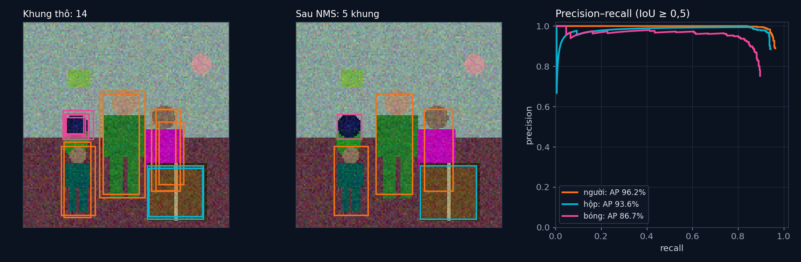

# Tập 2.8 · YOLO: robot nhận ra người và đồ vật

> **Mùa 2 · Biết nhìn** · ⏱ khoảng 45 phút · Độ khó ★★☆ · Cần: đã làm [tập 2.7](../tap27/) ·
> 📚 Giáo trình: Principles of Robot Autonomy, [Chương 10 · Object detection](https://porabook.com/book/object-detection/) ·
> 📺 Video: TikTok [@thanh82k5](https://www.tiktok.com/@thanh82k5) (tìm "Tập 2.8")

[](https://colab.research.google.com/github/thanhpro82/tu-hoc-robot-tu-hanh/blob/main/tap28/tap28_yolo.ipynb)
Không muốn cài gì? Bấm nút trên để làm toàn bộ bài ngay trên trình duyệt.

**Một câu:** YOLO nhìn ảnh **một lần** và đoán ngay mọi vật nằm ở đâu, là gì. Mạng tí hon 247.437 tham số học trên 5000 ảnh, nhận ra người,
hộp, bóng với mAP 92,1%. Bạn tự viết ba thứ biến đầu ra thô của mạng thành kết quả dùng được và chấm được: IoU, NMS, và mAP.



## Trong thư mục này

| File | Dùng khi nào |
|---|---|
| [tap28_yolo.ipynb](tap28_yolo.ipynb) | Làm bài trên Colab hoặc Jupyter |
| [bai_tap/yolo_cua_ban.py](bai_tap/yolo_cua_ban.py) | **Bạn viết code ở đây** (nếu làm trên máy) |
| [bai_tap/kiem_tra.py](bai_tap/kiem_tra.py) | Tự chấm: in ✅ / ❌ cho từng bài |
| [bai_tap/ve_do_thi.py](bai_tap/ve_do_thi.py) | Vẽ khung trước/sau NMS và đường precision-recall bằng code của bạn |
| [sim/yolo.py](sim/yolo.py) | Mô phỏng dùng trong video: tạo dữ liệu, mạng TinyYolo, hàm mất mát, đánh giá |
| [sim/trong_so.pt](sim/trong_so.pt) | Trọng số mạng đã học (1 MB), nạp sẵn để khỏi học lại |
| [bai_tap/loi_giai.py](bai_tap/loi_giai.py) | Lời giải cả 3 bài. Tự làm xong rồi hãy mở |

## 1. Bài toán

Ảnh 128 × 128 có vài người, hộp, bóng ở vị trí và kích thước ngẫu nhiên. YOLO chia ảnh thành lưới 8 × 8; mỗi ô đoán 2 khung (tâm, kích thước,
độ tin cậy) và xác suất 3 lớp, tức 8 × 8 × 13 = 832 con số mỗi ảnh:

```text
 ảnh ─► TinyYolo (1 lượt) ─► 832 số ─► giải mã: khung có điểm > 0,1 ─► 14 khung thô (nhiều khung cho cùng 1 vật)
                                                                              │
                         NMS (Bài 2): giữ khung điểm cao nhất, bỏ khung cùng lớp chồng lên ≥ 50% (đo bằng IoU, Bài 1)
                                                                              ▼
                                            5 khung ─► so với vật thật trên 500 ảnh thử ─► AP từng lớp, mAP (Bài 3)
```

**IoU** (intersection over union) đo hai khung trùng nhau cỡ nào: 1 là trùng khít, 0 là rời nhau.
**AP** là diện tích dưới đường precision-recall: xếp mọi dự đoán theo điểm, đi dần xuống và xem bao nhiêu cái đúng.

## 2. Sau bài này bạn làm được

| # | Bạn có thể… | Kiểm tra bằng | Đạt khi |
|---|---|---|---|
| 1 | Tính IoU của hai khung | `kiem_tra.py` Bài 1 | ✅ |
| 2 | Viết non-maximum suppression | `kiem_tra.py` Bài 2 | ✅ |
| 3 | Tính AP / mAP như các cuộc thi nhận dạng vật | `kiem_tra.py` Bài 3 | ✅, mAP 92,1% (không NMS: 84,4%) như video |
| 4 | Giải thích vì sao thiếu NMS thì mAP tụt | [Câu hỏi tự kiểm tra](#6-câu-hỏi-tự-kiểm-tra) | Tự trả lời được |

## 3. Bạn làm gì

| Bài | Hàm | Việc |
|---|---|---|
| **1** | `iou(a, b)` | Đổi (cx, cy, w, h) ra góc, tính giao / hợp |
| **2** | `nms(du_doan, nguong)` | Xếp theo điểm, giữ dần các khung không chồng ≥ ngưỡng lên khung cùng lớp đã giữ |
| **3** | `ap_lop(du_doan, that, c, nguong_iou)` | Ghép dự đoán với vật thật, cộng dồn TP/FP, tính AP |

Bài 3 nạp mạng đã học của video (`sim/trong_so.pt`) và tạo lại đúng 500 ảnh thử, rồi dùng NMS và AP của bạn để tính mAP.

## 4. Bắt đầu

**Cách 1: Colab.** Bấm nút *Open in Colab* ở đầu trang.

**Cách 2: trên máy** (cần `torch` bản CPU, `numpy`):

```bash
cd tu-hoc-robot-tu-hanh/tap28
python -X utf8 sim/yolo.py             # 1. số liệu trong video (dùng trong_so.pt, tạo lại 5500 ảnh)
python -X utf8 bai_tap/kiem_tra.py     # 2. lúc đầu: ⏳ chưa làm cả 3 bài
# 3. mở bai_tap/yolo_cua_ban.py, làm từng bài, chạy lại kiem_tra.py
python -X utf8 bai_tap/ve_do_thi.py    # 4. vẽ bằng code của bạn -> ket_qua.png
```

Kết quả mong đợi của bước 1 (dòng tốc độ tuỳ máy):

```text
Thiết bị: cpu · 5000 ảnh học, 500 ảnh thử · ảnh 128×128 · 247437 tham số
Đầu ra S×S×(B·5+C) = 8×8×13 = 832 con số mỗi ảnh
Mất mát theo vòng: [4.46, 0.73, 0.74, 0.68, 0.64, 0.59] ... 0.612
Ảnh thử có 1366 vật · khung trước NMS: 3064 · sau NMS: 1523
AP@0,5 từng lớp {'người': 96.2, 'hộp': 93.6, 'bóng': 86.7} · mAP = 92.1% (không NMS: 84.4%)
Ảnh minh hoạ #129: 5 vật, 14 khung thô -> 5 khung sau NMS
```

Kết quả khi làm xong cả 3 bài:

```text
✅ Bài 1 · IoU: IoU đúng: trùng = 1, rời = 0, lệch nửa khung = 1/3
✅ Bài 2 · NMS: giữ khung điểm cao nhất, bỏ khung cùng lớp chồng lên ≥ 50%, không đụng khung khác lớp
✅ Bài 3 · AP và mAP: AP người 96.2% · hộp 93.6% · bóng 86.7% → mAP 92.1% (không NMS: 84.4%) như video; 3064 khung thô → 1523 sau NMS

Đạt 3/3 bài.  🎉 Xong! Thử phần Thử thách trong README nhé.
```

Muốn tự huấn luyện lại mạng từ đầu: xoá `sim/trong_so.pt` rồi chạy `sim/yolo.py` (30 vòng, vài phút nếu có GPU, khá lâu trên CPU).

### Lịch gợi ý (45 phút)

| Phút | Việc |
|--:|:--|
| 10 | Xem video, đọc mục 1, chạy `sim/yolo.py` |
| 30 | Làm Bài 1 → 2 → 3 |
| 5 | Câu hỏi tự kiểm tra, chọn 1 thử thách |

## 5. Thử thách (không chấm)

1. **Ngưỡng NMS:** thử 0,3 và 0,7. mAP thay đổi thế nào? Ngưỡng thấp quá thì hai người đứng sát nhau có bị gộp làm một không?
2. **Ngưỡng IoU khi chấm:** tính mAP với `nguong_iou = 0,75`. Lớp nào tụt nhiều nhất? (Gợi ý: vật nhỏ khó khoanh khít.)
3. **Ngưỡng điểm:** chỉ giữ khung có điểm > 0,5 trước NMS. Precision và recall đổi ra sao?
4. **Lỗi hay gặp:** tìm ảnh thử có dự đoán sai lớp (khung khớp vật nhưng đoán nhầm lớp). Mạng hay nhầm lớp nào với lớp nào?

## 6. Câu hỏi tự kiểm tra

<details><summary>1. Vì sao YOLO đoán nhiều khung cho cùng một vật?</summary>

Mỗi ô lưới đoán 2 khung, và vật to nằm vắt qua nhiều ô, nên vài ô lân cận cùng "thấy" vật đó và cùng đoán. Mạng không tự biết các khung
đó trùng nhau, nên cần NMS để dọn.
</details>

<details><summary>2. Vì sao không NMS thì mAP tụt từ 92,1% xuống 84,4%?</summary>

Với mỗi vật thật chỉ một dự đoán được tính là đúng; các khung trùng còn lại thành dự đoán **sai** (FP), làm precision tụt. Đường precision-recall
thấp xuống, diện tích dưới nó (AP) nhỏ lại.
</details>

<details><summary>3. Vì sao lớp bóng có AP thấp nhất (86,7%)?</summary>

Bóng thường nhỏ hơn người và hộp. Vật nhỏ chiếm ít pixel trong ảnh 128 × 128 và ít ô lưới, nên khó khoanh chính xác: lệch vài pixel là IoU
tụt dưới 0,5 và bị tính là sai.
</details>

<details><summary>4. "Nhìn một lần" khác gì cách cũ?</summary>

Cách cũ (dò cửa sổ trượt, hoặc đề xuất vùng rồi phân loại từng vùng) phải chạy bộ phân loại hàng trăm lần mỗi ảnh. YOLO chạy mạng **một lần**
cho cả ảnh và ra mọi khung cùng lúc, nên đủ nhanh cho robot (mạng tí hon này: vài trăm khung hình mỗi giây).
</details>

## 7. Giới hạn cần biết

- Ảnh và vật là **giả định** tạo bằng code (hình khối đơn giản), dễ hơn ảnh thật nhiều.
- TinyYolo là bản thu nhỏ tự viết theo ý tưởng YOLO gốc (lưới, 2 khung mỗi ô), không phải YOLOv5/v8 có sẵn.
- Cách tính AP (nội suy liên tục kiểu VOC) là phần **mở rộng**; các bộ chấm khác (COCO) tính trung bình nhiều ngưỡng IoU nên ra số khác.

## Đọc thêm

- Sách, [Chương 10](https://porabook.com/book/object-detection/): nhận dạng vật, YOLO, đánh giá bằng mAP.
- Tập trước: [2.7 · CNN](../tap27/) · Tập sau: [2.9 · Tổng kết Mùa 2](../tap29/)

---
[← Về danh sách tập](../README.md)
