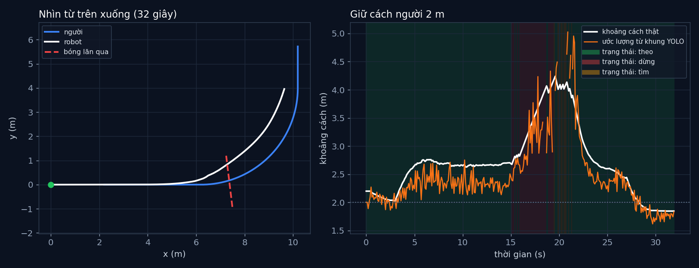

# Tập 2.9 · Tổng kết Mùa 2: robot đi theo bạn

> **Mùa 2 · Biết nhìn** · ⏱ khoảng 35 phút · Độ khó ★★☆ · Cần: đã làm [2.2](../tap22/), [2.8](../tap28/), [1.3](../tap13/) ·
> 📚 Giáo trình: Principles of Robot Autonomy, Chương 6 + 10 (và Chương 3 của Mùa 1) ·
> 📺 Video: TikTok [@thanh82k5](https://www.tiktok.com/@thanh82k5) (tìm "Tập 2.9")

[](https://colab.research.google.com/github/thanhpro82/tu-hoc-robot-tu-hanh/blob/main/tap29/tap29_di_theo.ipynb)
Không muốn cài gì? Bấm nút trên để làm toàn bộ bài ngay trên trình duyệt.

**Một câu:** ghép cả Mùa 2 vào một vòng lặp chạy thật: camera chụp ảnh, YOLO của tập 2.8 tìm người và bóng, công thức camera lỗ kim đổi khung
thành khoảng cách, bộ PI giữ cách người 2 m, và quả bóng lăn ngang thì robot dừng 3,9 s rồi đi tiếp. Bạn tự viết ba khâu sau YOLO.



## Trong thư mục này

| File | Dùng khi nào |
|---|---|
| [tap29_di_theo.ipynb](tap29_di_theo.ipynb) | Làm bài trên Colab hoặc Jupyter |
| [bai_tap/di_theo_cua_ban.py](bai_tap/di_theo_cua_ban.py) | **Bạn viết code ở đây** (nếu làm trên máy) |
| [bai_tap/kiem_tra.py](bai_tap/kiem_tra.py) | Tự chấm: phát lại 320 bước của video bằng code của bạn |
| [bai_tap/ve_do_thi.py](bai_tap/ve_do_thi.py) | Vẽ đường đi và khoảng cách, ra `ket_qua.png` |
| [sim/di_theo.py](sim/di_theo.py) | Mô phỏng dùng trong video (dùng YOLO đã học của `../tap28/sim/`) |
| [bai_tap/loi_giai.py](bai_tap/loi_giai.py) | Lời giải cả 3 bài. Tự làm xong rồi hãy mở |

## 1. Bài toán

Mỗi 0,1 giây, robot làm một vòng:

```text
 ┌─► camera (tập 2.2): vẽ ảnh 128×128 robot nhìn thấy
 │        ▼
 │   YOLO (tập 2.8): khung người, khung bóng
 │        ▼
 │   Bài 1: khung → khoảng cách Z = f·H/h (người cao 1,7 m), hướng = atan((u − u₀)/f)
 │        ▼
 │   Bài 3: chọn trạng thái ── bóng gần ngay trước? → "dừng"
 │        │                 ── thấy người?          → "theo"
 │        │                 ── không thấy gì        → "tìm" (quay về phía thấy lần cuối)
 │        ▼
 │   Bài 2: "theo" → PI: v từ sai số khoảng cách e = Z − 2 m, ω từ hướng
 │        ▼
 └── robot 2 bánh (tập 1.1) di chuyển
```

Không có thước đo khoảng cách nào cả: robot chỉ có một camera. Nó biết người cao khoảng 1,7 m, nên khung càng thấp thì người càng xa (tập 2.2, Bài 3).

## 2. Sau bài này bạn làm được

| # | Bạn có thể… | Kiểm tra bằng | Đạt khi |
|---|---|---|---|
| 1 | Đổi khung YOLO thành khoảng cách và hướng | `kiem_tra.py` Bài 1 | ✅ |
| 2 | Viết bộ PI đi theo, có kẹp tích phân và tốc độ | `kiem_tra.py` Bài 2 | ✅, khớp 271 bước "theo" của video |
| 3 | Viết logic chọn trạng thái (theo / dừng / tìm) | `kiem_tra.py` Bài 3 | ✅, khớp cả 320 bước |
| 4 | Giải thích nguồn sai số khi đo khoảng cách bằng một camera | [Câu hỏi tự kiểm tra](#6-câu-hỏi-tự-kiểm-tra) | Tự trả lời được |

## 3. Bạn làm gì

| Bài | Hàm | Việc |
|---|---|---|
| **1** | `uoc_luong(d)` | Người: `Z = H·F/(h·N)`; bóng: `Z = D·F/(w·N)`; hướng `atan((cx − 0,5)·N/F)` |
| **2** | `lenh(z_hat, huong, tich_phan)` | PI cho v (không lùi), P cho ω, kẹp tích phân trong ±1,5 |
| **3** | `quyet_dinh(dets)` | Bóng gần (< 1,6 m, lệch < 30°) → dừng; có người → theo; còn lại → tìm |

Bài 2–3 chạy lại mô phỏng của video một lần (YOLO + 320 bước) rồi phát lại từng bước: lệnh và trạng thái của bạn phải khớp từng bước.
Khớp hết nghĩa là nếu thay code của bạn vào, robot đi y hệt video.

## 4. Bắt đầu

**Cách 1: Colab.** Bấm nút *Open in Colab* ở đầu trang.

**Cách 2: trên máy** (cần `torch` bản CPU; dùng `../tap28/sim/trong_so.pt`, giữ nguyên cấu trúc thư mục):

```bash
cd tu-hoc-robot-tu-hanh/tap29
python -X utf8 sim/di_theo.py          # 1. số liệu trong video (30–60 giây)
python -X utf8 bai_tap/kiem_tra.py     # 2. lúc đầu: ⏳ chưa làm cả 3 bài
# 3. mở bai_tap/di_theo_cua_ban.py, làm từng bài, chạy lại kiem_tra.py
python -X utf8 bai_tap/ve_do_thi.py    # 4. vẽ đường đi và khoảng cách -> ket_qua.png
```

Kết quả mong đợi của bước 1:

```text
320 bước × 0.1 s = 32 s · thấy người ở 307/320 khung (96%)
Sai số ước lượng khoảng cách: trung bình 26.3 cm, lớn nhất 121.7 cm
Khoảng cách thật khi người đang đi: trung bình 2.65 m (muốn 2.0 m)
Khi người đứng lại (t ≥ 30 s): khoảng cách 1.85 m
Dừng vì bóng: 3.9 s (từ 15.1 s đến 19.4 s)
Khoảng cách gần nhất tới bóng: 1.38 m
Robot đã đi 11.5 m · trạng thái: {'theo': 271, 'dừng': 39, 'tìm': 10}
```

Kết quả khi làm xong cả 3 bài:

```text
✅ Bài 1 · khoảng cách và hướng từ khung: người cao 38 px giữa ảnh → cách 2.66 m; bóng dùng bề rộng; lệch phải thì hướng dương
✅ Bài 2 · lệnh đi theo (PI): phát lại 271 bước 'theo' của video: lệnh v, ω của bạn khớp từng bước
✅ Bài 3 · chọn trạng thái: cả 320 bước khớp video: {'theo': 271, 'dừng': 39, 'tìm': 10} → robot dừng 3.9 s khi bóng lăn qua rồi đi theo tiếp

Đạt 3/3 bài.  🎉 Xong! Thử phần Thử thách trong README nhé.
```

### Lịch gợi ý (35 phút)

| Phút | Việc |
|--:|:--|
| 10 | Xem video, đọc mục 1, chạy `sim/di_theo.py` |
| 20 | Làm Bài 1 → 2 → 3 |
| 5 | Câu hỏi tự kiểm tra, chọn 1 thử thách |

## 5. Thử thách (không chấm)

1. **Bỏ phần I:** đặt `KI = 0` trong `sim/di_theo.py`. Khi người đang đi, robot tụt lại xa hơn bao nhiêu?
2. **Người cao khác:** đổi người thành 1,5 m nhưng robot vẫn tưởng 1,7 m. Robot giữ cách thật bao nhiêu? Vì sao?
3. **Dừng an toàn hơn:** đổi ngưỡng dừng từ 1,6 m thành 2,2 m. Robot dừng lâu hơn bao nhiêu, còn cách bóng gần nhất bao xa?
4. **Lọc nhiễu:** khoảng cách ước lượng nhảy lung tung (đường cam). Thử lấy trung bình 5 khung gần nhất trước khi đưa vào PI.

## 6. Câu hỏi tự kiểm tra

<details><summary>1. Vì sao khoảng cách ước lượng sai trung bình tới 26 cm, có lúc 1,2 m?</summary>

Khung YOLO không bao giờ khít tuyệt đối. Người ở xa chỉ cao khoảng 25 px, lệch 2–3 px chiều cao là sai cả chục phần trăm khoảng cách
(Z tỉ lệ nghịch với h, giống bài stereo 2.4: càng xa càng sai). Khi người đi sát mép ảnh hoặc bị cắt bớt, khung càng sai hơn.
</details>

<details><summary>2. Vì sao người đi thì robot tụt lại ~2,65 m thay vì 2 m?</summary>

Người đi liên tục, robot phải chạy theo với tốc độ khác 0. Phần P cần sai số dương mới ra tốc độ dương; phần I bù dần nhưng bị kẹp trong ±1,5
và chỉ cộng khi đang "theo". Khi người đứng lại, sai số về gần 0 (1,85 m, hơi vượt vì quán tính của phần I).
</details>

<details><summary>3. Vì sao dừng vì bóng phải kiểm tra trước, rồi mới tới đi theo người?</summary>

An toàn quan trọng hơn nhiệm vụ: dù vẫn thấy người, nếu có vật cản ngay phía trước thì phải dừng. Thứ tự kiểm tra trong `quyet_dinh` chính là
thứ tự ưu tiên. Mùa 4 sẽ gọi cách tổ chức này là máy trạng thái.
</details>

<details><summary>4. Hướng dương nghĩa là gì, và vì sao ω lại là âm?</summary>

Hướng dương là người lệch sang phải ảnh. Robot muốn quay về phía người, tức quay phải, mà theo quy ước toán học quay phải là ω âm.
Vì vậy `ω = −KTH·hướng`.
</details>

## 7. Giới hạn cần biết

- Người đi theo lộ trình định sẵn, bóng lăn theo đường thẳng, các hệ số điều khiển, camera f = 60 px và cao 0,5 m là **giả định**.
- Ảnh camera được vẽ bằng code (cảnh đơn giản giống dữ liệu học của tập 2.8). Ảnh thật khó hơn nhiều.
- Robot chỉ có camera, chưa có cách lọc nhiễu theo thời gian; Mùa 3 (bộ lọc Kalman, kết hợp cảm biến) sẽ làm khoảng cách mượt và đáng tin hơn.

## Đọc thêm

- Sách, Chương 6 (camera) và Chương 10 (nhận dạng vật), cùng Chương 3 (điều khiển vòng kín).
- Tập trước: [2.8 · YOLO](../tap28/) · Mùa sau: [3.1 · Tôi đang ở đâu? Bộ lọc Bayes](../tap31/)

---
[← Về danh sách tập](../README.md)
