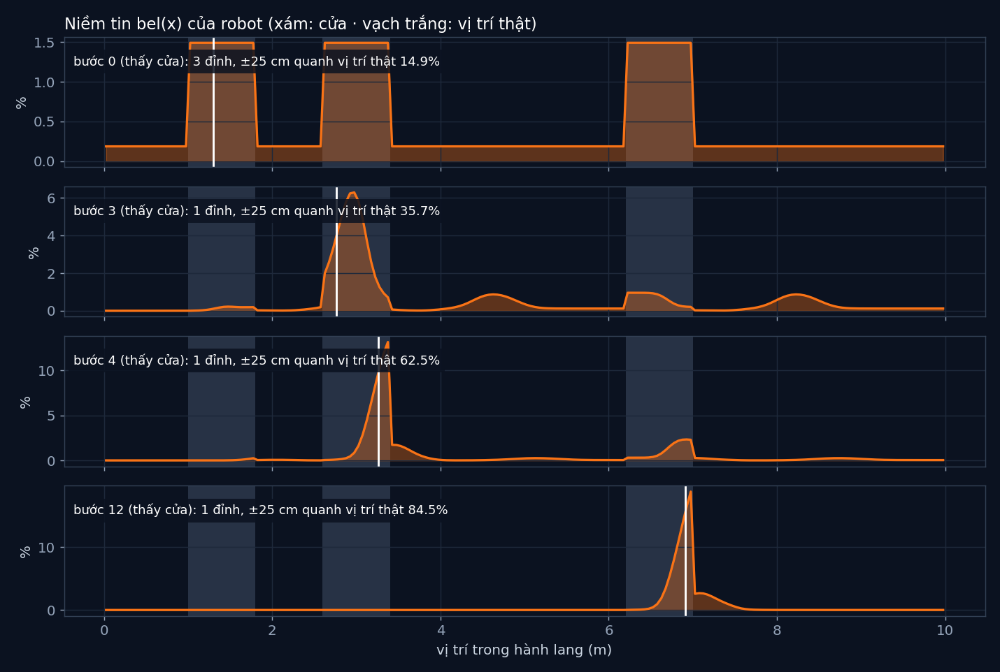

# Tập 3.1 · "Tôi đang ở đâu?": bộ lọc Bayes

> **Mùa 3 · Biết mình ở đâu** · ⏱ khoảng 35 phút · Độ khó ★★☆ · Cần: xác suất có điều kiện cơ bản, numpy ·
> 📚 Giáo trình: Principles of Robot Autonomy, [Chương 11 · Localization & filtering](https://porabook.com/book/localization-filtering/) (Thuật toán 2, Ví dụ 11.3.1) ·
> 📺 Video: TikTok [@thanh82k5](https://www.tiktok.com/@thanh82k5) (tìm "Tập 3.1")

[](https://colab.research.google.com/github/thanhpro82/tu-hoc-robot-tu-hanh/blob/main/tap31/tap31_bayes.ipynb)
Không muốn cài gì? Bấm nút trên để làm toàn bộ bài ngay trên trình duyệt.

**Một câu:** robot bị đặt vào một hành lang có 3 cánh cửa và không biết mình ở đâu. Nó không giữ một vị trí, mà giữ một **niềm tin**: xác suất
cho từng chỗ trong hành lang. Mỗi lần đi, niềm tin trôi và nhoè đi; mỗi lần nhìn, niềm tin sắc lại. Sau 12 bước, 84,5% niềm tin nằm trong
±25 cm quanh vị trí thật. Bạn tự viết cả hai bước của bộ lọc Bayes.



## Trong thư mục này

| File | Dùng khi nào |
|---|---|
| [tap31_bayes.ipynb](tap31_bayes.ipynb) | Làm bài trên Colab hoặc Jupyter |
| [bai_tap/bayes_cua_ban.py](bai_tap/bayes_cua_ban.py) | **Bạn viết code ở đây** (nếu làm trên máy) |
| [bai_tap/kiem_tra.py](bai_tap/kiem_tra.py) | Tự chấm: in ✅ / ❌ cho từng bài |
| [bai_tap/ve_do_thi.py](bai_tap/ve_do_thi.py) | Vẽ niềm tin ở 4 thời điểm bằng bộ lọc của bạn, ra `ket_qua.png` |
| [sim/bayes.py](sim/bayes.py) | Mô phỏng dùng trong video |
| [bai_tap/loi_giai.py](bai_tap/loi_giai.py) | Lời giải cả 3 bài. Tự làm xong rồi hãy mở |

## 1. Bài toán

Hành lang 10 m, chia thành 200 ô 5 cm. Robot mỗi bước đi tới 0,5 m (trượt ngẫu nhiên σ = 0,1 m), rồi nhìn sang bên: cảm biến báo "thấy cửa"
hay "không thấy", và nó cũng hay sai (ở cửa chỉ báo đúng 80%, ở tường vẫn báo nhầm 10%).

```text
 niềm tin bel(x) ─► DỰ ĐOÁN (Bài 2): đi tới 0,5 m        p̄(x_k) = Σ_i p(x_k | x_i, u)·p(x_i)     → trôi + nhoè
        ▲                                                                                              │
        │                                                                                              ▼
        └──────── HIỆU CHỈNH (Bài 1): nhìn cửa             p(x_k) = η·p(z | x_k)·p̄(x_k)           → sắc lại
```

Lần đầu thấy cửa, robot chỉ biết "mình ở trước **một** trong 3 cửa": niềm tin có 3 đỉnh bằng nhau. Nhưng 3 cửa cách nhau không đều, nên
đi tiếp vài bước và thấy cửa lần nữa thì chỉ còn một chỗ khớp với cả hai lần nhìn.

## 2. Sau bài này bạn làm được

| # | Bạn có thể… | Kiểm tra bằng | Đạt khi |
|---|---|---|---|
| 1 | Viết bước hiệu chỉnh (nhân với mô hình đo, chuẩn hoá) | `kiem_tra.py` Bài 1 | ✅, 3 đỉnh như video |
| 2 | Viết bước dự đoán (tích chập với mô hình chuyển động) | `kiem_tra.py` Bài 2 | ✅, 12 bước khớp video |
| 3 | Ghép thành bộ lọc Bayes đầy đủ | `kiem_tra.py` Bài 3 | ✅, cuối cùng ước lượng 6,93 m (thật 6,91 m) |
| 4 | Giải thích vì sao niềm tin có nhiều đỉnh rồi gom lại | [Câu hỏi tự kiểm tra](#6-câu-hỏi-tự-kiểm-tra) | Tự trả lời được |

## 3. Bạn làm gì

| Bài | Hàm | Việc |
|---|---|---|
| **1** | `hieu_chinh(bel_tr, thay_cua)` | Nhân với p(z \| x) (0,8/0,1 nếu thấy, 0,2/0,9 nếu không), chia tổng; trả về `(bel, η)` |
| **2** | `du_doan(bel)` | Ma trận K theo phân phối chuẩn N(x_k − x_i; 0,5, 0,1²), `K @ bel`, chuẩn hoá |
| **3** | `loc_bayes(ds_z)` | Bắt đầu đều; mỗi bước (k > 0) dự đoán rồi hiệu chỉnh; trả về niềm tin từng bước |

Bài 3 dùng đúng chuỗi kết quả cảm biến của lần chạy trong video, nên niềm tin của bạn phải khớp từng bước.

## 4. Bắt đầu

**Cách 1: Colab.** Bấm nút *Open in Colab* ở đầu trang.

**Cách 2: trên máy:**

```bash
cd tu-hoc-robot-tu-hanh/tap31
python -X utf8 sim/bayes.py            # 1. số liệu trong video
python -X utf8 bai_tap/kiem_tra.py     # 2. lúc đầu: ⏳ chưa làm cả 3 bài
# 3. mở bai_tap/bayes_cua_ban.py, làm từng bài, chạy lại kiem_tra.py
python -X utf8 bai_tap/ve_do_thi.py    # 4. vẽ niềm tin -> ket_qua.png
```

Kết quả mong đợi của bước 1 (rút gọn, file in đủ 25 dòng):

```text
bước  0 hiệu chỉnh x thật 1.30 m | thấy cửa   | đỉnh lớn nhất  1.49% tại 1.02 m | số đỉnh 3 | P(±25 cm quanh vị trí thật) = 14.9%
bước  3 hiệu chỉnh x thật 2.76 m | thấy cửa   | đỉnh lớn nhất  6.29% tại 2.98 m | số đỉnh 1 | P(±25 cm quanh vị trí thật) = 35.7%
bước  4 hiệu chỉnh x thật 3.26 m | thấy cửa   | đỉnh lớn nhất 13.17% tại 3.38 m | số đỉnh 1 | P(±25 cm quanh vị trí thật) = 62.5%
bước 12 hiệu chỉnh x thật 6.91 m | thấy cửa   | đỉnh lớn nhất 18.88% tại 6.98 m | số đỉnh 1 | P(±25 cm quanh vị trí thật) = 84.5%
Cuối: ước lượng (trung bình) 6.93 m, thật 6.91 m
```

Kết quả khi làm xong cả 3 bài:

```text
✅ Bài 1 · hiệu chỉnh: thấy cửa lần đầu: niềm tin dồn vào 3 cửa (đỉnh 1.49%, η = 3.73) như video
✅ Bài 2 · dự đoán: mỗi bước niềm tin dịch tới theo lệnh u = 0,5 m và nhoè đi vì nhiễu chuyển động; cả 12 bước dự đoán khớp video
✅ Bài 3 · cả bộ lọc Bayes: số đỉnh: 3 → 1 (bước 3); cuối cùng ước lượng 6.93 m (thật 6.91), 84.5% niềm tin trong ±25 cm như video

Đạt 3/3 bài.  🎉 Xong! Thử phần Thử thách trong README nhé.
```

### Lịch gợi ý (35 phút)

| Phút | Việc |
|--:|:--|
| 5 | Xem video, đọc mục 1 |
| 25 | Làm Bài 1 → 2 → 3 |
| 5 | Câu hỏi tự kiểm tra, chọn 1 thử thách |

## 5. Thử thách (không chấm)

1. **Cửa cách đều:** đổi 3 cửa thành cách đều nhau (vd. 1–1,8, 4–4,8, 7–7,8). Niềm tin còn gom về 1 đỉnh được không? Vì sao?
2. **Cảm biến tốt hơn:** đổi p(thấy | không ở cửa) từ 0,1 thành 0,01. Robot chắc chắn nhanh hơn bao nhiêu bước?
3. **Chỉ đi, không nhìn:** bỏ bước hiệu chỉnh. Niềm tin sau 12 bước trông thế nào?
4. **Bắt cóc:** giữa chừng, nhấc robot sang chỗ khác (đổi `x`). Bộ lọc có tự nhận ra không? Mất bao lâu? (Tập 3.5 bàn kỹ chuyện này.)

## 6. Câu hỏi tự kiểm tra

<details><summary>1. Vì sao lần đầu thấy cửa, niềm tin có đúng 3 đỉnh bằng nhau?</summary>

Trước đó robot chưa biết gì (niềm tin đều). Cảm biến chỉ nói "đang ở trước một cửa", mà 3 cửa giống hệt nhau, nên mọi ô trước cửa được nhân
cùng một hệ số 0,8, mọi ô trước tường nhân 0,1. Kết quả: 3 khối cao bằng nhau ở 3 cửa.
</details>

<details><summary>2. Vì sao bước dự đoán làm niềm tin nhoè ra?</summary>

Robot không đi chính xác 0,5 m: có lúc 0,4, có lúc 0,6. Mỗi khả năng vị trí cũ "toả" ra thành một vùng vị trí mới (phân phối chuẩn σ = 0,1 m).
Cộng tất cả lại là phép tích chập, làm đỉnh thấp xuống và rộng ra: đi mà không nhìn thì càng ngày càng mơ hồ.
</details>

<details><summary>3. Vì sao "không thấy cửa" cũng là thông tin có ích?</summary>

Nó làm giảm niềm tin ở các ô trước cửa (nhân 0,2) so với ô trước tường (nhân 0,9). Một giả thuyết "đáng lẽ phải đang ở trước cửa mà lại không thấy"
sẽ yếu dần qua vài bước như vậy.
</details>

<details><summary>4. η để làm gì?</summary>

Sau khi nhân với p(z | x), tổng các xác suất không còn bằng 1. η = 1/tổng đưa nó về 1 để vẫn là một phân phối xác suất. Giá trị η cũng cho biết
lần đo đó "bất ngờ" cỡ nào: η lớn nghĩa là trước đó robot nghĩ kết quả này khó xảy ra.
</details>

## 7. Giới hạn cần biết

- Cảm biến "thấy cửa", vị trí 3 cửa, xác suất 0,8 và 0,1, bước đi 0,5 m là **giả định**; Ví dụ 11.3.1 của sách dùng cảm biến khoảng cách.
- Hành lang 1 chiều, chia ô 5 cm. Không gian 2D/3D chia ô thì số ô bùng nổ, nên các tập sau dùng Kalman (3.2) và bộ lọc hạt (3.4).
- Seed 36 được chọn để bước đầu tiên thấy cửa (dễ kể chuyện trong video); mọi con số vẫn là kết quả chạy thật.

## Đọc thêm

- Sách, [Chương 11](https://porabook.com/book/localization-filtering/): niềm tin, bộ lọc Bayes, Ví dụ 11.3.1.
- Tập trước: [2.9 · Tổng kết Mùa 2](../tap29/) · Tập sau: [3.2 · Kalman dễ hiểu nhất](../tap32/)

---
[← Về danh sách tập](../README.md)
