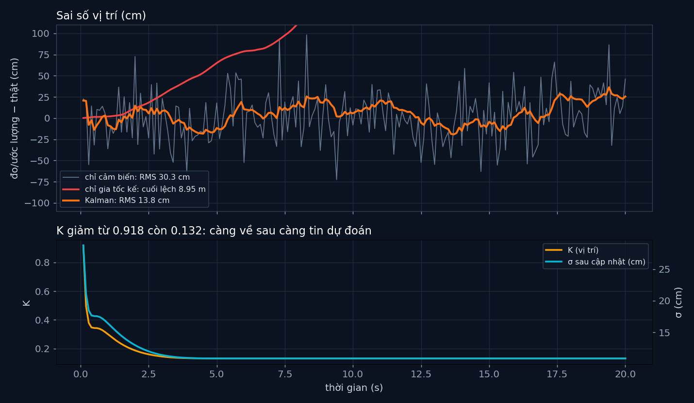

# Tập 3.2 · Kalman dễ hiểu nhất

> **Mùa 3 · Biết mình ở đâu** · ⏱ khoảng 35 phút · Độ khó ★★☆ · Cần: đã làm [tập 3.1](../tap31/), nhân ma trận numpy ·
> 📚 Giáo trình: Principles of Robot Autonomy, [Chương 11](https://porabook.com/book/localization-filtering/) (giới thiệu) và Mục 12.2 (Thuật toán 1, Ví dụ 12.2.1) ·
> 📺 Video: TikTok [@thanh82k5](https://www.tiktok.com/@thanh82k5) (tìm "Tập 3.2")

[](https://colab.research.google.com/github/thanhpro82/tu-hoc-robot-tu-hanh/blob/main/tap32/tap32_kalman.ipynb)
Không muốn cài gì? Bấm nút trên để làm toàn bộ bài ngay trên trình duyệt.

**Một câu:** một cảm biến nhiễu (sai 30 cm) cộng một mô hình bị trôi (cộng dồn gia tốc kế lệch 8,95 m sau 20 s) cho ra một thứ tốt hơn cả hai:
bộ lọc Kalman, sai chỉ 13,8 cm. Bạn tự viết hai bước dự đoán và cập nhật, chính là Thuật toán 1 của sách.



## Trong thư mục này

| File | Dùng khi nào |
|---|---|
| [tap32_kalman.ipynb](tap32_kalman.ipynb) | Làm bài trên Colab hoặc Jupyter |
| [bai_tap/kalman_cua_ban.py](bai_tap/kalman_cua_ban.py) | **Bạn viết code ở đây** (nếu làm trên máy) |
| [bai_tap/kiem_tra.py](bai_tap/kiem_tra.py) | Tự chấm: in ✅ / ❌ cho từng bài |
| [bai_tap/ve_do_thi.py](bai_tap/ve_do_thi.py) | Vẽ sai số, K và σ bằng Kalman của bạn, ra `ket_qua.png` |
| [sim/kalman.py](sim/kalman.py) | Mô phỏng dùng trong video |
| [bai_tap/loi_giai.py](bai_tap/loi_giai.py) | Lời giải cả 3 bài. Tự làm xong rồi hãy mở |

## 1. Bài toán

Robot chạy thẳng 20 giây. Nó có hai nguồn thông tin, cả hai đều tệ:

- **Gia tốc kế** (dùng làm điều khiển u): đo gia tốc, nhiễu 0,3 m/s² và lệch 0,02 m/s². Cộng dồn hai lần ra vị trí thì trôi tới 8,95 m.
- **Cảm biến khoảng cách** (số đo z): đo thẳng vị trí, không trôi, nhưng nhiễu 30 cm.

Bộ lọc Kalman là bộ lọc Bayes (tập 3.1) cho trường hợp mọi thứ là phân phối chuẩn: niềm tin chỉ cần hai thứ, **μ** (ở đâu) và **Σ** (chắc cỡ nào).

```text
  (μ, Σ) ──► DỰ ĐOÁN (Bài 1)                         ──► (μ̄, Σ̄) ──► CẬP NHẬT (Bài 2)                       ──► (μ, Σ)
             μ̄ = Aμ + Bu      (đẩy tới bằng gia tốc kế)            K = Σ̄Cᵀ(CΣ̄Cᵀ + R)⁻¹  (tin số đo bao nhiêu)
             Σ̄ = AΣAᵀ + Q     (bè ra vì nhiễu gia tốc)              μ = μ̄ + K(z − Cμ̄)
                                                                     Σ = (I − KC)Σ̄(I − KC)ᵀ + KRKᵀ   (hẹp lại)
```

`A = [[1, Δt], [0, 1]]`, `B = [Δt²/2, Δt]`, `C = [1, 0]`, Δt = 0,1 s (Ví dụ 12.2.1). **K** là "núm vặn tự động": lúc đầu chưa tin dự đoán thì K ≈ 0,92
(tin gần hết số đo); về sau dự đoán chắc hơn số đo thì K còn 0,13.

## 2. Sau bài này bạn làm được

| # | Bạn có thể… | Kiểm tra bằng | Đạt khi |
|---|---|---|---|
| 1 | Viết bước dự đoán của Kalman | `kiem_tra.py` Bài 1 | ✅ |
| 2 | Viết bước cập nhật (K, dạng Joseph) | `kiem_tra.py` Bài 2 | ✅, K bước 1 = 0,918 như video |
| 3 | Chạy cả bộ lọc trên dữ liệu thật của video | `kiem_tra.py` Bài 3 | ✅, sai 30,3 → 13,8 cm |
| 4 | Giải thích vì sao Kalman tốt hơn cả hai nguồn | [Câu hỏi tự kiểm tra](#6-câu-hỏi-tự-kiểm-tra) | Tự trả lời được |

## 3. Bạn làm gì

| Bài | Hàm | Việc |
|---|---|---|
| **1** | `du_doan(mu, Sig, u)` | `μ̄ = Aμ + Bu`, `Σ̄ = AΣAᵀ + Q` |
| **2** | `cap_nhat(mu_b, Sig_b, z)` | S, K, μ, Σ (dạng Joseph); trả về `(μ, Σ, K)` |
| **3** | `loc_kalman(ds_u, ds_z, mu0, Sig0)` | Mỗi bước dự đoán rồi cập nhật; trả về các μ |

Bài 3 dùng đúng chuỗi số đo gia tốc kế và cảm biến của lần chạy trong video.

## 4. Bắt đầu

**Cách 1: Colab.** Bấm nút *Open in Colab* ở đầu trang.

**Cách 2: trên máy:**

```bash
cd tu-hoc-robot-tu-hanh/tap32
python -X utf8 sim/kalman.py           # 1. số liệu trong video
python -X utf8 bai_tap/kiem_tra.py     # 2. lúc đầu: ⏳ chưa làm cả 3 bài
# 3. mở bai_tap/kalman_cua_ban.py, làm từng bài, chạy lại kiem_tra.py
python -X utf8 bai_tap/ve_do_thi.py    # 4. vẽ bằng Kalman của bạn -> ket_qua.png
```

Kết quả mong đợi của bước 1:

```text
200 bước × 0.1 s · quãng đường thật 27.20 m · Q từ σ_a = 0.3, R = σ_z² = 0.3²
Chỉ cảm biến khoảng cách: sai RMS 30.3 cm, lớn nhất 98.1 cm
Chỉ tích phân gia tốc kế: cuối cùng lệch 8.95 m
Kalman: sai RMS 13.8 cm, lớn nhất 36.3 cm · tốt hơn cảm biến 2.2 lần
K (vị trí) bước 1 = 0.918, bước 10 = 0.301, cuối = 0.132
σ sau cập nhật cuối = 10.9 cm (cảm biến 30 cm, dự đoán 11.7 cm)
Ví dụ bước 51 (t = 5.1 s): dự đoán 6.08 ± 11.7 cm, đo 5.96 ± 30 cm -> sau 6.07 ± 10.9 cm (thật 6.20) · K = 0.132
```

Kết quả khi làm xong cả 3 bài:

```text
✅ Bài 1 · dự đoán: μ̄ = Aμ + Bu đẩy niềm tin tới; Σ̄ = AΣAᵀ + Q làm nó bè ra (thêm bất định của gia tốc kế)
✅ Bài 2 · cập nhật: bước 1: K = 0.918 (chưa tin dự đoán nên tin gần hết số đo)
✅ Bài 3 · cả bộ lọc Kalman: sai RMS: chỉ cảm biến 30.3 cm → Kalman 13.8 cm, tốt hơn 2.2 lần như video

Đạt 3/3 bài.  🎉 Xong! Thử phần Thử thách trong README nhé.
```

### Lịch gợi ý (35 phút)

| Phút | Việc |
|--:|:--|
| 5 | Xem video, đọc mục 1 |
| 25 | Làm Bài 1 → 2 → 3 |
| 5 | Câu hỏi tự kiểm tra, chọn 1 thử thách |

## 5. Thử thách (không chấm)

1. **Khai sai R:** cho bộ lọc tưởng cảm biến tốt hơn thật (R = 0,05²) hoặc tệ hơn (R = 1²). Sai RMS đổi ra sao?
2. **Khai sai Q:** nhân Q lên 10 lần, rồi chia 10 lần. Bộ lọc "lì" hay "nhạy" hơn?
3. **Mất cảm biến:** từ giây 10 đến 14 bỏ bước cập nhật (chỉ dự đoán). σ tăng tới bao nhiêu? Lúc có lại số đo, K vọt lên bao nhiêu?
4. **Lệch gia tốc kế:** lệch 0,02 m/s² không có trong mô hình. Thêm "lệch" vào trạng thái (x = [p, v, lệch]) để Kalman tự ước lượng nó.

## 6. Câu hỏi tự kiểm tra

<details><summary>1. Vì sao Kalman tốt hơn cả cảm biến lẫn gia tốc kế?</summary>

Hai nguồn sai theo hai kiểu khác nhau: cảm biến nhảy lung tung nhưng không trôi, gia tốc kế mượt nhưng trôi dần. Kalman dùng gia tốc kế để dự đoán
mượt giữa các lần đo, rồi dùng cảm biến để kéo dự đoán về đúng chỗ, không cho nó trôi. Mỗi nguồn bù đúng điểm yếu của nguồn kia.
</details>

<details><summary>2. Vì sao K giảm dần rồi đứng yên ở 0,132?</summary>

Lúc đầu robot chưa chắc vị trí (Σ lớn), nên tin số đo (K lớn). Mỗi lần cập nhật Σ hẹp lại, dự đoán chắc dần nên K nhỏ dần. Tới lúc lượng bất định thêm
vào mỗi bước (Q) cân bằng với lượng số đo kéo bớt đi, Σ và K đứng yên ở trạng thái ổn định.
</details>

<details><summary>3. Vì sao σ sau cập nhật (10,9 cm) nhỏ hơn cả cảm biến (30 cm) lẫn dự đoán (11,7 cm)?</summary>

Gộp hai phân phối chuẩn độc lập thì độ bất định giảm: 1/σ² = 1/σ₁² + 1/σ₂². Hai nguồn thông tin, dù một nguồn tệ, vẫn tốt hơn một nguồn.
</details>

<details><summary>4. Vì sao dùng dạng Joseph cho Σ thay vì (I − KC)Σ̄ cho gọn?</summary>

Về toán học hai cách bằng nhau. Nhưng máy tính làm tròn số; dạng ngắn có thể làm Σ hết đối xứng hoặc ra giá trị âm sau nhiều bước. Dạng Joseph là
tổng của hai ma trận dạng "XΣXᵀ" nên luôn đối xứng và dương, an toàn hơn.
</details>

## 7. Giới hạn cần biết

- Hồ sơ gia tốc, nhiễu và lệch của gia tốc kế (σ = 0,3 m/s², lệch 0,02 m/s²), cảm biến σ = 0,3 m, Δt = 0,1 s là **giả định** (mở rộng của Ví dụ 12.2.1).
- Lệch gia tốc kế không có trong mô hình của bộ lọc (bộ lọc không biết nó), nên ước lượng hơi lệch một chiều về cuối.
- Mô hình tuyến tính 1 chiều. Robot thật quay, nên phương trình không còn tuyến tính: tập 3.3 (EKF, UKF) xử lý chuyện đó.

## Đọc thêm

- Sách, Mục 12.2: bộ lọc Kalman, Thuật toán 1, Ví dụ 12.2.1.
- Tập trước: [3.1 · Bộ lọc Bayes](../tap31/) · Tập sau: [3.3 · EKF và UKF](../tap33/)

---
[← Về danh sách tập](../README.md)
