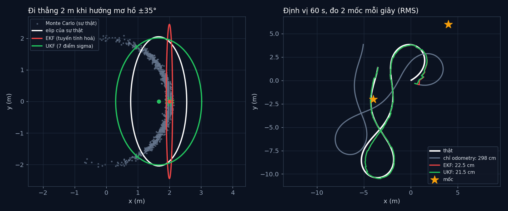

# Tập 3.3 · EKF và UKF: Kalman cho thế giới cong

> **Mùa 3 · Biết mình ở đâu** · ⏱ khoảng 45 phút · Độ khó ★★★ · Cần: đã làm [tập 3.2](../tap32/), biết đạo hàm riêng ·
> 📚 Giáo trình: Principles of Robot Autonomy, [Chương 12 · Approximate filters](https://porabook.com/book/approximate-filters/) (Mục 12.3, Thuật toán 2–3, Ví dụ 12.3.1) ·
> 📺 Video: TikTok [@thanh82k5](https://www.tiktok.com/@thanh82k5) (tìm "Tập 3.3")

[](https://colab.research.google.com/github/thanhpro82/tu-hoc-robot-tu-hanh/blob/main/tap33/tap33_ekf_ukf.ipynb)
Không muốn cài gì? Bấm nút trên để làm toàn bộ bài ngay trên trình duyệt.

**Một câu:** robot thật quay, nên chuyển động và phép đo đều "cong" (có sin, cos, atan2), Kalman thường không dùng được. EKF xấp xỉ đường cong bằng
đường thẳng (đạo hàm); UKF bắn 7 "điểm sigma" qua hàm cong thật rồi gộp lại. Khi hướng mơ hồ ±35°, EKF đoán tâm lệch 33,9 cm, UKF chỉ 0,3 cm.
Bạn tự viết hai ma trận Jacobi của EKF và các điểm sigma của UKF.



## Trong thư mục này

| File | Dùng khi nào |
|---|---|
| [tap33_ekf_ukf.ipynb](tap33_ekf_ukf.ipynb) | Làm bài trên Colab hoặc Jupyter |
| [bai_tap/ekf_ukf_cua_ban.py](bai_tap/ekf_ukf_cua_ban.py) | **Bạn viết code ở đây** (nếu làm trên máy) |
| [bai_tap/kiem_tra.py](bai_tap/kiem_tra.py) | Tự chấm: in ✅ / ❌ cho từng bài |
| [bai_tap/ve_do_thi.py](bai_tap/ve_do_thi.py) | Vẽ elip EKF/UKF bằng hàm của bạn và đường định vị, ra `ket_qua.png` |
| [sim/ekf_ukf.py](sim/ekf_ukf.py) | Mô phỏng dùng trong video: Phần A (một bước cong), Phần B (định vị 60 s) |
| [bai_tap/loi_giai.py](bai_tap/loi_giai.py) | Lời giải (trỏ vào code video). Tự làm xong rồi hãy mở |

## 1. Bài toán

Trạng thái `x = [p_x, p_y, θ]`. Chuyển động unicycle và phép đo khoảng cách + góc tới mốc (Ví dụ 12.3.1) đều phi tuyến:

```text
 f(x, u) = [p_x + v·dt·cos θ,  p_y + v·dt·sin θ,  θ + ω·dt]          h(x, ℓ) = [√(Δx² + Δy²),  atan2(Δy, Δx) − θ]
```

Đưa một phân phối chuẩn qua hàm cong thì ra một hình **không còn** chuẩn (trong hình: hình trăng khuyết). Hai cách xấp xỉ:

```text
 EKF (Thuật toán 2): thay f, h bằng đường thẳng tiếp tuyến tại μ        UKF (Thuật toán 3): chọn 2n+1 = 7 điểm đại diện
     μ̄ = f(μ, u),  Σ̄ = F Σ Fᵀ + Q,  F = ∂f/∂x  (Bài 1)                    X_0 = μ,  X_i = μ ± cột của √((n+λ)Σ)   (Bài 3)
     K = Σ̄Hᵀ(HΣ̄Hᵀ + R)⁻¹,          H = ∂h/∂x  (Bài 2)                    đưa từng điểm qua f, h THẬT, gộp lại bằng trọng số
```

Phần B: robot chạy 60 s theo hình số 8, đo 2 mốc mỗi giây, đoán ban đầu lệch 50 cm và sai hướng 50°.

## 2. Sau bài này bạn làm được

| # | Bạn có thể… | Kiểm tra bằng | Đạt khi |
|---|---|---|---|
| 1 | Tính Jacobi của mô hình chuyển động | `kiem_tra.py` Bài 1 | ✅, khớp đạo hàm số |
| 2 | Tính Jacobi của phép đo khoảng cách + góc | `kiem_tra.py` Bài 2 | ✅ |
| 3 | Sinh điểm sigma và trọng số của UKF | `kiem_tra.py` Bài 3 | ✅, UKF ra tâm 1,660 m (sự thật 1,661); EKF/UKF RMS 22,5 / 21,5 cm |
| 4 | Giải thích khi nào EKF hỏng và UKF tốt hơn | [Câu hỏi tự kiểm tra](#6-câu-hỏi-tự-kiểm-tra) | Tự trả lời được |

## 3. Bạn làm gì

| Bài | Hàm | Việc |
|---|---|---|
| **1** | `F_jac(x, u, dt)` | Ma trận 3×3, chỉ cột θ có số khác 0/1 |
| **2** | `H_jac(x, l)` | Ma trận 2×3 theo Δx, Δy, q, r |
| **3** | `diem_sigma(mu, Sig)` | λ, Cholesky, 7 điểm, trọng số Wm, Wc (α = 1, β = 2, κ = 0) |

Sau Bài 3, bộ chấm chạy lại Phần B của video (cùng chuỗi số ngẫu nhiên) với cả 3 hàm của bạn thay vào EKF và UKF.

## 4. Bắt đầu

**Cách 1: Colab.** Bấm nút *Open in Colab* ở đầu trang.

**Cách 2: trên máy:**

```bash
cd tu-hoc-robot-tu-hanh/tap33
python -X utf8 sim/ekf_ukf.py          # 1. số liệu trong video
python -X utf8 bai_tap/kiem_tra.py     # 2. lúc đầu: ⏳ chưa làm cả 3 bài
# 3. mở bai_tap/ekf_ukf_cua_ban.py, làm từng bài, chạy lại kiem_tra.py
python -X utf8 bai_tap/ve_do_thi.py    # 4. vẽ bằng hàm của bạn -> ket_qua.png
```

Kết quả mong đợi của bước 1:

```text
Phần A: hướng mơ hồ ±35°, đi thẳng 2 m
  Monte Carlo (sự thật): tâm (1.661, 0.002) m
  EKF: tâm (2.000, 0.000) -> lệch 33.9 cm
  UKF (7 điểm sigma): tâm (1.660, 0.000) -> lệch 0.3 cm
  σx: MC 44.4 cm · EKF 5.0 cm · UKF 68.1 cm
  σy: MC 102.5 cm · EKF 122.3 cm · UKF 100.7 cm
Phần B: 60 s, đo 2 mốc mỗi 1 s, đoán ban đầu lệch 50 cm, hướng sai 50°
  Chỉ odometry: RMS 297.9 cm · cuối lệch 2.93 m
  EKF: RMS 22.5 cm · 10 s đầu 36.5 cm · sau đó 18.5 cm
  UKF: RMS 21.5 cm · 10 s đầu 32.6 cm · sau đó 18.4 cm
  ekf: lần đầu dưới 20 cm ở t = 8.0 s
  ukf: lần đầu dưới 20 cm ở t = 7.4 s
```

Kết quả khi làm xong cả 3 bài:

```text
✅ Bài 1 · Jacobi chuyển động (EKF): EKF tuyến tính hoá tại tâm: σx = 5.0 cm, σy = 122.3 cm (Monte Carlo: 44.4 và 102.5 cm)
✅ Bài 2 · Jacobi phép đo (EKF): H đúng: khoảng cách đổi theo vị trí, góc đổi theo cả vị trí lẫn hướng (−1 ở cột θ)
✅ Bài 3 · điểm sigma (UKF): Phần A: UKF ra tâm x = 1.660 m (Monte Carlo 1.661, EKF 2.000); Phần B với 3 hàm của bạn: EKF RMS 22.5 cm, UKF 21.5 cm như video

Đạt 3/3 bài.  🎉 Xong! Thử phần Thử thách trong README nhé.
```

### Lịch gợi ý (45 phút)

| Phút | Việc |
|--:|:--|
| 10 | Xem video, đọc mục 1 |
| 30 | Làm Bài 1 → 2 → 3 |
| 5 | Câu hỏi tự kiểm tra, chọn 1 thử thách |

## 5. Thử thách (không chấm)

1. **Hướng rõ hơn:** đổi độ mơ hồ hướng trong `SIG_A` từ 35° xuống 5°. EKF còn lệch nhiều không? Kết luận gì về khi nào EKF đủ tốt?
2. **Đo thưa hơn:** đo mốc mỗi 3 giây thay vì 1 giây. EKF và UKF, cái nào giữ được tốt hơn?
3. **Một mốc:** bỏ mốc thứ hai. Robot còn định vị được không? Vì sao (gợi ý: một mốc cho bao nhiêu thông tin)?
4. **Tham số UKF:** thử κ = 1 hoặc α = 0,5. Tâm và độ rộng của UKF ở Phần A thay đổi thế nào?

## 6. Câu hỏi tự kiểm tra

<details><summary>1. Vì sao EKF đoán tâm ở 2,000 m trong khi sự thật là 1,661 m?</summary>

EKF chỉ đưa **tâm** μ (hướng 0°) qua f, được đúng 2 m về phía trước. Nhưng hướng thật có thể lệch ±35°, khi đó robot đi chéo và tiến ít hơn theo trục x
(2·cos 35° ≈ 1,64 m). Trung bình các trường hợp là 1,661 m. Phép tuyến tính hoá tại một điểm không thấy được sự "cong" này.
</details>

<details><summary>2. UKF làm được nhờ đâu?</summary>

7 điểm sigma trải ra theo độ bất định của Σ, gồm cả những điểm hướng lệch sang hai bên. Đưa từng điểm qua f **thật** (có cos) rồi lấy trung bình có
trọng số, nên phần "đi chéo tiến ít hơn" được tính vào. Không cần đạo hàm.
</details>

<details><summary>3. Ở Phần B, EKF và UKF ra gần bằng nhau (22,5 và 21,5 cm). Vậy UKF có đáng không?</summary>

Khi đo mốc đều đặn, Σ luôn nhỏ, hàm cong trong vùng nhỏ đó gần như thẳng, nên EKF đủ tốt. Khác biệt rõ ở lúc đầu (10 s đầu: 36,5 so với 32,6 cm),
khi hướng còn sai nhiều. UKF có lợi khi bất định lớn, và không cần tự tính Jacobi (dễ sai khi mô hình phức tạp).
</details>

<details><summary>4. Vì sao phải bọc góc (hàm goc) khi trừ hai góc?</summary>

Góc 179° và −179° chỉ cách nhau 2°, nhưng trừ thẳng ra 358°. Không bọc về [−π, π) thì phần chênh lệch số đo (innovation) sai bét và bộ lọc nhảy loạn.
</details>

## 7. Giới hạn cần biết

- Mọi tham số nhiễu, quỹ đạo, vị trí mốc, α = 1, β = 2, κ = 0 là **giả định**.
- Mốc được nhận ra chắc chắn (biết số đo nào của mốc nào). Ngoài đời phải giải quyết "ghép số đo với mốc" (data association).
- IMU có lệch nhẹ 1°/s không có trong mô hình của bộ lọc, giống tập 3.2.

## Đọc thêm

- Sách, [Chương 12](https://porabook.com/book/approximate-filters/), Mục 12.3: EKF (Thuật toán 2), UKF (Thuật toán 3), Ví dụ 12.3.1.
- Tập trước: [3.2 · Kalman](../tap32/) · Tập sau: [3.4 · Bộ lọc hạt](../tap34/)

---
[← Về danh sách tập](../README.md)
