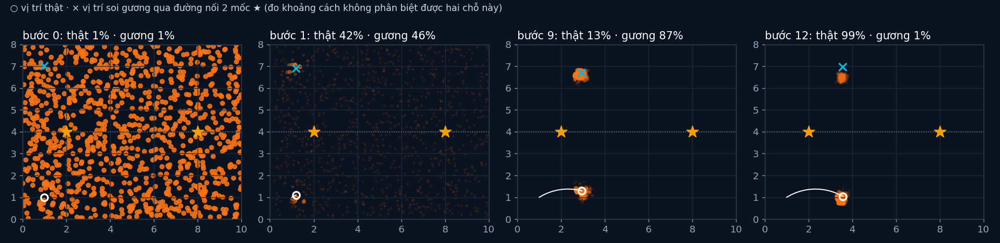

# Tập 3.4 · Bộ lọc hạt: ngàn phỏng đoán

> **Mùa 3 · Biết mình ở đâu** · ⏱ khoảng 40 phút · Độ khó ★★☆ · Cần: đã làm [tập 3.1](../tap31/), numpy ·
> 📚 Giáo trình: Principles of Robot Autonomy, [Chương 12 · Approximate filters](https://porabook.com/book/approximate-filters/) (Mục 12.4.2, Thuật toán 5) ·
> 📺 Video: TikTok [@thanh82k5](https://www.tiktok.com/@thanh82k5) (tìm "Tập 3.4")

[](https://colab.research.google.com/github/thanhpro82/tu-hoc-robot-tu-hanh/blob/main/tap34/tap34_hat.ipynb)
Không muốn cài gì? Bấm nút trên để làm toàn bộ bài ngay trên trình duyệt.

**Một câu:** thay vì một hình chuông (Kalman), robot giữ **1000 phỏng đoán** rải khắp phòng. Hạt nào khớp số đo thì sống, hạt nào sai thì chết.
Đo khoảng cách tới 2 mốc không phân biệt được vị trí thật với vị trí "soi gương" của nó, nên có lúc 87% hạt tin nhầm. Rẽ một khúc là đám hạt
nhận ra và gom 99,4% về đúng chỗ. Bạn tự viết cả ba bước của bộ lọc hạt.



## Trong thư mục này

| File | Dùng khi nào |
|---|---|
| [tap34_hat.ipynb](tap34_hat.ipynb) | Làm bài trên Colab hoặc Jupyter |
| [bai_tap/hat_cua_ban.py](bai_tap/hat_cua_ban.py) | **Bạn viết code ở đây** (nếu làm trên máy) |
| [bai_tap/kiem_tra.py](bai_tap/kiem_tra.py) | Tự chấm: chạy lại cả bộ lọc của video bằng code của bạn |
| [bai_tap/ve_do_thi.py](bai_tap/ve_do_thi.py) | Vẽ đám hạt ở 4 thời điểm, ra `ket_qua.png` |
| [sim/hat.py](sim/hat.py) | Mô phỏng dùng trong video |
| [bai_tap/loi_giai.py](bai_tap/loi_giai.py) | Lời giải cả 3 bài. Tự làm xong rồi hãy mở |

## 1. Bài toán

Phòng 10 × 8 m có 2 mốc phát sóng. Robot biết hướng (la bàn ±5°) nhưng không biết mình ở đâu, và chỉ đo được khoảng cách tới 2 mốc (σ = 0,2 m).
Hai mốc nằm trên đường y = 4, nên điểm (x, y) và điểm soi gương (x, 8 − y) cho **cùng** hai khoảng cách. Niềm tin có hai đỉnh, Kalman không biểu diễn nổi.

Bộ lọc hạt (Thuật toán 5), mỗi bước:

```text
 1000 hạt ─► (1) DỰ ĐOÁN: mỗi hạt tự đi theo lệnh (v, ω), cộng nhiễu riêng
          ─► (2) TRỌNG SỐ (Bài 1): w ∝ w_cũ · exp(−½ Σ (d_hạt→mốc − z)² / σ²)      hạt khớp số đo thì nặng
          ─► ESS = 1/Σw² (Bài 2): còn bao nhiêu hạt "có ích"?
          ─► (3) LẤY MẪU LẠI (Bài 3) nếu ESS < 500: chọn lại 1000 hạt theo trọng số   hạt nặng nhân bản, hạt nhẹ biến mất
```

Đi thẳng thì cả hai cụm (thật và soi gương) đều khớp mãi. Phải **rẽ** thì cụm soi gương mới đi sai hướng so với số đo và bị loại.

## 2. Sau bài này bạn làm được

| # | Bạn có thể… | Kiểm tra bằng | Đạt khi |
|---|---|---|---|
| 1 | Gán trọng số cho hạt theo mô hình đo | `kiem_tra.py` Bài 1 | ✅ |
| 2 | Đo độ suy biến của đám hạt bằng ESS | `kiem_tra.py` Bài 2 | ✅, bước 1 ESS = 16/1000 |
| 3 | Viết lấy mẫu lại kiểu hệ thống | `kiem_tra.py` Bài 3 | ✅, cả 40 bước khớp video; bước 12 gom 99,4% về đúng chỗ |
| 4 | Giải thích vì sao bộ lọc hạt hợp với niềm tin nhiều đỉnh | [Câu hỏi tự kiểm tra](#6-câu-hỏi-tự-kiểm-tra) | Tự trả lời được |

## 3. Bạn làm gì

| Bài | Hàm | Việc |
|---|---|---|
| **1** | `trong_so(P, z, W)` | Khoảng cách từ mỗi hạt tới 2 mốc, trừ z, mũ Gauss, nhân W cũ, chuẩn hoá |
| **2** | `ess(w)` | `1 / Σ w²` |
| **3** | `lay_mau_lai(w, r)` | K mốc cách đều `(r + i)/K` trên tổng dồn của w (`np.searchsorted`) |

Bài 3 chạy lại toàn bộ bộ lọc của video (cùng seed, cùng thứ tự dùng số ngẫu nhiên) bằng 3 hàm của bạn: đám hạt phải khớp từng bước.

## 4. Bắt đầu

**Cách 1: Colab.** Bấm nút *Open in Colab* ở đầu trang.

**Cách 2: trên máy:**

```bash
cd tu-hoc-robot-tu-hanh/tap34
python -X utf8 sim/hat.py              # 1. số liệu trong video
python -X utf8 bai_tap/kiem_tra.py     # 2. lúc đầu: ⏳ chưa làm cả 3 bài
# 3. mở bai_tap/hat_cua_ban.py, làm từng bài, chạy lại kiem_tra.py
python -X utf8 bai_tap/ve_do_thi.py    # 4. vẽ đám hạt -> ket_qua.png
```

Kết quả mong đợi của bước 1 (rút gọn, file in đầy đủ từng bước):

```text
K = 1000 hạt · phòng 10.0 × 8.0 m · 2 mốc [[2.0, 4.0], [8.0, 4.0]] · đo khoảng cách σ = 0.2 m
bước  1 trọng số     | hạt quanh vị trí thật (±0,5 m)  42.1% | quanh vị trí soi gương  45.7% | tâm đám hạt lệch 3.11 m | ESS 16
bước  9 trọng số     | hạt quanh vị trí thật (±0,5 m)  13.3% | quanh vị trí soi gương  86.7% | tâm đám hạt lệch 4.61 m | ESS 450
bước 12 trọng số     | hạt quanh vị trí thật (±0,5 m)  99.4% | quanh vị trí soi gương   0.6% | tâm đám hạt lệch 0.08 m | ESS 279
bước 40 lấy mẫu lại  | hạt quanh vị trí thật (±0,5 m) 100.0% | quanh vị trí soi gương   0.0% | tâm đám hạt lệch 0.06 m | ESS 528
ESS sau khi gán trọng số: bước 1 = 16, nhỏ nhất = 16, trung bình = 548 (trên 1000)
```

Kết quả khi làm xong cả 3 bài:

```text
✅ Bài 1 · trọng số: hạt nào cho khoảng cách tới 2 mốc gần số đo thì nặng hơn
✅ Bài 2 · cỡ mẫu hiệu dụng: bước 1: ESS = 16/1000 (chỉ ~16 hạt còn đáng kể), trung bình cả 40 bước 548
✅ Bài 3 · lấy mẫu lại: bước 9: 86.7% hạt tin nhầm vị trí soi gương; bước 12 (sau khi rẽ): 99.4% quanh vị trí thật, như video

Đạt 3/3 bài.  🎉 Xong! Thử phần Thử thách trong README nhé.
```

### Lịch gợi ý (40 phút)

| Phút | Việc |
|--:|:--|
| 5 | Xem video, đọc mục 1 |
| 30 | Làm Bài 1 → 2 → 3 |
| 5 | Câu hỏi tự kiểm tra, chọn 1 thử thách |

## 5. Thử thách (không chấm)

1. **Ít hạt:** đổi K = 100. Bộ lọc còn tìm ra vị trí không? Thử vài seed khác.
2. **Luôn lấy mẫu lại:** bỏ điều kiện ESS < 500 (bước nào cũng lấy mẫu lại). Cụm soi gương có biến mất sớm hơn, kể cả khi nó đúng?
3. **Đi thẳng mãi:** đổi `lenh` cho robot đi thẳng suốt. Đám hạt có bao giờ quyết được không?
4. **Thêm mốc thứ 3:** đặt mốc ở (5, 1). Còn hiện tượng soi gương không?

## 6. Câu hỏi tự kiểm tra

<details><summary>1. Vì sao ESS chỉ còn 16 sau lần đo đầu tiên?</summary>

Hạt lúc đầu rải đều khắp phòng 80 m². Chỉ vài chục hạt tình cờ nằm gần hai chỗ khớp số đo, phần lớn còn lại nhận trọng số gần 0. Trọng số dồn vào
một nhóm nhỏ, nên "số hạt có ích" chỉ còn khoảng 16. Đó là lúc cần lấy mẫu lại.
</details>

<details><summary>2. Vì sao có lúc 87% hạt tin nhầm vị trí soi gương?</summary>

Khi robot đi gần như song song với đường nối 2 mốc, vị trí soi gương cho số đo gần y hệt vị trí thật. Nhiễu ngẫu nhiên vô tình nghiêng về phía soi gương
vài lần, lấy mẫu lại khuếch đại thêm. Khi robot rẽ, cụm soi gương (đi đối xứng, sai hướng) bắt đầu cho khoảng cách lệch số đo và chết dần.
</details>

<details><summary>3. Vì sao chỉ lấy mẫu lại khi ESS < K/2?</summary>

Mỗi lần lấy mẫu lại có thể vô tình làm mất hạt tốt (nhất là ở cụm nhỏ). Giữ trọng số và nhân dồn qua vài bước giúp giữ được nhiều giả thuyết lâu hơn;
chỉ khi trọng số quá lệch (ESS thấp) mới lấy mẫu lại để tập trung hạt vào chỗ đáng giá.
</details>

<details><summary>4. Vì sao lấy mẫu lại kiểu "hệ thống" mà không rút 1000 lần ngẫu nhiên?</summary>

Rút độc lập 1000 lần thì có thể rút trùng hạt nặng quá nhiều và bỏ sót hạt vừa vừa, chỉ do may rủi. Kiểu hệ thống dùng một số ngẫu nhiên duy nhất và
1000 mốc cách đều, nên hạt nặng w được chọn đúng khoảng w·K lần, ít dao động hơn.
</details>

## 7. Giới hạn cần biết

- La bàn biết hướng ±5°, phòng 10 × 8 m, 2 mốc, σ = 0,2 m là **giả định**. Lấy mẫu lại kiểu hệ thống, ngưỡng ESS và "rung nhẹ" hạt là phần **mở rộng**.
- Seed 39 được chọn để có lúc đám hạt tin nhầm (dễ kể chuyện); mọi con số vẫn là kết quả chạy thật.
- Định vị trên bản đồ thật bằng LiDAR (bộ lọc hạt Monte Carlo) là tập 3.5.

## Đọc thêm

- Sách, [Chương 12](https://porabook.com/book/approximate-filters/), Mục 12.4: bộ lọc hạt, Thuật toán 5.
- Tập trước: [3.3 · EKF và UKF](../tap33/) · Tập sau: [3.5 · Định vị trên bản đồ, robot bị bắt cóc](../tap35/)

---
[← Về danh sách tập](../README.md)
