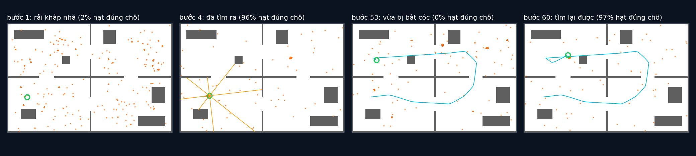

# Tập 3.5 · Định vị trên bản đồ có sẵn: robot bị bắt cóc

> **Mùa 3 · Biết mình ở đâu** · ⏱ khoảng 45 phút · Độ khó ★★☆ · Cần: đã làm [tập 3.4](../tap34/) ·
> 📚 Giáo trình: Principles of Robot Autonomy, [Chương 13 · Robot localization](https://porabook.com/book/robot-localization/) (Thuật toán 4, Eq. 13.2–13.3, ghi chú lề §13.6) ·
> 📺 Video: TikTok [@thanh82k5](https://www.tiktok.com/@thanh82k5) (tìm "Tập 3.5")

[](https://colab.research.google.com/github/thanhpro82/tu-hoc-robot-tu-hanh/blob/main/tap35/tap35_mcl.ipynb)
Không muốn cài gì? Bấm nút trên để làm toàn bộ bài ngay trên trình duyệt.

**Một câu:** robot có bản đồ căn hộ và một LiDAR 8 tia. Bật lên ở chỗ không biết, sau 4 bước nó đã tìm ra mình ở đâu. Giữa chừng có người nhấc nó
sang phòng khác (bắt cóc): bản thả thêm 3% hạt ngẫu nhiên mỗi bước tìm lại được sau 8 bước, bản không thả thì lạc mãi. Bạn tự viết phép dò tia,
trọng số theo bản đồ, và mẹo thả hạt.



## Trong thư mục này

| File | Dùng khi nào |
|---|---|
| [tap35_mcl.ipynb](tap35_mcl.ipynb) | Làm bài trên Colab hoặc Jupyter |
| [bai_tap/mcl_cua_ban.py](bai_tap/mcl_cua_ban.py) | **Bạn viết code ở đây** (nếu làm trên máy) |
| [bai_tap/kiem_tra.py](bai_tap/kiem_tra.py) | Tự chấm: Bài 3 chạy lại cả 100 bước của video bằng code của bạn |
| [bai_tap/ve_do_thi.py](bai_tap/ve_do_thi.py) | Vẽ đám hạt trên bản đồ, ra `ket_qua.png` |
| [sim/mcl.py](sim/mcl.py) | Mô phỏng dùng trong video |
| [bai_tap/loi_giai.py](bai_tap/loi_giai.py) | Lời giải cả 3 bài. Tự làm xong rồi hãy mở |

## 1. Bài toán

Ba bài toán định vị (Mục 13.1): **bám vị trí** (biết chỗ bắt đầu), **định vị toàn cục** (không biết gì), **robot bị bắt cóc** (đang biết thì bị
dời đi mà không báo). Monte Carlo Localization (Thuật toán 4) là bộ lọc hạt của tập 3.4, cộng thêm bản đồ:

```text
 2000 hạt ─► đi theo lệnh (có nhiễu)
          ─► mỗi hạt "giả vờ" quét LiDAR trên bản đồ (Bài 1): 8 khoảng cách dự đoán
          ─► trọng số = Π_8 tia p(tia đo | tia dự đoán)   ·  hạt nằm trong tường = 0   (Bài 2, Eq. 13.2–13.3)
          ─► lấy mẫu lại 2000 hạt
          ─► thay 3% hạt bằng hạt rải ngẫu nhiên khắp nhà (Bài 3, ghi chú lề §13.6)
```

Vì sao cần bước cuối? Sau khi tìm ra vị trí, mọi hạt tụ về một chỗ. Bị bắt cóc thì không còn hạt nào ở chỗ mới, lấy mẫu lại mãi cũng chỉ nhân bản
hạt sai. Vài hạt ngẫu nhiên mỗi bước như "người đi tuần": hạt nào tình cờ rơi đúng chỗ mới sẽ khớp số đo và nhân lên rất nhanh.

## 2. Sau bài này bạn làm được

| # | Bạn có thể… | Kiểm tra bằng | Đạt khi |
|---|---|---|---|
| 1 | Dò tia LiDAR trên bản đồ lưới | `kiem_tra.py` Bài 1 | ✅ |
| 2 | Tính trọng số hạt theo 8 tia và bản đồ | `kiem_tra.py` Bài 2 | ✅ |
| 3 | Chống bắt cóc bằng hạt ngẫu nhiên | `kiem_tra.py` Bài 3 | ✅, 100 bước khớp video: tìm lại ở bước 60 |
| 4 | Phân biệt 3 bài toán định vị | [Câu hỏi tự kiểm tra](#6-câu-hỏi-tự-kiểm-tra) | Tự trả lời được |

## 3. Bạn làm gì

| Bài | Hàm | Việc |
|---|---|---|
| **1** | `quet(X)` | Đi dọc mỗi tia theo bước 5 cm tới khi `chiem` là True; không chạm thì 6 m |
| **2** | `trong_so(P, z)` | Gauss σ = 0,6 m trộn 10% đều cho từng tia, cộng log 8 tia, hạt trong tường −∞, chuẩn hoá |
| **3** | `tha_hat(P, chon, hat_moi)` | Copy P, thay các hạt ở chỉ số `chon` bằng `hat_moi` |

## 4. Bắt đầu

**Cách 1: Colab.** Bấm nút *Open in Colab* ở đầu trang.

**Cách 2: trên máy:**

```bash
cd tu-hoc-robot-tu-hanh/tap35
python -X utf8 sim/mcl.py              # 1. số liệu trong video (~30 giây)
python -X utf8 bai_tap/kiem_tra.py     # 2. lúc đầu: ⏳ chưa làm cả 3 bài
# 3. mở bai_tap/mcl_cua_ban.py, làm từng bài, chạy lại kiem_tra.py
python -X utf8 bai_tap/ve_do_thi.py    # 4. vẽ đám hạt -> ket_qua.png
```

Kết quả mong đợi của bước 1 (rút gọn):

```text
bước  51           | có thả hạt:  97.0% gần đúng, lệch 0.09 m | không thả: 100.0% gần đúng, lệch 0.06 m
bước  52 (BẮT CÓC) | có thả hạt:   0.1% gần đúng, lệch 5.39 m | không thả:   0.0% gần đúng, lệch 5.39 m
bước  60           | có thả hạt:  97.0% gần đúng, lệch 0.31 m | không thả:   0.0% gần đúng, lệch 3.00 m
bước 100           | có thả hạt:  97.1% gần đúng, lệch 0.13 m | không thả:   0.0% gần đúng, lệch 5.09 m
Định vị toàn cục: ≥80% hạt quanh vị trí thật ở bước 4 (có thả) / 4 (không thả)
Sau bắt cóc (bước 52): tìm lại ở bước 60 (có thả) / None (không thả)
Lúc bám vị trí ổn định (bước 20-51): lệch trung bình 7.6 cm
Cuối cùng: có thả lệch 0.13 m · không thả lệch 5.09 m
```

Kết quả khi làm xong cả 3 bài:

```text
✅ Bài 1 · dò tia LiDAR: robot ở (1.2, 2.6) nhìn thấy tường ở 1.10, 1.60, 0.95, 3.55, 4.80, 4.00, 1.40, 1.60 m
✅ Bài 2 · trọng số theo bản đồ: hạt trong tường bị loại; hạt có 8 tia dự đoán khớp số đo thì nặng
✅ Bài 3 · thả hạt chống bắt cóc: bị bắt cóc ở bước 52: có thả 3% hạt ngẫu nhiên thì tìm lại ở bước 60, không thả thì không bao giờ (lạc mãi), như video

Đạt 3/3 bài.  🎉 Xong! Thử phần Thử thách trong README nhé.
```

### Lịch gợi ý (45 phút)

| Phút | Việc |
|--:|:--|
| 10 | Xem video, đọc mục 1, chạy `sim/mcl.py` |
| 30 | Làm Bài 1 → 2 → 3 |
| 5 | Câu hỏi tự kiểm tra, chọn 1 thử thách |

## 5. Thử thách (không chấm)

1. **Thả nhiều hay ít:** đổi `THA` thành 0,01 và 0,10. Tìm lại sau bắt cóc nhanh hơn hay chậm hơn? Lúc bám vị trí bình thường có bị nhiễu hơn không?
2. **Ít tia:** chỉ dùng 4 tia LiDAR. Định vị toàn cục mất bao nhiêu bước?
3. **Mô hình tia quá tự tin:** đổi `SIG_TIA` từ 0,6 xuống 0,1 m. Chuyện gì xảy ra với đám hạt (gợi ý: cạn hạt)?
4. **Nhà đối xứng:** bỏ hết đồ đạc khỏi bản đồ. Các phòng giống nhau thì robot còn phân biệt được không?

## 6. Câu hỏi tự kiểm tra

<details><summary>1. Vì sao bản không thả hạt lạc mãi sau khi bị bắt cóc?</summary>

Lúc bị bắt cóc, 100% hạt đang ở chỗ cũ. Lấy mẫu lại chỉ nhân bản hạt đang có, không tạo được hạt ở chỗ mới. Trọng số chỉ chọn "hạt đỡ sai nhất"
trong một đám toàn hạt sai, nên đám hạt cứ trôi lung tung (lệch 3–6 m) mà không bao giờ về đúng.
</details>

<details><summary>2. Mô hình tia vì sao trộn thêm 10% phân phối đều?</summary>

LiDAR thật hay đo bậy: người đi ngang, gương, kính, tia bắn xa không về. Nếu chỉ dùng Gauss, một tia bậy làm trọng số của hạt **đúng** gần bằng 0.
Phần đều đảm bảo mỗi tia không bao giờ cho xác suất quá nhỏ, để một tia bậy không giết oan hạt tốt.
</details>

<details><summary>3. Vì sao tính trọng số bằng log?</summary>

Nhân 8 xác suất nhỏ với nhau dễ ra số nhỏ hơn mức máy tính biểu diễn được (về 0 hết). Cộng log rồi trừ đi log lớn nhất trước khi mũ lên giữ được
thứ tự hạt nặng nhẹ mà không tràn số.
</details>

<details><summary>4. Định vị toàn cục khác bám vị trí thế nào?</summary>

Bám vị trí: biết chỗ bắt đầu, chỉ cần theo dõi sai số nhỏ (Kalman đủ dùng). Định vị toàn cục: không biết gì, niềm tin phải phủ cả căn nhà và có thể
nhiều đỉnh (bộ lọc hạt hợp hơn). Bắt cóc là khó nhất: robot tưởng mình biết, nhưng sai.
</details>

## 7. Giới hạn cần biết

- Căn hộ 12 × 8 m, LiDAR 8 tia tầm 6 m nhiễu 5 cm, mô hình tia Gauss σ = 0,6 m trộn 10% đều, K = 2000, thả 3% hạt là **giả định** (sách không nêu mô hình tia cụ thể).
- Bản đồ biết chính xác và không đổi. Vẽ bản đồ khi chưa có là bài toán SLAM (tập 3.6, 3.7).
- Robot đi theo lộ trình định sẵn dựa vào vị trí thật (để minh hoạ định vị), không dùng vị trí ước lượng để lái.

## Đọc thêm

- Sách, [Chương 13](https://porabook.com/book/robot-localization/): ba bài toán định vị, MCL (Thuật toán 4).
- Tập trước: [3.4 · Bộ lọc hạt](../tap34/) · Tập sau: [3.6 · SLAM: gà hay trứng?](../tap36/)

---
[← Về danh sách tập](../README.md)
