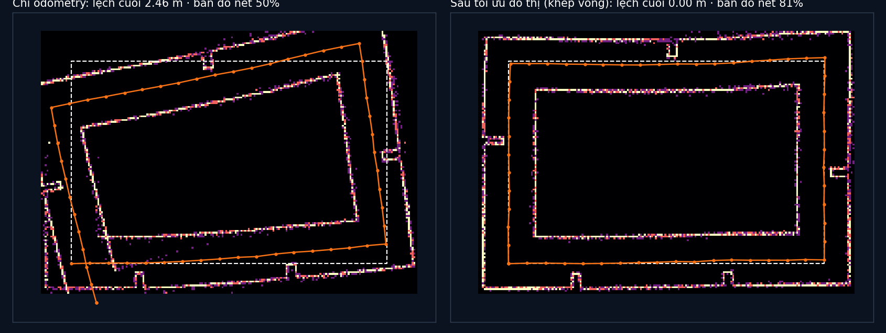

# Tập 3.6 · SLAM: con gà hay quả trứng?

> **Mùa 3 · Biết mình ở đâu** · ⏱ khoảng 45 phút · Độ khó ★★★ · Cần: đã làm [3.5](../tap35/), biết ma trận quay 2D ·
> 📚 Giáo trình: Principles of Robot Autonomy, [Chương 14 · SLAM](https://porabook.com/book/slam/) (Định nghĩa 14.2, Mục 14.2.5 ICP, Mục 14.7 Graph SLAM) ·
> 📺 Video: TikTok [@thanh82k5](https://www.tiktok.com/@thanh82k5) (tìm "Tập 3.6")

[](https://colab.research.google.com/github/thanhpro82/tu-hoc-robot-tu-hanh/blob/main/tap36/tap36_slam.ipynb)
Không muốn cài gì? Bấm nút trên để làm toàn bộ bài ngay trên trình duyệt.

**Một câu:** muốn định vị thì cần bản đồ, muốn vẽ bản đồ thì cần biết mình ở đâu: con gà hay quả trứng? SLAM làm cả hai cùng lúc. Robot đi một
vòng hành lang 58 m, chỉ cộng dồn odometry thì về tới nơi lệch 2,46 m và bản đồ nhoè (50% điểm quét đúng tường). Nhận ra "chỗ này mình đi qua rồi"
(khép vòng) và tối ưu cả đồ thị: lệch cuối về 0, bản đồ nét 81%. Bạn tự viết phép ghép tư thế, lõi của ICP, và sai số cạnh của đồ thị.



## Trong thư mục này

| File | Dùng khi nào |
|---|---|
| [tap36_slam.ipynb](tap36_slam.ipynb) | Làm bài trên Colab hoặc Jupyter |
| [bai_tap/slam_cua_ban.py](bai_tap/slam_cua_ban.py) | **Bạn viết code ở đây** (nếu làm trên máy) |
| [bai_tap/kiem_tra.py](bai_tap/kiem_tra.py) | Tự chấm: in ✅ / ❌ cho từng bài |
| [bai_tap/ve_do_thi.py](bai_tap/ve_do_thi.py) | Vẽ bản đồ trước/sau khép vòng bằng hàm của bạn, ra `ket_qua.png` |
| [sim/slam.py](sim/slam.py) | Mô phỏng dùng trong video |
| [bai_tap/loi_giai.py](bai_tap/loi_giai.py) | Lời giải cả 3 bài. Tự làm xong rồi hãy mở |

## 1. Bài toán

Robot đi vòng quanh một khối nhà 20 × 14 m, mỗi mét dừng lại quét LiDAR 90 tia. Odometry sai 2% quãng đường và quay hụt 0,5° mỗi mét.
Graph SLAM (Mục 14.7) biến bài toán thành một **đồ thị**:

```text
   nút = tư thế x_0, x_1, …, x_57          cạnh = "từ nút i, nút j nằm ở z_ij" (kèm độ tin cậy Ω)

   x_0 ──odo──► x_1 ──odo──► x_2 ──► … ──► x_57          57 cạnh odometry (nhiễu, cộng dồn ra lệch 2,46 m)
    ▲                                         │
    └──────────── khép vòng (ICP, Bài 2) ─────┘          1 cạnh: quét ở x_57 khớp quét ở x_0 → biết x_57 ≈ x_0

   tìm x* = argmin Σ r_ijᵀ Ω_ij r_ij,   r_ij = (x_i⁻¹ ⊕ x_j) − z_ij      (Bài 3, giải bằng Levenberg-Marquardt)
```

Một cạnh khép vòng nhỏ nhưng rất tin cậy "kéo" hai đầu quỹ đạo lại gần nhau, và bộ tối ưu rải phần sai số đã dồn ra đều dọc đường.

## 2. Sau bài này bạn làm được

| # | Bạn có thể… | Kiểm tra bằng | Đạt khi |
|---|---|---|---|
| 1 | Ghép và tách tư thế 2D (⊕, ⊖) | `kiem_tra.py` Bài 1 | ✅, odometry lệch cuối 2,46 m như video |
| 2 | Căn hai đám điểm bằng SVD (lõi của ICP) | `kiem_tra.py` Bài 2 | ✅ |
| 3 | Viết sai số cạnh và tối ưu đồ thị | `kiem_tra.py` Bài 3 | ✅, lệch trung bình 0,13 m, bản đồ nét 81,1% |
| 4 | Giải thích vì sao một cạnh khép vòng sửa được cả quỹ đạo | [Câu hỏi tự kiểm tra](#6-câu-hỏi-tự-kiểm-tra) | Tự trả lời được |

## 3. Bạn làm gì

| Bài | Hàm | Việc |
|---|---|---|
| **1** | `cong(a, b)`, `tru(a, b)` | a ⊕ b và a⁻¹ ⊕ b cho tư thế 2D, nhớ bọc góc |
| **2** | `can_chinh(P, Q)` | Trừ tâm, SVD của H, sửa lật gương, ra (dth, t) |
| **3** | `sai_so_canh(xi, xj, z)` | `tru(xi, xj) − z`, bọc góc; bộ chấm dùng nó để tối ưu cả đồ thị |

## 4. Bắt đầu

**Cách 1: Colab.** Bấm nút *Open in Colab* ở đầu trang.

**Cách 2: trên máy** (cần `numpy`, `scipy`):

```bash
cd tu-hoc-robot-tu-hanh/tap36
python -X utf8 sim/slam.py             # 1. số liệu trong video
python -X utf8 bai_tap/kiem_tra.py     # 2. lúc đầu: ⏳ chưa làm cả 3 bài
# 3. mở bai_tap/slam_cua_ban.py, làm từng bài, chạy lại kiem_tra.py
python -X utf8 bai_tap/ve_do_thi.py    # 4. vẽ bản đồ -> ket_qua.png
```

Kết quả mong đợi của bước 1:

```text
Hành lang vòng quanh khối nhà 20.0 × 14.0 m · 58 nút (mỗi 1.0 m) · LiDAR 90 tia · 57 cạnh odometry
Chỉ odometry: về tới cuối lệch 2.46 m, lớn nhất 2.69 m, trung bình 1.38 m
Khép vòng bằng ICP: tìm được (-0.00, 0.00, -0.0°), thật (0.00, 0.00, 0.0°), sai lệch điểm 1.8 cm
Sau tối ưu đồ thị: cuối lệch 0.00 m, lớn nhất 0.23 m, trung bình 0.13 m
Độ nét bản đồ (điểm quét rơi đúng tường): odometry 49.8% · sau tối ưu 81.1% · tư thế thật 100.0%
```

Kết quả khi làm xong cả 3 bài:

```text
✅ Bài 1 · ghép tư thế: cộng dồn odometry bằng hàm của bạn: về tới cuối lệch 2.46 m, lớn nhất 2.69 m như video
✅ Bài 2 · căn chỉnh (ICP): từ các cặp điểm đã ghép, tìm đúng phép quay + dời (bước lõi lặp đi lặp lại trong ICP)
✅ Bài 3 · sai số cạnh của đồ thị: sau tối ưu đồ thị (có cạnh khép vòng): cuối lệch 0.00 m, trung bình 0.13 m; bản đồ nét 81.1% như video

Đạt 3/3 bài.  🎉 Xong! Thử phần Thử thách trong README nhé.
```

### Lịch gợi ý (45 phút)

| Phút | Việc |
|--:|:--|
| 10 | Xem video, đọc mục 1, lướt hàm `icp` và `toi_uu` trong `sim/slam.py` |
| 30 | Làm Bài 1 → 2 → 3 |
| 5 | Câu hỏi tự kiểm tra, chọn 1 thử thách |

## 5. Thử thách (không chấm)

1. **Cạnh khép vòng yếu hơn:** chia Ω của cạnh khép vòng cho 100. Quỹ đạo sau tối ưu còn khép kín không?
2. **Khép vòng sai:** cố tình cho z_vòng lệch 1 m. Bản đồ sau tối ưu trông thế nào? (Đây là lý do front-end phải kiểm tra hình học kỹ.)
3. **ICP nhiều vòng lặp hơn/ít hơn:** đổi `lap` trong `icp` thành 3 và 100. Khi khởi đầu sai nhiều, ICP còn hội tụ không?
4. **Thêm khép vòng giữa đường:** robot đi qua lại một đoạn hai lần, thêm cạnh khép vòng ở đó. Lệch lớn nhất giảm bao nhiêu?

## 6. Câu hỏi tự kiểm tra

<details><summary>1. Vì sao chỉ cộng dồn odometry thì bản đồ méo?</summary>

Mỗi mét odometry sai một chút về quãng đường và góc quay. Sai số góc là tệ nhất: lệch 0,5° ở đầu làm mọi đoạn sau đi chéo đi, sai số vị trí lớn dần.
Ghép các lần quét theo tư thế sai thì cùng một bức tường bị vẽ ở nhiều chỗ, bản đồ nhoè (chỉ 50% điểm rơi đúng tường).
</details>

<details><summary>2. Vì sao một cạnh khép vòng sửa được cả 57 tư thế?</summary>

Cạnh khép vòng nói "x_57 trùng x_0" rất chắc chắn, mâu thuẫn với chuỗi odometry (cộng lại ra lệch 2,46 m). Bộ tối ưu tìm cách thoả mãn tất cả cạnh
cùng lúc, nên chia nhỏ phần mâu thuẫn ra cho từng cạnh odometry, mỗi cạnh chịu một chút. Kết quả là cả quỹ đạo được nắn lại.
</details>

<details><summary>3. Vì sao phải cố định tư thế đầu tiên?</summary>

Các cạnh chỉ nói tư thế **tương đối** giữa các nút. Dời hay xoay cả đồ thị đi bao nhiêu thì mọi cạnh vẫn thoả, nên bài toán có vô số nghiệm.
Cố định x_0 chọn ra một nghiệm (gọi là cố định "gauge").
</details>

<details><summary>4. ICP làm gì, và Bài 2 là phần nào của nó?</summary>

ICP lặp lại: ghép mỗi điểm của lần quét này với điểm gần nhất của lần quét kia, rồi tìm phép quay + dời tốt nhất cho các cặp đó (Bài 2, giải bằng SVD),
áp dụng, ghép lại, cứ thế tới khi khớp. Kết quả là chuyển động giữa hai lần quét, dùng làm cạnh khép vòng.
</details>

## 7. Giới hạn cần biết

- Hành lang, LiDAR 90 tia, nhiễu odometry, ICP điểm–điểm, giải bằng `scipy.optimize.least_squares` là **giả định / mở rộng**.
- Bước "nhận ra chỗ cũ" (place recognition) không mô phỏng: coi như đã biết nút cuối quay về gần nút đầu.
- Chỉ một cạnh khép vòng. Hệ thống thật (vd. slam_toolbox ở tập 3.7) tìm khép vòng liên tục khi chạy.

## Đọc thêm

- Sách, [Chương 14](https://porabook.com/book/slam/): bài toán SLAM, front-end (ICP, khép vòng), Graph SLAM.
- Tập trước: [3.5 · Định vị trên bản đồ](../tap35/) · Tập sau: [3.7 · Robot vẽ bản đồ nhà (ROS 2)](../tap37/)

---
[← Về danh sách tập](../README.md)
