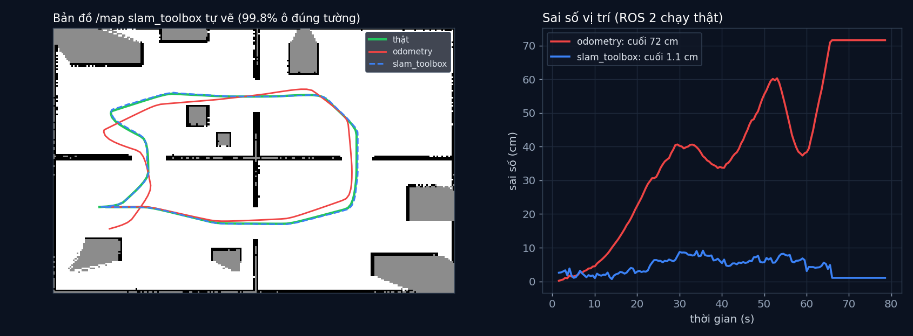

# Tập 3.7 · Robot vẽ bản đồ nhà tôi (ROS 2 + slam_toolbox)

> **Mùa 3 · Biết mình ở đâu** · ⏱ khoảng 35 phút (+ 20 phút nếu chạy ROS 2) · Độ khó ★★☆ · Cần: đã làm [3.6](../tap36/); Docker nếu muốn chạy ROS 2 ·
> 📚 Giáo trình: Principles of Robot Autonomy, [Chương 14 · SLAM](https://porabook.com/book/slam/); công cụ: slam_toolbox (phần **mở rộng**) ·
> 📺 Video: TikTok [@thanh82k5](https://www.tiktok.com/@thanh82k5) (tìm "Tập 3.7")

[](https://colab.research.google.com/github/thanhpro82/tu-hoc-robot-tu-hanh/blob/main/tap37/tap37_slam_toolbox.ipynb)
Phần bài tập là Python thuần trên dữ liệu ROS 2 đã ghi sẵn, làm được trên Colab. Chạy lại ROS 2 thì cần Docker.

**Một câu:** tập 3.6 tự viết Graph SLAM; tập này dùng **slam_toolbox**, thư viện SLAM thật mà robot ngoài đời dùng, chạy trong ROS 2 Jazzy. Robot
giả lập đi 21,7 m quanh căn hộ 4 phòng: odometry trôi 72 cm, slam_toolbox chỉ lệch 1,1 cm và tự vẽ bản đồ có 99,8% ô tường nằm đúng chỗ.
Bạn tự viết các mảnh dùng để đọc và chấm dữ liệu ROS 2: quaternion, đổi hệ toạ độ, chấm bản đồ /map.



## Trong thư mục này

| File | Dùng khi nào |
|---|---|
| [tap37_slam_toolbox.ipynb](tap37_slam_toolbox.ipynb) | Làm bài trên Colab hoặc Jupyter |
| [bai_tap/phan_tich_cua_ban.py](bai_tap/phan_tich_cua_ban.py) | **Bạn viết code ở đây** (nếu làm trên máy) |
| [bai_tap/kiem_tra.py](bai_tap/kiem_tra.py) | Tự chấm trên dữ liệu ROS 2 thật đã ghi |
| [bai_tap/ve_do_thi.py](bai_tap/ve_do_thi.py) | Vẽ bản đồ /map và sai số, ra `ket_qua.png` |
| [ws/robot_gia.py](ws/robot_gia.py) | Node ROS 2: robot + LiDAR 360 tia giả lập, phát `/scan`, `/odom`, TF; ghi kết quả |
| [ws/slam.yaml](ws/slam.yaml), [ws/chay.sh](ws/chay.sh), [ws/Dockerfile](ws/Dockerfile) | Cấu hình slam_toolbox, script chạy, ảnh Docker |
| [ws/out/](ws/out/) | Dữ liệu lần chạy trong video: `tu_the.jsonl`, 16 ảnh bản đồ `map_XXX.npy`, `slam.log` |
| [sim/phan_tich.py](sim/phan_tich.py) | Phân tích lần chạy (in số liệu trong video) |
| [bai_tap/loi_giai.py](bai_tap/loi_giai.py) | Lời giải cả 3 bài. Tự làm xong rồi hãy mở |

## 1. Bài toán

```text
 ┌──────────────────────────┐   /scan (360 tia, 10 Hz)    ┌─────────────────────────┐   /map (lưới ô 5 cm)
 │ robot_gia.py             │────────────────────────────►│ slam_toolbox            │──────────────────►  bản đồ
 │ căn hộ 12×8 m, đi lộ trình│   /odom + TF odom→base_link │ (Graph SLAM + khép vòng │   TF map→odom
 │ odometry quay hụt 0,5°/m │────────────────────────────►│  + Ceres giải tối ưu)   │──────────────────►  vị trí đã sửa
 └──────────────────────────┘                             └─────────────────────────┘
          │ ghi tư thế thật / odometry / slam mỗi 0,5 s và /map mỗi 5 s vào ws/out/
          ▼
   sim/phan_tich.py + bài tập của bạn: so sánh, chấm điểm
```

Ba thứ cần biết khi đọc dữ liệu ROS 2:

- **Quaternion:** ROS lưu hướng bằng 4 số (x, y, z, w). Robot chạy trên sàn chỉ quay quanh trục z, nên chỉ cần z = sin(θ/2), w = cos(θ/2).
- **Hệ toạ độ:** odometry và slam_toolbox tính trong hệ có gốc tại chỗ robot xuất phát; tư thế thật thì trong hệ căn hộ. Muốn so phải đổi về cùng hệ.
- **OccupancyGrid:** bản đồ là lưới ô −1 (chưa biết), 0 (trống), 100 (vật cản), kèm toạ độ góc và cỡ ô.

## 2. Sau bài này bạn làm được

| # | Bạn có thể… | Kiểm tra bằng | Đạt khi |
|---|---|---|---|
| 1 | Đổi qua lại góc và quaternion | `kiem_tra.py` Bài 1 | ✅ |
| 2 | Đưa các tư thế về cùng hệ toạ độ để so | `kiem_tra.py` Bài 2 | ✅, odometry lệch 0,72 m, slam_toolbox 1,1 cm |
| 3 | Chấm độ chính xác của bản đồ /map | `kiem_tra.py` Bài 3 | ✅, 99,8% ô đúng tường |
| 4 | Chạy slam_toolbox thật bằng Docker | `ws/chay.sh` | Ra lại các file trong `ws/out/` |

## 3. Bạn làm gì

| Bài | Hàm | Việc |
|---|---|---|
| **1** | `goc_sang_quat(th)`, `quat_sang_goc(x, y, z, w)` | Công thức yaw ↔ quaternion |
| **2** | `ve_goc(p, X0)` | Trừ điểm xuất phát, xoay ngược hướng xuất phát, bọc góc |
| **3** | `ty_le_dung_tuong(M, ox, oy, res, tuong, o_tuong)` | Tâm các ô 100 → toạ độ mét → tra lưới tường thật |

## 4. Bắt đầu

**Cách 1: Colab** (chỉ phần bài tập). Bấm nút *Open in Colab* ở đầu trang.

**Cách 2: trên máy:**

```bash
cd tu-hoc-robot-tu-hanh/tap37
python -X utf8 sim/phan_tich.py        # 1. số liệu trong video (đọc ws/out/)
python -X utf8 bai_tap/kiem_tra.py     # 2. lúc đầu: ⏳ chưa làm cả 3 bài
# 3. mở bai_tap/phan_tich_cua_ban.py, làm từng bài, chạy lại kiem_tra.py
python -X utf8 bai_tap/ve_do_thi.py    # 4. vẽ bản đồ và sai số -> ket_qua.png
```

**Chạy lại slam_toolbox thật** (cần Docker; lần đầu build ảnh mất vài phút). Từ thư mục `tap37`:

```bash
docker build -t ros-slam ws
```

```bash
docker run --rm -v "$PWD/ws:/ws" ros-slam bash /ws/chay.sh
```

Script xoá `ws/out/`, bật slam_toolbox, chạy robot hết lộ trình (~80 giây) rồi dừng. Sau đó chạy lại `sim/phan_tich.py` để xem số liệu lần chạy của bạn
(sẽ hơi khác video vì slam_toolbox chạy theo thời gian thực).

Kết quả mong đợi của bước 1:

```text
Thời gian 78.5 s · quãng đường thật 21.7 m · 16 ảnh bản đồ · số lần bộ giải Ceres chạy: 1
Odometry: cuối lệch 0.72 m, lớn nhất 0.72 m, trung bình 0.39 m
slam_toolbox: cuối lệch 1.1 cm, lớn nhất 9.1 cm, trung bình 4.3 cm
Điểm quét rơi đúng tường (±10 cm): ghép theo odometry 45.8% · theo slam_toolbox 95.6%
Bản đồ slam_toolbox: 2427 ô tường, 99.8% nằm đúng tường thật · diện tích trống đã vẽ 78.4 m² · ô 5 cm
Sai số slam lớn nhất ở t = 35.5 s; odometry lúc đó lệch 0.37 m
```

Kết quả khi làm xong cả 3 bài:

```text
✅ Bài 1 · góc và quaternion: đổi qua lại góc ↔ quaternion đúng (TF của ROS 2 dùng quaternion cho hướng)
✅ Bài 2 · đổi hệ toạ độ: trong hệ gốc: odometry cuối lệch 0.72 m, slam_toolbox chỉ lệch 1.1 cm (trung bình 4.3 cm) như video
✅ Bài 3 · chấm bản đồ /map: bản đồ slam_toolbox tự vẽ: 99.8% ô tường nằm đúng tường thật (±10 cm), như video

Đạt 3/3 bài.  🎉 Xong! Thử phần Thử thách trong README nhé.
```

### Lịch gợi ý (35 phút)

| Phút | Việc |
|--:|:--|
| 10 | Xem video, đọc mục 1, lướt `ws/robot_gia.py` |
| 20 | Làm Bài 1 → 2 → 3 |
| 5 | Câu hỏi tự kiểm tra, hoặc chạy Docker |

## 5. Thử thách (không chấm)

1. **Bản đồ lớn dần:** vẽ 16 ảnh `ws/out/map_XXX.npy` theo thứ tự. Diện tích trống đã vẽ tăng thế nào theo thời gian?
2. **Odometry tệ hơn:** trong `ws/robot_gia.py`, tăng `LECH_TH` lên 2°/m rồi chạy lại Docker. slam_toolbox còn giữ được không?
3. **Ô bản đồ to hơn:** sửa `resolution` trong `ws/slam.yaml` thành 0,1. Độ chính xác bản đồ đổi ra sao?
4. **Đọc log:** tìm trong `ws/out/slam.log` các dòng có chữ "loop". slam_toolbox khép vòng lúc nào?

## 6. Câu hỏi tự kiểm tra

<details><summary>1. Vì sao ROS dùng quaternion thay vì góc?</summary>

Robot nói chung quay được trong không gian 3 chiều. Ba góc (roll, pitch, yaw) bị lỗi khoá trục (gimbal lock) và ghép phép quay rất rối; quaternion
ghép gọn và không bị lỗi đó. Robot chạy trên sàn chỉ quay quanh z nên quaternion chỉ có z, w khác 0.
</details>

<details><summary>2. Vì sao phải đổi tư thế thật về hệ gốc tại điểm xuất phát?</summary>

slam_toolbox và odometry không biết căn hộ ở đâu; chúng bắt đầu ở (0, 0, 0) tại chỗ robot bật lên. Tư thế thật thì đo trong hệ căn hộ. So hai hệ khác
nhau thì sai số vô nghĩa, nên phải đưa tư thế thật về hệ gốc tại điểm xuất phát trước.
</details>

<details><summary>3. slam_toolbox chỉ chạy bộ giải Ceres 1 lần, vậy sao vẫn chính xác?</summary>

Phần lớn thời gian, slam_toolbox căn từng lần quét vào bản đồ đang có (scan matching) và tự sửa vị trí liên tục, nên sai số không kịp dồn lại như odometry.
Tối ưu toàn đồ thị (Ceres) chỉ cần khi khép vòng; ở đây quãng đường ngắn nên một lần là đủ.
</details>

<details><summary>4. Vì sao điểm quét ghép theo odometry chỉ 45,8% đúng tường?</summary>

Odometry lệch tới 72 cm và sai cả hướng. Cùng một bức tường, mỗi lần quét được đặt lệch một chút, nên bản đồ ghép theo odometry có tường bị "nhân đôi, nhân ba".
</details>

## 7. Giới hạn cần biết

- Robot và LiDAR là giả lập trong `robot_gia.py` (căn hộ giống tập 3.5), không có Gazebo hay robot thật. Nhiễu odometry là **giả định**.
- slam_toolbox chạy theo thời gian thực nên chạy lại sẽ ra số hơi khác video.
- Bài tập không đụng vào thuật toán bên trong slam_toolbox (đã tự viết phiên bản đơn giản ở tập 3.6).

## Đọc thêm

- Sách, [Chương 14](https://porabook.com/book/slam/): SLAM. Tài liệu slam_toolbox: [github.com/SteveMacenski/slam_toolbox](https://github.com/SteveMacenski/slam_toolbox).
- Tập trước: [3.6 · SLAM](../tap36/) · Tập sau: [3.8 · Kết hợp cảm biến theo dõi vật](../tap38/)

---
[← Về danh sách tập](../README.md)
