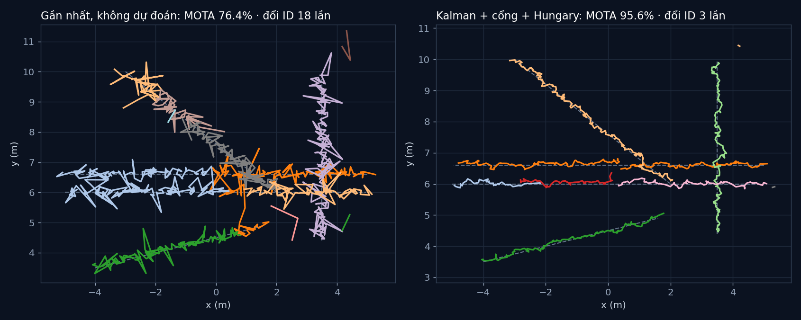

# Tập 3.8 · Kết hợp cảm biến và theo dõi nhiều người

> **Mùa 3 · Biết mình ở đâu** · ⏱ khoảng 40 phút · Độ khó ★★☆ · Cần: đã làm [tập 3.2](../tap32/) ·
> 📚 Giáo trình: Principles of Robot Autonomy, [Chương 15 · Sensor fusion](https://porabook.com/book/sensor-fusion/) (Ví dụ 15.0.1, 15.2.1; Mục 15.5, Thuật toán 2) ·
> 📺 Video: TikTok [@thanh82k5](https://www.tiktok.com/@thanh82k5) (tìm "Tập 3.8")

[](https://colab.research.google.com/github/thanhpro82/tu-hoc-robot-tu-hanh/blob/main/tap38/tap38_theo_doi.ipynb)
Không muốn cài gì? Bấm nút trên để làm toàn bộ bài ngay trên trình duyệt.

**Một câu:** camera đo hướng giỏi nhưng đo khoảng cách dở, radar thì ngược lại; ghép hai cái lại, sai số vị trí từ 0,8 m còn 0,17 m. Rồi theo dõi
5 người đi lại, có người đi cắt qua nhau, có báo động giả: cách "ghép điểm gần nhất" đổi nhầm ID 18 lần (MOTA 76,4%), còn Kalman + cổng Mahalanobis
+ thuật toán Hungary chỉ 3 lần (MOTA 95,6%). Bạn tự viết phép ghép cảm biến, khoảng cách Mahalanobis và cập nhật track.



## Trong thư mục này

| File | Dùng khi nào |
|---|---|
| [tap38_theo_doi.ipynb](tap38_theo_doi.ipynb) | Làm bài trên Colab hoặc Jupyter |
| [bai_tap/theo_doi_cua_ban.py](bai_tap/theo_doi_cua_ban.py) | **Bạn viết code ở đây** (nếu làm trên máy) |
| [bai_tap/kiem_tra.py](bai_tap/kiem_tra.py) | Tự chấm: Bài 3 chạy lại cả bộ theo dõi bằng code của bạn |
| [bai_tap/ve_do_thi.py](bai_tap/ve_do_thi.py) | Vẽ track của hai cách, ra `ket_qua.png` |
| [sim/theo_doi.py](sim/theo_doi.py) | Mô phỏng dùng trong video |
| [bai_tap/loi_giai.py](bai_tap/loi_giai.py) | Lời giải cả 3 bài. Tự làm xong rồi hãy mở |

## 1. Bài toán

**Ghép cảm biến (Mục 15.2).** Camera: σ khoảng cách 0,8 m, σ góc 1°. Radar: σ khoảng cách 0,1 m, σ góc 6°. Hình elip sai số của chúng vuông góc nhau,
ghép bằng dạng thông tin cho elip nhỏ hơn cả hai:

```text
   Y = R_cam⁻¹ + R_rad⁻¹         (thông tin cộng dồn)          Σ_ghép = Y⁻¹,   z_ghép = Σ_ghép·(R_cam⁻¹ z_cam + R_rad⁻¹ z_rad)
```

**Theo dõi nhiều người (Mục 15.5).** Mỗi người là một track Kalman vận tốc không đổi x = [x, y, ẋ, ẏ]. Mỗi khung 0,1 s:

```text
 dự đoán mọi track ─► cổng: chỉ xét cặp (track, phát hiện) có m² = z̃ᵀS⁻¹z̃ ≤ 9,21 (Bài 2)
                   ─► Hungary: chọn cách ghép tổng chi phí nhỏ nhất (mỗi track 1 phát hiện, mỗi phát hiện 1 track)
                   ─► cập nhật track được ghép (Bài 3) · track không ghép thì chỉ dự đoán (bị che tối đa 5 khung)
                   ─► phát hiện thừa → track mới, xác nhận khi thấy 3 trong 4 khung
```

Điểm mấu chốt: khi hai người đi cắt nhau, track **dự đoán** được ai đang đi hướng nào, nên không nhầm. Ghép theo điểm gần nhất thì không.

## 2. Sau bài này bạn làm được

| # | Bạn có thể… | Kiểm tra bằng | Đạt khi |
|---|---|---|---|
| 1 | Ghép phát hiện của nhiều cảm biến bằng dạng thông tin | `kiem_tra.py` Bài 1 | ✅, σ 0,8 + 0,1 → 0,099 m (Ví dụ 15.2.1) |
| 2 | Tính khoảng cách Mahalanobis để làm cổng | `kiem_tra.py` Bài 2 | ✅ |
| 3 | Cập nhật track bằng Kalman | `kiem_tra.py` Bài 3 | ✅, MOTA 95,6% như video |
| 4 | Giải thích vì sao dự đoán giúp không đổi nhầm ID | [Câu hỏi tự kiểm tra](#6-câu-hỏi-tự-kiểm-tra) | Tự trả lời được |

## 3. Bạn làm gì

| Bài | Hàm | Việc |
|---|---|---|
| **1** | `ghep(ds)` | Cộng các R⁻¹, cộng các R⁻¹z, nghịch đảo |
| **2** | `m2(x, P, z, R)` | S = HPHᵀ + R, z̃ = z − Hx, m² = z̃ᵀS⁻¹z̃ |
| **3** | `cap_nhat(x, P, z, R)` | Cập nhật Kalman với H chỉ đo vị trí |

Bài 3 thay `m2` và `cap_nhat` của bạn vào bộ theo dõi của video, chạy lại trên đúng 200 khung phát hiện và chấm MOTA.

## 4. Bắt đầu

**Cách 1: Colab.** Bấm nút *Open in Colab* ở đầu trang.

**Cách 2: trên máy** (cần `numpy`, `scipy`):

```bash
cd tu-hoc-robot-tu-hanh/tap38
python -X utf8 sim/theo_doi.py         # 1. số liệu trong video
python -X utf8 bai_tap/kiem_tra.py     # 2. lúc đầu: ⏳ chưa làm cả 3 bài
# 3. mở bai_tap/theo_doi_cua_ban.py, làm từng bài, chạy lại kiem_tra.py
python -X utf8 bai_tap/ve_do_thi.py    # 4. vẽ track -> ket_qua.png
```

Kết quả mong đợi của bước 1:

```text
200 khung × 0.1 s · 5 người · 1081 phát hiện (gồm báo động giả, trung bình 1.0/khung)
Sai số vị trí từng phát hiện (RMSE): chỉ camera 0.83 m · chỉ radar 0.75 m · ghép cả hai 0.17 m
Ví dụ 15.2.1 (khoảng cách): σ_camera 0.8 m, σ_radar 0.1 m -> σ_ghép 0.099 m
Gần nhất, không dự đoán : IDSW  18 · FP  157 · FN   38 / GT 901 · MOTA  76.4% · lệch TB 17.9 cm
Kalman + cổng + Hungary : IDSW   3 · FP   27 · FN   10 / GT 901 · MOTA  95.6% · lệch TB 9.6 cm
Số ID đã cấp: Kalman 163 · gần nhất 194
```

Kết quả khi làm xong cả 3 bài:

```text
✅ Bài 1 · ghép cảm biến: σ camera 0.8 m + σ radar 0.1 m → σ ghép 0.099 m (nhỏ hơn cả hai), như Ví dụ 15.2.1
✅ Bài 2 · khoảng cách Mahalanobis: khoảng cách Mahalanobis tính cả độ bất định của track lẫn phát hiện; cổng 9,21 loại phát hiện ở quá xa
✅ Bài 3 · cập nhật track: Kalman + cổng + Hungary: IDSW 3, FP 27, FN 10 / 901 → MOTA 95.6% (cách gần nhất không dự đoán: 76.4%), như video

Đạt 3/3 bài.  🎉 Xong! Thử phần Thử thách trong README nhé.
```

### Lịch gợi ý (40 phút)

| Phút | Việc |
|--:|:--|
| 10 | Xem video, đọc mục 1, lướt `chay_kalman_gnn` trong `sim/theo_doi.py` |
| 25 | Làm Bài 1 → 2 → 3 |
| 5 | Câu hỏi tự kiểm tra, chọn 1 thử thách |

## 5. Thử thách (không chấm)

1. **Cổng rộng / hẹp:** đổi `GATE` thành 4 và 25. MOTA đổi ra sao? Cổng quá hẹp thì chuyện gì xảy ra khi người đổi hướng đột ngột?
2. **Chỉ một cảm biến:** chỉ dùng camera (không ghép radar). MOTA tụt bao nhiêu?
3. **Bỏ Hungary:** ghép tham lam (mỗi track lấy phát hiện gần nhất trong cổng, không xét toàn cục). Số lần đổi ID tăng không?
4. **Q lớn hơn:** tăng `Q_CV` lên 1. Track mềm dẻo hơn hay rung hơn?

## 6. Câu hỏi tự kiểm tra

<details><summary>1. Vì sao ghép camera + radar tốt hơn hẳn từng cái (0,83 và 0,75 m → 0,17 m)?</summary>

Camera sai nhiều theo chiều khoảng cách (elip dài theo hướng nhìn), radar sai nhiều theo chiều ngang (elip dài vuông góc hướng nhìn). Ghép theo Bayes
lấy phần giỏi của mỗi bên: khoảng cách theo radar, hướng theo camera, nên elip ghép nhỏ cả hai chiều. Hai cảm biến **bổ sung** cho nhau (Ví dụ 15.0.1).
</details>

<details><summary>2. Vì sao dùng khoảng cách Mahalanobis mà không dùng khoảng cách thường?</summary>

Khoảng cách thường không biết độ bất định. Một phát hiện cách 0,5 m có thể rất gần (nếu track đang mơ hồ, S lớn) hoặc rất xa (nếu track đang chắc, S nhỏ).
Mahalanobis chia khoảng cách theo độ bất định S, và m² có phân phối χ² nên chọn được ngưỡng 9,21 cho 99%.
</details>

<details><summary>3. Hai người đi cắt nhau, vì sao Kalman không đổi nhầm ID?</summary>

Mỗi track có vận tốc; bước dự đoán đưa track tới chỗ người đó **sắp** tới. Lúc cắt nhau, phát hiện của mỗi người khớp với dự đoán của đúng track của họ
hơn. Ghép theo điểm gần nhất chỉ nhìn vị trí hiện tại, nên ở chỗ giao nhau rất dễ tráo ID.
</details>

<details><summary>4. Vì sao cần thuật toán Hungary?</summary>

Nhiều track, nhiều phát hiện: mỗi track chọn phát hiện gần nhất có thể dẫn tới hai track tranh một phát hiện. Hungary tìm cách ghép một-một sao cho
**tổng** chi phí nhỏ nhất (Thuật toán 2, GNN), tránh tranh chấp.
</details>

## 7. Giới hạn cần biết

- 5 người với lộ trình định sẵn, thông số camera/radar, xác suất phát hiện 0,9, 1 báo động giả mỗi khung là **giả định**.
- Coi như đã biết phát hiện camera và radar nào là cùng một người (bỏ qua bước ghép giữa các cảm biến).
- Chi phí m² + ln|S|, quy tắc không tạo track trong cổng, gộp track trùng là phần **mở rộng** ngoài sách.

## Đọc thêm

- Sách, [Chương 15](https://porabook.com/book/sensor-fusion/): ghép cảm biến, theo dõi nhiều vật, MOTA.
- Tập trước: [3.7 · slam_toolbox](../tap37/) · Tập sau: [3.9 · Tổng kết Mùa 3 (Nav2)](../tap39/)

---
[← Về danh sách tập](../README.md)
