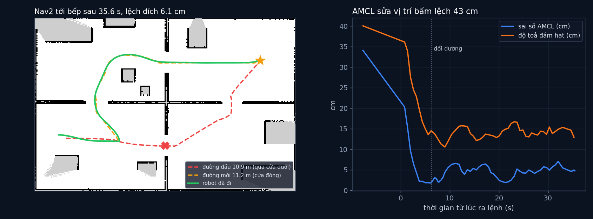

# Tập 3.9 · Tổng kết Mùa 3: robot tự dẫn đường (ROS 2 + Nav2)

> **Mùa 3 · Biết mình ở đâu** · ⏱ khoảng 35 phút (+ 20 phút nếu chạy ROS 2) · Độ khó ★★☆ · Cần: đã làm [3.5](../tap35/), [3.7](../tap37/); Docker nếu muốn chạy ROS 2 ·
> 📚 Giáo trình: Principles of Robot Autonomy, Chương 11–15; công cụ: Nav2 (phần **mở rộng**) ·
> 📺 Video: TikTok [@thanh82k5](https://www.tiktok.com/@thanh82k5) (tìm "Tập 3.9")

[](https://colab.research.google.com/github/thanhpro82/tu-hoc-robot-tu-hanh/blob/main/tap39/tap39_nav2.ipynb)
Phần bài tập là Python thuần trên dữ liệu ROS 2 đã ghi sẵn, làm được trên Colab. Chạy lại Nav2 thì cần Docker.

**Một câu:** ghép cả Mùa 3 vào Nav2, bộ dẫn đường mà robot thật dùng: bản đồ vẽ ở tập 3.7, AMCL (bộ lọc hạt của tập 3.4–3.5) sửa vị trí bấm lệch
43 cm còn 4,3 cm, và khi phát hiện cửa đóng, Nav2 tự lập đường vòng. Robot tới bếp sau 35,6 s, lệch đích 6,1 cm, không va chạm. Bạn tự viết các mảnh
để chấm lần chạy đó: so AMCL với vị trí thật, nhận ra lúc đổi đường, đo độ toả của đám hạt.



## Trong thư mục này

| File | Dùng khi nào |
|---|---|
| [tap39_nav2.ipynb](tap39_nav2.ipynb) | Làm bài trên Colab hoặc Jupyter |
| [bai_tap/nav_cua_ban.py](bai_tap/nav_cua_ban.py) | **Bạn viết code ở đây** (nếu làm trên máy) |
| [bai_tap/kiem_tra.py](bai_tap/kiem_tra.py) | Tự chấm trên dữ liệu Nav2 thật đã ghi |
| [bai_tap/ve_do_thi.py](bai_tap/ve_do_thi.py) | Vẽ bản đồ, đường đi, sai số AMCL, ra `ket_qua.png` |
| [ws/robot_nav.py](ws/robot_nav.py) | Node ROS 2: robot + LiDAR giả lập, có cửa sẽ đóng giữa chừng |
| [ws/ra_lenh.py](ws/ra_lenh.py) | Bấm ước lượng vị trí (cố tình lệch), ra lệnh "đi tới bếp", ghi lại AMCL, đường, hạt |
| [ws/nav2.yaml](ws/nav2.yaml), [ws/map/](ws/map/), [ws/chay.sh](ws/chay.sh), [ws/Dockerfile](ws/Dockerfile) | Cấu hình Nav2, bản đồ của tập 3.7, script chạy, ảnh Docker |
| [ws/out/](ws/out/) | Dữ liệu lần chạy trong video (`nav.json`, `robot.jsonl`, costmap, log). `out_astar/`, `out_mac_dinh/`, `out_nguong25/` là các lần chạy thử cấu hình khác |
| [sim/phan_tich.py](sim/phan_tich.py) | Phân tích lần chạy (in số liệu trong video) |
| [bai_tap/loi_giai.py](bai_tap/loi_giai.py) | Lời giải cả 3 bài. Tự làm xong rồi hãy mở |

## 1. Bài toán

```text
 bản đồ tập 3.7 ──► map_server ──┐
                                 ▼
 /scan, /odom ──► AMCL (bộ lọc hạt, 3.4–3.5): "robot đang ở đâu?"  ──► TF map→odom
                                 │
 "đi tới bếp" ──► planner (đường trên costmap) ──► controller (bám đường) ──► /cmd_vel ──► robot
                       ▲                                  │
                       └── costmap cập nhật từ /scan ◄─────┘   cửa đóng → ô cửa thành vật cản → lập đường mới
```

Kịch bản: người dùng bấm ước lượng vị trí ban đầu lệch 43 cm và 12°. Robot ra lệnh đi tới bếp; đường ngắn nhất (10,9 m) đi qua cửa dưới, nhưng cửa đóng
lúc robot đang đi. LiDAR thấy cửa, costmap đánh dấu vật cản, Nav2 lập đường vòng 11,2 m qua cửa trên.

## 2. Sau bài này bạn làm được

| # | Bạn có thể… | Kiểm tra bằng | Đạt khi |
|---|---|---|---|
| 1 | So ước lượng AMCL với tư thế thật theo thời gian | `kiem_tra.py` Bài 1 | ✅, 34,1 cm → dưới 10 cm sau 2 s |
| 2 | Nhận ra lúc Nav2 đổi đường vì cửa đóng | `kiem_tra.py` Bài 2 | ✅, đổi đường ở t = 6,2 s |
| 3 | Đo độ toả của đám hạt AMCL | `kiem_tra.py` Bài 3 | ✅, 40 cm → 13 cm |
| 4 | Chạy Nav2 thật bằng Docker | `ws/chay.sh` | Ra lại `ws/out/` |

## 3. Bạn làm gì

| Bài | Hàm | Việc |
|---|---|---|
| **1** | `that_luc(TR, THAT, t)` | Tra tư thế thật gần thời điểm t bằng `np.searchsorted`, kẹp chỉ số |
| **2** | `qua_cua(xy, cua, ban_kinh)`, `do_dai(xy)` | Đường có điểm nào qua khe cửa dưới không; chiều dài đường gấp khúc |
| **3** | `do_toa(xy)` | √(var x + var y) của đám hạt |

## 4. Bắt đầu

**Cách 1: Colab** (chỉ phần bài tập). Bấm nút *Open in Colab* ở đầu trang.

**Cách 2: trên máy:**

```bash
cd tu-hoc-robot-tu-hanh/tap39
python -X utf8 sim/phan_tich.py        # 1. số liệu trong video (đọc ws/out/)
python -X utf8 bai_tap/kiem_tra.py     # 2. lúc đầu: ⏳ chưa làm cả 3 bài
# 3. mở bai_tap/nav_cua_ban.py, làm từng bài, chạy lại kiem_tra.py
python -X utf8 bai_tap/ve_do_thi.py    # 4. vẽ bản đồ và sai số -> ket_qua.png
```

**Chạy lại Nav2 thật** (cần Docker). Ảnh `ros-nav` xây trên ảnh `ros-slam` của tập 3.7, nên build cả hai (lần đầu mất vài phút):

```bash
docker build -t ros-slam ../tap37/ws
```

```bash
docker build -t ros-nav ws
```

```bash
docker run --rm -v "$PWD/ws:/ws" ros-nav bash /ws/chay.sh
```

Script xoá `ws/out/`, bật robot giả lập và Nav2, bấm ước lượng lệch, ra lệnh đi tới bếp, rồi tự tắt khi tới nơi. Chạy lại `sim/phan_tich.py` để xem số liệu
lần chạy của bạn (hơi khác video vì Nav2 chạy theo thời gian thực).

Kết quả mong đợi của bước 1:

```text
bấm ước lượng lệch 43 cm, 12°; hạt ban đầu σ ≈ 40 cm, số hạt 589 -> 501
AMCL: sai số lần đầu 34.1 cm; < 10 cm lúc t = 2.0 s; trung bình khi chạy (t>2s) 4.3 cm, max 9.6 cm, góc TB 1.8°
đường đầu tiên 10.94 m qua cửa dưới; t = 6.2 s đổi sang đường mới 11.22 m (robot cách cửa 2.15 m); số lần lập đường 35
tới bếp sau 35.6 s, quãng đường 13.91 m, lệch đích 6.1 cm, va chạm 0, phục hồi 0
odometry lúc tới nơi lệch 80 cm (AMCL lúc đó 4.8 cm)
```

Kết quả khi làm xong cả 3 bài:

```text
✅ Bài 1 · so AMCL với tư thế thật: AMCL: lúc đầu lệch 34.1 cm (do bấm ước lượng lệch 43 cm), dưới 10 cm sau 2.0 s, sau đó trung bình 4.3 cm như video
✅ Bài 2 · đường đi và cửa đóng: đường đầu tiên dài 10.91 m qua cửa dưới; t = 6.2 s Nav2 phát hiện cửa đóng, đổi sang đường 11.16 m đi vòng (Nav2 báo 10.94 và 11.22 m)
✅ Bài 3 · độ toả đám hạt: đám hạt AMCL: toả 40 cm lúc bấm ước lượng → 13 cm khi tới bếp (589 → 501 hạt)

Đạt 3/3 bài.  🎉 Xong! Thử phần Thử thách trong README nhé.
```

(Chiều dài bạn tính hơi ngắn hơn số Nav2 báo vì dữ liệu chỉ ghi lại một phần các điểm của đường.)

### Lịch gợi ý (35 phút)

| Phút | Việc |
|--:|:--|
| 10 | Xem video, đọc mục 1, lướt `ws/ra_lenh.py` |
| 20 | Làm Bài 1 → 2 → 3 |
| 5 | Câu hỏi tự kiểm tra, hoặc chạy Docker |

## 5. Thử thách (không chấm)

1. **So các cấu hình:** `ws/out_astar/` (planner A*), `ws/out_mac_dinh/` (tham số mặc định), `ws/out_nguong25/` là các lần chạy khác. Sửa `OUT` trong `sim/phan_tich.py` để so thời gian tới đích.
2. **Bấm lệch nhiều hơn:** trong `ws/ra_lenh.py` cho ước lượng lệch 1,5 m. AMCL còn hội tụ không?
3. **Ít hạt:** giảm `max_particles` của AMCL trong `ws/nav2.yaml` xuống 100. Sai số khi chạy thay đổi thế nào?
4. **Đọc costmap:** vẽ `ws/out/costmap_000.npy` và `costmap_013.npy`. Ô cửa đóng hiện ra từ ảnh thứ mấy?

## 6. Câu hỏi tự kiểm tra

<details><summary>1. AMCL là gì so với bộ lọc hạt bạn viết ở tập 3.4–3.5?</summary>

Cùng ý tưởng (Monte Carlo Localization), thêm vài cải tiến: số hạt tự điều chỉnh (KLD sampling, ở đây 589 → 501 hạt), và tự thả hạt ngẫu nhiên khi
trọng số tụt (giống mẹo chống bắt cóc ở tập 3.5). "A" là adaptive.
</details>

<details><summary>2. Vì sao odometry lệch 80 cm mà robot vẫn tới đúng bếp (lệch 6,1 cm)?</summary>

Nav2 không lái theo odometry mà theo vị trí của AMCL, và AMCL liên tục so LiDAR với bản đồ để sửa. Odometry chỉ dùng cho chuyển động ngắn giữa các lần sửa.
</details>

<details><summary>3. Nav2 biết cửa đóng bằng cách nào?</summary>

Costmap cục bộ cập nhật từ /scan liên tục. Khi LiDAR thấy vật cản ở chỗ bản đồ ghi là trống (cửa), ô đó thành vật cản, đường cũ cắt qua vật cản nên bị
loại; planner lập lại đường (Nav2 lập đường thường xuyên, ở đây 35 lần) và chọn đường vòng.
</details>

<details><summary>4. Vì sao đám hạt không gom về 0 cm mà dừng ở khoảng 13 cm?</summary>

Mỗi bước chuyển động, AMCL thêm nhiễu vào hạt theo mô hình odometry (vì odometry thật có sai số). Số đo LiDAR kéo hạt lại, nhiễu chuyển động đẩy chúng ra,
hai lực cân bằng ở một độ toả nhất định, giống Σ của Kalman đứng yên ở tập 3.2.
</details>

## 7. Giới hạn cần biết

- Robot, LiDAR và cửa là giả lập trong `ws/robot_nav.py` (căn hộ giống tập 3.5, 3.7). Độ lệch khi bấm ước lượng và lúc cửa đóng là **giả định**.
- Nav2 chạy theo thời gian thực nên chạy lại sẽ ra số hơi khác video.
- Bài tập phân tích kết quả, không viết lại Nav2 (planner, controller đã tự viết bản đơn giản ở Mùa 1).

## Đọc thêm

- Sách, Chương 11–15. Tài liệu Nav2: [docs.nav2.org](https://docs.nav2.org/).
- Tập trước: [3.8 · Kết hợp cảm biến](../tap38/) · Mùa sau: [4.1 · Máy trạng thái: bộ não robot](../tap41/)

---
[← Về danh sách tập](../README.md)
