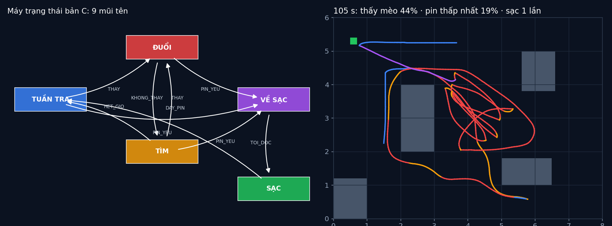

# Tập 4.1 · Máy trạng thái: bộ não hành vi của robot

> **Mùa 4 · Biết tự quyết định** · ⏱ khoảng 35 phút · Độ khó ★☆☆ · Cần: Python (dict, tuple) ·
> 📚 Giáo trình: Principles of Robot Autonomy, [Chương 16 · Finite state machines](https://porabook.com/book/finite-state-machines/) (Mục 16.1–16.2) ·
> 📺 Video: TikTok [@thanh82k5](https://www.tiktok.com/@thanh82k5) (tìm "Tập 4.1")

[](https://colab.research.google.com/github/thanhpro82/tu-hoc-robot-tu-hanh/blob/main/tap41/tap41_fsm.ipynb)
Không muốn cài gì? Bấm nút trên để làm toàn bộ bài ngay trên trình duyệt.

**Một câu:** robot tuần tra phòng, thấy mèo thì đuổi. Bộ não chỉ có 2 trạng thái thì mèo khuất sau tủ là bỏ cuộc; thêm trạng thái TÌM thì thời gian thấy
mèo tăng gấp đôi; thêm VỀ SẠC thì hết cảnh chết pin giữa nhà. Nhưng ghép thêm cái cửa và cái đèn, bảng chuyển phình từ 30 lên 1920 ô. Bạn tự viết bảng
chuyển của hai bản não và phép ghép song song.



## Trong thư mục này

| File | Dùng khi nào |
|---|---|
| [tap41_fsm.ipynb](tap41_fsm.ipynb) | Làm bài trên Colab hoặc Jupyter |
| [bai_tap/fsm_cua_ban.py](bai_tap/fsm_cua_ban.py) | **Bạn viết code ở đây** (nếu làm trên máy) |
| [bai_tap/kiem_tra.py](bai_tap/kiem_tra.py) | Tự chấm: cho robot chạy bằng bảng chuyển của bạn |
| [bai_tap/ve_do_thi.py](bai_tap/ve_do_thi.py) | Vẽ sơ đồ trạng thái và đường robot, ra `ket_qua.png` |
| [sim/fsm.py](sim/fsm.py) | Mô phỏng dùng trong video (thế giới, mèo, camera, pin, A*) |
| [bai_tap/loi_giai.py](bai_tap/loi_giai.py) | Lời giải cả 3 bài. Tự làm xong rồi hãy mở |

## 1. Bài toán

Máy trạng thái hữu hạn (Mục 16.1) là bộ năm M = (S, I, O, n, s₀). Kiểu Mealy của sách: mỗi nhịp 0,1 s, máy nhận **đúng một** đầu vào i_t:

```text
   s_{t+1} = n(s_t, i_t)          lệnh xuất ra  o_t = o(s_t, i_t)

   bản A:   TUẦN TRA ──THAY──► ĐUỔI ──KHONG_THAY──► TUẦN TRA          (mèo khuất là bỏ)
   bản B:   + ĐUỔI ──KHONG_THAY──► TÌM ──THAY──► ĐUỔI,  TÌM ──HET_GIO (8 s)──► TUẦN TRA
   bản C:   + (TUẦN TRA | ĐUỔI | TÌM) ──PIN_YEU──► VỀ SẠC ──TOI_DOC──► SẠC ──DAY_PIN──► TUẦN TRA
```

Khối "sinh sự kiện" đọc cảm biến (camera, pin, vị trí đốc sạc) và chọn một đầu vào mỗi nhịp theo thứ tự ưu tiên. Ô nào không có mũi tên thì máy ở yên.

**Ghép song song** (Eq. 16.2): chạy nhiều máy cùng lúc (robot, cửa, đèn) thì trạng thái chung là bộ (s_robot, s_cửa, s_đèn), đầu vào là bộ, và bảng chuyển
có số ô bằng tích: bùng nổ tổ hợp. FSM cũng không biết lựa chọn nào **tốt hơn**; tập 4.2 (MDP) giải quyết chuyện đó.

## 2. Sau bài này bạn làm được

| # | Bạn có thể… | Kiểm tra bằng | Đạt khi |
|---|---|---|---|
| 1 | Viết bảng chuyển cho một hành vi | `kiem_tra.py` Bài 1 | ✅, bản B thấy mèo gấp đôi bản A |
| 2 | Mở rộng FSM bằng hành vi mới (sạc pin) | `kiem_tra.py` Bài 2 | ✅, hết pin 8/8 → 0/8 lần |
| 3 | Ghép song song nhiều FSM và đếm trạng thái | `kiem_tra.py` Bài 3 | ✅, 30 → 480 → 1920 ô |
| 4 | Giải thích giới hạn của FSM | [Câu hỏi tự kiểm tra](#6-câu-hỏi-tự-kiểm-tra) | Tự trả lời được |

## 3. Bạn làm gì

| Bài | Hàm | Việc |
|---|---|---|
| **1** | `chuyen_B()` | Dict 4 mũi tên của bản B |
| **2** | `them_sac(chuyen)` | Dict mới = bản B + 5 mũi tên sạc pin |
| **3** | `ghep_song_song(*may)` | Duyệt các bộ trạng thái tới được từ trạng thái đầu; trả về (số trạng thái, số đầu vào, số ô) |

Bài 1–2 thay bộ não của robot trong mô phỏng bằng bảng chuyển của bạn và chạy 8 lần (khoảng 10–20 giây).

## 4. Bắt đầu

**Cách 1: Colab.** Bấm nút *Open in Colab* ở đầu trang.

**Cách 2: trên máy:**

```bash
cd tu-hoc-robot-tu-hanh/tap41
python -X utf8 sim/fsm.py              # 1. so bản A và B qua 20 lần chạy (~20 giây)
python -X utf8 bai_tap/kiem_tra.py     # 2. lúc đầu: ⏳ chưa làm cả 3 bài
# 3. mở bai_tap/fsm_cua_ban.py, làm từng bài, chạy lại kiem_tra.py
python -X utf8 bai_tap/ve_do_thi.py    # 4. vẽ sơ đồ và đường robot -> ket_qua.png
```

Kết quả mong đợi của bước 1:

```text
A thấy mèo TB 36.5% bỏ cuộc TB 4.8 [61, 28, 32, 25, 18, 37, 12, 64, 27, 35, 40, 41, 26, 74, 43, 33, 47, 43, 18, 24]
   khoảng mất dấu: trung vị 3.2 s, TB 9.0 s, số 86; >10 s: 28
B thấy mèo TB 70.0% bỏ cuộc TB 0.0 [77, 82, 78, 80, 66, 77, 66, 57, 78, 81, 81, 70, 72, 57, 77, 72, 67, 46, 43, 72]
   khoảng mất dấu: trung vị 1.0 s, TB 1.6 s, số 281; >10 s: 4
```

(Video dùng 30 lần chạy nên ra 36,0% và 71,6%.)

Kết quả khi làm xong cả 3 bài:

```text
✅ Bài 1 · bảng chuyển bản B: 8 lần chạy: bản A thấy mèo 34.7% thời gian, bản B của bạn 72.8% (thêm trạng thái TÌM)
✅ Bài 2 · thêm hành vi sạc: 8 lần chạy 150 s: bản B hết pin giữa nhà 8/8 lần, bản C của bạn 0/8 lần
✅ Bài 3 · ghép song song: robot 5×6 = 30 ô; ghép thêm cửa: 480 ô; thêm đèn: 1920 ô (bùng nổ tổ hợp), như video

Đạt 3/3 bài.  🎉 Xong! Thử phần Thử thách trong README nhé.
```

### Lịch gợi ý (35 phút)

| Phút | Việc |
|--:|:--|
| 5 | Xem video, đọc mục 1 |
| 25 | Làm Bài 1 → 2 → 3 |
| 5 | Câu hỏi tự kiểm tra, chọn 1 thử thách |

## 5. Thử thách (không chấm)

1. **Hết giờ tìm:** đổi `HET_GIO_TIM` thành 3 s và 20 s. Thời gian thấy mèo thay đổi thế nào? Có cái giá nào khi tìm quá lâu?
2. **Ngưỡng pin:** đổi `PIN_YEU_NGUONG` thành 10%. Robot còn về kịp đốc không?
3. **Trạng thái mới:** thêm trạng thái "SỢ" khi gặp chó (một đầu vào mới). Cần thêm bao nhiêu mũi tên?
4. **FSM phân cấp:** gom TUẦN TRA, ĐUỔI, TÌM thành một siêu trạng thái "LÀM VIỆC" (xem `dem_mui_ten` trong `sim/fsm.py`). Số mũi tên giảm còn bao nhiêu?

## 6. Câu hỏi tự kiểm tra

<details><summary>1. Vì sao thêm một trạng thái TÌM lại giúp nhiều như vậy?</summary>

Bản A không có "trí nhớ": hết thấy mèo là quay về tuần tra, nên mỗi lần mèo khuất sau tủ là mất dấu lâu (có lần quá 10 s). TÌM nhớ chỗ thấy mèo lần cuối
(đoán thêm hướng chạy) và tới đó nhìn quanh, nên phần lớn lần mất dấu chỉ kéo dài 1 s.
</details>

<details><summary>2. Vì sao mỗi nhịp chỉ được một đầu vào, và thứ tự ưu tiên để làm gì?</summary>

Để máy **tất định**: cùng trạng thái, cùng đầu vào thì luôn ra cùng kết quả. Nếu pin yếu đúng lúc thấy mèo, khối sinh sự kiện chọn PIN_YEU trước (ưu tiên cao hơn),
nên robot chắc chắn đi sạc thay vì vừa đuổi vừa sạc.
</details>

<details><summary>3. Vì sao ghép song song làm bảng phình từ 30 lên 1920 ô?</summary>

Trạng thái chung là tổ hợp trạng thái của từng máy, đầu vào chung là tổ hợp đầu vào. Số ô = (tích số trạng thái tới được) × (tích số đầu vào), nên thêm mỗi máy
là nhân lên chứ không cộng thêm. Vẽ tay hay kiểm tra bảng này là không thể.
</details>

<details><summary>4. FSM không làm được gì?</summary>

FSM chỉ làm đúng những gì người viết bảng chuyển nghĩ ra. Nó không biết đường nào nhanh hơn, rủi ro nào đáng chấp nhận, hay hành động nào cho kết quả tốt hơn
về lâu dài. Muốn robot tự **cân nhắc** thì cần mô hình có phần thưởng và xác suất: MDP ở tập 4.2.
</details>

## 7. Giới hạn cần biết

- Thế giới, con mèo, camera, pin, A* là **giả định** của mô phỏng, không có trong sách. Mức tiêu hao pin (0,2–1,2 %/s) là tự đặt.
- Số liệu trong video lấy từ 30 lần chạy; bộ chấm chạy 8 lần cho nhanh nên con số hơi khác.

## Đọc thêm

- Sách, [Chương 16](https://porabook.com/book/finite-state-machines/): FSM, Mealy/Moore, phân cấp, ghép song song.
- Tập trước: [3.9 · Tổng kết Mùa 3](../tap39/) · Tập sau: [4.2 · MDP: đường tắt hay đường vòng](../tap42/)

---
[← Về danh sách tập](../README.md)
