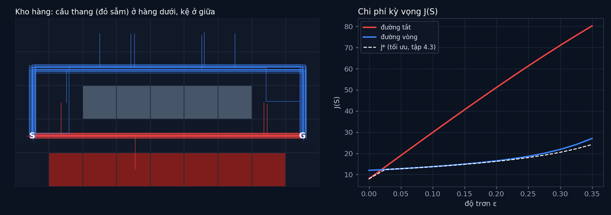

# Tập 4.2 · Đường tắt hay đường vòng? MDP

> **Mùa 4 · Biết tự quyết định** · ⏱ khoảng 35 phút · Độ khó ★★☆ · Cần: xác suất cơ bản, dict trong Python ·
> 📚 Giáo trình: Principles of Robot Autonomy, [Chương 17 · Decision making](https://porabook.com/book/decision-making/) (Mục 17.2, Eq. 17.7–17.11) ·
> 📺 Video: TikTok [@thanh82k5](https://www.tiktok.com/@thanh82k5) (tìm "Tập 4.2")

[](https://colab.research.google.com/github/thanhpro82/tu-hoc-robot-tu-hanh/blob/main/tap42/tap42_mdp.ipynb)
Không muốn cài gì? Bấm nút trên để làm toàn bộ bài ngay trên trình duyệt.

**Một câu:** trong kho có đường tắt 8 bước chạy sát mép cầu thang, và đường vòng 12 bước an toàn. Sàn khô thì đường tắt thắng. Sàn trơn chỉ 10% thôi,
đường tắt rơi cầu thang 17% số lần và chi phí kỳ vọng vọt lên 29,90, còn đường vòng chỉ 13,75. MDP cho robot cách tính chuyện đó trước khi đi.
Bạn tự viết mô hình chuyển, phép đánh giá chính sách, và mô phỏng Monte Carlo để kiểm chứng.



## Trong thư mục này

| File | Dùng khi nào |
|---|---|
| [tap42_mdp.ipynb](tap42_mdp.ipynb) | Làm bài trên Colab hoặc Jupyter |
| [bai_tap/mdp_cua_ban.py](bai_tap/mdp_cua_ban.py) | **Bạn viết code ở đây** (nếu làm trên máy) |
| [bai_tap/kiem_tra.py](bai_tap/kiem_tra.py) | Tự chấm: in ✅ / ❌ cho từng bài |
| [bai_tap/ve_do_thi.py](bai_tap/ve_do_thi.py) | Vẽ kho, các lần chạy và chi phí theo ε, ra `ket_qua.png` |
| [sim/mdp.py](sim/mdp.py) | Mô phỏng dùng trong video |
| [bai_tap/loi_giai.py](bai_tap/loi_giai.py) | Lời giải cả 3 bài. Tự làm xong rồi hãy mở |

## 1. Bài toán

MDP theo dạng điều khiển tối ưu của sách (tối thiểu hoá **chi phí**, chân trời T = 30 bước):

```text
   x_{t+1} = f(x_t, u_t, w_t),   w_t ~ p(w | x_t, u_t)        sàn trơn: xác suất ε robot đi hướng ngẫu nhiên
   chi phí mỗi bước g = 1 (chưa tới G);  cuối cùng chưa tới G thì phạt g_T = 100

   J_π(x_0) = E[ g_T(x_T) + Σ_t g(x_t) ]                      (Eq. 17.11)

   tính lùi:  J_T(x) = g_T(x),   J_t(x) = g(x) + Σ_x' p(x' | x, π(x))·J_{t+1}(x')     (Bài 2)
```

Chính sách π là quy tắc "ở ô nào thì ra lệnh gì" (vòng kín). Hai chính sách viết tay: đường tắt (đi sát cầu thang) và đường vòng (đi phía trên dãy kệ).
Đánh giá bằng công thức (Bài 2) và kiểm chứng bằng cách cho robot chạy thật nhiều lần (Bài 3) phải ra gần nhau.

## 2. Sau bài này bạn làm được

| # | Bạn có thể… | Kiểm tra bằng | Đạt khi |
|---|---|---|---|
| 1 | Viết mô hình xác suất chuyển của MDP | `kiem_tra.py` Bài 1 | ✅ |
| 2 | Đánh giá một chính sách bằng cách tính lùi | `kiem_tra.py` Bài 2 | ✅, ε = 0,1: tắt 29,90, vòng 13,75 |
| 3 | Kiểm chứng bằng Monte Carlo | `kiem_tra.py` Bài 3 | ✅, khớp mô phỏng của video |
| 4 | Giải thích vì sao đường ngắn nhất không phải lúc nào cũng tốt nhất | [Câu hỏi tự kiểm tra](#6-câu-hỏi-tự-kiểm-tra) | Tự trả lời được |

## 3. Bạn làm gì

| Bài | Hàm | Việc |
|---|---|---|
| **1** | `chuyen(x, u, eps)` | Dict {ô mới: xác suất}, mỗi hướng (1 − ε)·[đúng lệnh] + ε/4, cộng dồn khi trùng ô |
| **2** | `danh_gia(pi, eps)` | Lặp T lần công thức tính lùi; trả về J_0 cho mọi ô |
| **3** | `mo_phong(pi, eps, n, seed)` | n lần chạy T bước, gọi `rng` đúng thứ tự trong docstring; tỉ lệ tới G và tỉ lệ rơi |

## 4. Bắt đầu

**Cách 1: Colab.** Bấm nút *Open in Colab* ở đầu trang.

**Cách 2: trên máy:**

```bash
cd tu-hoc-robot-tu-hanh/tap42
python -X utf8 sim/mdp.py              # 1. số liệu trong video
python -X utf8 bai_tap/kiem_tra.py     # 2. lúc đầu: ⏳ chưa làm cả 3 bài
# 3. mở bai_tap/mdp_cua_ban.py, làm từng bài, chạy lại kiem_tra.py
python -X utf8 bai_tap/ve_do_thi.py    # 4. vẽ bằng hàm của bạn -> ket_qua.png
```

Kết quả mong đợi của bước 1:

```text
ε=0.00  J_tắt=  8.00 (rơi   0.0%, tới 100.0%, MC 8.00)  J_vòng= 12.00 (rơi  0.0%, tới 100.0%)  J*=  8.00  vòng hở: tới 100.0% rơi  0.0%
ε=0.10  J_tắt= 29.90 (rơi  17.0%, tới  83.0%, MC 29.31)  J_vòng= 13.75 (rơi  0.1%, tới  99.9%)  J*= 13.70  vòng hở: tới  76.8% rơi 18.5%
ε=0.20  J_tắt= 51.13 (rơi  35.3%, tới  64.7%, MC 52.18)  J_vòng= 16.48 (rơi  0.7%, tới  99.2%)  J*= 16.24  vòng hở: tới  56.1% rơi 36.8%
ε=0.30  J_tắt= 71.01 (rơi  50.3%, tới  49.7%, MC 70.73)  J_vòng= 21.87 (rơi  2.1%, tới  96.4%)  J*= 20.51  vòng hở: tới  41.2% rơi 49.7%
```

Kết quả khi làm xong cả 3 bài:

```text
✅ Bài 1 · xác suất chuyển: từ (1, 1) đi phải với ε = 0.1: tới (2, 1) 0.925, rơi xuống (1, 0) 0.025, ...
✅ Bài 2 · đánh giá chính sách: J_π(S): ε=0.0: tắt 8.00 / vòng 12.00 · ε=0.1: tắt 29.90 / vòng 13.75 · ε=0.2: tắt 51.13 / vòng 16.48 → sàn trơn thì đường vòng rẻ hơn, như video
✅ Bài 3 · mô phỏng Monte Carlo: 2000 lần chạy, ε = 0.1: đường tắt rơi 16.2%, đường vòng rơi 0.1%

Đạt 3/3 bài.  🎉 Xong! Thử phần Thử thách trong README nhé.
```

(Video chạy 10.000 lần nên ra 17,0%; bộ chấm chạy 2000 lần cho nhanh.)

### Lịch gợi ý (35 phút)

| Phút | Việc |
|--:|:--|
| 5 | Xem video, đọc mục 1 |
| 25 | Làm Bài 1 → 2 → 3 |
| 5 | Câu hỏi tự kiểm tra, chọn 1 thử thách |

## 5. Thử thách (không chấm)

1. **Điểm hoà vốn:** ε bằng bao nhiêu thì đường tắt và đường vòng có J bằng nhau? (Gợi ý: nhìn hình bên phải, rồi tìm chính xác bằng chia đôi.)
2. **Phạt rơi nhẹ hơn:** đổi g_T từ 100 thành 20. Ở ε = 0,1 đường nào thắng?
3. **Vòng hở:** chuỗi 8 lệnh "phải" tính trước (không nhìn vị trí) rơi bao nhiêu % ở ε = 0,2? Vì sao tệ hơn chính sách đường tắt vòng kín?
4. **Chính sách của bạn:** viết một π đi giữa (hàng y = 1 rồi lên y = 3 khi gần cầu thang). J có thấp hơn đường vòng không?

## 6. Câu hỏi tự kiểm tra

<details><summary>1. Vì sao sàn trơn 10% đã làm đường tắt tệ hơn hẳn?</summary>

Đường tắt đi 7 ô ngay trên cầu thang. Mỗi bước có xác suất ε/4 = 2,5% trượt xuống, cộng lại qua 7 bước ra khoảng 17% rơi. Mỗi lần rơi phải trả phạt 100 cộng các
bước còn lại, nên kỳ vọng vọt lên 29,90, dù khi không rơi thì chỉ tốn 8.
</details>

<details><summary>2. "Chính sách vòng kín" khác "chuỗi lệnh tính trước" thế nào?</summary>

Chính sách nhìn vị trí hiện tại rồi mới ra lệnh, nên lỡ trượt thì sửa ngay (vd. trượt lên hàng trên thì đi xuống lại). Chuỗi lệnh tính trước (vòng hở) cứ "phải, phải, phải"
dù đã trượt đi đâu, nên ở ε = 0,2 rơi 36,8% so với 35,3%, và tới đích ít hơn.
</details>

<details><summary>3. Vì sao Monte Carlo (29,31) không khớp tuyệt đối công thức (29,90)?</summary>

Monte Carlo là trung bình của số lần chạy hữu hạn nên có sai số ngẫu nhiên; chạy càng nhiều càng gần. Công thức tính lùi cho kỳ vọng chính xác của mô hình.
Hai cách khớp nhau là cách kiểm tra mô hình và code đều đúng.
</details>

<details><summary>4. J* là gì, và vì sao đường vòng gần J* nhưng chưa bằng?</summary>

J* là chi phí của chính sách **tốt nhất có thể**, tìm bằng quy hoạch động (tập 4.3). Đường vòng viết tay đã khá tốt nhưng chưa tối ưu ở mọi ô (vd. lúc lỡ trượt về
gần cầu thang), nên J lớn hơn J* một chút, nhất là khi sàn trơn nhiều.
</details>

## 7. Giới hạn cần biết

- Kho hàng 9 × 5, cầu thang, kệ, chi phí 1 mỗi bước và phạt 100 là **giả định** (kiểu bài Markovian Drone, Mục 17.5).
- Hai chính sách viết tay chỉ để so sánh; tìm chính sách tối ưu là việc của tập 4.3.

## Đọc thêm

- Sách, [Chương 17](https://porabook.com/book/decision-making/): MDP, chính sách, chi phí kỳ vọng.
- Tập trước: [4.1 · Máy trạng thái](../tap41/) · Tập sau: [4.3 · Quy hoạch động](../tap43/)

---
[← Về danh sách tập](../README.md)
