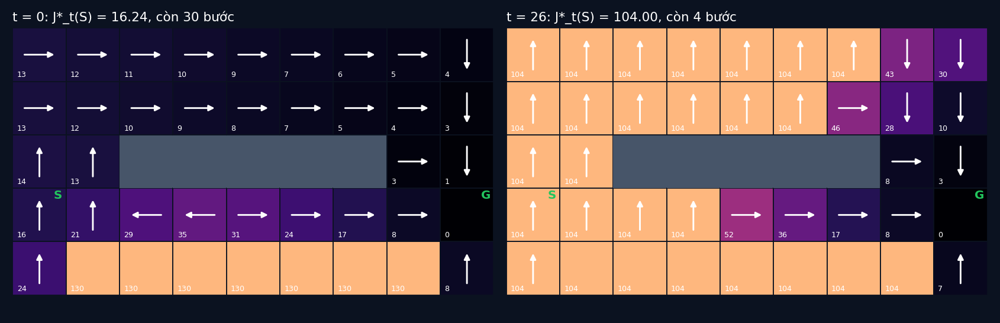

# Tập 4.3 · Quy hoạch động: nhìn trước mọi nước đi

> **Mùa 4 · Biết tự quyết định** · ⏱ khoảng 35 phút · Độ khó ★★☆ · Cần: đã làm [tập 4.2](../tap42/) ·
> 📚 Giáo trình: Principles of Robot Autonomy, [Chương 17 · Decision making](https://porabook.com/book/decision-making/) (Mục 17.2.2, Thuật toán 2, Eq. 17.13–17.14) ·
> 📺 Video: TikTok [@thanh82k5](https://www.tiktok.com/@thanh82k5) (tìm "Tập 4.3")

[](https://colab.research.google.com/github/thanhpro82/tu-hoc-robot-tu-hanh/blob/main/tap43/tap43_qhd.ipynb)
Không muốn cài gì? Bấm nút trên để làm toàn bộ bài ngay trên trình duyệt.

**Một câu:** thử hết mọi chuỗi lệnh trong 30 bước là 4³⁰ ≈ 10¹⁸ khả năng, không máy nào chạy nổi. Quy hoạch động tính lùi từ đích và chỉ cần 4800 phép
tính để ra chính sách **tốt nhất** cho mọi ô ở mọi thời điểm: J* = 16,24, tốt hơn đường vòng viết tay (16,48). Bạn tự viết bước Bellman, vòng lặp tính
lùi, và cho robot chạy thử chính sách tối ưu.



## Trong thư mục này

| File | Dùng khi nào |
|---|---|
| [tap43_qhd.ipynb](tap43_qhd.ipynb) | Làm bài trên Colab hoặc Jupyter |
| [bai_tap/qhd_cua_ban.py](bai_tap/qhd_cua_ban.py) | **Bạn viết code ở đây** (nếu làm trên máy) |
| [bai_tap/kiem_tra.py](bai_tap/kiem_tra.py) | Tự chấm: in ✅ / ❌ cho từng bài |
| [bai_tap/ve_do_thi.py](bai_tap/ve_do_thi.py) | Vẽ chính sách tối ưu ở hai thời điểm, ra `ket_qua.png` |
| [sim/qhd.py](sim/qhd.py) | Mô phỏng dùng trong video (dùng kho hàng của `../tap42/sim/mdp.py`) |
| [bai_tap/loi_giai.py](bai_tap/loi_giai.py) | Lời giải cả 3 bài. Tự làm xong rồi hãy mở |

## 1. Bài toán

Cùng kho hàng tập 4.2, sàn trơn ε = 0,2. Nguyên lý tối ưu: nếu biết chi phí tốt nhất từ mọi ô ở bước t + 1, thì chi phí tốt nhất ở bước t chỉ cần thử 4 lệnh
cho một bước:

```text
   J*_T(x) = g_T(x)                                                       (cuối giờ: tới G thì 0, chưa tới thì phạt 100)
   J*_t(x) = min_u  [ g(x) + Σ_x' p(x' | x, u)·J*_{t+1}(x') ]             (Eq. 17.13, Bài 1)
   π*_t(x) = argmin_u [ … ]                                               (Eq. 17.14)

   t = 29 ◄── t = 28 ◄── … ◄── t = 0            tính LÙI (Bài 2): 40 ô × 4 lệnh × 30 bước = 4800 phép tính
```

Chính sách tối ưu **đổi theo thời gian**: còn nhiều thời gian thì đi vòng an toàn; gần hết giờ thì có ô chấp nhận liều hơn, có ô đành chịu phạt vì không kịp tới đích.

## 2. Sau bài này bạn làm được

| # | Bạn có thể… | Kiểm tra bằng | Đạt khi |
|---|---|---|---|
| 1 | Viết một bước Bellman (cực tiểu hoá theo lệnh) | `kiem_tra.py` Bài 1 | ✅ |
| 2 | Viết quy hoạch động lùi cho chân trời hữu hạn | `kiem_tra.py` Bài 2 | ✅, J*_0(S) = 16,24 như video |
| 3 | Chạy chính sách thay đổi theo thời gian | `kiem_tra.py` Bài 3 | ✅, rơi chỉ 0,8% dù sàn trơn 20% |
| 4 | Giải thích vì sao quy hoạch động tránh được bùng nổ tổ hợp | [Câu hỏi tự kiểm tra](#6-câu-hỏi-tự-kiểm-tra) | Tự trả lời được |

## 3. Bạn làm gì

| Bài | Hàm | Việc |
|---|---|---|
| **1** | `bellman(x, J_sau, eps)` | Thử 4 lệnh, chọn chi phí nhỏ nhất (hoà thì lấy lệnh đứng trước trong U) |
| **2** | `quy_hoach_dong(eps)` | Bắt đầu từ J[T] = gT, lặp lùi tới t = 0; trả về (J, PI) |
| **3** | `mo_phong(PI, eps, n, seed)` | Chạy robot với PI[t] đổi theo bước, đếm tỉ lệ tới / rơi |

## 4. Bắt đầu

**Cách 1: Colab.** Bấm nút *Open in Colab* ở đầu trang.

**Cách 2: trên máy:**

```bash
cd tu-hoc-robot-tu-hanh/tap43
python -X utf8 sim/qhd.py              # 1. số liệu trong video
python -X utf8 bai_tap/kiem_tra.py     # 2. lúc đầu: ⏳ chưa làm cả 3 bài
# 3. mở bai_tap/qhd_cua_ban.py, làm từng bài, chạy lại kiem_tra.py
python -X utf8 bai_tap/ve_do_thi.py    # 4. vẽ chính sách -> ket_qua.png
```

Kết quả mong đợi của bước 1 (rút gọn):

```text
J*_0(S) = 16.24, số lần tính kỳ vọng = 4800 (= 40 ô × 4 lệnh × T 30)
so với chính sách vòng tay (4.2): 16.48
MC π*: {'toi': 0.9924, 'roi': 0.0075, 'J_mc': 16.2448}
ô π*_0 khác chính sách vòng: [(4, 1), (0, 4), (1, 4), (2, 4), (3, 4), (4, 4), (5, 4), (6, 4), (7, 4)]
vét cạn vòng hở 4^T = 1152921504606846976 ; số chính sách dừng 4^|X| = 1208925819614629174706176
```

Kết quả khi làm xong cả 3 bài:

```text
✅ Bài 1 · một bước Bellman: tại S, bước đầu: lệnh tốt nhất là 'len', chi phí kỳ vọng 16.24
✅ Bài 2 · quy hoạch động lùi: J*_0(S) = 16.24 (chính sách vòng viết tay ở 4.2: 16.48); 40 ô × 4 lệnh × 30 bước = 4800 phép tính
✅ Bài 3 · chạy chính sách tối ưu: 2000 lần chạy π* với sàn trơn 20%: tới đích 99.2%, rơi cầu thang 0.8%

Đạt 3/3 bài.  🎉 Xong! Thử phần Thử thách trong README nhé.
```

### Lịch gợi ý (35 phút)

| Phút | Việc |
|--:|:--|
| 5 | Xem video, đọc mục 1 |
| 25 | Làm Bài 1 → 2 → 3 |
| 5 | Câu hỏi tự kiểm tra, chọn 1 thử thách |

## 5. Thử thách (không chấm)

1. **Sàn khô:** chạy `quy_hoach_dong(0.0)`. π* có chọn đường tắt không? J*_0(S) bằng bao nhiêu?
2. **Chân trời ngắn:** đổi T thành 12. Robot ở S còn tới kịp G không? π* làm gì?
3. **Phạt nặng hơn:** đổi g_T thành 1000. Chính sách ở các ô gần cầu thang đổi thế nào?
4. **Lặp giá trị:** bỏ giới hạn T, lặp Bellman tới khi J không đổi nữa (value iteration). So với J*_0 ở T = 30.

## 6. Câu hỏi tự kiểm tra

<details><summary>1. Vì sao quy hoạch động chỉ cần 4800 phép tính thay vì 4³⁰?</summary>

Vét cạn thử mọi **chuỗi** lệnh, số chuỗi tăng theo cấp số mũ với độ dài. Quy hoạch động lưu J*_{t+1} cho mọi ô, nên ở mỗi bước t, mỗi ô chỉ cần thử 4 lệnh một bước
rồi tra bảng. Mọi chuỗi đi qua cùng một ô ở cùng thời điểm dùng chung một kết quả, nên số phép tính chỉ là ô × lệnh × bước.
</details>

<details><summary>2. Vì sao phải tính lùi chứ không tính xuôi từ S?</summary>

Chi phí tốt nhất từ một ô phụ thuộc vào những gì xảy ra **sau** đó. Ở bước cuối, ta biết chính xác chi phí (g_T). Từ đó lùi dần: biết tương lai rồi mới chọn được lệnh hiện tại tốt nhất.
</details>

<details><summary>3. Vì sao chính sách tối ưu đổi theo thời gian?</summary>

Chân trời hữu hạn: cùng một ô, còn 30 bước thì đi vòng an toàn là đáng; còn 4 bước thì đi vòng không kịp tới G, nên lựa chọn thay đổi (trong hình, ở t = 26 phần lớn ô bên trái đành chịu phạt 104).
</details>

<details><summary>4. J*_0(S) = 16,24 và Monte Carlo ra 16,2448: vì sao khớp vậy?</summary>

Quy hoạch động tính kỳ vọng **chính xác** của mô hình. Monte Carlo 10.000 lần chạy là ước lượng ngẫu nhiên của cùng con số đó, nên chạy càng nhiều càng sát.
</details>

## 7. Giới hạn cần biết

- Kho hàng, độ trơn 0,2 và chi phí là **giả định** của tập 4.2.
- Quy hoạch động cần biết mô hình p(x' | x, u) và duyệt được mọi trạng thái. Không biết mô hình thì phải học từ kinh nghiệm: tập 4.4 (Q-learning).

## Đọc thêm

- Sách, [Chương 17](https://porabook.com/book/decision-making/), Mục 17.2.2: nguyên lý tối ưu, quy hoạch động.
- Tập trước: [4.2 · MDP](../tap42/) · Tập sau: [4.4 · Học tăng cường Q-learning](../tap44/)

---
[← Về danh sách tập](../README.md)
