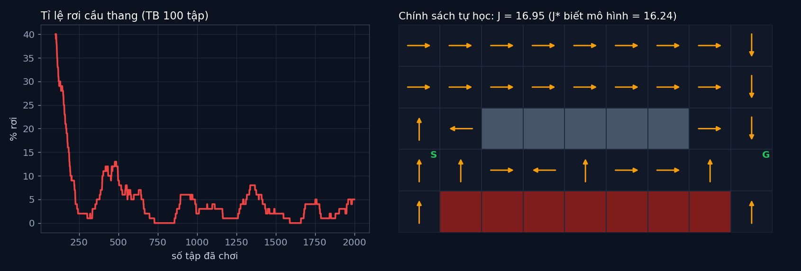

# Tập 4.4 · Học tăng cường: robot học từ thất bại (Q-learning)

> **Mùa 4 · Biết tự quyết định** · ⏱ khoảng 35 phút · Độ khó ★★☆ · Cần: đã làm [4.2](../tap42/), [4.3](../tap43/) ·
> 📚 Giáo trình: Principles of Robot Autonomy, [Chương 18 · Reinforcement learning](https://porabook.com/book/reinforcement-learning/) (Eq. 18.18, Thuật toán 5) ·
> 📺 Video: TikTok [@thanh82k5](https://www.tiktok.com/@thanh82k5) (tìm "Tập 4.4")

[](https://colab.research.google.com/github/thanhpro82/tu-hoc-robot-tu-hanh/blob/main/tap44/tap44_qlearn.ipynb)
Không muốn cài gì? Bấm nút trên để làm toàn bộ bài ngay trên trình duyệt.

**Một câu:** quy hoạch động (tập 4.3) cần biết sàn trơn bao nhiêu. Nếu không biết thì sao? Robot tự đi thử, rơi cầu thang, rút kinh nghiệm. 100 tập đầu
rơi 40%; sau 2000 tập nó tự tìm ra chính sách có chi phí 16,95, sát mức tối ưu 16,24 của người biết hết mô hình. Bạn tự viết ε-greedy, cập nhật Q, và
chính sách học được.



## Trong thư mục này

| File | Dùng khi nào |
|---|---|
| [tap44_qlearn.ipynb](tap44_qlearn.ipynb) | Làm bài trên Colab hoặc Jupyter |
| [bai_tap/qlearn_cua_ban.py](bai_tap/qlearn_cua_ban.py) | **Bạn viết code ở đây** (nếu làm trên máy) |
| [bai_tap/kiem_tra.py](bai_tap/kiem_tra.py) | Tự chấm: cho robot học bằng code của bạn |
| [bai_tap/ve_do_thi.py](bai_tap/ve_do_thi.py) | Vẽ đường học và chính sách, ra `ket_qua.png` |
| [sim/qlearn.py](sim/qlearn.py) | Mô phỏng dùng trong video (dùng kho của `../tap42/sim/mdp.py`) |
| [bai_tap/loi_giai.py](bai_tap/loi_giai.py) | Lời giải cả 3 bài. Tự làm xong rồi hãy mở |

## 1. Bài toán

Cùng kho hàng tập 4.2 (sàn trơn 20%), nhưng robot **không biết** mô hình. Chương 18 dùng **phần thưởng** (tối đa hoá): mỗi bước r = −1, rơi cầu thang r = −100 và
kết thúc, tới G là kết thúc. Robot giữ bảng Q(x, u): "nếu ở ô x làm lệnh u, sau đó làm tốt nhất, thì tổng thưởng kỳ vọng là bao nhiêu".

```text
 mỗi bước:   chọn u bằng ε-greedy (Bài 1):  90% chọn u có Q lớn nhất · 10% chọn bừa (để còn khám phá)
             làm u → sàn trơn quyết định robot thật sự tới x', nhận r
             cập nhật (Bài 2, Eq. 18.18):  Q(x, u) ← Q(x, u) + α·( r + γ·max_u' Q(x', u') − Q(x, u) )
                                                          └──── mục tiêu ────┘
 cuối cùng: chính sách học được π(x) = argmax_u Q(x, u)   (Bài 3)
```

Mỗi lần rơi, Q của lệnh dẫn tới chỗ rơi bị kéo xuống gần −100, và cái "xấu" đó lan ngược dần về các ô trước, nên robot học cách tránh xa mép cầu thang.

## 2. Sau bài này bạn làm được

| # | Bạn có thể… | Kiểm tra bằng | Đạt khi |
|---|---|---|---|
| 1 | Viết chính sách ε-greedy | `kiem_tra.py` Bài 1 | ✅ |
| 2 | Viết cập nhật Q-learning | `kiem_tra.py` Bài 2 | ✅, 300 tập ra đúng bảng Q như video |
| 3 | Rút chính sách từ bảng Q và đánh giá nó | `kiem_tra.py` Bài 3 | ✅, J = 16,95 so với J* = 16,24 |
| 4 | Giải thích vì sao cần khám phá | [Câu hỏi tự kiểm tra](#6-câu-hỏi-tự-kiểm-tra) | Tự trả lời được |

## 3. Bạn làm gì

| Bài | Hàm | Việc |
|---|---|---|
| **1** | `chon_hanh_dong(Qi, eps, rng)` | ε-greedy, gọi `rng` đúng thứ tự trong docstring, hoà thì bốc thăm |
| **2** | `cap_nhat_q(Q, i, a, r, i2, xong, alpha, gamma)` | Mục tiêu = r (nếu xong) hoặc r + γ·max Q[i2]; kéo Q[i, a] về mục tiêu một đoạn α |
| **3** | `chinh_sach_tham_lam(Q, cac_o, IDX, U)` | `argmax` từng hàng Q ra tên lệnh |

## 4. Bắt đầu

**Cách 1: Colab.** Bấm nút *Open in Colab* ở đầu trang.

**Cách 2: trên máy:**

```bash
cd tu-hoc-robot-tu-hanh/tap44
python -X utf8 sim/qlearn.py           # 1. so các cấu hình (60 lần học × 2000 tập, khoảng 2 phút)
python -X utf8 bai_tap/kiem_tra.py     # 2. lúc đầu: ⏳ chưa làm cả 3 bài
# 3. mở bai_tap/qlearn_cua_ban.py, làm từng bài, chạy lại kiem_tra.py
python -X utf8 bai_tap/ve_do_thi.py    # 4. vẽ đường học và chính sách -> ket_qua.png
```

Kết quả mong đợi của bước 1:

```text
J* (quy hoạch động, biết mô hình) = 16.24
Q0 =     0 ε = 0.00: J_π cuối TB 17.65, trung vị 16.92, min 16.24, max 22.44 [18, 17, 16, 17, 19, 17, 17, 17, 16, 22]
Q0 =     0 ε = 0.10: J_π cuối TB 17.60, trung vị 17.03, min 16.29, max 21.58 [17, 17, 17, 19, 16, 17, 17, 18, 17, 22]
Q0 =     0 ε = 0.30: J_π cuối TB 18.01, trung vị 16.86, min 16.29, max 20.44 [16, 16, 17, 17, 20, 20, 20, 16, 20, 17]
Q0 =   -50 ε = 0.00: J_π cuối TB 19.45, trung vị 17.43, min 16.96, max 27.41 [18, 27, 18, 21, 17, 24, 17, 17, 17, 17]
Q0 =   -50 ε = 0.10: J_π cuối TB 17.46, trung vị 17.20, min 16.45, max 20.62 [17, 17, 17, 17, 17, 18, 17, 17, 21, 16]
Q0 =   -50 ε = 0.30: J_π cuối TB 18.79, trung vị 17.55, min 16.36, max 24.32 [24, 21, 21, 17, 17, 18, 20, 17, 17, 16]
```

Kết quả khi làm xong cả 3 bài:

```text
✅ Bài 1 · ε-greedy: ε = 0 luôn khai thác (hoà thì bốc thăm), ε > 0 thỉnh thoảng thử bừa; gọi rng đúng thứ tự
✅ Bài 2 · cập nhật Q: 300 tập học bằng 2 hàm của bạn ra đúng bảng Q như code video
✅ Bài 3 · chính sách học được: 2000 tập: rơi 40% ở 100 tập đầu → 2.4% ở 500 tập cuối; chính sách học được J = 16.95 (tối ưu khi biết mô hình J* = 16.24)

Đạt 3/3 bài.  🎉 Xong! Thử phần Thử thách trong README nhé.
```

### Lịch gợi ý (35 phút)

| Phút | Việc |
|--:|:--|
| 5 | Xem video, đọc mục 1 |
| 25 | Làm Bài 1 → 2 → 3 |
| 5 | Câu hỏi tự kiểm tra, chọn 1 thử thách |

## 5. Thử thách (không chấm)

1. **Không khám phá:** học với ε = 0. Chính sách cuối có tốt bằng không? Thử vài seed.
2. **Tốc độ học α:** thử α = 0,02 và α = 0,8. Học nhanh hơn hay chậm hơn, ổn định hơn hay rung hơn?
3. **Lạc quan hay bi quan:** khởi tạo Q0 = 0 (lạc quan, vì thưởng luôn âm) và Q0 = −50. Cái nào khám phá nhiều hơn? Vì sao?
4. **Học lâu hơn:** 10.000 tập. J của chính sách học được có về đúng 16,24 không?

## 6. Câu hỏi tự kiểm tra

<details><summary>1. Q-learning khác quy hoạch động ở điểm nào?</summary>

Quy hoạch động tính kỳ vọng bằng mô hình p(x' | x, u). Q-learning không có mô hình: nó thay kỳ vọng bằng **một lần thử thật**, rồi cập nhật một chút (α).
Lặp đủ nhiều lần thì trung bình của các lần thử tiến về kỳ vọng.
</details>

<details><summary>2. Vì sao cần khám phá (ε > 0)?</summary>

Nếu luôn chọn lệnh đang có Q cao nhất, robot có thể kẹt ở một lựa chọn "tạm ổn" mà không bao giờ thử lựa chọn khác có khi tốt hơn. Thỉnh thoảng thử bừa
giúp nó phát hiện đường tốt hơn. Đổi lại, trong lúc học nó vẫn rơi thỉnh thoảng (2,4% ở cuối) vì những lần thử bừa đó.
</details>

<details><summary>3. Vì sao robot học được tránh cầu thang dù chỉ bị phạt lúc rơi?</summary>

Phần r + γ·max Q(x') làm giá trị lan ngược: ô sát cầu thang có Q thấp vì hay dẫn tới rơi, ô trước đó có Q thấp vì dẫn tới ô sát cầu thang, cứ thế. Sau nhiều tập,
cả vùng gần mép đều bị đánh giá thấp và chính sách tránh xa.
</details>

<details><summary>4. Vì sao J học được (16,95) chưa bằng J* (16,24)?</summary>

Robot chỉ học từ 2000 tập, có ô hiếm khi ghé nên Q ở đó chưa chính xác, và chính sách tham lam có thể chọn sai ở vài ô. Học lâu hơn, giảm dần α và ε thì về gần J* hơn.
</details>

## 7. Giới hạn cần biết

- Kho hàng, thưởng −1 và −100, tập tối đa 100 bước là **giả định** của mô phỏng.
- Bảng Q chỉ dùng được khi số trạng thái nhỏ (40 ô). Không gian lớn (ảnh camera, tốc độ liên tục) cần mạng nơ-ron thay bảng: tập 4.5 (deep RL).

## Đọc thêm

- Sách, [Chương 18](https://porabook.com/book/reinforcement-learning/): học tăng cường, Q-learning, khám phá và khai thác.
- Tập trước: [4.3 · Quy hoạch động](../tap43/) · Tập sau: [4.5 · Deep RL luyện trong mô phỏng](../tap45/)

---
[← Về danh sách tập](../README.md)
