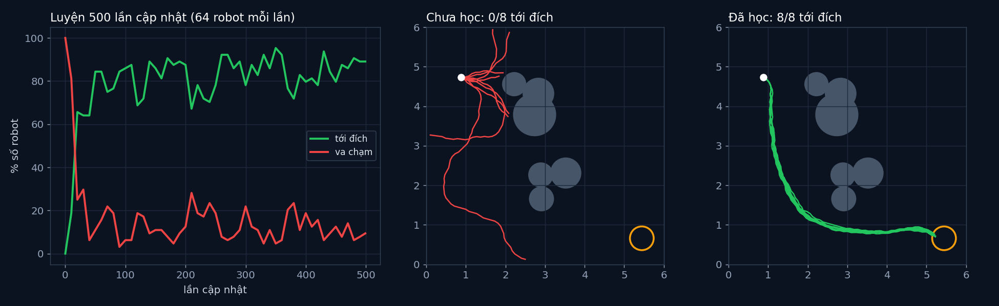

# Tập 4.5 · Deep RL: luyện robot trong mô phỏng

> **Mùa 4 · Biết tự quyết định** · ⏱ khoảng 40 phút · Độ khó ★★★ · Cần: đã làm [4.4](../tap44/) và [2.7](../tap27/), PyTorch cơ bản ·
> 📚 Giáo trình: Principles of Robot Autonomy, [Chương 18 · Reinforcement learning](https://porabook.com/book/reinforcement-learning/) (Mục 18.5, Eq. 18.31–18.32, Thuật toán 6) ·
> 📺 Video: TikTok [@thanh82k5](https://www.tiktok.com/@thanh82k5) (tìm "Tập 4.5")

[](https://colab.research.google.com/github/thanhpro82/tu-hoc-robot-tu-hanh/blob/main/tap45/tap45_deeprl.ipynb)
Không muốn cài gì? Bấm nút trên để làm toàn bộ bài ngay trên trình duyệt (Colab có sẵn PyTorch).

**Một câu:** robot thật nhìn bằng LiDAR, trạng thái là số thực liên tục; lập bảng Q như tập 4.4 cần cỡ 10¹² ô. Thay bảng bằng một mạng nơ-ron 5187 tham số,
luyện bằng gradient chính sách REINFORCE trong mô phỏng: từ 0% lên 86% tới đích giữa các vật cản ngẫu nhiên. Bạn tự viết reward-to-go, hàm mất mát REINFORCE,
và vòng cập nhật.



## Trong thư mục này

| File | Dùng khi nào |
|---|---|
| [tap45_deeprl.ipynb](tap45_deeprl.ipynb) | Làm bài trên Colab hoặc Jupyter |
| [bai_tap/deeprl_cua_ban.py](bai_tap/deeprl_cua_ban.py) | **Bạn viết code ở đây** (nếu làm trên máy) |
| [bai_tap/kiem_tra.py](bai_tap/kiem_tra.py) | Tự chấm: Bài 3 luyện mạng bằng code của bạn (~30 giây) |
| [bai_tap/ve_do_thi.py](bai_tap/ve_do_thi.py) | Vẽ đường học và robot trước/sau khi học, ra `ket_qua.png` |
| [sim/deeprl.py](sim/deeprl.py) | Môi trường, mạng chính sách, REINFORCE, đánh giá |
| [sim/pi_sach_*.pt](sim/), [sim/pi_dr_*.pt](sim/) | Mạng đã luyện 500 lần trong video (3 seed, luyện sạch và luyện có ngẫu nhiên hoá) |
| [sim/ket_qua.txt](sim/ket_qua.txt) | Kết quả đánh giá các mạng trên (số liệu trong video) |
| [bai_tap/loi_giai.py](bai_tap/loi_giai.py) | Lời giải cả 3 bài. Tự làm xong rồi hãy mở |

## 1. Bài toán

Phòng 6 × 6 m, 4–7 vật cản tròn đặt ngẫu nhiên mỗi tập. Robot thấy 9 tia LiDAR và hướng, khoảng cách tới đích (12 số); chọn 1 trong 3 lệnh quay.
Mạng π_θ(u | x) cho xác suất của 3 lệnh. REINFORCE (Mục 18.5.2):

```text
 cho 64 robot chạy bằng π_θ (bốc lệnh theo xác suất) ─► ghi lại log π_θ(u_t | x_t) và thưởng r_t
       │
       ▼
 R_t = Σ_{t'≥t} γ^{t'−t} r_{t'}       (reward-to-go, Bài 1: thưởng từ bước t trở đi)
 A_t = (R_t − trung bình) / độ lệch chuẩn                   (tốt hơn hay tệ hơn mức thường)
 loss = − Σ_t log π_θ(u_t | x_t) · A_t / 64                 (Bài 2)
       │
       ▼
 Adam: θ ← θ − lr·∇loss    (Bài 3)  ⇒ lệnh dẫn tới kết quả tốt được tăng xác suất, lệnh dẫn tới va chạm bị giảm
```

Thưởng (giả định, có "định hình" theo tiến độ): +10 tới đích, −10 va chạm, 2 × (khoảng cách giảm được) mỗi bước, −0,01 mỗi bước.

## 2. Sau bài này bạn làm được

| # | Bạn có thể… | Kiểm tra bằng | Đạt khi |
|---|---|---|---|
| 1 | Tính reward-to-go có chiết khấu | `kiem_tra.py` Bài 1 | ✅ |
| 2 | Viết hàm mất mát gradient chính sách có baseline | `kiem_tra.py` Bài 2 | ✅ |
| 3 | Viết vòng cập nhật và luyện mạng | `kiem_tra.py` Bài 3 | ✅, 30 lần cập nhật khớp code video |
| 4 | Giải thích vì sao luyện trong mô phỏng sạch thì ra ngoài kém đi | [Câu hỏi tự kiểm tra](#6-câu-hỏi-tự-kiểm-tra) | Tự trả lời được |

## 3. Bạn làm gì

| Bài | Hàm | Việc |
|---|---|---|
| **1** | `reward_to_go(rew, gamma)` | Đi ngược từ bước cuối: acc = r_t + γ·acc |
| **2** | `loi_reinforce(logp, R, alive)` | Chuẩn hoá R trên các ô còn chạy, loss = −Σ logp·A·m / B |
| **3** | `mot_cap_nhat(pi, opt, env, gamma)` | `chay_tap` → R → loss → `zero_grad`, `backward`, `step` |

## 4. Bắt đầu

**Cách 1: Colab.** Bấm nút *Open in Colab* ở đầu trang.

**Cách 2: trên máy** (cần `torch` bản CPU):

```bash
cd tu-hoc-robot-tu-hanh/tap45
python -X utf8 sim/deeprl.py           # 1. luyện thử 60 lần cập nhật (~30 giây)
python -X utf8 bai_tap/kiem_tra.py     # 2. lúc đầu: ⏳ chưa làm cả 3 bài
# 3. mở bai_tap/deeprl_cua_ban.py, làm từng bài, chạy lại kiem_tra.py
python -X utf8 bai_tap/ve_do_thi.py    # 4. vẽ đường học và robot -> ket_qua.png
```

Kết quả mong đợi của bước 1 (dòng cuối; con số có thể lệch chút nếu khác phiên bản PyTorch):

```text
thời gian 26.5 s; tham số 5187 {'toi': 0.766, 'va': 0.208, 'het_gio': 0.026}
```

Số liệu trong video (mạng luyện đủ 500 lần, 3 seed, xem `sim/ket_qua.txt`): trong mô phỏng sạch tới đích trung bình 85,7%; đem ra điều kiện "thật hơn"
(LiDAR nhiễu và mất tia, bánh trượt, động cơ trễ) tụt còn 70,5%.

Kết quả khi làm xong cả 3 bài:

```text
✅ Bài 1 · reward-to-go: R_t cộng dồn thưởng từ t về sau (càng xa càng nhân thêm γ)
✅ Bài 2 · hàm mất mát REINFORCE: loss = −Σ logπ·A: lệnh nào cho kết quả tốt hơn trung bình (A > 0) sẽ được tăng xác suất
✅ Bài 3 · một lần cập nhật: 30 lần cập nhật bằng code của bạn: tới đích 0% → 66% (khớp code video); mạng luyện đủ 500 lần trong video tới đích 86.0%

Đạt 3/3 bài.  🎉 Xong! Thử phần Thử thách trong README nhé.
```

### Lịch gợi ý (40 phút)

| Phút | Việc |
|--:|:--|
| 10 | Xem video, đọc mục 1, lướt `huan_luyen` trong `sim/deeprl.py` |
| 25 | Làm Bài 1 → 2 → 3 |
| 5 | Câu hỏi tự kiểm tra, chọn 1 thử thách |

## 5. Thử thách (không chấm)

1. **Bỏ baseline:** dùng A = R (không trừ trung bình, không chia độ lệch chuẩn). Luyện 60 lần: học nhanh hơn hay chậm hơn, rung hơn không?
2. **Bỏ định hình thưởng:** chỉ thưởng +10 tới đích, −10 va chạm. Mạng còn học được không?
3. **Ra ngoài đời:** đánh giá `pi_sach_0.pt` với `danh_gia(..., nhieu=True)`, rồi `pi_dr_0.pt` (luyện có ngẫu nhiên hoá miền). Cái nào chịu nhiễu tốt hơn?
4. **Mạng nhỏ hơn:** đổi `an=64` thành 8. Mạng còn đủ sức không?

## 6. Câu hỏi tự kiểm tra

<details><summary>1. Vì sao không dùng bảng Q như tập 4.4?</summary>

Trạng thái là 12 số thực. Dù chỉ chia mỗi số thành 10 mức đã ra 10¹² ô, robot không bao giờ đi qua đủ để học. Mạng nơ-ron **xấp xỉ** hàm: những trạng thái giống nhau
cho đầu ra giống nhau, nên học ở chỗ này cũng giúp chỗ khác chưa từng gặp.
</details>

<details><summary>2. Vì sao phải trừ baseline?</summary>

Nếu thưởng luôn dương, mọi lệnh đều được "thưởng" và tăng xác suất, chỉ khác nhau mức độ, nên gradient rất nhiễu. Trừ trung bình cho biết lệnh nào **tốt hơn mức thường**
(A > 0) và lệnh nào tệ hơn (A < 0), gradient ít nhiễu hơn hẳn mà vẫn đúng hướng.
</details>

<details><summary>3. Vì sao dùng reward-to-go thay vì tổng thưởng cả tập?</summary>

Lệnh ở bước t không ảnh hưởng tới thưởng trước bước t. Tính cả phần đó chỉ thêm nhiễu. Reward-to-go chỉ "khen chê" lệnh theo những gì xảy ra sau nó.
</details>

<details><summary>4. Vì sao ra điều kiện "thật hơn" thì tụt từ 85,7% còn 70,5%?</summary>

Mạng chỉ thấy mô phỏng sạch: LiDAR không nhiễu, bánh không trượt, lệnh thực hiện ngay. Ngoài đời khác đi một chút là có tình huống nó chưa từng gặp (khoảng cách sim-to-real).
Ngẫu nhiên hoá miền (luyện với nhiễu ngẫu nhiên) là một cách thu hẹp khoảng cách đó; trong video nó chưa giúp nhiều (70,4%) vì nhiễu luyện chưa đủ giống nhiễu thật.
</details>

## 7. Giới hạn cần biết

- Môi trường, thưởng định hình, nhiễu "thật hơn" là **giả định**; định hình thưởng và ngẫu nhiên hoá miền là phần **mở rộng** (sách không bàn).
- REINFORCE đơn giản nhưng tốn mẫu và rung; các thuật toán hiện đại (PPO, SAC) ổn định hơn.
- Kết quả có thể lệch chút giữa các máy và phiên bản PyTorch dù đã cố định seed.

## Đọc thêm

- Sách, [Chương 18](https://porabook.com/book/reinforcement-learning/), Mục 18.5: xấp xỉ hàm, gradient chính sách.
- Tập trước: [4.4 · Q-learning](../tap44/) · Tập sau: [4.6 · Học bắt chước, DAgger](../tap46/)

---
[← Về danh sách tập](../README.md)
