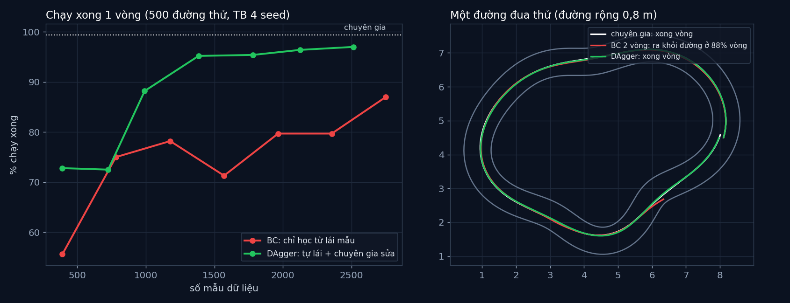

# Tập 4.6 · Học bắt chước: robot học từ người lái (BC và DAgger)

> **Mùa 4 · Biết tự quyết định** · ⏱ khoảng 40 phút · Độ khó ★★☆ · Cần: đã làm [4.5](../tap45/), PyTorch cơ bản ·
> 📚 Giáo trình: Principles of Robot Autonomy, [Chương 19 · Imitation learning](https://porabook.com/book/imitation-learning/) (Mục 19.2, Thuật toán 1 và 3) ·
> 📺 Video: TikTok [@thanh82k5](https://www.tiktok.com/@thanh82k5) (tìm "Tập 4.6")

[](https://colab.research.google.com/github/thanhpro82/tu-hoc-robot-tu-hanh/blob/main/tap46/tap46_dagger.ipynb)
Không muốn cài gì? Bấm nút trên để làm toàn bộ bài ngay trên trình duyệt.

**Một câu:** thay vì để robot tự thử sai hàng nghìn lần (tập 4.5), cho nó xem người lái mẫu rồi bắt chước. Chỉ xem 2 vòng thì chỉ 55,6% số lần chạy xong một vòng:
lệch một chút là gặp tình huống chưa từng thấy và lệch luôn. DAgger cho robot tự lái, chuyên gia sửa ngay chỗ nó sai: cùng lượng dữ liệu đã lên 97,0%.
Bạn tự viết chuyên gia pure pursuit, behavior cloning và một vòng DAgger.



## Trong thư mục này

| File | Dùng khi nào |
|---|---|
| [tap46_dagger.ipynb](tap46_dagger.ipynb) | Làm bài trên Colab hoặc Jupyter |
| [bai_tap/batchuoc_cua_ban.py](bai_tap/batchuoc_cua_ban.py) | **Bạn viết code ở đây** (nếu làm trên máy) |
| [bai_tap/kiem_tra.py](bai_tap/kiem_tra.py) | Tự chấm (học nhanh 300 bước, khoảng 30 giây) |
| [bai_tap/ve_do_thi.py](bai_tap/ve_do_thi.py) | Vẽ BC vs DAgger và một đường thử, ra `ket_qua.png` |
| [sim/duongdua.py](sim/duongdua.py) | Đường đua, chuyên gia, mạng người học, BC, DAgger (thí nghiệm chính của video) |
| [sim/thi_nghiem2.py](sim/thi_nghiem2.py), [sim/do_lech.py](sim/do_lech.py) | Thí nghiệm BC theo số vòng vs DAgger; đo độ lệch tâm |
| [sim/dd_*.pt](sim/), [sim/tn2_*.json](sim/), [sim/ket_qua.txt](sim/ket_qua.txt) | Mạng đã học và kết quả của 4 seed trong video |
| [sim/batchuoc.py](sim/batchuoc.py) | Phiên bản đầu (phòng vật cản của tập 4.5), giữ để tham khảo |
| [bai_tap/loi_giai.py](bai_tap/loi_giai.py) | Lời giải cả 3 bài. Tự làm xong rồi hãy mở |

## 1. Bài toán

Đường đua khép kín uốn lượn, rộng 0,8 m. Robot chạy 1 m/s, chỉ thấy 9 tia LiDAR, phải tự chọn lệnh quay ω. "Chuyên gia" (thay cho người lái) là thuật toán
pure pursuit biết đường tâm: nhắm một điểm phía trước cách 1,17 m và quay theo ω = 2v·sin α / L_d.

```text
 Behavior cloning (Thuật toán 1)            DAgger (Thuật toán 3)
 chuyên gia lái N vòng ─► dữ liệu 𝒟          𝒟 = 2 vòng chuyên gia lái  ─► học π₁
 học π: LiDAR → ω (hồi quy MSE)             lặp:  π_i TỰ LÁI ─► chuyên gia gán nhãn lệnh đúng cho mọi chỗ robot đã đi qua
                                                    𝒟 ← 𝒟 ∪ 𝒟_i ─► học lại π_{i+1}
 vấn đề: robot chỉ thấy trạng thái           robot học cả cách SỬA khi đã lệch, vì dữ liệu có cả những trạng thái lệch
 "đẹp" của chuyên gia; lệch là bối rối
```

Đây là lỗi **lệch phân phối** (distribution shift): dữ liệu học đến từ chuyên gia, nhưng lúc chạy robot gặp trạng thái do chính nó tạo ra.

## 2. Sau bài này bạn làm được

| # | Bạn có thể… | Kiểm tra bằng | Đạt khi |
|---|---|---|---|
| 1 | Viết chuyên gia pure pursuit | `kiem_tra.py` Bài 1 | ✅ |
| 2 | Viết behavior cloning (học có giám sát) | `kiem_tra.py` Bài 2 | ✅, mạng khớp code video |
| 3 | Viết một vòng DAgger | `kiem_tra.py` Bài 3 | ✅, sau 2 vòng khớp đáp án |
| 4 | Giải thích lệch phân phối và vì sao DAgger sửa được | [Câu hỏi tự kiểm tra](#6-câu-hỏi-tự-kiểm-tra) | Tự trả lời được |

## 3. Bạn làm gì

| Bài | Hàm | Việc |
|---|---|---|
| **1** | `omega_pure_pursuit(x, y, th, gx, gy, V, LD, W_MAX)` | α = góc tới điểm nhắm (bọc góc), ω = 2V sin α / LD, kẹp |
| **2** | `hoc_bc(X, U, seed, n_buoc, lr)` | Adam, mỗi bước chọn 256 mẫu ngẫu nhiên (theo `torch.Generator`), MSE |
| **3** | `vong_dagger(pi, env, X, U, hoc)` | Người học tự lái có nhãn chuyên gia → gộp dữ liệu → học lại |

## 4. Bắt đầu

**Cách 1: Colab.** Bấm nút *Open in Colab* ở đầu trang.

**Cách 2: trên máy** (cần `torch` bản CPU):

```bash
cd tu-hoc-robot-tu-hanh/tap46
python -X utf8 sim/duongdua.py         # 1. chuyên gia chạy 500 đường (có và không có nhiễu lái)
python -X utf8 bai_tap/kiem_tra.py     # 2. lúc đầu: ⏳ chưa làm cả 3 bài
# 3. mở bai_tap/batchuoc_cua_ban.py, làm từng bài, chạy lại kiem_tra.py
python -X utf8 bai_tap/ve_do_thi.py    # 4. vẽ BC vs DAgger -> ket_qua.png
```

Số liệu trong video (`sim/ket_qua.txt`, trung bình 4 seed, mỗi mạng thử 500 đường):

| | Mẫu dữ liệu | Chạy xong 1 vòng |
|---|--:|--:|
| Chuyên gia | — | 99,4% |
| BC, 2 vòng lái mẫu | 392 | 55,6% |
| BC, 14 vòng lái mẫu | 2750 | 87,0% |
| DAgger, 2 vòng mẫu + 6 vòng tự lái | 2513 | 97,0% |

Muốn chạy lại cả thí nghiệm: `python -X utf8 sim/thi_nghiem2.py 0 1 2 3` (khá lâu trên CPU, mỗi lần học 3000 bước).

Kết quả khi làm xong cả 3 bài:

```text
✅ Bài 1 · chuyên gia pure pursuit: nhắm một điểm phía trước, quay càng gắt khi điểm càng lệch sang bên
✅ Bài 2 · behavior cloning: học bắt chước trên 401 mẫu của 2 vòng lái mẫu: mạng khớp code video
✅ Bài 3 · một vòng DAgger: 2 vòng DAgger: dữ liệu 902 mẫu, khớp đáp án; mạng của video (seed 1, 100 đường thử): BC 2 vòng mẫu xong 61% · DAgger xong 98%

Đạt 3/3 bài.  🎉 Xong! Thử phần Thử thách trong README nhé.
```

### Lịch gợi ý (40 phút)

| Phút | Việc |
|--:|:--|
| 10 | Xem video, đọc mục 1, lướt `hoc` và `dagger` trong `sim/duongdua.py` |
| 25 | Làm Bài 1 → 2 → 3 |
| 5 | Câu hỏi tự kiểm tra, chọn 1 thử thách |

## 5. Thử thách (không chấm)

1. **Chuyên gia run tay:** dùng `danh_gia(..., nhieu=0.3)` (lệnh lái của chuyên gia bị nhiễu). Học BC từ dữ liệu "run tay" đó có tốt hơn không? (Gợi ý: dữ liệu có cả trạng thái lệch.)
2. **Đo lệch phân phối:** chạy `sim/do_lech.py`. BC đi lệch tâm hơn 20 cm bao nhiêu % thời gian, so với chuyên gia và DAgger?
3. **Đường hẹp hơn:** đổi `RONG` thành 0,6 m. BC và DAgger, cái nào chịu được?
4. **Bao nhiêu vòng DAgger là đủ:** vẽ tỉ lệ chạy xong sau mỗi vòng từ `tn2_*.json`.

## 6. Câu hỏi tự kiểm tra

<details><summary>1. Vì sao BC sai rất ít trên dữ liệu của chuyên gia mà vẫn hay lao ra khỏi đường?</summary>

Trên trạng thái của chuyên gia, BC sai trung bình chỉ 0,038 rad/s. Nhưng khi tự lái, sai một chút là robot lệch khỏi chỗ chuyên gia hay đi, gặp trạng thái hiếm thấy
trong dữ liệu, sai nhiều hơn (0,091 rad/s), lệch thêm nữa: sai số cộng dồn. Đó là lệch phân phối.
</details>

<details><summary>2. DAgger sửa lệch phân phối bằng cách nào?</summary>

Dữ liệu mới được thu ở chính những trạng thái **người học** đi tới, kể cả lúc đã lệch, và chuyên gia cho biết nên làm gì ở đó. Mạng học được cả cách quay về giữa đường,
nên sai số không cộng dồn nữa (sai khi tự lái chỉ 0,035 rad/s).
</details>

<details><summary>3. Học bắt chước khác học tăng cường (tập 4.5) ở đâu?</summary>

Học tăng cường chỉ có điểm thưởng, phải tự thử sai rất nhiều. Học bắt chước có nhãn "lệnh đúng" từ chuyên gia ở từng bước, nên học nhanh hơn nhiều, đổi lại cần
một chuyên gia (người lái) sẵn sàng làm mẫu và, với DAgger, sửa lỗi.
</details>

<details><summary>4. Vì sao BC 14 vòng (2750 mẫu) vẫn thua DAgger (2513 mẫu)?</summary>

Thêm dữ liệu chuyên gia chỉ thêm trạng thái "đẹp". DAgger thêm đúng loại dữ liệu đang thiếu: trạng thái lệch. Ít mẫu hơn nhưng đúng chỗ hơn.
</details>

## 7. Giới hạn cần biết

- Chuyên gia là thuật toán pure pursuit biết đường tâm, thay cho người lái thật (**giả định**). Người thật không gán nhãn hoàn hảo và mệt.
- Đường đua và cảm biến là mô phỏng; bộ chấm học nhanh 300 bước nên không đạt tỉ lệ như mạng 3000 bước của video.

## Đọc thêm

- Sách, [Chương 19](https://porabook.com/book/imitation-learning/): behavior cloning, DAgger, lệch phân phối.
- Tập trước: [4.5 · Deep RL](../tap45/) · Tập sau: [4.7 · Tương lai: Physical AI](../tap47/)

---
[← Về danh sách tập](../README.md)
