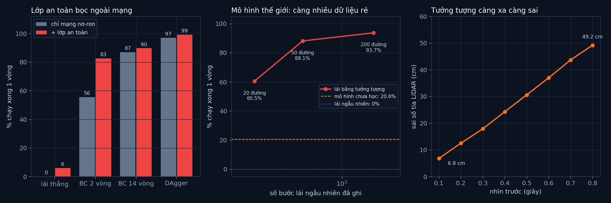

# Tập 4.7 · Tương lai: Physical AI (lớp an toàn và mô hình thế giới)

> **Mùa 4 · Biết tự quyết định** · ⏱ khoảng 40 phút · Độ khó ★★☆ · Cần: đã làm [4.6](../tap46/) ·
> 📚 Giáo trình: Principles of Robot Autonomy, [chương kết · Prospects](https://porabook.com/book/prospects/) (world models, Physical AI Safety) ·
> 📺 Video: TikTok [@thanh82k5](https://www.tiktok.com/@thanh82k5) (tìm "Tập 4.7")

[](https://colab.research.google.com/github/thanhpro82/tu-hoc-robot-tu-hanh/blob/main/tap47/tap47_physai.ipynb)
Không muốn cài gì? Bấm nút trên để làm toàn bộ bài ngay trên trình duyệt.

**Một câu:** chương kết của sách nói tới hai hướng: robot có **mô hình thế giới** để tưởng tượng tương lai trước khi làm, và học máy phải đi kèm
**đảm bảo an toàn** kiểu điều khiển cổ điển. Bài này làm cả hai thật nhỏ trên đường đua tập 4.6: một luật an toàn chỉ vài dòng đưa mạng BC 2 vòng từ 55,6% lên 82,6%;
một mô hình chỉ học từ lái **ngẫu nhiên** (không chuyên gia) đủ để robot tưởng tượng đường đi và chạy xong 93,7%.



## Trong thư mục này

| File | Dùng khi nào |
|---|---|
| [tap47_physai.ipynb](tap47_physai.ipynb) | Làm bài trên Colab hoặc Jupyter |
| [bai_tap/physai_cua_ban.py](bai_tap/physai_cua_ban.py) | **Bạn viết code ở đây** (nếu làm trên máy) |
| [bai_tap/kiem_tra.py](bai_tap/kiem_tra.py) | Tự chấm (thử trên 100 đường, khoảng 45 giây) |
| [bai_tap/ve_do_thi.py](bai_tap/ve_do_thi.py) | Vẽ số liệu video, ra `ket_qua.png` |
| [sim/an_toan.py](sim/an_toan.py) | Lớp an toàn bọc các mạng của tập 4.6 |
| [sim/the_gioi.py](sim/the_gioi.py) | Thu dữ liệu lái ngẫu nhiên, học mô hình thế giới, lái bằng tưởng tượng |
| [sim/doi_chung.py](sim/doi_chung.py) | Đối chứng: lái ngẫu nhiên, mô hình chưa học |
| [sim/tg*_s.pt](sim/), [sim/ket_qua.txt](sim/ket_qua.txt) | Mô hình thế giới đã học (20/50/200 đường × 4 seed) và số liệu video |
| [bai_tap/loi_giai.py](bai_tap/loi_giai.py) | Lời giải cả 3 bài. Tự làm xong rồi hãy mở |

Bài này dùng lại đường đua và các mạng trong [`../tap46/sim/`](../tap46/sim/), nên giữ nguyên cả thư mục repo.

## 1. Bài toán

```text
 (A) Lớp an toàn                                   (B) Mô hình thế giới
 LiDAR ─► mạng nơ-ron ─► ω ─►┌─────────────┐        dữ liệu rẻ: robot lái lung tung, ghi (o_t, ω_t, o_{t+1}), KHÔNG cần chuyên gia
                             │ sát mép?     │─► xe   học f: (o_t, ω_t) ─► o_{t+1}
 LiDAR ─► khoảng hở c_L,c_R ─►│ ép rẽ ra    │        mỗi bước: thử 25 lệnh ω ─► f "mơ" 8 bước (0,8 s) ─► chấm điểm ─► chọn lệnh tốt nhất
                             └─────────────┘        chỉ làm bước đầu rồi tưởng tượng lại (kiểu MPC)
 xa mép: giữ nguyên lệnh của mạng                  hàm chấm điểm do người viết: xa mép, giữa đường
```

- Khoảng hở bên trái c_L = nhỏ nhất của dᵢ·sin aᵢ trên các tia trái (bên phải tương tự). Nếu c_L < m = 0,17 m thì ép ω ≤ −k(m − c_L), k = 12.
- Mô hình thế giới là mạng 10–128–128–9 học thay đổi của 9 tia LiDAR sau một bước.

## 2. Sau bài này bạn làm được

| # | Bạn có thể… | Kiểm tra bằng | Đạt khi |
|---|---|---|---|
| 1 | Tính khoảng hở hai bên từ LiDAR | `kiem_tra.py` Bài 1 | ✅ |
| 2 | Viết lớp an toàn bọc quanh một mạng bất kỳ | `kiem_tra.py` Bài 2 | ✅, mạng BC tệ nhất được cứu |
| 3 | Lái bằng tưởng tượng với mô hình thế giới | `kiem_tra.py` Bài 3 | ✅, chi phí khớp video |
| 4 | Giải thích vì sao học máy cần lớp an toàn, và mô hình thế giới dùng để làm gì | [Câu hỏi tự kiểm tra](#6-câu-hỏi-tự-kiểm-tra) | Tự trả lời được |

## 3. Bạn làm gì

| Bài | Hàm | Việc |
|---|---|---|
| **1** | `khoang_ho(obs)` | d = obs·3 m, lấy min của d·sin a bên trái, d·(−sin a) bên phải |
| **2** | `boc_an_toan(lai, m, k)` | Trả về người lái mới: sát mép thì ép rẽ ra, còn lại giữ lệnh cũ |
| **3** | `chi_phi_tuong_tuong(f, obs)` | Lặp obs cho 25 lệnh, cho f chạy 8 bước, cộng `diem` có chiết khấu 0,9 |

## 4. Bắt đầu

**Cách 1: Colab.** Bấm nút *Open in Colab* ở đầu trang.

**Cách 2: trên máy** (cần `torch` bản CPU):

```bash
cd tu-hoc-robot-tu-hanh/tap47
python -X utf8 bai_tap/kiem_tra.py     # 1. lúc đầu: ⏳ chưa làm cả 3 bài
# 2. mở bai_tap/physai_cua_ban.py, làm từng bài, chạy lại kiem_tra.py
python -X utf8 bai_tap/ve_do_thi.py    # 3. vẽ số liệu video -> ket_qua.png
```

Số liệu trong video (`sim/ket_qua.txt`, 500 đường thử × 4 seed):

| Người lái | Tự lái | + lớp an toàn | Lớp an toàn phải sửa lệnh |
|---|--:|--:|--:|
| Lái thẳng (không có mạng) | 0% | 6,0% | — |
| BC 2 vòng (tập 4.6) | 55,6% | 82,6% | 4,0% thời gian |
| BC 14 vòng | 87,0% | 89,7% | |
| DAgger | 97,0% | 99,1% | 0,2% thời gian |

| Mô hình thế giới học từ | Số bước dữ liệu | Chạy xong |
|---|--:|--:|
| (lái ngẫu nhiên, không có mô hình) | — | 0% |
| 20 đường lái ngẫu nhiên | 175 | 60,5% |
| 50 đường | 457 | 88,1% |
| 200 đường | 1.882 | 93,7% |

Sai số tưởng tượng (200 đường): 6,8 cm sau 0,1 s, tăng dần tới 49,2 cm sau 0,8 s.

Kết quả khi làm xong cả 3 bài:

```text
✅ Bài 1 · khoảng hở hai bên: trên 384 quan sát thật: khoảng hở nhỏ nhất 8 cm, lớn nhất 0.64 m
✅ Bài 2 · lớp an toàn: lệnh ngẫu nhiên bị sửa 3% số lần; mạng BC 2 vòng (seed 3, 100 đường): tự lái xong 3% → bọc lớp an toàn xong 99%
✅ Bài 3 · lái bằng tưởng tượng: chi phí khớp video; lái bằng tưởng tượng (mô hình học từ 200 đường lái ngẫu nhiên, seed 1): xong 98% trên 100 đường

Đạt 3/3 bài.  🎉 Xong! Thử phần Thử thách trong README nhé.
```

### Lịch gợi ý (40 phút)

| Phút | Việc |
|--:|:--|
| 10 | Xem video, đọc mục 1, lướt `sim/an_toan.py` và `sim/the_gioi.py` |
| 25 | Làm Bài 1 → 2 → 3 |
| 5 | Câu hỏi tự kiểm tra, chọn 1 thử thách |

## 5. Thử thách (không chấm)

1. **Chỉnh lớp an toàn:** thử m = 0,10 và m = 0,25. Vùng an toàn rộng quá có làm mạng tốt (DAgger) chạy kém đi không?
2. **Lớp an toàn có "lái hộ" không?** Bọc quanh `lai_thang` (luôn ω = 0): video ra 6,0%. Vì sao luật này không tự lái được, mà vẫn cứu được mạng BC?
3. **Tưởng tượng xa hơn:** đổi `H` thành 4 hoặc 12. Nhìn xa hơn có tốt hơn khi sai số tưởng tượng tăng theo thời gian?
4. **Mô hình chưa học:** dùng `G.TheGioi()` chưa học với cùng cách lái. Video đo được 20,6% trung bình nhưng dao động rất mạnh giữa các seed (xem `chua_hoc_tung_seed`): vì sao không nên tin một con số như vậy?

## 6. Câu hỏi tự kiểm tra

<details><summary>1. Vì sao mạng nơ-ron cần lớp an toàn bọc ngoài?</summary>

Mạng học từ dữ liệu có thể đoán sai khi gặp trạng thái ngoài phân phối huấn luyện (tập 4.6), và ta không chứng minh được nó luôn đúng. Một luật cổ điển đơn giản, hiểu được,
kiểm tra được, chỉ can thiệp khi sắp nguy hiểm: mạng tốt thì gần như không bị đụng tới (DAgger chỉ bị sửa 0,2% thời gian), mạng tệ thì được cứu.
</details>

<details><summary>2. Lớp an toàn ở đây có phải control barrier function không?</summary>

Không. Đây là luật tay chỉ dùng LiDAR (mở rộng). CBF đúng nghĩa cần mô hình động học và chứng minh tập an toàn bất biến; sách chỉ nêu CBF như một hướng kết hợp
học máy với đảm bảo kiểu điều khiển.
</details>

<details><summary>3. Mô hình thế giới học từ dữ liệu "rẻ" nghĩa là gì?</summary>

Không cần chuyên gia hay nhãn "lệnh đúng": robot cứ lái lung tung và ghi lại điều gì xảy ra. Mô hình học cách thế giới thay đổi, còn mục tiêu (xa mép, giữa đường) nằm ở hàm chấm điểm
dùng khi tưởng tượng.
</details>

<details><summary>4. Vì sao chỉ thực hiện bước đầu rồi tưởng tượng lại?</summary>

Tưởng tượng càng xa càng sai (6,8 cm sau 0,1 s, 49,2 cm sau 0,8 s). Làm một bước rồi nhìn lại bằng cảm biến thật giúp sửa sai liên tục, giống MPC.
</details>

## 7. Giới hạn cần biết

- Cả hai phần là phiên bản thu nhỏ do mình viết (**mở rộng, giả định**), chỉ minh hoạ ý của chương Prospects. Chương này không có số liệu thực nghiệm; mọi con số ở đây là từ mô phỏng của mình.
- m, k của lớp an toàn được chọn sau một lần quét nhỏ trên 1 seed. Phần tăng lớn của BC 2 vòng chủ yếu nhờ seed 3 (3,4% → 99,8%).
- Mô hình thế giới thật (Cosmos, Genie 3, V-JEPA 2) học từ video và dữ liệu khổng lồ; ở đây chỉ là 9 tia LiDAR.

## Đọc thêm

- Sách, [Prospects](https://porabook.com/book/prospects/): foundation models, world models, Physical AI Safety.
- Tập trước: [4.6 · Học bắt chước](../tap46/) · Tập sau: [F · Tập cuối: robot giao đồ](../tapF/)

---
[← Về danh sách tập](../README.md)
