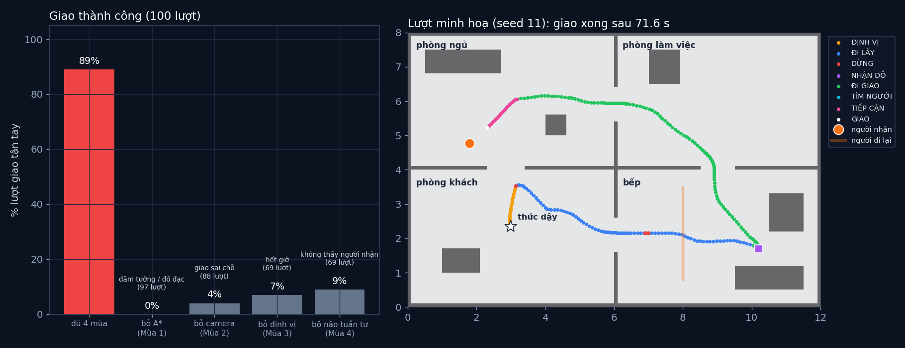

# Tập cuối F · Robot giao đồ trong nhà: ghép cả 4 mùa

> **Tập cuối** · ⏱ khoảng 45 phút · Độ khó ★★☆ · Cần: đã làm các mùa trước (ít nhất [2.8](../tap28/), [3.5](../tap35/), [4.1](../tap41/)) ·
> 📚 Giáo trình: Principles of Robot Autonomy: [máy trạng thái](https://porabook.com/book/finite-state-machines/), [định vị](https://porabook.com/book/robot-localization/),
> [tìm đường](https://porabook.com/book/motion-planning/), [điều khiển vòng kín](https://porabook.com/book/closed-loop-control/), [camera](https://porabook.com/book/camera-models/),
> [nhận dạng vật](https://porabook.com/book/object-detection/), [kết hợp cảm biến](https://porabook.com/book/sensor-fusion/) ·
> 📺 Video: TikTok [@thanh82k5](https://www.tiktok.com/@thanh82k5) (tìm "Tập cuối")

[](https://colab.research.google.com/github/thanhpro82/tu-hoc-robot-tu-hanh/blob/main/tapF/tapF_giaodo.ipynb)
Không muốn cài gì? Bấm nút trên để làm toàn bộ bài ngay trên trình duyệt.

**Một câu:** robot thức dậy trong căn hộ 12 × 8 m, không biết mình ở đâu. Nó phải lấy đồ ở bếp, tránh người đi lại, rồi tìm và giao tận tay người nhận.
Mỗi khối là code của một mùa trước. Đủ 4 mùa: **89/100 lượt** giao thành công. Bỏ đi bất kỳ mùa nào, robot gần như hỏng hẳn (0–9 lượt).
Bạn viết 3 mối nối giữa các khối: camera → khoảng cách, ghép camera với LiDAR, và bộ não máy trạng thái.



## Trong thư mục này

| File | Dùng khi nào |
|---|---|
| [tapF_giaodo.ipynb](tapF_giaodo.ipynb) | Làm bài trên Colab hoặc Jupyter |
| [bai_tap/giaodo_cua_ban.py](bai_tap/giaodo_cua_ban.py) | **Bạn viết code ở đây** (nếu làm trên máy) |
| [bai_tap/kiem_tra.py](bai_tap/kiem_tra.py) | Tự chấm (ảnh camera thật + YOLO tập 2.8, khoảng 15 giây) |
| [bai_tap/ve_do_thi.py](bai_tap/ve_do_thi.py) | Vẽ so sánh 5 phiên bản và lượt minh hoạ, ra `ket_qua.png` |
| [sim/giao_do.py](sim/giao_do.py) | Toàn bộ robot: bản đồ, A*, bộ lọc hạt, YOLO, máy trạng thái, 5 phiên bản |
| [sim/yolo_nap.py](sim/yolo_nap.py) | Nạp mạng YOLO đã học ở tập 2.8 (không học lại) |
| [sim/thu_dinh_vi.py](sim/thu_dinh_vi.py) | Thử riêng giai đoạn định vị toàn cục |
| [sim/ket_qua.txt](sim/ket_qua.txt), [sim/ket_qua_100.json](sim/ket_qua_100.json), [sim/luot_minh_hoa.json](sim/luot_minh_hoa.json) | Số liệu video: 100 lượt × 5 phiên bản, lượt minh hoạ |
| [bai_tap/loi_giai.py](bai_tap/loi_giai.py) | Lời giải cả 3 bài. Tự làm xong rồi hãy mở |

Bài này dùng YOLO trong [`../tap28/sim/trong_so.pt`](../tap28/sim/), nên giữ nguyên cả thư mục repo.

## 1. Bài toán

```text
                         ┌──────────── Mùa 4 · BỘ NÃO (máy trạng thái, tập 4.1) ───────────┐
 CHỜ LỆNH ─► ĐỊNH VỊ ─► ĐI LẤY ─► NHẬN ĐỒ ─► ĐI GIAO ─► TÌM NGƯỜI ─► TIẾP CẬN ─► GIAO ─► XONG
                ▲          │  ▲                 │  ▲
                │   vật lạ ▼  │ đường trống      ▼  │
                │         DỪNG ───────────────────┘      (DỪNG nhớ việc đang làm dở để quay lại)
                └── mất dấu ──┘
 Mùa 3 · ĐỊNH VỊ:   bộ lọc hạt trên bản đồ (tập 3.5), 4000 hạt lúc thức dậy, 1500 hạt khi đi
 Mùa 1 · ĐI:        A* trên lưới 10 cm (tập 1.5) + PD trên góc hướng, e = r − y (tập 1.3)
 Mùa 2 · NHÌN:      camera lỗ kim (tập 2.2) + YOLO đã học (tập 2.8) tìm "người"; ghép LiDAR (tập 3.8) để biết người cách bao xa
```

Mỗi bước 0,1 s. Bánh xe trượt, LiDAR có nhiễu, một người đi qua lại trong bếp, người nhận đứng ở chỗ ngẫu nhiên.

## 2. Sau bài này bạn làm được

| # | Bạn có thể… | Kiểm tra bằng | Đạt khi |
|---|---|---|---|
| 1 | Đổi khung YOLO thành khoảng cách và hướng | `kiem_tra.py` Bài 1 | ✅ trên ảnh camera thật |
| 2 | Ghép camera với LiDAR để định vị người | `kiem_tra.py` Bài 2 | ✅, sai số nhỏ hơn chỉ dùng camera |
| 3 | Viết hàm chuyển của bộ não robot | `kiem_tra.py` Bài 3 | ✅ cả 400 trường hợp |
| 4 | Giải thích vì sao thiếu một mùa là robot hỏng | [Câu hỏi tự kiểm tra](#6-câu-hỏi-tự-kiểm-tra) | Tự trả lời được |

## 3. Bạn làm gì

| Bài | Hàm | Việc |
|---|---|---|
| **1** | `vi_tri_tu_khung(khung)` | Z = H·f / h (pixel), hướng = atan((cx − 0,5)·N / f) |
| **2** | `ghep(uoc, z, Z_cam, huong)` | Tìm tia LiDAR theo hướng người chạm vật lạ; có thì lấy khoảng cách LiDAR, không thì dùng camera |
| **3** | `chuyen(s, su_kien, truoc_dung, da_lay)` | Bảng chuyển trạng thái, DỪNG quay lại việc dở |

## 4. Bắt đầu

**Cách 1: Colab.** Bấm nút *Open in Colab* ở đầu trang.

**Cách 2: trên máy** (cần `torch` bản CPU, `scipy`):

```bash
cd tu-hoc-robot-tu-hanh/tapF
python -X utf8 bai_tap/kiem_tra.py     # 1. lúc đầu: ⏳ chưa làm cả 3 bài
# 2. mở bai_tap/giaodo_cua_ban.py, làm từng bài, chạy lại kiem_tra.py
python -X utf8 bai_tap/ve_do_thi.py    # 3. vẽ -> ket_qua.png
python -X utf8 sim/giao_do.py 10 du    # 4. (tuỳ chọn) chạy 10 lượt bản đủ 4 mùa, mỗi lượt khoảng 1 phút
```

Số liệu trong video (`sim/ket_qua.txt`, 100 lượt mỗi phiên bản):

| Phiên bản | Giao thành công | Hỏng nhiều nhất vì |
|---|--:|---|
| **Đủ 4 mùa** | **89** | đâm vào người (6), đâm tường (2), không thấy người nhận (2), hết giờ (1) |
| Bỏ A*, đi thẳng tới đích (Mùa 1) | 0 | đâm tường / đồ đạc (97) |
| Bỏ camera, giao ở điểm nhìn (Mùa 2) | 4 | giao sai chỗ (88) |
| Bỏ định vị, chỉ đếm bánh xe (Mùa 3) | 7 | hết giờ (69) |
| Bộ não tuần tự: không dừng chờ, không xoay tìm (Mùa 4) | 9 | không thấy người nhận (69), đâm vào người (20) |

Bản đủ 4 mùa: giao xong TB 84,6 s, sai số định vị TB 4,3 cm. Lượt minh hoạ (seed 11): xong sau 71,6 s, định vị xong ở giây 13,2;
camera + LiDAR đo người nhận cách 1,89 m (thật 1,91 m).

Kết quả khi làm xong cả 3 bài:

```text
✅ Bài 1 · khoảng cách từ khung YOLO: YOLO (tập 2.8) thấy người trong 35/40 cảnh; chỉ dùng camera: đoán khoảng cách sai TB 21 cm
✅ Bài 2 · ghép camera + LiDAR: 35 cảnh, 33 cảnh LiDAR đo được người; vị trí người nhận sai TB: chỉ camera 23 cm → ghép LiDAR 14 cm
✅ Bài 3 · máy trạng thái: đúng cả 400 trường hợp; lượt minh hoạ: CHỜ LỆNH → ĐỊNH VỊ → ĐI LẤY → DỪNG → ĐI LẤY → NHẬN ĐỒ → ĐI GIAO → TÌM NGƯỜI → TIẾP CẬN → GIAO → XONG

Đạt 3/3 bài.  🎉 Xong! Thử phần Thử thách trong README nhé.
```

### Lịch gợi ý (45 phút)

| Phút | Việc |
|--:|:--|
| 10 | Xem video, đọc mục 1, lướt `chay_luot` trong `sim/giao_do.py` (mỗi khối có ghi mùa nào) |
| 25 | Làm Bài 1 → 2 → 3 |
| 10 | Câu hỏi tự kiểm tra, chọn 1 thử thách |

## 5. Thử thách (không chấm)

1. **Một lượt trọn vẹn:** `goc.chay_luot(goc.tao_luot(11), "du", ghi=True)` rồi vẽ `log["x"]` và `log["uoc"]`: đường thật và đường robot nghĩ mình đi lệch nhau bao nhiêu?
2. **Bỏ từng mùa:** chạy `python -X utf8 sim/giao_do.py 10 khong_m3`. Robot chỉ đếm bánh xe thì lạc ở đâu?
3. **Ít hạt hơn:** đổi `K0 = 4000` thành 1000. Định vị toàn cục còn chốt đúng chỗ không? (`sim/thu_dinh_vi.py`)
4. **Người đi nhanh hơn:** đổi tốc độ trong `nguoi_di_tai` từ 0,5 thành 0,8 m/s. Lỗi "đâm vào người" tăng bao nhiêu?

## 6. Câu hỏi tự kiểm tra

<details><summary>1. Vì sao bỏ A* thì 97/100 lượt đâm tường?</summary>

Đi thẳng tới đích bỏ qua tường và cửa. Căn hộ có 4 phòng thông nhau qua cửa hẹp, nên đường thẳng gần như luôn cắt qua tường. Điều khiển (Mùa 1, tập 1.3) chỉ bám được đường, còn đường phải do tìm đường (tập 1.5) vạch ra.
</details>

<details><summary>2. Vì sao bỏ camera thì hầu hết "giao sai chỗ"?</summary>

Robot vẫn tới đúng phòng nhờ định vị, nhưng không biết người nhận đứng đâu trong phòng nên chỉ giao ở một điểm cố định. Người nhận đứng ngẫu nhiên, nên gần như luôn cách xa hơn 1 m.
</details>

<details><summary>3. Vì sao cần ghép camera với LiDAR?</summary>

Camera biết đó là người và ở hướng nào, nhưng đoán khoảng cách qua chiều cao khung thì sai vài chục cm. LiDAR đo khoảng cách chuẩn nhưng không biết thứ nó chạm là gì. Ghép lại thì có cả hai.
</details>

<details><summary>4. Trạng thái DỪNG cần nhớ gì, và vì sao?</summary>

Nó nhớ việc đang làm dở (ĐI LẤY hay ĐI GIAO) để khi đường trống thì quay lại đúng việc đó. Không nhớ thì robot không biết sau khi nhường đường phải đi tiếp tới bếp hay tới người nhận.
</details>

## 7. Giới hạn cần biết

- Căn hộ, robot, cảm biến, bánh xe trượt, người đi lại đều là mô phỏng (**mở rộng, giả định**). Ảnh camera chỉ vẽ người theo kiểu tập 2.8/2.9, không phải ảnh thật.
- DỪNG nhớ trạng thái trước đó và lưới tạm để đi vòng là phần mở rộng của mình, sách chỉ định nghĩa máy trạng thái chung.
- Robot thật (tập 1.8) còn hoãn tới khi có phần cứng.

## Đọc thêm

- Ôn lại theo mùa: [Mùa 1 · 1.7](../tap17/) · [Mùa 2 · 2.9](../tap29/) · [Mùa 3 · 3.9](../tap39/) · [Mùa 4 · 4.1](../tap41/)
- Tập trước: [4.7 · Tương lai: Physical AI](../tap47/)

---
[← Về danh sách tập](../README.md)
